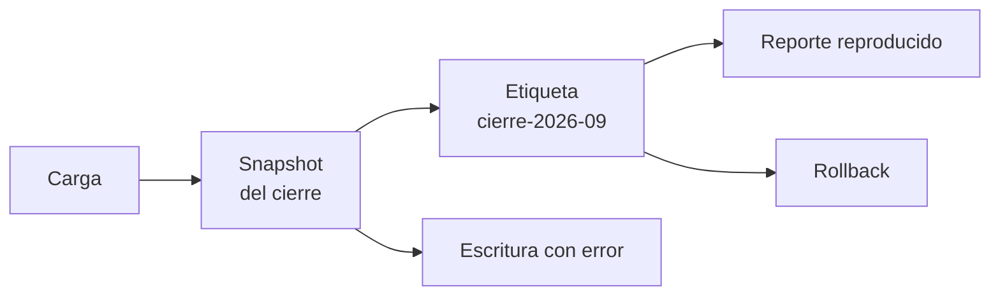

## 1. Resumen

Una tabla que solo guarda su estado actual no responde tres preguntas: ¿qué vio el reporte de cierre del mes pasado?, ¿qué había antes de que el job de anoche la rompiera?, ¿puedo reproducir este modelo con los datos de esa fecha? El **versionado de datos** conserva versiones de las tablas para **reproducir**, **auditar** y **recuperar**.

Los formatos abiertos lo hacen con **snapshots**: cada escritura es una versión, y las **etiquetas** dan nombre a las importantes (*Branching and Tagging*, Iceberg). Los warehouses ofrecen **time travel** dentro de una ventana (en BigQuery, siete días por defecto) y **clones** baratos que solo cobran lo que cambia (*Introduction to table clones*). La diferencia práctica es cuánto tiempo se conserva cada versión.

## 2. Qué es

- **Snapshot:** el estado de la tabla después de una escritura (`open-table-formats`).
- **Etiqueta:** un nombre que apunta a un snapshot y lo protege, por ejemplo `cierre-2026-09`.
- **Time travel:** leer la tabla como estaba en un instante o en un snapshot.
- **Rollback:** volver la tabla a un snapshot anterior sin copiar datos.
- **Clon:** copia escribible que comparte los datos de la base y paga solo lo que cambia.
- **Retención:** cuánto tiempo se conservan las versiones; fuera de la ventana, ya no existen.

## 3. Problema que resuelve

El 3 de octubre, un job con un error sobrescribe `finanzas.ventas` con una sola fila. El reporte de cierre de septiembre ya se envió con 400 de total, y auditoría pregunta de dónde salió. Con el snapshot del cierre etiquetado, el reporte se reproduce exacto y la tabla vuelve a ese estado en segundos.

## 4. Cómo funciona

1. Cada carga crea un snapshot.
2. Los puntos importantes (cierre de mes, versión de un modelo) se etiquetan.
3. Para auditar o reproducir, se lee la etiqueta o el instante.
4. Para recuperar, la tabla vuelve al snapshot correcto.
5. La retención borra lo viejo sin tocar lo etiquetado.

## 5. Cuándo utilizarlo

- Reportes regulatorios o de cierre que hay que poder reproducir.
- Recuperación tras errores de carga.
- Entrenar y comparar modelos con los mismos datos.
- Pruebas con clones de producción en ambientes inferiores.

## 6. Cuándo no utilizarlo

- Como respaldo de largo plazo: la ventana de time travel es corta y tiene límites.
- Para conservar datos personales que debían suprimirse: las versiones también son copias (`retention-and-erasure`).

## 7. Ejemplo sencillo

| Paso | Resultado |
|---|---|
| Carga de septiembre y etiqueta `cierre-2026-09` | 3 filas, total 400 |
| Job con error sobrescribe | 1 fila, total 80 |
| Reporte desde la etiqueta | Total 400 |
| Rollback a la etiqueta | 3 filas, total 400; el snapshot actual es el del cierre |

## 8. Ejemplo de producción

Tablas de finanzas:

- snapshot por carga y etiqueta en cada cierre de mes;
- reportes de cierre que leen la etiqueta, no la tabla actual;
- procedimiento de rollback documentado, junto al de backfill (`backfill`);
- retención que expira snapshots viejos y conserva las etiquetas;
- en la nube (no ejecutado): time travel y clones de BigQuery, time travel de Athena sobre Iceberg o de Fabric Data Warehouse.

## 9. Arquitectura



## 10. Código

```python
# Python 3.12, PyIceberg 0.12 y PyArrow (ejecutado en la CI en Linux; mypy --strict sin errores; ADR-018): versionado
# de datos para reproducir y recuperar. Se etiqueta el snapshot del cierre de mes, un job con un error sobrescribe la
# tabla, el reporte del cierre se reproduce leyendo la etiqueta y la tabla vuelve a ese snapshot sin copiar datos.
from __future__ import annotations

import sys
import tempfile
from pathlib import Path

import pyarrow as pa  # type: ignore[import-untyped]  # pyarrow no publica stubs de tipos
from pyiceberg.catalog.sql import SqlCatalog

base = Path(sys.argv[1] if len(sys.argv) > 1 else tempfile.mkdtemp())
warehouse = base / "warehouse"
warehouse.mkdir(parents=True, exist_ok=True)
catalog = SqlCatalog("local", uri=f"sqlite:///{(base / 'catalog.db').as_posix()}", warehouse=warehouse.as_uri())
catalog.create_namespace("finanzas")


def ventas(ids: list[int], montos: list[float]) -> pa.Table:
    return pa.table({"id": pa.array(ids, pa.int64()), "monto": pa.array(montos, pa.float64())})


def total(rows: pa.Table) -> float:
    return float(sum(rows.column("monto").to_pylist()))


table = catalog.create_table("finanzas.ventas", schema=ventas([], []).schema)
table.append(ventas([1, 2, 3], [100.0, 250.0, 50.0]))                       # carga de septiembre
cierre = table.current_snapshot()
assert cierre is not None
table.manage_snapshots().create_tag(cierre.snapshot_id, "cierre-2026-09").commit()

table.overwrite(ventas([4], [80.0]))                                          # job con error: borra la historia
print(f"filas hoy: {table.scan().to_arrow().num_rows}; total hoy: {total(table.scan().to_arrow())}")

tag = table.snapshot_by_name("cierre-2026-09")
assert tag is not None
print(f"reporte del cierre (etiqueta): {total(table.scan(snapshot_id=tag.snapshot_id).to_arrow())}")

table.manage_snapshots().rollback_to_snapshot(tag.snapshot_id).commit()      # recuperar sin copiar archivos
table = catalog.load_table("finanzas.ventas")
current = table.current_snapshot()
assert current is not None
print(f"tras volver a la etiqueta: {table.scan().to_arrow().num_rows} filas, total {total(table.scan().to_arrow())}")
print(f"snapshot actual es el del cierre: {current.snapshot_id == tag.snapshot_id}")
print(f"snapshots guardados: {len(table.metadata.snapshots)}; referencias: {sorted(table.metadata.refs)}")
```

El script se **ejecuta en la CI con PyIceberg 0.12 y un catálogo SQLite** (ADR-018; en Linux) y pasa `mypy --strict`. Imprime `filas hoy: 1; total hoy: 80.0`, `reporte del cierre (etiqueta): 400.0`, `tras volver a la etiqueta: 3 filas, total 400.0`, que el snapshot actual es el del cierre y las referencias `['cierre-2026-09', 'main']`. El time travel básico de Iceberg está en `open-table-formats`.

## 11. GCP

En GCP, **time travel** y **table clones** de BigQuery. Según *Data retention with time travel and fail-safe* e *Introduction to table clones* (no ejecutado):

| | Este concepto | BigQuery |
|---|---|---|
| Ventana | La retención que se defina | Siete días por defecto, configurable entre dos y siete |
| Etiqueta con nombre | Tag de Iceberg | Table snapshot (copia de solo lectura) |
| Copia para probar | Branch | Table clone escribible; se cobra solo lo que difiere |

## 12. AWS

En AWS, el **time travel de Amazon Athena** sobre Iceberg. Según *Perform time travel and version travel queries* (no ejecutado):

| | Este concepto | Athena |
|---|---|---|
| Por instante | `snapshot_as_of_timestamp` | `FOR TIMESTAMP AS OF` (UTC si no hay zona) |
| Por versión | `snapshot_id` o etiqueta | `FOR VERSION AS OF` con el ID del snapshot |

## 13. Azure

En Azure, el **time travel de Fabric Data Warehouse**, que la página marca como preview. Según *Time Travel* (no ejecutado):

| | Este concepto | Fabric Data Warehouse |
|---|---|---|
| Sintaxis | Lectura de un snapshot | Hint `FOR TIMESTAMP AS OF` en `OPTION` |
| Resultado | Lectura | Solo lectura; limitado por la retención configurable del warehouse |
| Estado | — | Preview, según la página |

## 14. Buenas prácticas

- Etiquetar las versiones que se reportan o se usan para entrenar.
- Reportes de cierre que leen la etiqueta.
- Retención explícita, conocida por quienes recuperan.
- **Seguridad:** las versiones son copias; aplicarles la misma política de acceso y supresión.
- **Observabilidad:** registrar qué snapshot leyó cada reporte.
- **Costo:** expirar snapshots viejos; cada versión retenida ocupa almacenamiento.

## 15. Errores frecuentes

- Confiar en el time travel como respaldo.
- No saber cuál es la ventana de retención hasta que se necesita.
- Reproducir un reporte leyendo la tabla actual.
- Olvidar que una supresión debe alcanzar también las versiones.

## 16. Trade-offs

Más versiones dan más capacidad de auditar y recuperar, a cambio de almacenamiento y de copias que hay que gobernar. Etiquetas explícitas son claras y requieren disciplina; una ventana fija es automática y se pierde al vencer.

## 17. Conceptos relacionados

- `open-table-formats`: snapshots en Iceberg, Delta y Hudi.
- `backfill` y `replay`: reprocesar.
- `data-reconciliation`: comparar contra lo reportado.
- `retention-and-erasure`: las versiones también son copias.

## 18. Preguntas técnicas abiertas

1. ¿Qué reporte tuyo habría que poder reproducir dentro de un año?
2. ¿Cuál es la ventana de time travel de tu warehouse?
3. ¿Tu procedimiento de supresión alcanza las versiones?

## 19. Laboratorio relacionado

Pendiente (F4).

## 20. Fuentes

- Apache Iceberg: *Branching and Tagging*.
- Google Cloud: *Data retention with time travel and fail-safe* e *Introduction to table clones*.
- AWS: *Perform time travel and version travel queries*.
- Microsoft Learn: *Time Travel*.

El detalle de cada fuente está en `sources` del frontmatter.

## 21. Fecha de última verificación

2026-10-26. Pasa a `verified` el 2026-10-27: revisión B-F3.1 del lote F3b-22a aplicada (docs/reviews/cards-f3b-22a.md) y CI en verde (run 40596994498).

## 22. Historial de cambios importantes

- 2026-10-26: creación (lote F3b-22a).
- 2026-10-27: revisión B-F3.1 del lote F3b-22a aplicada (docs/reviews/cards-f3b-22a.md): `page_title` «Time Travel» y el §13 dice que la página marca la capacidad como preview.
- 2026-10-27: `verification_status: verified` (revisión aplicada; CI en verde, run 40596994498).
