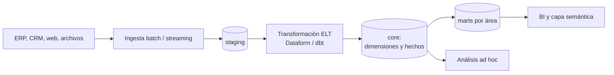

## 1. Resumen

Un data warehouse es la base de datos donde una organización integra datos de muchas fuentes, ya limpios y modelados, para consultarlos y analizarlos sin cargar a los sistemas operacionales. Está optimizado para leer y agregar grandes volúmenes (almacenamiento columnar) y conserva la historia. Los warehouses cloud (BigQuery, Redshift, Fabric Warehouse) agregan la separación de cómputo y almacenamiento y la operación administrada. Se organiza en capas: staging, core (modelo integrado) y marts para el consumo.

## 2. Qué es

Es un paradigma de almacenamiento consolidado: una base de datos **analítica** (OLAP), distinta de las bases **transaccionales** (OLTP) que registran las operaciones del día a día. Según Microsoft, los sistemas OLAP están optimizados para muchas lecturas y pocas escrituras, se modelan y limpian para el análisis y suelen conservar historia para series de tiempo. Frente a un data lake, el warehouse guarda datos **modelados y gobernados** en un motor SQL, mientras el lake guarda archivos crudos o abiertos para varios motores.

## 3. Problema que resuelve

Las preguntas de negocio cruzan sistemas: ventas del ERP, clientes del CRM, tráfico de la web. Consultarlos uno por uno es lento, inconsistente y afecta su rendimiento. El warehouse integra todo con definiciones comunes (qué es un cliente, una venta neta), guarda la historia que los sistemas operacionales sobrescriben y responde consultas analíticas sobre millones de filas en segundos.

## 4. Cómo funciona

1. **Ingesta** desde las fuentes, en batch o streaming, a una capa **staging** que refleja el origen.
2. **Transformación** (en los warehouses cloud, típicamente ELT: dentro del mismo motor) hacia una capa **core** integrada: dimensiones conformadas, hechos con grano declarado, historia (SCD).
3. **Marts** o modelos de consumo por área (finanzas, comercial), usualmente en esquema estrella, sobre los que se apoyan BI y la capa semántica.
4. **Motor analítico:** almacenamiento columnar (se leen solo las columnas usadas), procesamiento distribuido, y en las versiones cloud, cómputo y almacenamiento separados, que escalan por separado.

## 5. Cuándo utilizarlo

- BI y reportes recurrentes sobre datos de varias fuentes.
- Métricas oficiales con definiciones únicas y gobernadas.
- Análisis históricos que los sistemas operacionales no conservan.
- Muchos usuarios concurrentes consultando el mismo modelo.

## 6. Cuándo no utilizarlo

- Como base de una aplicación transaccional (muchas escrituras pequeñas por fila): para eso está OLTP.
- Para guardar archivos crudos, binarios o datos que nadie modelará: un data lake es más barato y flexible.
- Para necesidades de latencia de milisegundos por registro (servir una API): mejor una base operacional o un almacén especializado.

## 7. Ejemplo sencillo

| Capa | Dataset (BigQuery) | Contenido |
|---|---|---|
| Staging | `staging` | Copia del origen, con expiración |
| Core | `core` | Dimensiones y hechos integrados |
| Marts | `mart_comercial` | Estrella de ventas para BI |

## 8. Ejemplo de producción

Un retail carga cada hora pedidos, clientes e inventario a `staging` (las tablas expiran a los 7 días; el respaldo crudo está en el lake). Dataform transforma a `core`: `dim_cliente` con SCD2, `fact_venta_linea` al grano de línea. Desde ahí construye `mart_comercial` con agregados diarios. El tablero de ventas consulta solo el mart. Las consultas ad hoc de analistas van a `core` con un límite de bytes facturados por consulta. Un control diario cuadra los totales de `core` contra el ERP.

## 9. Arquitectura



## 10. Código

```sql
-- BigQuery (ejecutable adaptando proyecto y ubicación): las tres capas como datasets.
-- Staging expira solo; core y marts no tienen expiración por defecto.
CREATE SCHEMA IF NOT EXISTS `proyecto.staging`
OPTIONS (
  location = 'US',
  default_table_expiration_days = 7,
  description = 'Copia del origen; se recarga en cada ejecución'
);

CREATE SCHEMA IF NOT EXISTS `proyecto.core`
OPTIONS (location = 'US', description = 'Modelo integrado: dimensiones y hechos');

CREATE SCHEMA IF NOT EXISTS `proyecto.mart_comercial`
OPTIONS (location = 'US', description = 'Estrella de ventas para BI');
```

Separar las capas en datasets distintos permite dar permisos por capa (los analistas leen `mart_comercial` y `core`, no `staging`) y fijar políticas propias de expiración.

## 11. GCP

**BigQuery** es serverless: no hay clúster que dimensionar, y cómputo y almacenamiento están separados. Guarda las tablas en formato columnar y se organiza en **datasets**, el equivalente de un esquema, que son la unidad de ubicación, permisos y expiración por defecto. También consulta tablas en formatos abiertos (Iceberg, Delta, Hudi), lo que acerca el warehouse al lake.

## 12. AWS

**Redshift** existe en dos modalidades: clústeres **aprovisionados**, donde el equipo elige el tamaño y el tipo de nodo, y **Serverless**, que aprovisiona y escala la capacidad y cobra por lo usado. Almacena las tablas en formato columnar. A diferencia de BigQuery, en Redshift las decisiones físicas (distribución y orden de las tablas) siguen siendo parte del diseño.

## 13. Azure

**Fabric Data Warehouse** es, según Microsoft, un *lake warehouse*: guarda los datos en tablas **Delta** (Parquet con log de transacciones) en OneLake, separa almacenamiento y cómputo, admite transacciones ACID multi-tabla y se trabaja con T-SQL. Tiene dos ítems: el **Warehouse** (lectura y escritura) y el **SQL analytics endpoint** (consulta tablas Delta del lakehouse). Frente a BigQuery y Redshift, el formato de almacenamiento es abierto y compartido con el resto de Fabric.

## 14. Buenas prácticas

- Capas explícitas (staging, core, marts), con reglas sobre quién lee cada una.
- Definiciones de negocio únicas en core; los marts no redefinen métricas.
- Particionar por fecha y clusterizar las tablas grandes; consultar siempre con filtro de fecha.
- Transformaciones versionadas (Dataform, dbt) con tests de datos.
- **Seguridad:** permisos por capa (dataset o esquema), seguridad a nivel de fila y columna para datos sensibles, y staging fuera del alcance de los consumidores.
- **Observabilidad:** frescura de cada tabla, conteos y cuadratura contra el origen, y monitoreo de consultas lentas o caras.
- **Costo:** expiración en staging, límites de bytes por consulta en exploración y modelos de consumo agregados para que BI no relea el detalle.

## 15. Errores frecuentes

- Cargar las fuentes "tal cual" y dejar que cada reporte las integre a su manera: métricas que no cuadran entre áreas.
- Usar el warehouse como base de una aplicación transaccional.
- Dar a todos acceso a todo, incluida staging.
- No conservar historia (sobrescribir dimensiones) y no poder explicar reportes pasados.
- Modelar marts sin grano declarado.

## 16. Trade-offs

Consultas rápidas, gobernadas y consistentes, a cambio de modelar y mantener el modelo y de pagar almacenamiento y cómputo del motor. Frente a un lake: menos flexibilidad de formatos y motores, más consistencia y rendimiento para BI. Los warehouses cloud administrados quitan operación, pero atan al modelo de costos del proveedor.

## 17. Conceptos relacionados

- `data-lake`: el complemento para datos crudos y abiertos.
- `star-schema`: el modelo de consumo.
- `etl-vs-elt`: dónde se transforma.
- `partitioning`: leer menos en tablas grandes.
- Con ficha: `data-mart`, `lakehouse`.

## 18. Preguntas técnicas abiertas

1. ¿Qué datos pondrías en el warehouse y cuáles dejarías solo en el lake?
2. ¿Cómo organizarías permisos por capa para analistas, ingenieros y BI?
3. ¿Qué cambia en tu diseño si el warehouse es Redshift aprovisionado en vez de BigQuery?

## 19. Laboratorio relacionado

Pendiente (F4).

## 20. Fuentes

- Microsoft Learn: *Online analytical processing* y *What is Fabric Data Warehouse?*
- Google Cloud: *BigQuery overview*, *Overview of BigQuery storage*, *Data definition language statements* y *Estimate and control costs*.
- AWS: *What is Amazon Redshift?*, *Amazon Redshift Serverless* y *Columnar storage*.

El detalle de cada fuente está en `sources` del frontmatter.

## 21. Fecha de última verificación

2026-10-05. Pasa a `verified`: revisión B-F3.1 del lote 6 aplicada, sin VERIFY pendientes.

## 22. Historial de cambios importantes

- 2026-10-05: creación (lote 6 de F3).
- 2026-10-05: revisión B-F3.1 del lote 6 aplicada (docs/reviews/cards-lote6.md), sin cambios pedidos. `verification_status: verified` (sin VERIFY pendientes).
- 2026-10-06: la sección de conceptos relacionados ya no lista como pendientes de ficha a `data-mart`, `lakehouse`, que ya tienen ficha.
