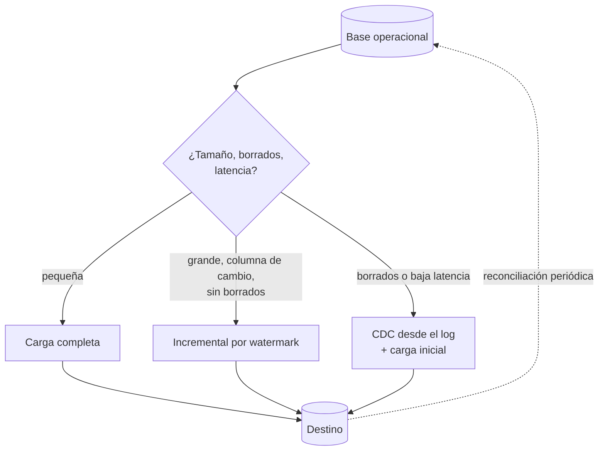

## 1. Resumen

Ingerir una base de datos operacional es elegir entre tres opciones:

- **Carga completa:** copiar todo cada vez.
- **Incremental por watermark:** copiar solo lo que cambió desde la última vez, según una columna de fecha o un id creciente.
- **CDC:** leer los cambios del log de la base, incluidos los borrados.

No es una cuarta técnica: es la decisión entre esas tres, según el volumen, la latencia, si hay que ver los borrados y cuánto se puede cargar la base de origen. El detalle de cada técnica está en `incremental-load`, `incremental-pipelines` y `change-data-capture`.

## 2. Qué es

| Opción | Qué lee | Qué no ve | Costo en el origen |
|---|---|---|---|
| Carga completa | Toda la tabla | Nada se pierde, pero no distingue qué cambió | Lee todo en cada corrida |
| Incremental por watermark | Filas con columna de cambio mayor al último valor | Borrados físicos; cambios que no actualizan la columna | Lee solo el rango, si la columna tiene índice |
| CDC basado en log | El log de cambios de la base | Nada a nivel de fila, si el log está disponible | Lectura del log; requiere configurar la base |

Los servicios administrados combinan las opciones:

- **AWS DMS:** carga completa, y carga completa más CDC.
- **Datastream:** CDC y backfill.
- **Azure Data Factory:** documenta la copia incremental por watermark, y también por Change Tracking (SQL Server y Azure SQL Database).

## 3. Problema que resuelve

Elegir mal sale caro en las dos direcciones:

- una carga completa diaria de una tabla de cientos de millones de filas castiga a la base de origen y tarda más que la ventana disponible;
- un incremental por watermark sobre una tabla con borrados físicos deja en el destino filas que ya no existen, sin ningún error;
- configurar CDC para una tabla pequeña que cambia una vez al día agrega una infraestructura que no paga su costo.

## 4. Cómo funciona

1. **¿Cuánto mide y cuánto cambia la tabla?** Si es pequeña, la carga completa es la opción más simple y siempre correcta.
2. **¿Hay una columna confiable de cambio** (actualizado, id creciente) con índice? El incremental por watermark lee solo lo nuevo y aplica un upsert (ver `incremental-load`).
3. **¿Hay borrados físicos o cambios que no tocan esa columna?** El watermark no los ve. Se necesita:
   - CDC;
   - una reconciliación periódica con carga completa;
   - o borrado lógico en el origen.
4. **¿Se necesita baja latencia o el historial de cambios?** CDC lee el log de la base y entrega inserciones, actualizaciones y borrados (ver `change-data-capture`).
5. **Arranque:** CDC necesita una carga inicial (snapshot o backfill) antes de aplicar cambios, como hacen la carga completa más CDC de DMS y el backfill de Datastream.

## 5. Cuándo utilizarlo

Esta decisión se toma por cada tabla de origen:

- **Carga completa:** tablas pequeñas, catálogos o reconciliaciones periódicas.
- **Watermark:** tablas grandes con columna de cambio confiable y sin borrados físicos, o con borrado lógico.
- **CDC:** tablas grandes con borrados, baja latencia o necesidad de historial.

## 6. Cuándo no utilizarlo

- No mezclar en una misma tabla un incremental por watermark y ediciones manuales del destino: el watermark no sabe de ellas.
- No usar el watermark si la columna la actualiza la aplicación y no la base: cualquier proceso que la olvide deja cambios invisibles.
- No leer con consultas pesadas la base primaria en horario de operación si hay una réplica de lectura disponible.

## 7. Ejemplo sencillo

Una tabla de pedidos con `actualizado`:

- el incremental lee `WHERE actualizado > :ultimo_watermark` y aplica un upsert;
- si alguien borra un pedido en el origen, el destino lo sigue teniendo;
- por eso, una vez por semana, una carga completa reconcilia.

## 8. Ejemplo de producción

Un e-commerce ingiere su base PostgreSQL al warehouse:

- **Carga completa diaria:** catálogos de productos y tiendas, pequeños.
- **Watermark cada hora:** clientes, que tiene `actualizado` con índice y borrado lógico.
- **CDC con un servicio administrado:** pedidos y pagos, que tienen borrados físicos y deben verse en minutos. Una carga inicial y después el flujo de cambios.

Un chequeo nocturno compara conteos por tabla entre origen y destino.

## 9. Arquitectura



## 10. Código

```sql
-- PostgreSQL 17 (ejecutado): carga completa frente a incremental por watermark desde una tabla de origen,
-- y lo que el watermark no ve (borrados), que es el motivo para pasar a CDC.
CREATE TABLE origen  (id integer PRIMARY KEY, estado text NOT NULL, actualizado timestamptz NOT NULL);
CREATE TABLE destino (id integer PRIMARY KEY, estado text NOT NULL, actualizado timestamptz NOT NULL);
CREATE TABLE control (tabla text PRIMARY KEY, watermark timestamptz NOT NULL);

INSERT INTO origen VALUES (1, 'nuevo', '2026-10-07 10:00'), (2, 'nuevo', '2026-10-07 10:05'), (3, 'nuevo', '2026-10-07 10:10');

-- 1) Carga completa: reemplaza todo el destino; simple y correcta, pero lee la tabla entera cada vez.
BEGIN;
TRUNCATE destino;
INSERT INTO destino SELECT * FROM origen;
INSERT INTO control VALUES ('origen', (SELECT max(actualizado) FROM origen))
ON CONFLICT (tabla) DO UPDATE SET watermark = EXCLUDED.watermark;
COMMIT;

-- Cambios en el origen: una actualización, una fila nueva y un borrado.
UPDATE origen SET estado = 'pagado', actualizado = '2026-10-07 11:00' WHERE id = 2;
INSERT INTO origen VALUES (4, 'nuevo', '2026-10-07 11:05');
DELETE FROM origen WHERE id = 3;

-- 2) Incremental por watermark: solo filas con actualizado mayor al último watermark, con upsert.
CREATE PROCEDURE incremental() LANGUAGE sql AS $$
  INSERT INTO destino
  SELECT o.* FROM origen o, control c WHERE c.tabla = 'origen' AND o.actualizado > c.watermark
  ON CONFLICT (id) DO UPDATE SET estado = EXCLUDED.estado, actualizado = EXCLUDED.actualizado;
  UPDATE control SET watermark = coalesce((SELECT max(actualizado) FROM origen), watermark) WHERE tabla = 'origen';
$$;
CALL incremental();
CALL incremental();                                   -- re-ejecutar no cambia nada

SELECT id, estado FROM destino ORDER BY id;
-- 1 | nuevo
-- 2 | pagado
-- 3 | nuevo     <- borrado en el origen, sigue en el destino: el watermark no ve borrados
-- 4 | nuevo
SELECT (SELECT count(*) FROM origen) AS filas_origen, (SELECT count(*) FROM destino) AS filas_destino;   -- 3 | 4
```

Ejecutado en PostgreSQL 17.11 local, en un esquema desechable:

- La carga completa copia las 3 filas.
- El incremental aplica la actualización de la fila 2 y la fila nueva 4, y re-ejecutarlo no cambia nada.
- La fila 3, borrada en el origen, sigue en el destino: 3 filas en el origen frente a 4 en el destino.

Es la limitación que obliga a CDC o a una reconciliación periódica.

## 11. GCP

**Datastream** es un servicio serverless de CDC y replicación desde bases operacionales. Replica a BigQuery, puede escribir el flujo de cambios en Cloud Storage y transfiere datos de **CDC y de backfill**. El backfill de cada objeto del stream se puede administrar. Es la opción CDC de la tabla de la §2, sin infraestructura propia.

## 12. AWS

En **AWS DMS**, una tarea puede:

- migrar los datos existentes (**Full Load**): crea y llena las tablas en paralelo;
- capturar además los cambios ocurridos durante y después de la carga (**full-load-and-cdc**): el CDC aplica en el destino los cambios capturados como transacciones confirmadas.

Es la combinación de carga inicial más CDC del paso 5 de la §4.

## 13. Azure

**Azure Data Factory** documenta la copia incremental con **watermark**: una columna de marca de tiempo de última actualización, o una clave incremental, en la base de origen. Cada corrida copia los cambios entre el watermark anterior y el nuevo. Diferencia con DMS y Datastream: esta opción no lee el log de la base, así que comparte la limitación de los borrados que muestra la §10.

## 14. Buenas prácticas

- Decidir por tabla, con criterios escritos (tamaño, borrados, latencia, columna de cambio).
- Watermark solo con columnas mantenidas por la base (o con disciplina comprobada) y con índice.
- Reconciliación periódica de conteos y, si hace falta, carga completa para tablas con watermark.
- Leer desde réplicas de lectura cuando existan.
- **Seguridad:** usuario de lectura con permisos mínimos sobre las tablas a ingerir; CDC suele requerir permisos especiales de replicación que conviene acotar y auditar.
- **Observabilidad:** registrar por corrida el watermark anterior y el nuevo, filas leídas y aplicadas; en CDC, vigilar el retraso respecto de la base.
- **Costo:** la carga completa de tablas grandes cuesta en el origen y en el destino; CDC cuesta en infraestructura y operación; el watermark es lo más barato mientras sus supuestos se cumplan.

## 15. Errores frecuentes

- Watermark sobre una tabla con borrados físicos y sin reconciliación.
- Watermark con `>` sobre una marca de tiempo que no es única, perdiendo filas confirmadas con el mismo valor que el último cargado; se evita con `>=` más upsert idempotente, o con un watermark compuesto (marca de tiempo e id).
- Empezar CDC sin carga inicial y dejar el destino con solo los cambios.
- Carga completa de tablas grandes en horario de operación sobre la base primaria.

## 16. Trade-offs

- **Carga completa:** simple y siempre correcta, pero cara a medida que crece la tabla.
- **Watermark:** barato, pero ciego a borrados y a cambios que no tocan su columna.
- **CDC:** completo y de baja latencia, a cambio de configuración en la base, una carga inicial y más componentes que operar.

Muchos equipos combinan: CDC o watermark para el día a día, y carga completa periódica para reconciliar.

## 17. Conceptos relacionados

- `change-data-capture`: CDC basado en log.
- `incremental-load` e `incremental-pipelines`: el watermark en SQL y en el pipeline.
- `batch-ingestion`: cargas programadas.
- `python-database-io` y `upsert`: leer y aplicar los cambios.

## 18. Preguntas técnicas abiertas

1. ¿Qué tablas de tu origen tienen borrados físicos y cómo los detectas hoy?
2. ¿Qué columna usarías como watermark si dos filas pueden tener la misma marca de tiempo?
3. ¿Cada cuánto reconciliarías una tabla cargada por watermark?

## 19. Laboratorio relacionado

Pendiente (F4).

## 20. Fuentes

- AWS: *Creating a task* (AWS DMS).
- Google Cloud: *Datastream overview*.
- Microsoft Learn: *Incrementally copy data from a source data store to a destination data store* (Azure Data Factory).
- PostgreSQL 17: *Logical Replication*.

El detalle de cada fuente está en `sources` del frontmatter.

## 21. Fecha de última verificación

2026-10-11. Pasa a `verified`: revisión B-F3.1 del lote F3b-05a aplicada, sin VERIFY pendientes.

## 22. Historial de cambios importantes

- 2026-10-11: creación (lote F3b-05a).
- 2026-10-11: revisión B-F3.1 del lote F3b-05a aplicada (docs/reviews/cards-f3b-05a.md): filas aprobadas sin cambios en esta ficha.
- 2026-10-11: `verification_status: verified` (sin VERIFY pendientes).
- 2026-10-13: `page_title` en cada cita, con el título de la página citada (ADR-012); sin cambios de contenido.
