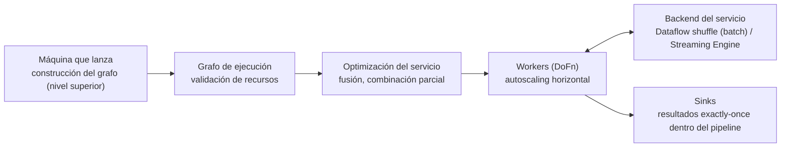

## 1. Resumen

**Dataflow** ejecuta pipelines de Apache Beam como un servicio administrado. El código del pipeline se divide en dos momentos:

- **Construcción del grafo:** el código del nivel superior del script corre **en la máquina que lanza el job**. Beam convierte las fuentes, transforms y sinks en un grafo y valida que los recursos existan.
- **Ejecución:** el código de los `DoFn` corre **en los workers** de Dataflow.

Entre uno y otro, el servicio optimiza:

- **fusiona** pasos para no materializar cada resultado intermedio;
- **combina parcialmente** en cada worker antes del shuffle.

Además, saca el shuffle (en batch) y la ejecución streaming (Streaming Engine) fuera de las VMs, y escala los workers solo. El procesamiento es **exactly-once** por defecto, con un modo **at-least-once** opcional en streaming. El modelo de Beam en sí está en `beam-programming-model`.

## 2. Qué es

- **Grafo de ejecución:** la representación del pipeline que Dataflow construye desde el código. Respeta las dependencias de datos; el resto de los pasos puede ejecutarse en cualquier orden.
- **Fusión:**
  - une varios pasos en uno para no materializar las PCollections intermedias;
  - si limita el paralelismo, `Redistribute` (`arbitrarily` o `byKey`) le da una pista al servicio.
- **Combinación parcial:**
  - antes de un `GroupByKey`, `CoGroupByKey` o `Combine`, el servicio combina localmente en cada worker;
  - la documentación recomienda no hacerlo a mano;
  - en streaming puede no hacerlo, para no sumar latencia.
- **Dataflow shuffle (batch)** y **Streaming Engine (streaming):** mueven el shuffle y la ejecución al backend del servicio. Las VMs usan menos CPU, memoria y disco, y el autoscaling puede quitarlas antes.
- **Autoscaling horizontal:** ajusta la cantidad de workers según la CPU promedio y el paralelismo. En batch reevalúa el trabajo cada 30 segundos.
- **Runners:** el **Portable Runner** (antes llamado Runner v2) y, en Java, el Non-Portable Runner (batch) o el Streaming Java Runner (streaming).
- **Exactly-once:** los registros se procesan al menos una vez y sus resultados se confirman exactamente una vez. Los efectos fuera del pipeline pueden repetirse.

## 3. Problema que resuelve

Ejecutar Beam en un clúster propio exige dimensionar, operar el shuffle y escalar a mano. Dataflow se encarga de todo eso: el equipo escribe el pipeline y el servicio decide cuántos workers, cómo fusionar y dónde hacer el shuffle. Entender el modelo evita errores típicos:

- poner trabajo costoso en el nivel superior del script, donde corre en la máquina que lanza el job;
- optimizar a mano lo que el servicio ya hace;
- hacer llamadas no idempotentes que se repiten.

## 4. Cómo funciona

1. Se lanza el pipeline con el runner de Dataflow. Sube el código y las dependencias a un bucket y crea un job.
2. **Construcción:** Beam ejecuta localmente el nivel superior del script, arma el grafo y valida los recursos (buckets, tablas, temas).
3. **Optimización:** el servicio fusiona pasos y aplica la combinación parcial antes de los agrupamientos.
4. **Ejecución:**
   - los workers corren los `DoFn`;
   - en batch, el shuffle va al backend del servicio;
   - en streaming, Streaming Engine mueve la ejecución al backend.
5. **Autoscaling:** el servicio agrega o quita workers según la CPU y el paralelismo.
6. **Resultados:** con exactly-once, los que quedan dentro del pipeline se confirman una vez. Un sink externo o una llamada remota pueden ejecutarse más de una vez.

## 5. Cuándo utilizarlo

- Pipelines de Beam, batch o streaming, que se quieren correr sin operar un clúster.
- ETL hacia BigQuery, movimiento de datos entre sistemas y procesamiento de logs o eventos a escala.
- Cargas variables, donde el autoscaling evita pagar workers ociosos.

## 6. Cuándo no utilizarlo

- Transformaciones que caben en SQL dentro de BigQuery: suele ser más simple (ver `etl-vs-elt`).
- Trabajos pequeños de un solo paso: el arranque de un job tiene su costo.
- Lógica con efectos externos no idempotentes que no tolera repetirse, salvo que se rediseñe.

## 7. Ejemplo sencillo

En el script de §10, el `print` del nivel superior corre una vez, al construir el grafo. `NormalizarCanal` corre en los workers, una vez por pedido. La suma por canal (`CombinePerKey`) es un agrupamiento: Dataflow combina parcialmente en cada worker antes del shuffle, sin que el código lo pida.

## 8. Ejemplo de producción

Un pipeline batch diario lee 2 TB de logs de Cloud Storage, normaliza y escribe agregados en BigQuery. El equipo:

- deja en el nivel superior solo la construcción del pipeline, y mueve las llamadas a APIs dentro de los `DoFn`;
- no implementa combinación parcial a mano;
- revisa en el grafo del job qué pasos fusionó el servicio y, como un paso quedaba con poco paralelismo, agrega un `Redistribute`;
- confía en el autoscaling y en Dataflow shuffle para no dimensionar VMs grandes.

El enriquecimiento que llama a una API externa es idempotente, porque esa llamada puede repetirse.

## 9. Arquitectura



## 10. Código

```python
# Apache Beam 2.77.0, Python 3.12 (ejecutado en local con DirectRunner, que en esta versión delega en el runner Prism;
# no se corrió en Dataflow): qué código corre al construir el grafo y qué corre en los workers. Con
# runner="DataflowRunner", el mismo pipeline crearía un job de Dataflow.
import apache_beam as beam
from apache_beam.options.pipeline_options import PipelineOptions

print("construcción del grafo: esto corre en la máquina que lanza el pipeline")   # nivel superior del script


class NormalizarCanal(beam.DoFn):
    def process(self, pedido: dict[str, object]):  # type: ignore[no-untyped-def]
        # Esto corre en los workers (en Dataflow, en las VMs del job), una vez por elemento.
        yield str(pedido["canal"]).strip().lower(), float(str(pedido["monto"]))


pedidos = [
    {"canal": " Web", "monto": 120.0},
    {"canal": "app", "monto": 80.0},
    {"canal": "WEB ", "monto": 50.0},
    {"canal": "tienda", "monto": 30.0},
]

opciones = PipelineOptions(runner="DirectRunner")   # en Dataflow: runner="DataflowRunner", project, region, temp_location
with beam.Pipeline(options=opciones) as p:
    (
        p
        | "Leer" >> beam.Create(pedidos)
        | "Normalizar" >> beam.ParDo(NormalizarCanal())
        | "Sumar por canal" >> beam.CombinePerKey(sum)   # Dataflow combina parcialmente en cada worker antes del shuffle
        | "Imprimir" >> beam.Map(print)
    )
# construcción del grafo: esto corre en la máquina que lanza el pipeline
# y, en cualquier orden: ('web', 170.0)  ('app', 80.0)  ('tienda', 30.0)
```

Este pipeline de Apache Beam 2.77.0 en Python 3.12 está **ejecutado en local** con `DirectRunner` (en esta versión, delega en el runner Prism, según su log). **No se corrió en Dataflow.** Muestra qué código corre al construir el grafo y qué corre en los workers. Con `runner="DataflowRunner"` y las opciones de proyecto, región y bucket temporal, el mismo pipeline crearía un job. El orden de salida de la suma por canal no está fijado.

## 11. GCP

**Dataflow** con Apache Beam. La fusión, la combinación parcial, Dataflow shuffle, Streaming Engine, el autoscaling y los runners son los de sus páginas. El **Portable Runner** es el nombre actual de lo que antes se llamaba Runner v2, según su página.

## 12. AWS

No aplica de forma específica: esta ficha describe Dataflow, el servicio que ejecuta Beam en Google Cloud.

## 13. Azure

No aplica de forma específica (ver §12).

## 14. Buenas prácticas

- Nada costoso en el nivel superior del script: ahí corre en la máquina que lanza el job.
- No optimizar a mano la combinación parcial: el servicio la hace.
- Revisar el grafo del job; `Redistribute` si la fusión deja poco paralelismo.
- Efectos externos idempotentes, porque pueden repetirse incluso con exactly-once.
- At-least-once solo si el destino deduplica (ver `dataflow-streaming-pipelines`).
- **Seguridad:** la cuenta de servicio de los workers necesita acceso a las fuentes y sinks; la cuenta que lanza el job también, porque Beam valida los recursos al construir el grafo.
- **Observabilidad:** el grafo del job, el estado de cada paso y la cantidad de workers muestran cuellos de botella y fusiones que limitan el paralelismo.
- **Costo:** se pagan los recursos de los workers y del servicio (shuffle, Streaming Engine); el autoscaling y at-least-once (donde aplique) bajan el costo. Los montos están en la página de precios.

## 15. Errores frecuentes

- Leer una tabla grande o llamar una API en el nivel superior del script.
- Implementar combinación parcial a mano y empeorar el pipeline.
- Asumir que exactly-once cubre las llamadas a servicios externos.
- Dar permisos solo a la cuenta de los workers y que la construcción falle al validar recursos.

## 16. Trade-offs

Dataflow quita la operación de clústeres y escala solo, a cambio de menos control sobre cómo se ejecuta cada paso: el servicio decide la fusión y el orden. Exactly-once da resultados correctos dentro del pipeline, con un costo de deduplicación; at-least-once es más barato y rápido si el destino tolera duplicados. Shuffle y Streaming Engine en el backend liberan las VMs, pero son recursos del servicio que también se pagan.

## 17. Conceptos relacionados

- `beam-programming-model`: el modelo de Beam.
- `dataflow-streaming-pipelines`: ventanas, watermarks y modos de streaming.
- `batch-vs-streaming`: un modelo para los dos.
- `idempotency`: efectos externos que pueden repetirse.
- `etl-vs-elt`: cuándo conviene transformar en SQL.

## 18. Preguntas técnicas abiertas

1. ¿Qué código de tus pipelines corre hoy en el nivel superior y debería ir en un `DoFn`?
2. ¿Qué llamada externa de tus pipelines no es idempotente?
3. ¿Qué pipeline tuyo toleraría at-least-once?

## 19. Laboratorio relacionado

Pendiente (F4).

## 20. Fuentes

- Google Cloud, Dataflow: *Dataflow overview*, *Pipeline lifecycle*, *Dataflow shuffle for batch jobs*, *Use Streaming Engine for streaming jobs*, *Horizontal Autoscaling*, *Use the Dataflow Portable Runner* y *Exactly-once in Dataflow*.
- Apache Beam: *Beam Programming Guide*.

El detalle de cada fuente está en `sources` del frontmatter.

## 21. Fecha de última verificación

2026-10-12. Pasa a `verified`: revisión B-F3.1 del lote F3b-08c aplicada, sin VERIFY pendientes.

## 22. Historial de cambios importantes

- 2026-10-11: creación (lote F3b-08c).
- 2026-10-12: revisión B-F3.1 del lote F3b-08c aplicada (docs/reviews/cards-f3b-08c.md): filas aprobadas sin cambios en esta ficha.
- 2026-10-12: `verification_status: verified` (sin VERIFY pendientes).
