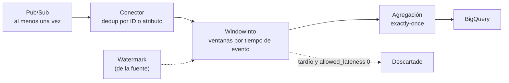

## 1. Resumen

Un pipeline **streaming** en Dataflow procesa datos que no terminan de llegar, como mensajes de Pub/Sub. Lo que lo distingue del batch:

- **Ventanas:** agrupan los eventos por **su propio tiempo** (tumbling, hopping o sesión), no por cuándo llegan.
- **Watermark:** la estimación de hasta cuándo ya llegó todo. Un evento de una ventana ya cerrada es **tardío**; con la configuración por defecto de Beam, se descarta.
- **Modos:** exactly-once por defecto. **At-least-once** baja el costo y la latencia si el destino tolera o deduplica duplicados.
- **Pub/Sub:** entrega al menos una vez; el conector de Dataflow deduplica por ID de mensaje o por un atributo propio.
- **Cambiar o detener un job en marcha:** actualización en vuelo o job de reemplazo para cambiar; **drain** (termina lo pendiente) frente a **cancel** (descarta lo pendiente) para detener.

## 2. Qué es

- **Ventanas:**
  - **tumbling** (fixed en Beam): intervalos fijos sin solaparse;
  - **hopping** (sliding en Beam): intervalos fijos que se solapan;
  - **sesión:** agrupan actividad separada por silencios.
- **Watermark:**
  - el umbral a partir del cual Dataflow espera que estén todos los datos de una ventana;
  - lo determina la fuente;
  - los datos no llegan en orden ni a intervalos predecibles.
- **Datos tardíos:** con timestamp dentro de una ventana cuyo final ya pasó el watermark. Con `allowed_lateness` 0, que es el valor por defecto, se descartan.
- **Triggers:** cuándo emitir resultados. Por defecto, cuando el watermark pasa el final de la ventana.
- **Exactly-once / at-least-once:**
  - **exactly-once** para agregaciones y casos críticos;
  - **at-least-once** para cargas solo de map o con deduplicación aguas abajo (BigQuery, una base SQL, CDC, logs).
- **Deduplicación de Pub/Sub:** por el ID que asigna Pub/Sub, o por un atributo del mensaje (un ID de negocio) que el publicador mantiene igual en los reintentos.

## 3. Problema que resuelve

En streaming no hay un «fin de los datos»: hay que decidir cuándo un resultado está completo, qué hacer con lo que llega tarde y cómo no contar dos veces un mensaje reenviado. Dataflow y Beam dan:

- ventanas y watermarks para cerrar resultados por tiempo de evento;
- deduplicación de Pub/Sub y exactly-once para no duplicar;
- formas de cambiar o detener un job sin perder lo que está en curso.

## 4. Cómo funciona

1. Pub/Sub entrega mensajes al conector, que deduplica por ID o por un atributo.
2. Cada evento lleva su timestamp; `WindowInto` lo asigna a una ventana.
3. La fuente hace avanzar el watermark. Cuando pasa el final de una ventana, el trigger por defecto emite su resultado.
4. Un evento que llega después, con un timestamp de esa ventana, es tardío: con `allowed_lateness` 0 se descarta; con un valor mayor, el trigger puede emitir de nuevo.
5. Con exactly-once, los resultados dentro del pipeline se confirman una vez. Con at-least-once, puede haber duplicados.
6. **Para cambiar el código,** se lanza un job de reemplazo; Dataflow verifica la compatibilidad para transferir el estado. **Para ajustar los límites de workers,** con Streaming Engine alcanza una actualización en vuelo.
7. **Para detenerlo,** drain termina lo que está en buffer, y cancel lo descarta.

## 5. Cuándo utilizarlo

- Agregados por minuto u hora sobre eventos de Pub/Sub, con resultados por tiempo de evento.
- **At-least-once** para ingesta solo de map hacia BigQuery cuando el destino deduplica.
- **Exactly-once** para conteos y sumas que deben ser exactos.

## 6. Cuándo no utilizarlo

- Si alcanza con resultados cada hora sobre datos ya cargados, un pipeline batch o SQL programado es más simple.
- No usar at-least-once con agregaciones: los duplicados alteran conteos y sumas.
- No cancelar un pipeline que tiene datos en buffer que importan: drain los termina.

## 7. Ejemplo sencillo

Con ventanas de 60 segundos, los eventos de los segundos 5 y 30 caen en `[0, 60)`, y el del 70 en `[60, 120)`. El watermark llega a 130 y las dos ventanas emiten. Luego llega un evento con timestamp 50: es tardío, y con la configuración por defecto se descarta. El script de §10 lo muestra con `TestStream`.

## 8. Ejemplo de producción

Un pipeline lee pedidos de Pub/Sub y escribe totales por tienda cada 5 minutos en BigQuery:

- deduplica por el atributo `pedido_id`, que el publicador mantiene igual en los reintentos;
- usa exactly-once, porque son sumas;
- acepta datos tardíos hasta 10 minutos con `allowed_lateness`, y el trigger reemite la ventana cuando llegan.

Para desplegar una versión nueva, el equipo valida el grafo y lanza un job de reemplazo. Para apagar el pipeline durante una migración, hace drain y antes crea un snapshot del job.

## 9. Arquitectura



## 10. Código

```python
# Apache Beam 2.77.0, Python 3.12 (ejecutado en local con DirectRunner y TestStream; no se corrió en Dataflow):
# ventanas fijas (tumbling) de 60 segundos sobre eventos con su propio tiempo; el watermark avanza y un evento
# que llega después de cerrar su ventana es tardío: sin allowed_lateness, se descarta.
import apache_beam as beam
from apache_beam.options.pipeline_options import PipelineOptions, StandardOptions
from apache_beam.testing.test_stream import TestStream
from apache_beam.transforms.window import FixedWindows, TimestampedValue

eventos = (
    TestStream()
    .add_elements([TimestampedValue(("web", 10), 5), TimestampedValue(("app", 20), 30)])   # ventana [0, 60)
    .add_elements([TimestampedValue(("web", 5), 70)])                                       # ventana [60, 120)
    .advance_watermark_to(130)                     # el watermark pasa el final de las dos ventanas
    .add_elements([TimestampedValue(("web", 99), 50)])   # evento de la ventana [0, 60) que llega tarde
    .advance_watermark_to_infinity()
)

opciones = PipelineOptions(runner="DirectRunner")
opciones.view_as(StandardOptions).streaming = True
with beam.Pipeline(options=opciones) as p:
    (
        p
        | eventos
        | beam.WindowInto(FixedWindows(60))          # allowed_lateness por defecto: 0
        | beam.CombinePerKey(sum)
        | beam.WithKeys(lambda kv: kv[0])
        | beam.Map(lambda kv, w=beam.DoFn.WindowParam: f"[{int(w.start)}, {int(w.end)}) {kv[1]}")
        | beam.Map(print)
    )
# En cualquier orden:
# [0, 60) ('web', 10)
# [0, 60) ('app', 20)
# [60, 120) ('web', 5)
# (el ('web', 99) tardío no aparece: llegó con el watermark ya en 130)
```

Este pipeline de Apache Beam 2.77.0 en Python 3.12 está **ejecutado en local** con `DirectRunner` y `TestStream`, y **no se corrió en Dataflow**. Muestra las ventanas fijas, el avance del watermark y el descarte del dato tardío con `allowed_lateness` 0, como describe la guía de Beam. En Dataflow, la fuente sería Pub/Sub y el watermark lo daría el conector.

## 11. GCP

**Dataflow** con **Pub/Sub**. Los modos de streaming, la deduplicación del conector, la actualización y la detención de jobs son los de sus páginas. La semántica de entrega de Pub/Sub en sí está en `pubsub-delivery-semantics`.

## 12. AWS

No aplica de forma específica: esta ficha describe Dataflow y Pub/Sub.

## 13. Azure

No aplica de forma específica (ver §12).

## 14. Buenas prácticas

- Ventanas por tiempo de evento, no por hora de llegada.
- `allowed_lateness` según cuánto pueden atrasarse los datos de la fuente.
- Deduplicar por un ID de negocio que el publicador mantenga en los reintentos.
- At-least-once solo con destinos que deduplican y pipelines sin agregaciones.
- Drain, y un snapshot previo, para detener sin perder lo que está en buffer.
- **Seguridad:** la cuenta de servicio del job lee la suscripción y escribe el destino; nada más.
- **Observabilidad:** seguir el atraso del watermark, el backlog de la suscripción y los datos tardíos descartados; un watermark que no avanza es la primera señal de un problema.
- **Costo:** exactly-once paga la deduplicación; at-least-once lo evita donde aplica. Un pipeline streaming corre todo el tiempo: cada worker cuenta las 24 horas.

## 15. Errores frecuentes

- Agrupar por la hora de llegada en vez del tiempo del evento.
- No configurar `allowed_lateness` y perder datos tardíos sin saberlo.
- At-least-once en un pipeline que suma.
- Cancelar en vez de drenar y perder los datos en buffer.
- Cambiar el código con un job nuevo sin validar la compatibilidad con el que corre.

## 16. Trade-offs

Las ventanas por tiempo de evento dan resultados correctos aunque los datos lleguen desordenados, a cambio de esperar al watermark. Un `allowed_lateness` mayor acepta más datos tardíos, pero obliga a reemitir resultados y a guardar más estado. Exactly-once da resultados exactos con costo de deduplicación; at-least-once es más barato y rápido y deja los duplicados al destino.

## 17. Conceptos relacionados

- `dataflow-execution-model`: cómo ejecuta Dataflow.
- `pubsub-delivery-semantics`: la entrega de Pub/Sub.
- `checkpoints`: el estado y la recuperación en streaming.
- `late-arriving-data` y `streaming-ingestion`: datos tardíos e ingesta continua.
- Del blueprint, pendientes de ficha: `watermarks` y `streaming-pipeline-architecture` (arquitectura de F4).

## 18. Preguntas técnicas abiertas

1. ¿Cuánto pueden atrasarse los eventos de tu fuente, y qué `allowed_lateness` pondrías?
2. ¿Qué pipeline tuyo podría pasar a at-least-once sin riesgo?
3. ¿Qué harías antes de detener un pipeline streaming con estado?

## 19. Laboratorio relacionado

Pendiente (F4).

## 20. Fuentes

- Google Cloud, Dataflow: *Streaming pipelines*, *Set the pipeline streaming mode*, *Read from Pub/Sub to Dataflow*, *Update an existing pipeline* y *Stop a running Dataflow pipeline*.
- Apache Beam: *Beam Programming Guide*.

El detalle de cada fuente está en `sources` del frontmatter.

## 21. Fecha de última verificación

2026-10-11. `review_required`: pendiente de revisión B-F3.1 del lote F3b-08c.

## 22. Historial de cambios importantes

- 2026-10-11: creación (lote F3b-08c).
