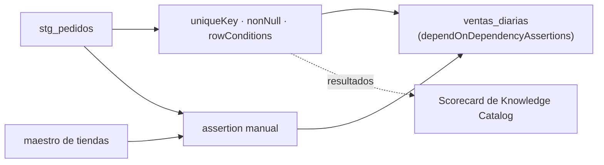

## 1. Resumen

En **Dataform**, una **assertion** es una consulta que busca filas que violan una regla: si devuelve filas, falla (*Test data quality*). Hay dos formas:

- **incorporadas**, en el bloque `config` de una tabla: `nonNull`, `rowConditions`, `uniqueKey` y `uniqueKeys`;
- **manuales**, un archivo SQLX con `type: "assertion"` y una consulta que debe devolver cero filas.

Dataform corre las assertions cada vez que actualiza el workflow, avisa si alguna falla, crea vistas con los resultados en un schema de assertions y publica el resultado en el scorecard de calidad de Knowledge Catalog. Que falle una assertion **no impide** ejecutar lo que depende de esa tabla: para que una tabla no se construya si fallan las assertions de lo que lee, hay que declararlas como dependencias (*Set dependencies*).

## 2. Qué es

- **Assertion incorporada:** una regla en `config.assertions` de la tabla.
- **Assertion manual:** un SQLX `type: "assertion"`, útil para reglas más complejas o para datasets que Dataform no crea.
- **Schema de assertions:** donde Dataform crea las vistas con los resultados (por defecto `dataform_assertions`).
- **`includeDependentAssertions`:** agrega las assertions de una dependencia elegida como dependencias.
- **`dependOnDependencyAssertions`:** agrega las de todas las dependencias.

## 3. Problema que resuelve

Una tabla `ventas_diarias` lee `stg_pedidos`. Si `stg_pedidos` trae ids repetidos, `ventas_diarias` duplica montos. Con un `uniqueKey` en `stg_pedidos` y `dependOnDependencyAssertions: true` en `ventas_diarias`, la assertion falla y la tabla que depende de ella no se construye con datos duplicados.

## 4. Cómo funciona

1. La tabla declara sus assertions incorporadas en `config`.
2. Para reglas más complejas, un SQLX `type: "assertion"` con una consulta que devuelve las filas inválidas.
3. Dataform compila cada assertion a una consulta y crea una vista en el schema de assertions.
4. En cada ejecución, si la consulta devuelve filas, la assertion falla y Dataform avisa.
5. Con `dependOnDependencyAssertions` o `includeDependentAssertions`, las assertions pasan a ser dependencias de la tabla que lee: se ejecutan antes.

## 5. Cuándo utilizarlo

- En todo workflow de Dataform: clave única y no nulos en cada tabla.
- `rowConditions` para reglas por fila (rangos, formatos).
- Assertions manuales para reglas entre tablas o sobre tablas que Dataform no crea.

## 6. Cuándo no utilizarlo

- Para validar datos antes de cargarlos a BigQuery: las assertions corren sobre tablas ya cargadas.
- Como reemplazo de los tests unitarios de Dataform (`type: "test"`), que prueban la lógica con datos de entrada propios.

## 7. Ejemplo sencillo

| Archivo | Assertion | Falla si |
|---|---|---|
| `stg_pedidos.sqlx` | `uniqueKey: ["id"]`, `nonNull: ["id", "tienda"]` | Hay ids repetidos o nulos |
| `stg_pedidos.sqlx` | `rowConditions: ["monto >= 0"]` | Una fila tiene monto negativo |
| `pedidos_sin_tienda.sqlx` | Manual: pedidos cuya tienda no está en el maestro | La consulta devuelve filas |
| `ventas_diarias.sqlx` | `dependOnDependencyAssertions: true` | — (espera las assertions de `stg_pedidos`) |

## 8. Ejemplo de producción

Un repositorio de Dataform de ventas:

- cada tabla de staging con `uniqueKey` y `nonNull`;
- assertions manuales para integridad referencial con los maestros;
- las tablas de marts con `dependOnDependencyAssertions: true`;
- un schema de assertions por entorno, configurado en el archivo de settings del workflow;
- el scorecard de Knowledge Catalog como vista de calidad para los consumidores.

## 9. Arquitectura



## 10. Código

```sql
-- definitions/stg_pedidos.sqlx (Dataform, no ejecutado): assertions incorporadas
config {
  type: "table",
  assertions: {
    uniqueKey: ["id"],
    nonNull: ["id", "tienda"],
    rowConditions: ["monto >= 0"]
  }
}
SELECT id, tienda, monto, fecha FROM ${ref("raw_pedidos")}
```

```sql
-- definitions/pedidos_sin_tienda.sqlx (Dataform, no ejecutado): assertion manual; falla si devuelve filas
config { type: "assertion" }
SELECT p.id, p.tienda
FROM ${ref("stg_pedidos")} p
LEFT JOIN ${ref("tiendas")} t ON t.nombre = p.tienda
WHERE t.nombre IS NULL
```

```sql
-- definitions/ventas_diarias.sqlx (Dataform, no ejecutado): espera las assertions de lo que lee
config { type: "table", dependOnDependencyAssertions: true }
SELECT fecha, tienda, SUM(monto) AS total FROM ${ref("stg_pedidos")} GROUP BY fecha, tienda
```

El código **no se ejecutó**: necesita un repositorio de Dataform y BigQuery. La forma sigue *Test data quality* y *Set dependencies*.

## 11. GCP

**Dataform** y **Knowledge Catalog** pueden medir la calidad de la misma tabla. Según *Test data quality* y *Auto data quality overview* (no ejecutado):

| | Assertions de Dataform | Reglas de Knowledge Catalog |
|---|---|---|
| Dónde se definen | En el código del workflow (SQLX) | En un escaneo de calidad sobre la tabla |
| Cuándo corren | En cada actualización del workflow | Según el escaneo |
| Umbral | Falla si devuelve una fila | Por fila, con umbral de porcentaje de filas que pasan |
| Relación | Dataform publica sus resultados en el scorecard de Knowledge Catalog | Cada regla se asocia a una dimensión |

## 12. AWS

En AWS, **AWS Glue Data Quality**. Según *Test data quality* y *AWS Glue Data Quality* (no ejecutado):

| | Assertions de Dataform | AWS Glue Data Quality |
|---|---|---|
| Momento | Sobre tablas ya construidas en BigQuery | En ETL jobs, antes de cargar (proactivo), o sobre tablas del Data Catalog |
| Filas que fallan | Vistas en el schema de assertions | Solo la calidad para ETL jobs identifica los registros que fallaron |

## 13. Azure

En Azure, **Microsoft Purview Unified Catalog**. Según *Test data quality* y *Create data quality rules* (no ejecutado):

| | Assertions de Dataform | Microsoft Purview |
|---|---|---|
| Reglas | En el código, versionadas con el workflow | Incorporadas y Custom, en el catálogo |
| Lenguaje | SQL | Expresiones regulares, de Azure Data Factory o SQL |

## 14. Buenas prácticas

- `uniqueKey` y `nonNull` en cada tabla de staging.
- `dependOnDependencyAssertions` en las tablas que leen otras con assertions.
- Assertions manuales con nombres que digan la regla.
- **Seguridad:** las vistas de assertions muestran filas reales; el schema de assertions tiene los mismos permisos que los datos.
- **Observabilidad:** usar el scorecard de Knowledge Catalog o las vistas de assertions para seguir fallas a lo largo del tiempo.
- **Costo:** cada assertion es una consulta en BigQuery que lee la tabla; en tablas grandes conviene limitarla a la partición nueva.

## 15. Errores frecuentes

- Assertions que fallan y no impiden nada: sin declararlas como dependencias, Dataform ejecuta igual las acciones que dependen de la tabla.
- Confundir assertions (datos) con tests unitarios (`type: "test"`, lógica).
- Assertions sobre tablas enteras que se escanean completas en cada ejecución.

## 16. Trade-offs

Declarar las assertions como dependencias protege a los consumidores y detiene las tablas que dependen de una falla. Una assertion falla con una sola fila: no hay umbral de porcentaje como en las reglas de Knowledge Catalog. Las assertions corren donde ya están los datos, sin moverlos, pero después de cargarlos.

## 17. Conceptos relacionados

- `dataform-workflows`: el workflow.
- `dbt-tests`: tests de dbt.
- `sql-quality-checks`: reglas en SQL.
- `quality-gate`: bloquear lo que depende.
- `data-quality-dimensions`: qué mide cada assertion.

## 18. Preguntas técnicas abiertas

1. ¿Tus tablas de marts esperan las assertions de lo que leen?
2. ¿Qué regla entre tablas necesitaría una assertion manual?
3. ¿Quién mira hoy las vistas de assertions?

## 19. Laboratorio relacionado

Pendiente (F4).

## 20. Fuentes

- Google Cloud: *Test data quality* y *Set dependencies* (Dataform), *Auto data quality overview* (Knowledge Catalog).
- AWS: *AWS Glue Data Quality*.
- Microsoft Learn: *Create data quality rules*.

El detalle de cada fuente está en `sources` del frontmatter.

## 21. Fecha de última verificación

2026-10-20. `review_required`: pendiente de revisión B-F3.1 del lote F3b-15b.

## 22. Historial de cambios importantes

- 2026-10-20: creación (lote F3b-15b).
