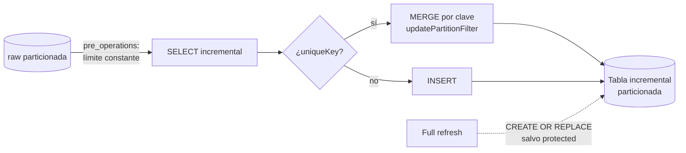

## 1. Resumen

Una tabla incremental de Dataform (`type: "incremental"`) se construye completa la primera vez y, en las ejecuciones siguientes, solo procesa lo nuevo: lo **inserta** o, si tiene `uniqueKey`, lo **fusiona** por clave con un `MERGE` que Dataform genera. Bien configurada, reduce costo y latencia sin escribir el `MERGE` a mano. Mal configurada, duplica filas, escanea tablas enteras o pierde datos en una reconstrucción.

## 2. Qué es

Es la implementación en Dataform (el servicio de transformación SQL de BigQuery en Google Cloud) del patrón de carga incremental. Se declara en un archivo SQLX: un bloque `config` con el tipo y las opciones, y un `SELECT` que define el contenido. La función `when(incremental(), ...)` agrega una condición solo en las ejecuciones incrementales, y `${self()}` referencia la propia tabla de destino.

## 3. Problema que resuelve

Reconstruir una tabla grande en cada ejecución cuesta tiempo y bytes procesados, y aumenta la latencia de los datos. Escribir a mano el `MERGE` incremental, el control de la primera carga y la reconstrucción es repetitivo y propenso a errores. Dataform resuelve esos tres casos (primera vez, incremental y full refresh) desde una sola definición.

## 4. Cómo funciona

1. **Primera ejecución:** la tabla no existe; `incremental()` es falso y se construye con el `SELECT` completo.
2. **Ejecuciones siguientes:** `incremental()` es verdadero y se agrega el filtro (típicamente, lo posterior al máximo ya cargado en `${self()}`).
3. **Estrategia de escritura:**
   - sin `uniqueKey`: **inserción**; las filas releídas se duplican;
   - con `uniqueKey`: **merge** por clave; las filas releídas se actualizan.
4. **Poda en el destino:** `bigquery.updatePartitionFilter` limita las particiones del destino que el `MERGE` examina. **Solo funciona con `uniqueKey`**; sin ella, Dataform usa inserción y la opción no tiene efecto.
5. **Poda en el origen:** BigQuery solo limita las particiones escaneadas con filtros de expresión constante; un filtro cuyo valor sale de una consulta sobre la tabla (`SELECT MAX(...) FROM ${self()}`) es dinámico y no poda el origen. La documentación recomienda calcular el límite en `pre_operations` como variable de BigQuery scripting y usar la variable como expresión constante en el `WHERE`.
6. **Full refresh:** con `--full-refresh` o la opción *Run with full refresh*, Dataform ignora `when(incremental(), ...)` y recrea la tabla con `CREATE OR REPLACE`. `protected: true` impide esa reconstrucción.

## 5. Cuándo utilizarlo

- Tablas grandes que crecen con eventos nuevos (logs, transacciones) donde reconstruir todo es caro.
- Modelos de estado actual con una clave y una columna de modificación confiable (`uniqueKey`).
- Snapshots diarios que se agregan sin reescribir los anteriores.
- Ejecuciones frecuentes que necesitan baja latencia.

## 6. Cuándo no utilizarlo

- Tablas pequeñas: una tabla normal (`type: "table"`) es más simple y siempre consistente.
- Lógica que depende de toda la historia en cada ejecución (rankings globales, deduplicación contra todo el pasado sin clave).
- Fuentes sin columna de modificación o con datos tardíos impredecibles: el filtro incremental pierde filas.

## 7. Ejemplo sencillo

```sql
-- definitions/user_actions.sqlx
config {
  type: "incremental",
  uniqueKey: ["transaction_id"]
}

SELECT timestamp, action, transaction_id
FROM ${ref("user_actions_raw")}
${when(incremental(), `WHERE timestamp > (SELECT MAX(timestamp) FROM ${self()})`)}
```

Primera ejecución: carga todo. Siguientes: solo lo posterior al máximo cargado, fusionado por `transaction_id`.

## 8. Ejemplo de producción

Una tabla de eventos de 3 TB, particionada por día, se actualiza cada hora desde una tabla raw también particionada:

- el límite se calcula en `pre_operations` (máximo cargado menos 2 horas de margen para tardíos) y se usa como constante, de modo que BigQuery solo lee las particiones recientes del origen;
- `uniqueKey: ["event_id"]` hace que releer el margen no duplique;
- `updatePartitionFilter` restringe el `MERGE` a los últimos 2 días del destino;
- la tabla está `protected: true` porque la raw solo retiene 30 días: una reconstrucción completa perdería la historia;
- una aserción de Dataform verifica unicidad de `event_id` en los últimos días.

## 9. Arquitectura



## 10. Código

```sql
-- definitions/events.sqlx (Dataform sobre BigQuery). Requiere: repositorio de Dataform conectado
-- a BigQuery y la fuente raw_events(event_id, event_timestamp TIMESTAMP, payload) declarada
-- y particionada por DATE(event_timestamp).
config {
  type: "incremental",
  uniqueKey: ["event_id"],
  protected: true,
  bigquery: {
    partitionBy: "DATE(event_timestamp)",
    updatePartitionFilter: "event_timestamp >= TIMESTAMP_SUB(CURRENT_TIMESTAMP(), INTERVAL 48 HOUR)"
  }
}

pre_operations {
  -- Límite como variable: el WHERE usa una expresión constante y BigQuery poda el origen.
  DECLARE checkpoint DEFAULT (
    ${when(incremental(),
      `SELECT TIMESTAMP_SUB(MAX(event_timestamp), INTERVAL 2 HOUR) FROM ${self()}`,
      `SELECT TIMESTAMP("2000-01-01")`)}
  )
}

SELECT event_id, event_timestamp, payload
FROM ${ref("raw_events")}
WHERE event_timestamp > checkpoint
```

El margen de 2 horas relee eventos tardíos; `uniqueKey` evita duplicarlos. `updatePartitionFilter` debe cubrir al menos ese margen, o el `MERGE` no encontraría las filas ya cargadas y las insertaría de nuevo.

## 11. GCP

**Dataform** compila el SQLX a sentencias de BigQuery (`CREATE`, `INSERT`, `MERGE`) y las ejecuta en el orden de dependencias del workflow. Además de lo anterior, ofrece `onSchemaChange` para agregar o quitar columnas sin full refresh. Al 2026-10-02 esa opción está en **Preview**, requiere Dataform core 3.0.11 o superior y no está disponible en la CLI. Sus valores son `IGNORE` (por defecto), `FAIL`, `EXTEND` y `SYNCHRONIZE`, y este último puede borrar columnas sin vuelta atrás. El snippet `dataform-incremental-model` muestra la variante mínima.

## 12. AWS

AWS no tiene un servicio equivalente a Dataform. El análogo más usado es **dbt** con el adaptador de **Redshift**. En dbt, `materialized='incremental'` con `is_incremental()` cumple el papel de `when(incremental())`, `unique_key` el de `uniqueKey`, y `--full-refresh` reconstruye. Diferencias: dbt es una herramienta externa que hay que ejecutar y orquestar (no un servicio administrado del proveedor), y elige la estrategia con `incremental_strategy`.

## 13. Azure

Tampoco hay un equivalente directo. En Synapse o Fabric Warehouse, la carga incremental se escribe con `MERGE` de T-SQL orquestado por pipelines de Data Factory, o con dbt. La tabla de adaptadores de la página *Supported data platforms* de dbt **no** incluye Fabric al 2026-10-02, así que antes de elegir dbt para Fabric hay que verificar qué adaptador existe y quién lo mantiene.

## 14. Buenas prácticas

- Usar `uniqueKey` siempre que la fuente pueda repetir o corregir filas.
- Calcular el límite incremental en `pre_operations` cuando el origen está particionado.
- Hacer que `updatePartitionFilter` cubra el margen de relectura.
- Marcar `protected: true` las tablas cuya fuente no conserva la historia.
- Agregar aserciones de unicidad y de no nulos sobre la clave.
- **Seguridad:** la cuenta de servicio de Dataform escribe en los datasets de destino; limitar sus permisos a esos datasets.
- **Costo:** sin poda en origen y destino, una incremental puede leer tanto como una reconstrucción; revisar los bytes procesados de cada ejecución.

## 15. Errores frecuentes

- `updatePartitionFilter` sin `uniqueKey`: no hay `MERGE` y la opción no hace nada.
- Filtro incremental con un valor calculado por consulta (`MAX(...)` de `${self()}`) sobre un origen particionado: puede escanear toda la tabla en cada ejecución.
- Margen de relectura mayor que el `updatePartitionFilter`: filas duplicadas.
- Ejecutar un full refresh sobre una tabla cuya fuente ya purgó datos antiguos.
- Cambiar el `SELECT` (columnas nuevas) y esperar que la tabla existente se adapte sola.

## 16. Trade-offs

Menos costo y latencia por ejecución, a cambio de más estados posibles (primera carga, incremental, refresh) y del riesgo de divergir de lo que daría una reconstrucción completa. El merge es más robusto que la inserción, pero examina el destino y cuesta más por ejecución.

## 17. Conceptos relacionados

- `incremental-load`: el patrón general.
- `idempotency`: qué hace a la ejecución repetible.
- `partition-pruning` y `bigquery-partitioning`: cómo no leer de más.
- `schema-evolution`: cambiar columnas sin perder datos.
- Del blueprint, pendiente de ficha: `dataform-workflows`.

## 18. Preguntas técnicas abiertas

1. ¿Qué margen de relectura elegirías y cómo lo medirías con datos reales de llegada tardía?
2. Una columna nueva debe aparecer en una incremental protegida de 5 TB. ¿Cómo la agregarías?
3. ¿Cómo detectarías que una incremental divergió de lo que daría una reconstrucción completa?

## 19. Laboratorio relacionado

Pendiente (F4).

## 20. Fuentes

- Google Cloud: *Create tables* (Dataform) y *Query partitioned tables* (BigQuery).
- dbt: *Incremental models* y *Supported data platforms*.

El detalle de cada fuente está en `sources` del frontmatter.

## 21. Fecha de última verificación

2026-10-02. En `review_required` hasta la revisión B-F3.1 del lote 5.

## 22. Historial de cambios importantes

- 2026-10-02: creación (lote 5 de F3).
