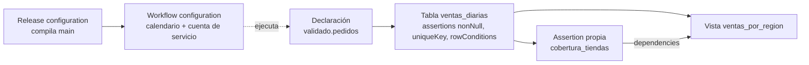

## 1. Resumen

Un **workflow de Dataform** es un conjunto de archivos **SQLX** en un repositorio Git que transforma datos dentro de BigQuery: la T de un ELT. Cada archivo es una pieza:

- **declaración** de una fuente que ya existe;
- **tabla** (`table`, `incremental`, `view` o `materialized view`);
- **assertion**, una prueba de calidad;
- **operación SQL** que corre tal cual.

Las dependencias salen de `ref()` en el SQL o de `dependencies` en el `config`, y forman el árbol que fija el orden de ejecución. Un detalle que suele sorprender, según su documentación: **si fallan las assertions de una tabla, las que dependen de ella se ejecutan igual**, salvo que esas assertions se declaren como dependencia. Programar el workflow tiene varias opciones: workflow configurations, Workflows con Cloud Scheduler, Managed Service for Apache Airflow o Cloud Build.

Las tablas incrementales tienen su ficha: `dataform-incremental-tables`.

## 2. Qué es

- **SQLX:** SQL con un bloque `config` (tipo, descripción, partición, assertions, dependencias) y referencias `${ref("…")}`.
- **Declaración:** registra una tabla de BigQuery que ya existe, para poder usar `ref()` sobre ella.
- **Tablas:** `table`, `incremental`, `view` y `materialized view`.
- **Assertions:**
  - en el `config`: `nonNull`, `rowConditions`, `uniqueKey` y `uniqueKeys`;
  - en un archivo propio: una consulta que devuelve las filas que violan la regla.
- **Dependencias:** `ref()` las declara automáticamente; `dependencies: [...]` las declara a mano, por ejemplo hacia una assertion.
- **Release configuration y workflow configuration:** la primera compila el repositorio; la segunda ejecuta ese resultado con un calendario y una cuenta de servicio. Si una corrida no termina antes de la siguiente, la siguiente se salta con error.

## 3. Problema que resuelve

Transformaciones SQL repartidas en consultas programadas sueltas no tienen orden explícito, versiones ni pruebas: cambiar una tabla rompe otras sin aviso. Dataform da:

- el árbol de dependencias explícito y visible;
- el código SQL en Git, con revisión;
- pruebas de calidad que corren con cada actualización;
- documentación junto al código.

## 4. Cómo funciona

1. Se escriben los SQLX: declaraciones, tablas con `ref()` y assertions.
2. Dataform **compila** el repositorio: resuelve `ref()`, arma el árbol y genera el SQL de BigQuery. Las assertions del `config` se convierten en acciones propias.
3. Una **release configuration** compila una rama o versión.
4. Una **workflow configuration** ejecuta esa compilación con un calendario y una cuenta de servicio. También se puede disparar desde Workflows, Airflow o Cloud Build.
5. Dataform ejecuta en orden. Las assertions corren tras actualizar su tabla. Una tabla que depende de otra corre aunque fallen las assertions de esa otra, salvo que las declare como dependencia.

## 5. Cuándo utilizarlo

- Transformaciones en BigQuery con muchas tablas y dependencias.
- Cuando se quiere el SQL en Git, con revisión y pruebas, en lugar de consultas programadas sueltas.
- Como capa de transformación de un ELT (ver `etl-vs-elt`).

## 6. Cuándo no utilizarlo

- Transformaciones que no son SQL en BigQuery, como procesamiento de archivos o streaming: ahí van Dataflow u otro motor.
- Si el pipeline tiene muchos pasos fuera de BigQuery: Dataform puede ser un paso dentro de un orquestador como Managed Airflow, según su página.
- No confiar en que una assertion fallida detiene lo que viene después: hay que declararla como dependencia.

## 7. Ejemplo sencillo

`ventas_diarias.sqlx` lee `${ref("pedidos")}`, agrupa por día y tienda, y declara `uniqueKey: ["dia", "tienda_id"]`. Dataform la ejecuta después de la declaración de `pedidos`, y corre la assertion de unicidad tras actualizarla.

## 8. Ejemplo de producción

El repositorio de transformaciones tiene una declaración de `validado.pedidos`, la tabla `ventas_diarias` con assertions, una prueba propia `cobertura_tiendas` y la vista `ventas_por_region`. Como la vista no debe publicarse si hay tiendas sin maestro, declara `dependencies: ["cobertura_tiendas"]`: si la prueba falla, la vista no se actualiza.

Una release configuration compila la rama `main`, y una workflow configuration la ejecuta cada mañana con su cuenta de servicio. El equipo revisa en la consola el árbol de dependencias antes de cada cambio grande.

## 9. Arquitectura



## 10. Código

```sql
// Dataform (compilado en local con @dataform/cli 3.0.71: `dataform compile` sin errores de grafo; no se ejecutó en BigQuery).
// Un workflow de cuatro archivos SQLX: una declaración de fuente, una tabla con assertions, una prueba propia y una
// vista que solo se actualiza si pasa esa prueba. workflow_settings.yaml: defaultProject mi-proyecto, defaultLocation US,
// defaultDataset marts, defaultAssertionDataset calidad.

// --- definitions/fuentes/pedidos.sqlx
config {
  type: "declaration",
  database: "mi-proyecto",
  schema: "validado",
  name: "pedidos",
  description: "Pedidos validados, cargados por el pipeline de ingesta."
}

// --- definitions/modelos/ventas_diarias.sqlx
config {
  type: "table",
  description: "Ventas por día y tienda.",
  bigquery: { partitionBy: "dia" },
  assertions: {
    nonNull: ["dia", "tienda_id"],
    uniqueKey: ["dia", "tienda_id"],
    rowConditions: ["monto >= 0"]
  }
}

SELECT dia, tienda_id, SUM(monto) AS monto, COUNT(*) AS pedidos
FROM ${ref("pedidos")}
GROUP BY dia, tienda_id

// --- definitions/calidad/cobertura_tiendas.sqlx
config {
  type: "assertion",
  description: "Toda tienda con ventas existe en el maestro de tiendas."
}

SELECT v.tienda_id
FROM ${ref("ventas_diarias")} AS v
LEFT JOIN `mi-proyecto.core.tiendas` AS t USING (tienda_id)
WHERE t.tienda_id IS NULL

// --- definitions/modelos/ventas_por_region.sqlx
config {
  type: "view",
  description: "Ventas por región. Solo se actualiza si pasa la prueba de cobertura de tiendas.",
  dependencies: ["cobertura_tiendas"]
}

SELECT t.region, v.dia, SUM(v.monto) AS monto
FROM ${ref("ventas_diarias")} AS v
JOIN `mi-proyecto.core.tiendas` AS t USING (tienda_id)
GROUP BY t.region, v.dia
```

Estos cuatro archivos SQLX se **compilaron en local** con `@dataform/cli` 3.0.71, instalado en un directorio temporal, no en el proyecto. `dataform compile` terminó sin errores de grafo. El resultado tiene dos tablas, la declaración y tres assertions: la propia más las de unicidad y condiciones de fila generadas desde el `config`. La vista depende de la tabla (por `ref()`) y de la prueba (por `dependencies`). **No se ejecutaron en BigQuery.**

## 11. GCP

**Dataform** en BigQuery. Los tipos de objetos, las dependencias, las assertions y los métodos de programación son los de sus páginas. Entre esos métodos está **Managed Service for Apache Airflow** (ver `composer-environments`).

## 12. AWS

No aplica de forma específica: esta ficha describe Dataform. La transformación SQL en otros warehouses se trata en `data-transformation`.

## 13. Azure

No aplica de forma específica (ver §12).

## 14. Buenas prácticas

- Declarar todas las fuentes y usar siempre `ref()`, nunca nombres de tabla escritos a mano entre tablas del workflow.
- Assertions en cada tabla publicada; las críticas, como dependencia de lo que se publica después.
- Compilar en la CI antes de fusionar a la rama de la release.
- Workflow configurations con una cuenta de servicio propia, que solo pueda escribir los datasets del workflow.
- **Seguridad:** la cuenta de servicio de la workflow configuration ejecuta todo el SQL del workflow; darle los permisos mínimos sobre los datasets de origen y destino.
- **Observabilidad:** revisar las ejecuciones fallidas y las assertions que fallan; una corrida que no termina antes de la siguiente hace que esa se salte con error.
- **Costo:** cada ejecución consume BigQuery; las tablas incrementales y las vistas materializadas reducen lo que se procesa en cada corrida.

## 15. Errores frecuentes

- Esperar que una assertion fallida frene la vista que depende de la tabla.
- Referenciar tablas por nombre en lugar de `ref()` y perder el orden de ejecución.
- Programar más seguido de lo que dura una corrida, y que las siguientes se salten.
- Usar la cuenta de servicio por defecto con permisos amplios.

## 16. Trade-offs

Dataform da orden, versiones y pruebas al SQL de BigQuery, a cambio de aprender SQLX, operar un repositorio y atar la transformación a BigQuery. Las assertions como dependencia detienen datos malos, pero frenan también lo que depende de ellas: un falso positivo bloquea la publicación. Programar dentro de Dataform es lo más simple; un orquestador externo coordina mejor los pasos fuera de BigQuery.

## 17. Conceptos relacionados

- `data-transformation` y `etl-vs-elt`: la transformación en general.
- `dataform-incremental-tables`: tablas incrementales.
- `sql-quality-checks`: pruebas de calidad en SQL.
- `pipeline-dependencies`: el árbol de dependencias.
- `composer-environments`: programar Dataform desde Airflow.

## 18. Preguntas técnicas abiertas

1. ¿Qué consultas programadas sueltas de tu proyecto convertirías primero en un workflow?
2. ¿Qué assertion debería detener una publicación, y cuál solo avisar?
3. ¿Dónde programarías el workflow: dentro de Dataform o en un orquestador?

## 19. Laboratorio relacionado

Pendiente (F4).

## 20. Fuentes

- Google Cloud, Dataform: *Dataform overview*, *Overview of workflows*, *Set dependencies*, *Test data quality* y *Schedule runs*.

El detalle de cada fuente está en `sources` del frontmatter.

## 21. Fecha de última verificación

2026-10-12. Pasa a `verified`: revisión B-F3.1 del lote F3b-08c aplicada, sin VERIFY pendientes.

## 22. Historial de cambios importantes

- 2026-10-11: creación (lote F3b-08c).
- 2026-10-12: revisión B-F3.1 del lote F3b-08c aplicada (docs/reviews/cards-f3b-08c.md): filas aprobadas sin cambios en esta ficha.
- 2026-10-12: `verification_status: verified` (sin VERIFY pendientes).
- 2026-10-13: `page_title` en cada cita, con el título de la página citada (ADR-012); sin cambios de contenido.
