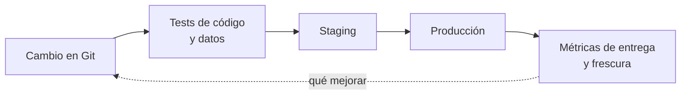

## 1. Resumen

DataOps es un **paraguas**: aplicar a la entrega de datos las prácticas que la ingeniería de software ya tiene. Cambios pequeños y versionados, tests automáticos en cada etapa, ambientes separados, despliegue automatizado, monitoreo y, sobre todo, **medir el proceso de entrega**. AWS lo resume en su Data Analytics Lens: automatizar las pruebas de infraestructura, código y datos en cada etapa, con procedimientos estándar de despliegue, rollback y backfill (*2 – Modernize deployment of the analytics jobs and applications*).

No es una herramienta ni sustituye nada: **combina** CI/CD (`ci-cd-for-data`), calidad y observabilidad (`data-observability`). Lo que agrega es mirar el sistema completo y medir si mejora.

## 2. Qué es

- **Control de versiones:** todo cambio (SQL, DAG, configuración) entra por el repositorio.
- **Ambientes:** desarrollo, staging y producción aislados; Dataform propone tres formas de separarlos según el tamaño del equipo (*Best practices for the workflow lifecycle*).
- **Tests en cada etapa:** del código, de los datos y del despliegue.
- **Despliegue automatizado:** promoción entre ambientes (`environment-promotion`).
- **Medición:** frecuencia de despliegue, tasa de cambios que fallan, tiempo de recuperación y objetivos de frescura (`data-slo`).

## 3. Problema que resuelve

El equipo despliega una vez al mes porque cada despliegue rompe algo y nadie sabe cuánto tardan en arreglarlo. Sin medir, cada discusión es de opinión. Con las métricas de entrega y de frescura a la vista, se sabe si un cambio de proceso (más tests, staging, despliegues más chicos) mejoró algo.

## 4. Cómo funciona

1. Cada cambio entra por pull request, con tests de código y datos.
2. La CI despliega a staging con datos de prueba conocidos.
3. Lo validado se promueve a producción en forma automática.
4. El monitoreo registra incidentes, recuperación y frescura.
5. Las métricas del proceso se revisan con regularidad para decidir qué mejorar.

## 5. Cuándo utilizarlo

- Equipos con varios pipelines y despliegues frecuentes.
- Cuando los incidentes por cambios son recurrentes.
- Para ordenar prácticas que ya existen por separado.

## 6. Cuándo no utilizarlo

- Como nombre nuevo para algo que no cambia: sin medición ni automatización, es solo una etiqueta.
- Como reemplazo de CI/CD, calidad u observabilidad: los necesita a los tres.

## 7. Ejemplo sencillo

| Métrica | Valor |
|---|---|
| Despliegues por semana | 2.6 |
| Tasa de cambios que fallan | 33 % |
| Tiempo mediano de recuperación | 1:37:30 |
| Frescura incumplida en `ventas_diarias` | 2 de 4 cargas (objetivo 6 h) |

## 8. Ejemplo de producción

Plataforma con 40 pipelines:

- todo cambio por pull request, con tests de código y datos (`ci-cd-for-data`);
- staging con datos de prueba fijos;
- promoción automatizada a producción (`environment-promotion`);
- monitoreo de pipelines y datos (`orchestration-observability`, `data-observability`);
- tablero mensual con las métricas de entrega y de frescura;
- en la nube (no ejecutado): ambientes de Dataform, el ciclo de la Data Analytics Lens o Git y deployment pipelines de Fabric.

## 9. Arquitectura



## 10. Código

```python
# Python 3.12, biblioteca estándar (ejecutado en la CI): métricas de entrega de una plataforma de datos calculadas desde
# el registro de despliegues y de incidentes: frecuencia de despliegue, tasa de cambios que fallan, tiempo de
# recuperación y frescura incumplida. Lo que se mide es el proceso, no un pipeline aislado; los datos son fijos.
from dataclasses import dataclass
from datetime import datetime, timedelta
from statistics import median


@dataclass(frozen=True)
class Deploy:
    at: datetime
    failed: bool                      # el cambio causó un incidente o un rollback
    recovered_at: datetime | None = None


D = datetime.fromisoformat
DEPLOYS = [
    Deploy(D("2026-10-05T10:00"), False),
    Deploy(D("2026-10-07T15:00"), True, D("2026-10-07T17:30")),
    Deploy(D("2026-10-12T09:00"), False),
    Deploy(D("2026-10-14T11:00"), False),
    Deploy(D("2026-10-19T10:00"), True, D("2026-10-19T10:45")),
    Deploy(D("2026-10-21T16:00"), False),
]
FRESHNESS_SLO = timedelta(hours=6)
LOADS = {"ventas_diarias": [timedelta(hours=2), timedelta(hours=7), timedelta(hours=3), timedelta(hours=9)]}

weeks = (max(d.at for d in DEPLOYS) - min(d.at for d in DEPLOYS)).days / 7
failed = [d for d in DEPLOYS if d.failed]
recovery = [d.recovered_at - d.at for d in failed if d.recovered_at is not None]
print(f"despliegues por semana: {len(DEPLOYS) / weeks:.1f}")
print(f"tasa de cambios que fallan: {len(failed) / len(DEPLOYS):.0%}")
print(f"tiempo mediano de recuperación: {timedelta(seconds=median(r.total_seconds() for r in recovery))}")
for table, delays in LOADS.items():
    late = sum(d > FRESHNESS_SLO for d in delays)
    print(f"{table}: frescura incumplida en {late} de {len(delays)} cargas (objetivo {FRESHNESS_SLO})")
```

El script se **ejecuta en la CI** con la biblioteca estándar y pasa `mypy --strict`. Imprime las cuatro líneas del §7. El registro de despliegues y de cargas es fijo; en una plataforma real sale del orquestador y del registro de incidentes.

## 11. GCP

En GCP, los ambientes de **Dataform**. Según *Best practices for the workflow lifecycle* (no ejecutado):

| | Este concepto | Dataform |
|---|---|---|
| Ambientes | Desarrollo, staging y producción | Por esquema, por esquema y proyecto, o por proyectos separados |
| Según el equipo | — | Chico, mediano o grande con staging |

## 12. AWS

En AWS, la **Data Analytics Lens** del Well-Architected Framework. Según *2 – Modernize deployment of the analytics jobs and applications* (no ejecutado):

| | Este concepto | Data Analytics Lens |
|---|---|---|
| Tests | En cada etapa | Automatización de pruebas de infraestructura, código y datos en cada etapa |
| Procedimientos | Rollback y backfill | Procedimientos estándar de despliegue, test, rollback y backfill |

## 13. Azure

En Azure, **CI/CD en Microsoft Fabric**. Según *What is CI/CD in Microsoft Fabric?* (no ejecutado):

| | Este concepto | Fabric |
|---|---|---|
| Versionado | Repositorio | Integración con Git (Azure DevOps o GitHub) |
| Promoción | Automatizada | Deployment pipelines entre Dev, Test y Prod, con reglas de configuración |

## 14. Buenas prácticas

- Cambios pequeños y frecuentes.
- Datos de prueba fijos para comparar versiones.
- Procedimientos escritos de rollback y backfill (`backfill`).
- **Seguridad:** credenciales distintas por ambiente; producción solo la escribe el despliegue.
- **Observabilidad:** métricas de entrega y de frescura en el mismo tablero.
- **Costo:** staging con muestras, no con copias completas de producción.

## 15. Errores frecuentes

- Llamar DataOps a un despliegue manual con un nombre nuevo.
- Medir solo si el job terminó, no si los datos llegaron a tiempo.
- Un solo ambiente compartido para todos.
- Métricas que nadie revisa.

## 16. Trade-offs

Más automatización y ambientes dan seguridad para desplegar seguido y cuestan infraestructura y mantenimiento. Medir el proceso ayuda a mejorar y puede volverse un fin en sí mismo si las métricas no se conectan con decisiones.

## 17. Conceptos relacionados

- `ci-cd-for-data` y `environment-promotion`: el despliegue.
- `data-observability` y `orchestration-observability`: el monitoreo.
- `data-slo`: la frescura.
- `backfill`: un procedimiento estándar.

## 18. Preguntas técnicas abiertas

1. ¿Cuántos despliegues por semana hace tu equipo y cuántos fallan?
2. ¿Cuánto tardan en recuperarse?
3. ¿Qué tabla tiene un objetivo de frescura escrito?

## 19. Laboratorio relacionado

Pendiente (F4).

## 20. Fuentes

- Google Cloud: *Best practices for the workflow lifecycle* (Dataform).
- AWS: *2 – Modernize deployment of the analytics jobs and applications* (Data Analytics Lens).
- Microsoft Learn: *What is CI/CD in Microsoft Fabric?*.

El detalle de cada fuente está en `sources` del frontmatter.

## 21. Fecha de última verificación

2026-10-26. Pasa a `verified` el 2026-10-27: revisión B-F3.1 del lote F3b-22a sin hallazgos en esta ficha (docs/reviews/cards-f3b-22a.md) y CI en verde (run 40596994498).

## 22. Historial de cambios importantes

- 2026-10-26: creación (lote F3b-22a).
- 2026-10-27: `verification_status: verified` (revisión sin hallazgos en esta ficha; CI en verde, run 40596994498).
