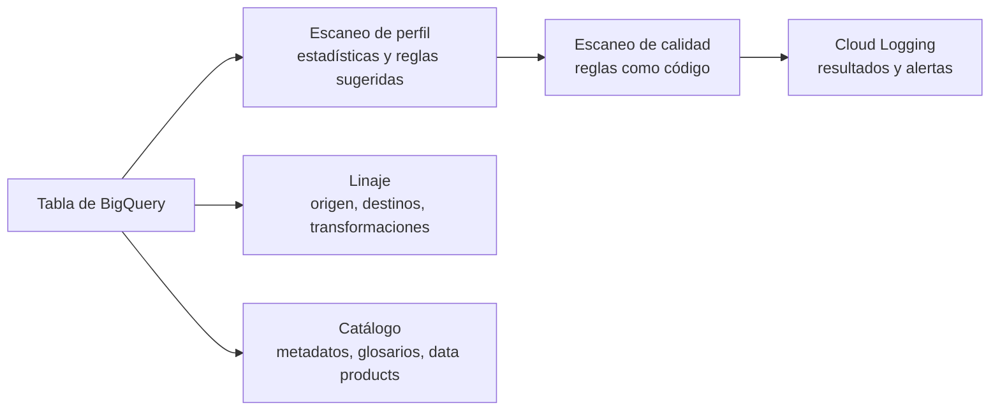

## 1. Resumen

**Knowledge Catalog** es el servicio de gobierno de datos de Google Cloud. Según su página, **Dataplex Universal Catalog pasó a llamarse Knowledge Catalog el 10 de abril de 2026**, y los nombres de la API, las bibliotecas cliente, la CLI y IAM no cambiaron. Por eso el recurso de Terraform sigue siendo `google_dataplex_datascan`, y el slug de esta ficha conserva «dataplex». Lo que ofrece, según sus páginas:

- **auto data quality:** escaneos que validan una tabla contra reglas, definidas como código, con alertas;
- **perfilado:** estadísticas de una tabla que sugieren reglas de calidad;
- **linaje:** de dónde vienen los datos, adónde van y qué transformaciones pasan, entre BigQuery y otros productos;
- **catálogo, glosarios y data products** (ver `data-products`), con capacidades de IA para describir assets.

El catálogo y el linaje como conceptos están en el dominio 17; esta ficha trata el servicio.

## 2. Qué es

- **Data scan:** un job de Knowledge Catalog que toma muestras de BigQuery, o de Cloud Storage a través de tablas externas, e infiere metadatos.
- **Escaneo de calidad (auto data quality):**
  - un data scan sobre **una** tabla de BigQuery que valida reglas incorporadas o propias;
  - corre con recursos de Google, sin infraestructura propia;
  - registra resultados y alertas en Cloud Logging.
- **Escaneo de perfil:** estadísticas de una tabla (BigQuery, Iceberg REST Catalog, SAP BDC Delta Lake o Hive) que recomiendan reglas.
- **Linaje:** el mapa de origen, destinos y transformaciones, en la consola o con la Data Lineage API, multirregión.
- **Roles que describe su página:**
  - *context engineers*, es decir data engineers: metadatos y linaje;
  - *data stewards*: glosarios y revisión de descripciones generadas por IA;
  - desarrolladores de IA: contexto vía MCP o API.

## 3. Problema que resuelve

Saber si una tabla está bien, de dónde vienen sus datos y qué significa cada columna suele quedar repartido en scripts, planillas y la memoria de las personas. Knowledge Catalog lo centraliza:

- reglas de calidad declarativas que corren solas sobre las tablas publicadas;
- linaje que muestra qué se rompe aguas abajo si cambia una tabla;
- metadatos y glosarios para encontrar y entender los datos.

## 4. Cómo funciona

1. Un escaneo de **perfil** sobre una tabla genera estadísticas y sugiere reglas.
2. Se define un escaneo de **calidad** con reglas: completitud, unicidad, validez, rangos o SQL propio. Se puede hacer como código, por ejemplo con Terraform y `google_dataplex_datascan`.
3. El escaneo corre bajo demanda o según un calendario, con recursos de Google, y publica resultados y alertas en Cloud Logging.
4. El **linaje** se registra para los assets compatibles (BigQuery y otros) y se ve en la consola o con la API.
5. Los assets, con sus descripciones, glosarios y aspects, se descubren en el catálogo, y pueden agruparse en data products.

## 5. Cuándo utilizarlo

- Validar tablas publicadas en BigQuery con reglas declarativas y alertas, sin montar infraestructura.
- Ver el linaje entre tablas para evaluar el impacto de un cambio.
- Centralizar metadatos y glosarios de los datos de la organización.

## 6. Cuándo no utilizarlo

- No reemplaza las validaciones dentro del pipeline: el escaneo mira la tabla ya escrita, no impide que entren datos malos (ver `data-validation-with-pydantic`).
- Un escaneo de calidad corre sobre una sola tabla; las reglas que cruzan tablas van en SQL propio (ver `sql-quality-checks`).
- Si todo el stack está fuera de Google Cloud, conviene evaluar herramientas que lean esas fuentes, porque este servicio se centra en assets de Google Cloud.

## 7. Ejemplo sencillo

Un escaneo diario sobre `core.clientes` verifica tres reglas:

- `cliente_id` no es nulo y es único;
- `segmento` está en `{pyme, empresa, persona}`.

Si una regla falla, el resultado queda en el escaneo y se puede alertar desde Cloud Logging.

## 8. Ejemplo de producción

El equipo de datos define en Terraform un escaneo de calidad por cada tabla publicada, con un calendario diario después de la carga:

- un escaneo de perfil inicial sugirió las reglas, y el equipo las revisó antes de adoptarlas;
- las fallas generan alertas por Cloud Logging;
- antes de cambiar una tabla del núcleo, el equipo mira el linaje en la consola para saber qué tablas y vistas dependen de ella.

Los policy tags de las columnas sensibles siguen en la API de Data Catalog (ver `bigquery-policy-tags`).

## 9. Arquitectura



## 10. Código

```hcl
# Terraform (validado en la CI con terraform validate, sin credenciales; no se aplicó): escaneo de calidad de datos
# de Knowledge Catalog sobre una tabla de BigQuery, diario, con reglas de completitud, unicidad y validez. El recurso
# se llama google_dataplex_datascan: según el aviso de Knowledge Catalog, los nombres de la API no cambiaron.
# Requiere: provider hashicorp/google; la tabla core.clientes existente.
terraform {
  required_providers {
    google = {
      source  = "hashicorp/google"
      version = "~> 8.0"
    }
  }
}

variable "project_id" {
  type = string
}

resource "google_dataplex_datascan" "calidad_clientes" {
  project      = var.project_id
  location     = "us-central1"
  data_scan_id = "calidad-clientes"

  data {
    resource = "//bigquery.googleapis.com/projects/${var.project_id}/datasets/core/tables/clientes"
  }

  execution_spec {
    trigger {
      schedule {
        cron = "0 6 * * *" # todos los días a las 6:00
      }
    }
  }

  data_quality_spec {
    rules {
      column    = "cliente_id"
      dimension = "COMPLETENESS"
      threshold = 1.0
      non_null_expectation {}
    }
    rules {
      column    = "cliente_id"
      dimension = "UNIQUENESS"
      uniqueness_expectation {}
    }
    rules {
      column      = "segmento"
      dimension   = "VALIDITY"
      ignore_null = true
      set_expectation {
        values = ["pyme", "empresa", "persona"]
      }
    }
  }
}
```

Este bloque de Terraform se valida en la CI con `terraform validate`, sin credenciales (`make validate-terraform`), y **no se aplicó**. `terraform validate` comprueba que el recurso y sus atributos (calendario, reglas de completitud, unicidad y validez) existan en el provider. El nombre `google_dataplex_datascan` coincide con el aviso de Knowledge Catalog: los nombres de la API no cambiaron.

## 11. GCP

**Knowledge Catalog**, que según sus páginas es la evolución de Dataplex Universal Catalog (renombrado el 10 de abril de 2026). La entidad de la tecnología conserva el slug `gcp-dataplex`, con los nombres anteriores como alias (ADR-010).

## 12. AWS

No aplica de forma específica: esta ficha describe el servicio de Google Cloud. El catálogo y el gobierno en AWS se tratan en sus fichas.

## 13. Azure

No aplica de forma específica (ver §12).

## 14. Buenas prácticas

- Reglas de calidad como código, versionadas con el resto de la infraestructura.
- Un escaneo después de cada carga de las tablas publicadas.
- Revisar las reglas que sugiere el perfilado antes de adoptarlas.
- Validar también dentro del pipeline; el escaneo es la segunda línea.
- **Seguridad:** el escaneo toma muestras de los datos; quién puede crear escaneos y ver sus resultados debe limitarse en tablas con datos sensibles.
- **Observabilidad:** los resultados y alertas en Cloud Logging son la señal de calidad de cada tabla; el linaje acelera el diagnóstico cuando algo falla aguas arriba.
- **Costo:** cada escaneo consume recursos; ajustar la frecuencia y el muestreo al valor de la tabla.

## 15. Errores frecuentes

- Buscar «Dataplex» en la documentación y no encontrar el nombre nuevo: el producto es Knowledge Catalog, con los nombres de la API sin cambios.
- Confiar solo en el escaneo y dejar entrar datos malos al pipeline.
- Adoptar sin revisión las reglas que sugiere el perfilado.
- Esperar que un escaneo valide reglas entre varias tablas.

## 16. Trade-offs

Knowledge Catalog da calidad, linaje y catálogo administrados, sin infraestructura, a cambio de atar ese gobierno a Google Cloud y a sus formas de definir reglas. Las validaciones en SQL o en el pipeline son portables y detienen datos malos antes de publicarlos, pero cada equipo las escribe y opera. Lo habitual es combinarlas: validar en el pipeline y escanear lo publicado.

## 17. Conceptos relacionados

- `data-products`: los data products de Knowledge Catalog.
- `data-validation-with-pydantic` y `sql-quality-checks`: validar dentro del pipeline.
- `bigquery-policy-tags`: seguridad por columna, en la API de Data Catalog.
- Del blueprint, pendientes de ficha: `data-catalog` y `data-lineage` (dominio 17).

## 18. Preguntas técnicas abiertas

1. ¿Qué tablas publicadas de tu proyecto no tienen hoy ninguna regla de calidad?
2. ¿Qué cambio reciente habría sido más seguro con el linaje a la vista?
3. ¿Qué reglas validarías dentro del pipeline y cuáles con un escaneo?

## 19. Laboratorio relacionado

Pendiente (F4).

## 20. Fuentes

- Google Cloud, Knowledge Catalog: *Knowledge Catalog overview*, *About data products* (aviso del cambio de nombre), *Auto data quality overview*, *About data profiling* y *About data lineage*.

El detalle de cada fuente está en `sources` del frontmatter.

## 21. Fecha de última verificación

2026-10-11. Pasa a `verified`: revisión B-F3.1 del lote F3b-08b aplicada, sin VERIFY pendientes.

## 22. Historial de cambios importantes

- 2026-10-11: creación (lote F3b-08b), con el nombre actual del servicio y los anteriores como alias (ADR-010).
- 2026-10-11: revisión B-F3.1 del lote F3b-08b aplicada (docs/reviews/cards-f3b-08b.md): filas aprobadas sin cambios en esta ficha.
- 2026-10-11: `verification_status: verified` (sin VERIFY pendientes).
