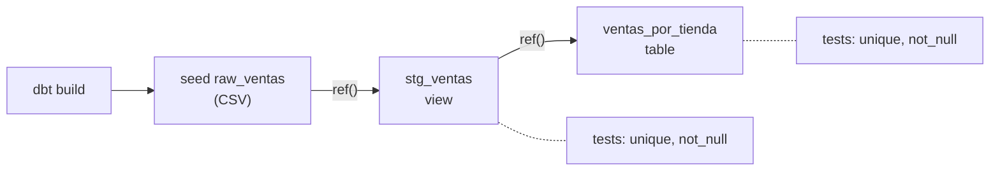

## 1. Resumen

dbt «transforms raw warehouse data into trusted data products»: se escriben transformaciones como sentencias `select` en SQL y dbt las convierte en tablas y vistas del warehouse, en el orden correcto, con tests.

Cuatro conceptos lo explican:

- **modelo:** «A model is a single file containing a final select statement»;
- **`ref()`:** «The most important function in dbt»; un modelo referencia a otro y así dbt arma el grafo;
- **materialización:** cómo se guarda cada modelo (`table`, `view`, `incremental`, `ephemeral`, `materialized view`);
- **data tests:** afirmaciones sobre los resultados, como `unique` y `not_null`.

`dbt build` corre seeds, modelos y tests en el orden del grafo. La documentación distingue dos generaciones: dbt v1, la original en Python (dbt Core, la que usa esta ficha), y la actual, escrita en Rust.

## 2. Qué es

- **Proyecto:** una carpeta con `dbt_project.yml`, modelos, seeds y tests.
- **Perfil (`profiles.yml`):** la conexión al warehouse.
- **Seed:** un CSV del proyecto que dbt carga como tabla.
- **Modelo:** un `select` en un archivo `.sql`; su nombre es el del objeto en la base.
- **`ref('modelo')`:** compila al nombre completo del objeto y declara la dependencia.
- **Data test:** una consulta que devuelve las filas que fallan; un test genérico es una consulta con parámetros que se declara en un `.yml`.

## 3. Problema que resuelve

Un equipo tiene cuarenta scripts SQL que crean tablas en el warehouse, con un orden que solo conoce quien los escribió y sin pruebas. Un cambio en una tabla de staging rompe un reporte y nadie lo nota. Con dbt, cada script es un modelo, `ref()` declara de qué depende, el orden sale del grafo y los tests corren junto con los modelos.

## 4. Cómo funciona

1. dbt lee el proyecto y arma el grafo a partir de los `ref()`.
2. `dbt build` recorre el grafo: carga seeds, construye cada modelo con su materialización y corre sus tests.
3. Si un test de un modelo falla, los modelos que dependen de él no se construyen.
4. Una materialización `view` crea una vista; `table` recrea la tabla en cada corrida; `incremental` agrega o actualiza solo lo nuevo.
5. Correr `dbt build` otra vez rehace lo mismo: el resultado no se duplica.

## 5. Cuándo utilizarlo

- Transformaciones en SQL dentro del warehouse (la T de un ELT).
- Equipos que quieren versionar, revisar y probar sus transformaciones como código.
- Modelos con dependencias entre sí, donde el orden importa.

## 6. Cuándo no utilizarlo

- Extracción y carga desde las fuentes: dbt transforma lo que ya está en el warehouse.
- Procesamiento de streams o lógica que no se expresa bien en SQL.
- Un `table` para tablas enormes que cambian poco: un modelo `incremental` reduce el tiempo de build.

## 7. Ejemplo sencillo

Un seed `raw_ventas` con tres ventas, un modelo de staging `stg_ventas` (vista) que normaliza la tienda, y un mart `ventas_por_tienda` (tabla) que agrupa por tienda con `ref('stg_ventas')`. Los tests `unique` y `not_null` corren sobre `id` y `tienda`. `dbt build` construye 7 nodos (1 seed, 2 modelos y 4 tests), y una segunda corrida deja lo mismo: `norte` con 2 ventas y 30.5, `sur` con 1 y 4.25.

## 8. Ejemplo de producción

El proyecto de dbt de un equipo de analítica:

- staging como vistas, una por fuente; marts como tablas o incrementales;
- `unique`, `not_null` y `relationships` en las claves de cada mart;
- `dbt build` en la CI sobre un esquema temporal en cada pull request;
- `dbt build` en producción desde el orquestador, después de que cargan las fuentes.

## 9. Arquitectura



## 10. Código

```python
# Python 3.12, dbt Core 1.12 y dbt-postgres 1.11 contra PostgreSQL 17 (ejecutado en la CI con el servicio postgres:17;
# ADR-018): un proyecto mínimo con un seed, un modelo de staging (view), un mart que lo usa con ref() (table) y tests.
# dbt build corre seeds, modelos y tests en el orden del grafo; correrlo dos veces deja lo mismo. PG_HOST, PG_PORT,
# PG_USER, PG_PASSWORD y PG_DB apuntan a una base vacía que el test crea y borra.
from __future__ import annotations

import os
import sys
import tempfile
from pathlib import Path

import psycopg
from dbt.cli.main import dbtRunner
from dbt.artifacts.schemas.run import RunExecutionResult

FILES = {
    "dbt_project.yml": """
name: ventas
version: "1.0.0"
profile: ventas
models:
  ventas:
    staging: {+materialized: view}
    marts: {+materialized: table}
""",
    "profiles.yml": """
ventas:
  target: ci
  outputs:
    ci:
      type: postgres
      host: "{{ env_var('PG_HOST') }}"
      port: "{{ env_var('PG_PORT') | int }}"
      user: "{{ env_var('PG_USER') }}"
      password: "{{ env_var('PG_PASSWORD') }}"
      dbname: "{{ env_var('PG_DB') }}"
      schema: analytics
      threads: 1
""",
    "seeds/raw_ventas.csv": "id,tienda,monto\n1,norte,10.5\n2,sur,4.25\n3,norte,20\n",
    "models/staging/stg_ventas.sql": "select id, lower(tienda) as tienda, monto::numeric(10, 2) as monto from {{ ref('raw_ventas') }}\n",
    "models/marts/ventas_por_tienda.sql": """
select tienda, count(*) as ventas, sum(monto) as total
from {{ ref('stg_ventas') }}
group by tienda
""",
    "models/schema.yml": """
version: 2
models:
  - name: stg_ventas
    columns:
      - name: id
        data_tests: [unique, not_null]
  - name: ventas_por_tienda
    columns:
      - name: tienda
        data_tests: [unique, not_null]
""",
}

project = Path(sys.argv[1] if len(sys.argv) > 1 else tempfile.mkdtemp())
for name, text in FILES.items():
    (project / name).parent.mkdir(parents=True, exist_ok=True)
    (project / name).write_text(text.lstrip("\n"), encoding="utf-8")

args = ["--project-dir", str(project), "--profiles-dir", str(project), "--quiet"]
runner = dbtRunner()
for run in (1, 2):                                       # idempotente: la segunda corrida rehace lo mismo
    result = runner.invoke(["build", *args])
    assert result.success and isinstance(result.result, RunExecutionResult), result.exception
    kinds = sorted({str(r.node.resource_type) for r in result.result.results})
    print(f"build {run}: {len(result.result.results)} nodos ({', '.join(kinds)}), todos ok")

with psycopg.connect(host=os.environ["PG_HOST"], port=os.environ["PG_PORT"], user=os.environ["PG_USER"],
                     password=os.environ["PG_PASSWORD"], dbname=os.environ["PG_DB"]) as conn:
    objects = conn.execute("SELECT table_name, table_type FROM information_schema.tables "
                         "WHERE table_schema = 'analytics' ORDER BY table_name").fetchall()
    rows = conn.execute("SELECT tienda, ventas, total::float FROM analytics.ventas_por_tienda ORDER BY tienda").fetchall()
print("objetos:", objects)
print("ventas_por_tienda:", rows)
```

El script se **ejecuta en la CI con dbt Core 1.12 y dbt-postgres 1.11 contra el servicio postgres:17** (ADR-018), en una base vacía que el test crea y borra, y pasa `mypy --strict`. Imprime `build 1: 7 nodos (model, seed, test), todos ok`, lo mismo para la segunda corrida, los objetos creados (`raw_ventas` y `ventas_por_tienda` como tablas, `stg_ventas` como vista) y `ventas_por_tienda: [('norte', 2, 30.5), ('sur', 1, 4.25)]`. El proyecto va dentro del script para que el test lo arme en una carpeta temporal; en un repositorio, cada archivo de `FILES` es un archivo del proyecto.

## 11. GCP

En GCP, **Dataform** cumple un papel parecido para BigQuery, y no es lo mismo que dbt. Según *Dataform overview*, *Set dependencies* y *Test data quality* (no ejecutado):

| | dbt | Dataform |
|---|---|---|
| Dónde corre | En cualquier warehouse con adaptador (la tabla lista BigQuery como Generally available) | Un servicio de Google Cloud para workflows de transformación en BigQuery |
| Dependencias | `ref()` en los modelos | Dependencias entre acciones declaradas en SQLX (ver `dataform-workflows`) |
| Pruebas | Data tests en `.yml` | Assertions de calidad sobre tablas de origen y de salida |

## 12. AWS

En AWS, dbt se usa con el adaptador de **Redshift**. Según *Supported data platforms* (no ejecutado):

| | dbt con PostgreSQL (esta ficha) | dbt con Redshift |
|---|---|---|
| Adaptador | dbt-postgres | Redshift, Generally available en la tabla de adaptadores |
| Ciclo de vida | — | Puede diferir entre la plataforma de dbt y el desarrollo local |

## 13. Azure

En Azure, dbt se usa con el adaptador de **Databricks** (Azure Databricks). Según *Supported data platforms* (no ejecutado):

| | dbt con PostgreSQL (esta ficha) | dbt con Databricks |
|---|---|---|
| Adaptador | dbt-postgres | Databricks, Generally available en la tabla de adaptadores |

## 14. Buenas prácticas

- Staging como vistas por fuente y marts como tablas o incrementales.
- `ref()` siempre, nunca nombres de tabla escritos a mano.
- `unique` y `not_null` en cada clave, y `dbt build` en la CI.
- **Seguridad:** `profiles.yml` con variables de entorno (`env_var`), sin contraseñas escritas.
- **Observabilidad:** el artefacto de resultados de `dbt build` dice qué nodo falló y cuánto tardó cada uno.
- **Costo:** un `table` grande que se recrea en cada corrida cuesta cómputo del warehouse; un `incremental` procesa solo lo nuevo.

## 15. Errores frecuentes

- Escribir nombres de tabla directamente en vez de `ref()`, y perder el orden del grafo.
- Usar solo `dbt run` y no correr los tests.
- Contraseñas en `profiles.yml` versionado.
- Confundir dbt Core (v1) con la generación actual del motor al seguir la documentación.

## 16. Trade-offs

dbt trae disciplina de ingeniería (versiones, grafo, tests) al SQL del warehouse, a cambio de una herramienta y un proyecto más que mantener. Las vistas son baratas de construir y caras de consultar; las tablas, al revés; los incrementales ahorran cómputo con más configuración. Dataform resuelve algo parecido dentro de BigQuery, con su propio modelo.

## 17. Conceptos relacionados

- `data-transformation`: la capa de transformación.
- `materialization-strategies`: cómo se guarda cada modelo.
- `dataform-workflows`: Dataform en GCP.
- `postgresql-for-data-engineers`: el warehouse del ejemplo.
- `sql-quality-checks`: los tests como controles de calidad.
- Del blueprint, pendiente de ficha: `dbt-tests`.

## 18. Preguntas técnicas abiertas

1. ¿Qué scripts SQL de tu warehouse podrían ser modelos con `ref()`?
2. ¿Qué claves de tus marts no tienen hoy un test de unicidad?
3. ¿Qué modelos se recrean enteros cada día y podrían ser incrementales?

## 19. Laboratorio relacionado

Pendiente (F4).

## 20. Fuentes

- dbt: *What is dbt?*, *About dbt models*, *About ref function*, *Materializations*, *Add data tests to your DAG*, *About dbt build command*, *Add Seeds to your DAG* y *Supported data platforms*.
- Google Cloud: *Dataform overview*, *Set dependencies* y *Test data quality*.

El detalle de cada fuente está en `sources` del frontmatter.

## 21. Fecha de última verificación

2026-10-20. `review_required`: pendiente de revisión B-F3.1 del lote F3b-20b.

## 22. Historial de cambios importantes

- 2026-10-20: creación (lote F3b-20b).
