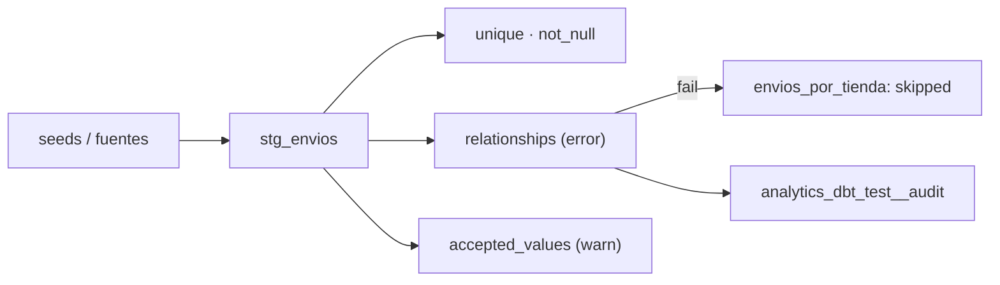

## 1. Resumen

En dbt, un **data test** es una consulta que devuelve las filas que fallan: si no devuelve ninguna, pasa (*Add data tests to your DAG*). Hay dos tipos:

- **genéricos**, que se declaran en YAML sobre una columna: dbt trae `unique`, `not_null`, `accepted_values` y `relationships`;
- **singulares**, un archivo `.sql` en `tests/` con la consulta exacta.

Tres configuraciones los vuelven útiles en producción:

- **`severity`**, **`warn_if`** y **`error_if`**: un test puede avisar en lugar de fallar, o fallar solo pasado un umbral (*severity, error_if, and warn_if*);
- **`store_failures`**: guarda las filas que fallan en una tabla para revisarlas (*store_failures*);
- **`dbt build`**: corre modelos y tests en orden, y si un test falla, salta lo que depende de ese modelo (*About dbt build command*).

## 2. Qué es

- **Test genérico:** una consulta parametrizada; se aplica por nombre en `data_tests` de una columna o un modelo.
- **Test singular:** un `SELECT` que devuelve las filas que fallan, en `tests/`.
- **Fallas:** el número de filas que devuelve el test.
- **`severity`:** `error` (por defecto) o `warn`.
- **`error_if` / `warn_if`:** condiciones sobre el número de fallas (por defecto `!= 0`).
- **`store_failures`:** las fallas quedan en el schema `<schema>_dbt_test__audit`.

## 3. Problema que resuelve

Un modelo de envíos se publica cada mañana. Un día llega un envío de una tienda que no existe en el maestro, y el `join` del mart lo descarta sin aviso: el total de envíos baja y nadie sabe por qué. Con un test `relationships` sobre `tienda_id`, `dbt build` falla en ese test, no construye el mart y deja la fila huérfana guardada para revisarla.

## 4. Cómo funciona

1. Los tests genéricos se declaran en `schema.yml`; los singulares, en `tests/`.
2. `dbt build` corre seeds, modelos y tests en el orden del grafo.
3. Cada test cuenta sus fallas. Con `severity: error`, dbt evalúa primero `error_if` y después `warn_if`; con `severity: warn`, solo avisa.
4. Un test que termina en `fail` hace que se salten (`skipped`) los modelos que dependen del modelo probado.
5. Con `store_failures`, cada test guarda sus filas en una tabla; la corrida siguiente la reemplaza.

## 5. Cuándo utilizarlo

- En todo proyecto de dbt: al menos `unique` y `not_null` en la clave de cada modelo.
- `relationships` donde un `join` podría descartar filas en silencio.
- `warn` para reglas que conviene vigilar sin detener la publicación.

## 6. Cuándo no utilizarlo

- Para reglas sobre datos que no pasan por dbt: van en la ingesta.
- Como única defensa de calidad de la fuente: el test detecta, no corrige.
- Tests que siempre avisan y nadie mira: se vuelven ruido.

## 7. Ejemplo sencillo

Cuatro envíos y dos tiendas. Un envío está `perdido` (estado no aceptado), uno tarda 9 días y uno apunta a la tienda 3, que no existe.

| Nodo | Configuración | Resultado |
|---|---|---|
| `unique_stg_envios_id`, `not_null_stg_envios_id` | error | `pass` |
| `accepted_values_…estado…` | `severity: warn` | `warn` (1 falla) |
| `envios_lentos` (singular) | `warn_if: >= 1`, `error_if: >= 3` | `warn` (1 falla) |
| `relationships_…tienda_id…` | error | `fail` (1 falla) |
| `envios_por_tienda` (mart) | depende de `stg_envios` | `skipped` |

## 8. Ejemplo de producción

Un proyecto de dbt de envíos:

- `unique` y `not_null` en la clave de cada modelo, con `error`;
- `relationships` hacia los maestros, con `error`;
- `accepted_values` en estados, con `warn`, y una alerta si el aviso se repite tres días;
- un test singular de tiempos de entrega con `warn_if` y `error_if`;
- `store_failures` a nivel de proyecto, con un schema de auditoría que lee el equipo de datos;
- `dbt build` en el orquestador: un fallo detiene lo que depende del modelo probado.

## 9. Arquitectura



## 10. Código

```python
# Python 3.12, dbt Core 1.12 y dbt-postgres 1.11 contra PostgreSQL 17 (ejecutado en la CI; ADR-018): data tests
# genéricos y singulares, severidad con warn_if y error_if, store_failures y el salto de lo que depende de un test fallido.
# PG_HOST, PG_PORT, PG_USER, PG_PASSWORD y PG_DB apuntan a una base vacía que el test crea y borra.
from __future__ import annotations

import os
import sys
import tempfile
from pathlib import Path

import psycopg
from dbt.artifacts.schemas.run import RunExecutionResult
from dbt.cli.main import dbtRunner

FILES = {
    "dbt_project.yml": """
name: envios
version: "1.0.0"
profile: envios
models:
  envios:
    +materialized: table
data_tests:
  envios:
    +store_failures: true
""",
    "profiles.yml": """
envios:
  target: ci
  outputs:
    ci:
      type: postgres
      host: "{{ env_var('PG_HOST') }}"
      port: "{{ env_var('PG_PORT') | int }}"
      user: "{{ env_var('PG_USER') }}"
      password: "{{ env_var('PG_PASSWORD') }}"
      dbname: "{{ env_var('PG_DB') }}"
      schema: analytics
      threads: 1
""",
    "seeds/raw_tiendas.csv": "id,nombre\n1,norte\n2,sur\n",
    "seeds/raw_envios.csv": "id,tienda_id,estado,dias\n1,1,entregado,2\n2,2,entregado,9\n3,1,perdido,3\n4,3,entregado,1\n",
    "models/stg_envios.sql": "select id, tienda_id, estado, dias from {{ ref('raw_envios') }}\n",
    "models/envios_por_tienda.sql": """
select t.nombre as tienda, count(*) as envios, avg(e.dias)::float as dias_promedio
from {{ ref('stg_envios') }} e join {{ ref('raw_tiendas') }} t on t.id = e.tienda_id
group by t.nombre
""",
    "models/schema.yml": """
version: 2
models:
  - name: stg_envios
    columns:
      - name: id
        data_tests: [unique, not_null]
      - name: estado
        data_tests:
          - accepted_values:
              arguments: {values: [entregado, en_camino]}
              config: {severity: warn}
      - name: tienda_id
        data_tests:
          - relationships:
              arguments: {to: "ref('raw_tiendas')", field: id}
""",
    "tests/envios_lentos.sql": """
{{ config(warn_if = '>= 1', error_if = '>= 3') }}
select * from {{ ref('stg_envios') }} where dias > 7
""",
}

project = Path(sys.argv[1] if len(sys.argv) > 1 else tempfile.mkdtemp())
for name, text in FILES.items():
    (project / name).parent.mkdir(parents=True, exist_ok=True)
    (project / name).write_text(text.lstrip("\n"), encoding="utf-8")

args = ["--project-dir", str(project), "--profiles-dir", str(project), "--quiet"]
result = dbtRunner().invoke(["build", *args])
assert isinstance(result.result, RunExecutionResult), result.exception
print(f"build ok: {result.success}")
for r in sorted(result.result.results, key=lambda r: r.node.name):
    if str(r.node.resource_type) in ("model", "test"):
        fallas = "" if r.failures is None else f" ({r.failures} fallas)"
        print(f"  {r.node.name}: {r.status}{fallas}")

with psycopg.connect(host=os.environ["PG_HOST"], port=os.environ["PG_PORT"], user=os.environ["PG_USER"],
                     password=os.environ["PG_PASSWORD"], dbname=os.environ["PG_DB"]) as conn:
    audit = conn.execute("SELECT table_name FROM information_schema.tables "
                         "WHERE table_schema = 'analytics_dbt_test__audit' ORDER BY table_name").fetchall()
    huerfanos = conn.execute("SELECT * FROM analytics_dbt_test__audit."
                             "relationships_stg_envios_tienda_id__id__ref_raw_tiendas_").fetchall()
print("tablas de fallas:", len(audit))
print("filas huérfanas guardadas:", huerfanos)
```

El script se **ejecuta en la CI con dbt Core 1.12 y dbt-postgres 1.11 contra el servicio postgres:17** (ADR-018), en una base vacía que el test crea y borra, y pasa `mypy --strict`. Imprime `build ok: False` y el estado de cada nodo: `relationships_stg_envios_tienda_id__id__ref_raw_tiendas_: fail (1 fallas)`, `envios_por_tienda: skipped`, `accepted_values_…: warn (1 fallas)`, `envios_lentos: warn (1 fallas)`. Después muestra que se guardaron 5 tablas de fallas y que la fila huérfana es la de `tienda_id` 3.

## 11. GCP

En GCP, **Dataform** prueba con assertions. Según *Add data tests to your DAG*, *About dbt build command* y *Test data quality* (no ejecutado):

| | dbt | Dataform |
|---|---|---|
| Qué es un test | Una consulta que devuelve las filas que fallan | Igual: una assertion falla si la consulta devuelve filas |
| Incorporados | `unique`, `not_null`, `accepted_values`, `relationships` | `nonNull`, `rowConditions`, `uniqueKey`, `uniqueKeys` en el config de la tabla |
| Propios | Tests singulares en `tests/` | Assertions manuales en un SQLX con `type: assertion` |
| Dónde quedan las fallas | Con `store_failures`, en `<schema>_dbt_test__audit` | Vistas en el schema de assertions (por defecto `dataform_assertions`); resultados en el scorecard de Knowledge Catalog |
| Bloquear lo que depende | `dbt build` salta los dependientes | Se declara: ver `dataform-assertions` |

## 12. AWS

En AWS, **AWS Glue Data Quality**. Según *Add data tests to your DAG* y *Data Quality Definition Language (DQDL) reference* (no ejecutado):

| | dbt | AWS Glue Data Quality |
|---|---|---|
| Lenguaje | SQL y YAML en el proyecto | Rulesets DQDL (`IsComplete`, `IsUnique`, `ReferentialIntegrity`, `CustomSQL`…) |
| Dónde corre | En el warehouse, como parte de `dbt build` | En ETL jobs de Glue o sobre tablas del Data Catalog |

## 13. Azure

En Azure, **Microsoft Purview Unified Catalog**. Según *Add data tests to your DAG* y *Create data quality rules* (no ejecutado):

| | dbt | Microsoft Purview |
|---|---|---|
| Reglas | Tests en el proyecto, versionados con el código | Reglas incorporadas (Unique values, Empty/blank fields, Table lookup…) y Custom, en el catálogo |
| Efecto | `dbt build` salta los dependientes | Las páginas citadas no describen bloquear un pipeline |

## 14. Buenas prácticas

- `unique` y `not_null` en la clave de cada modelo.
- `relationships` donde un `join` puede perder filas.
- Severidad explícita: qué bloquea y qué avisa.
- `store_failures` para poder ver las filas, no solo el número.
- **Seguridad:** las tablas de fallas copian filas reales; el schema de auditoría tiene los mismos permisos que los datos.
- **Observabilidad:** guardar `run_results` de cada corrida y contar `warn` por test a lo largo del tiempo.
- **Costo:** cada test es una consulta al warehouse; en tablas grandes, un `where` (configuración de dbt) limita lo que lee.

## 15. Errores frecuentes

- Todos los tests en `warn`: nada bloquea.
- Un `relationships` faltante que deja al `join` perder filas sin aviso.
- Leer `success` de la corrida y no el estado de cada test.
- Esperar que `store_failures` conserve el historial: cada corrida reemplaza la tabla del test.

## 16. Trade-offs

Más tests detectan más y alargan cada `build`. `error` protege a los consumidores y detiene la publicación; `warn` publica y obliga a mirar los avisos. Guardar fallas facilita el diagnóstico y copia datos a otro schema.

## 17. Conceptos relacionados

- `dbt-core-concepts`: el proyecto, `ref()` y `dbt build`.
- `sql-quality-checks`: reglas en SQL.
- `quality-gate`: bloquear o publicar.
- `custom-data-validators`: umbrales y severidades fuera de dbt.
- `data-quality-dimensions`: qué mide cada test.
- `dataform-workflows`: el workflow de Dataform.
- `dataform-assertions`: las assertions de Dataform.

## 18. Preguntas técnicas abiertas

1. ¿Qué modelos de tu proyecto no tienen test en su clave?
2. ¿Qué tests deberían avisar en lugar de bloquear?
3. ¿Dónde quedan hoy las filas que fallan?

## 19. Laboratorio relacionado

Pendiente (F4).

## 20. Fuentes

- dbt: *Add data tests to your DAG*, *About dbt build command*, *severity, error_if, and warn_if* y *store_failures*.
- Google Cloud: *Test data quality* (Dataform).
- AWS: *Data Quality Definition Language (DQDL) reference*.
- Microsoft Learn: *Create data quality rules*.

El detalle de cada fuente está en `sources` del frontmatter.

## 21. Fecha de última verificación

2026-10-20. Pasa a `verified`: revisión B-F3.1 del lote F3b-15b sin hallazgos, sin VERIFY pendientes.

## 22. Historial de cambios importantes

- 2026-10-20: creación (lote F3b-15b).
- 2026-10-20: revisión B-F3.1 del lote F3b-15b (docs/reviews/cards-f3b-15b.md), sin hallazgos que corregir.
- 2026-10-20: `verification_status: verified` (sin VERIFY pendientes).
