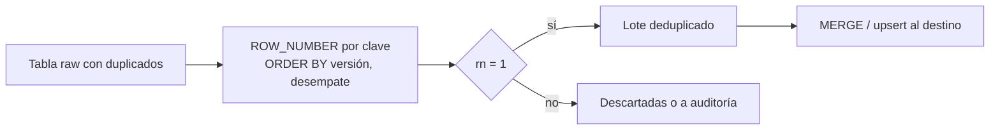

## 1. Resumen

Deduplicar es quedarse con **una fila por clave de negocio**. El patrón SQL estándar numera las filas de cada clave con `ROW_NUMBER() OVER (PARTITION BY clave ORDER BY criterio)` y conserva la número 1. Lo importante no es la sintaxis sino dos decisiones: qué define "la misma entidad" (la clave) y cuál de las copias gana (el orden, que debe ser determinista).

## 2. Qué es

Es un patrón consolidado de SQL analítico, no una característica de un producto. Existen dos tipos de duplicado:

- **Duplicado exacto:** filas idénticas en todas las columnas (por ejemplo, un archivo cargado dos veces). Se resuelve con `SELECT DISTINCT` o con el mismo patrón por un hash de la fila.
- **Duplicado por clave:** varias versiones de la misma entidad (un cliente con dos correos en el mismo lote). Hay que elegir cuál conservar: la más reciente, la de mayor versión, la de la fuente más confiable.

## 3. Problema que resuelve

Los duplicados aparecen por diseño en casi todo pipeline: reintentos que repiten una carga, mensajería con entrega *at-least-once*, extracciones con solapamiento para no perder datos tardíos, o una fuente que emite varias versiones de un registro. Sin deduplicar, las métricas se inflan y los `MERGE` fallan: en BigQuery, Redshift y T-SQL, un `MERGE` cuyo origen trae varias filas para una misma fila del destino termina en error.

## 4. Cómo funciona

1. **Definir la clave de negocio:** las columnas que identifican a la entidad (`cliente_id`, o `pedido_id` + `linea`).
2. **Definir el criterio de desempate:** qué copia gana. Debe ser **total**: si dos filas empatan en el `ORDER BY`, `ROW_NUMBER` elige una de forma no determinista (lo dicen las documentaciones de BigQuery y de T-SQL), y dos ejecuciones pueden conservar filas distintas. Se agrega una columna de desempate (`ingested_at`, un identificador de mensaje).
3. **Numerar:** `ROW_NUMBER() OVER (PARTITION BY clave ORDER BY criterio DESC, desempate DESC)`.
4. **Filtrar la fila 1:** con `QUALIFY` donde existe (BigQuery, Redshift) o con una subconsulta o CTE y `WHERE rn = 1` (T-SQL y cualquier motor).

## 5. Cuándo utilizarlo

- Antes de un `MERGE` o upsert: el origen debe traer una fila por clave.
- En la capa *staging* o *silver*, al consolidar cargas que pueden repetirse o solaparse.
- Al consumir mensajería con entrega al menos una vez (Pub/Sub, SQS estándar, Event Hubs).
- Para construir "la última versión" de una entidad a partir de un historial de cambios (CDC).

## 6. Cuándo no utilizarlo

- Cuando las filas repetidas son **hechos legítimos**: dos compras idénticas del mismo cliente en el mismo minuto no son un duplicado. Sin una clave del evento, deduplicar borra datos reales.
- Cuando hay que conservar la historia de versiones: SCD tipo 2 o una tabla de cambios, no deduplicar.
- Como sustituto de corregir la causa: si una carga se repite por un error de orquestación, conviene también hacerla idempotente.

## 7. Ejemplo sencillo

Lote con dos versiones del cliente 42; se conserva la de mayor `version`:

| cliente_id | email | version | ¿se conserva? |
|---|---|---|---|
| 42 | ana@viejo.cl | 3 | no |
| 42 | ana@nuevo.cl | 5 | sí |
| 77 | luis@x.cl | 1 | sí |

## 8. Ejemplo de producción

Un consumidor de Pub/Sub escribe eventos de pedidos en una tabla *raw* de BigQuery. Por la entrega at-least-once y los reintentos, un mismo evento puede aparecer varias veces. Cada hora, un modelo toma la ventana de las últimas horas (con margen para eventos tardíos), deduplica por `event_id` con desempate por `publish_time` y aplica el resultado con `MERGE` a la tabla de pedidos. Un control cuenta duplicados por clave en el destino y alerta si es mayor que cero.

## 9. Arquitectura



## 10. Código

```sql
-- BigQuery: deja la versión más reciente de cada cliente; ingested_at desempata
-- para que el resultado sea determinista. QUALIFY filtra por el resultado de la ventana.
SELECT cliente_id, email, version, ingested_at
FROM `proyecto.staging.clientes`
WHERE TRUE
QUALIFY ROW_NUMBER() OVER (
  PARTITION BY cliente_id
  ORDER BY version DESC, ingested_at DESC
) = 1;
```

```sql
-- T-SQL (Synapse dedicated SQL pool, Fabric Warehouse) y cualquier motor sin QUALIFY:
-- el mismo patrón con una CTE.
WITH numeradas AS (
  SELECT cliente_id, email, version, ingested_at,
         ROW_NUMBER() OVER (PARTITION BY cliente_id ORDER BY version DESC, ingested_at DESC) AS rn
  FROM staging.clientes
)
SELECT cliente_id, email, version, ingested_at
FROM numeradas
WHERE rn = 1;
```

El snippet `bigquery-deduplicate-latest` combina este filtro con un `MERGE` condicionado a la versión.

## 11. GCP

En **BigQuery**, `QUALIFY` filtra directamente el resultado de `ROW_NUMBER` sin subconsulta. La documentación advierte que `ROW_NUMBER` es no determinista entre empates y sin `ORDER BY`, así que el desempate es responsabilidad de quien escribe la consulta. Es habitual deduplicar dentro del `USING` de un `MERGE`, porque `MERGE` falla si el origen trae varias filas por fila destino.

## 12. AWS

**Redshift** también admite `QUALIFY`. A diferencia de BigQuery, si `QUALIFY` va justo después del `FROM`, la tabla del `FROM` debe tener alias. Su `MERGE` también falla con varias filas de origen por fila destino, así que la deduplicación previa es igual de necesaria. El modo `REMOVE DUPLICATES` de `MERGE` no deduplica el origen: actúa sobre duplicados del destino.

## 13. Azure

En **T-SQL** (Synapse dedicated SQL pool, Fabric Warehouse) no se usa `QUALIFY`: el patrón se escribe con una CTE o subconsulta y `WHERE rn = 1`, como en el segundo bloque de la sección 10. La documentación de `ROW_NUMBER()` lo declara no determinista, con la misma consecuencia: hace falta un desempate único.

## 14. Buenas prácticas

- Hacer el `ORDER BY` total: agregar una columna de desempate única.
- Usar como criterio una versión o timestamp **del origen**, no la hora de carga, cuando representa "la más nueva".
- Deduplicar lo más temprano posible (staging) y medir: contar filas descartadas por ejecución.
- Limitar la ventana deduplicada a las particiones afectadas (con margen para tardíos) para no releer toda la tabla.
- **Seguridad:** las filas descartadas pueden contener datos personales; si se guardan para auditoría, aplicarles la misma retención y acceso que a la tabla principal.
- **Observabilidad:** registrar por ejecución cuántas filas se descartaron como duplicadas y alertar si la proporción cambia bruscamente; un control posterior debe contar cero duplicados por clave en el destino.
- **Costo:** la función de ventana ordena por partición; filtrar por fecha antes de numerar reduce bytes procesados y memoria.

## 15. Errores frecuentes

- `ORDER BY` con empates: dos ejecuciones conservan filas distintas y los resultados "cambian solos".
- Deduplicar por todas las columnas cuando el duplicado real es por clave (versiones con distinto timestamp de carga sobreviven).
- Usar `DISTINCT` sobre columnas que incluyen la hora de carga: nunca encuentra duplicados.
- Deduplicar solo el lote nuevo y no contra lo ya cargado: el duplicado entre lotes pasa (lo resuelve el `MERGE` por clave).
- Confundir duplicados con hechos repetidos legítimos.

## 16. Trade-offs

`ROW_NUMBER` permite elegir con precisión qué copia gana, a cambio de ordenar los datos de cada clave. `DISTINCT` es más simple pero solo sirve para duplicados exactos. Deduplicar en lectura (vista) mantiene los datos crudos pero repite el costo en cada consulta; materializar el resultado paga una vez y fija la decisión.

## 17. Conceptos relacionados

- `upsert` y `sql-merge`: el paso siguiente a deduplicar el lote.
- `idempotency`: deduplicar por clave hace repetibles las cargas.
- `pubsub-delivery-semantics`: una fuente típica de duplicados.
- Del blueprint, pendiente de ficha: `sql-window-functions`.

## 18. Preguntas técnicas abiertas

1. Si la fuente no expone versión ni timestamp de modificación, ¿qué criterio usarías para elegir la copia ganadora y qué riesgo asumes?
2. ¿Cómo distinguirías un duplicado técnico de dos eventos de negocio idénticos?
3. ¿Qué margen de ventana usarías para deduplicar eventos tardíos sin releer toda la tabla?

## 19. Laboratorio relacionado

Pendiente (F4).

## 20. Fuentes

- Google Cloud: *Numbering functions*, *Query syntax* y *DML statements* (BigQuery).
- AWS: *QUALIFY clause* y *MERGE* (Amazon Redshift).
- Microsoft Learn: *ROW_NUMBER (Transact-SQL)*.

El detalle de cada fuente está en `sources` del frontmatter.

## 21. Fecha de última verificación

2026-10-02. En `review_required` hasta la revisión B-F3.1 del lote 5.

## 22. Historial de cambios importantes

- 2026-10-02: creación (lote 5 de F3).
- 2026-10-04: revisión B-F3.1 del lote 5 aplicada (docs/reviews/cards-lote5.md): viñeta de Observabilidad en §14.
