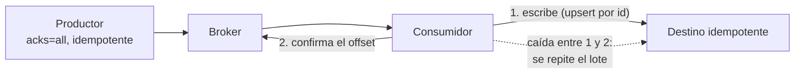

## 1. Resumen

La documentación de Kafka define tres garantías:

- **at-most-once:** «Messages may be lost but are never redelivered»;
- **at-least-once:** «Messages are never lost but may be redelivered»;
- **exactly-once:** cada mensaje se procesa una sola vez, con un alcance que hay que leer con cuidado (no es parte de esta ficha).

Del lado del consumidor, la diferencia entre las dos primeras es el orden de dos pasos: guardar la posición antes de procesar es at-most-once; procesar antes de guardarla es at-least-once. Del lado del productor, cuenta cuántos acuses pide (`acks`) y si es idempotente.

La opción habitual en Data Engineering es **at-least-once con un destino idempotente**: no se pierde nada y los repetidos no duplican.

## 2. Qué es

- **At-most-once:** confirmar y después procesar; una caída en el medio pierde eventos.
- **At-least-once:** procesar y después confirmar; una caída en el medio repite eventos.
- **`acks`:** `0` no espera acuse, `1` espera al líder, `all` espera a todas las réplicas sincronizadas (valor por defecto).
- **Productor idempotente:** `enable.idempotence`, que evita que los reintentos del productor dupliquen en el log.
- **Destino idempotente:** escribir de forma que aplicar dos veces el mismo evento dé el mismo resultado (upsert por id).

## 3. Problema que resuelve

Un consumidor carga ventas y se cae a mitad de un lote. Si había confirmado antes de escribir, las ventas que no llegó a escribir se pierden y nadie lo nota. Si confirma después, al volver repite las que ya había escrito. Elegir la semántica, y hacer idempotente el destino, decide cuál de los dos problemas se acepta y cómo se neutraliza.

## 4. Cómo funciona

1. El productor escribe con `acks=all` y es idempotente: el broker no pierde ni duplica por reintentos del productor.
2. El consumidor lee un lote desde su offset.
3. **At-least-once:** escribe el lote en el destino y después confirma el offset.
4. Si se cae entre escribir y confirmar, al volver lee de nuevo el mismo lote.
5. El destino hace upsert por id del evento, y repetir no duplica.

## 5. Cuándo utilizarlo

- **At-least-once:** casi siempre en pipelines de datos, con un destino idempotente.
- **At-most-once:** cuando perder algún evento es aceptable y repetir no lo es, como métricas de muestreo.

## 6. Cuándo no utilizarlo

- At-most-once para datos de negocio: la pérdida no deja rastro.
- At-least-once con un destino que solo agrega filas: cada reintento duplica.
- `enable.auto.commit` con procesamiento asíncrono: se puede confirmar lo que todavía no se escribió.

## 7. Ejemplo sencillo

Seis ventas en una partición y un consumidor que se cae tras procesar dos del primer lote de tres. Con at-most-once, `venta-3` se pierde. Con at-least-once, `venta-1` y `venta-2` se procesan dos veces. Con at-least-once y un sink que hace upsert por id, quedan seis filas para seis ventas.

## 8. Ejemplo de producción

La ingesta de pagos a BigQuery:

- productor con `acks=all` e idempotencia (los valores por defecto);
- consumidor con `enable.auto.commit=false` que confirma el offset después de escribir cada lote;
- escritura con `MERGE` por id del pago;
- los eventos que no se pueden procesar van a una dead-letter queue en lugar de frenar la partición.

## 9. Arquitectura



## 10. Código

```python
# Python 3.12, solo biblioteca estándar (ejecutado en la CI; mypy --strict sin errores; simulación sin broker): un
# consumidor que se cae a mitad de un lote, con las dos órdenes que describe Kafka. Confirmar el offset antes de procesar
# pierde eventos (at-most-once); procesar antes de confirmar los repite (at-least-once). Un sink idempotente por id
# absorbe los repetidos.
from __future__ import annotations

from dataclasses import dataclass, field

EVENTS = [f"venta-{i}" for i in range(1, 7)]   # el log de una partición: offsets 0 a 5


@dataclass
class Run:
    committed: int = 0                                     # offset confirmado: el próximo a leer
    processed: list[str] = field(default_factory=list)     # lo que llegó al sink, con repetidos


def consume(run: Run, commit_first: bool, crash_after: int | None, batch: int = 3) -> None:
    """Lee lotes desde el offset confirmado; con crash_after, se cae tras procesar o confirmar esa cantidad del lote."""
    while run.committed < len(EVENTS):
        chunk = EVENTS[run.committed : run.committed + batch]
        if commit_first:
            run.committed += len(chunk)                     # confirma y después procesa
            if crash_after is not None:
                run.processed.extend(chunk[:crash_after])   # se cae: el resto del lote nunca se procesa
                return
            run.processed.extend(chunk)
        else:
            if crash_after is not None:
                run.processed.extend(chunk[:crash_after])   # procesa una parte y se cae antes de confirmar
                return
            run.processed.extend(chunk)                     # procesa y después confirma
            run.committed += len(chunk)


def simulate(commit_first: bool) -> Run:
    run = Run()
    consume(run, commit_first, crash_after=2)   # primera corrida: se cae en el primer lote
    consume(run, commit_first, crash_after=None)   # el reemplazo retoma desde el offset confirmado
    return run


for name, commit_first in (("at-most-once", True), ("at-least-once", False)):
    run = simulate(commit_first)
    lost = sorted(set(EVENTS) - set(run.processed))
    dups = len(run.processed) - len(set(run.processed))
    print(f"{name}: procesados {len(run.processed)}, perdidos {lost}, repetidos {dups}")

sink: dict[str, str] = {}
for event_id in simulate(commit_first=False).processed:
    sink[event_id] = "ok"                                   # upsert por id: repetir no duplica
print(f"at-least-once con sink idempotente: {len(sink)} filas para {len(EVENTS)} eventos")
```

El script es una **simulación en Python de biblioteca estándar, sin broker**, y se **ejecuta en la CI** (pasa `mypy --strict`). Reproduce las dos órdenes que describe *Design*. Imprime `at-most-once: procesados 5, perdidos ['venta-3'], repetidos 0`, `at-least-once: procesados 8, perdidos [], repetidos 2` y `at-least-once con sink idempotente: 6 filas para 6 eventos`. Con un broker real, el orden de escribir y confirmar es el mismo; los ejemplos de Kafka en Docker están en `offsets` y `producers-and-consumers`.

## 11. GCP

En GCP, **Pub/Sub** entrega al menos una vez por defecto. Según *Subscription overview* y *Class Message* (no ejecutado):

| | Kafka | Pub/Sub |
|---|---|---|
| Por defecto | Depende de cuándo confirme el consumidor | Al menos una vez (at-least-once) en todos los tipos de suscripción |
| Confirmación | Offset por partición | `ack()` por mensaje, después de procesar; como los acks son best effort, el procesamiento debe ser idempotente |

## 12. AWS

En AWS, **Kinesis Data Streams** puede entregar un registro más de una vez. Según *Handle duplicate records* (no ejecutado):

| | Kafka | Kinesis Data Streams |
|---|---|---|
| Repetidos del productor | El productor idempotente los evita en el log | Reintentos del productor (por ejemplo, un timeout antes del acuse) pueden duplicar |
| Repetidos del consumidor | Al volver desde el offset confirmado | Procesadores que se reinician al reasignar shards; la aplicación debe prever procesar un registro varias veces |

## 13. Azure

En Azure, **Event Hubs** deja el checkpoint al consumidor. Según *Event Hubs features and terminology* (no ejecutado):

| | Kafka | Event Hubs |
|---|---|---|
| Quién guarda la posición | Kafka, por grupo | El consumidor, con su checkpoint (por ejemplo, en Blob Storage) |
| Qué decide la semántica | Confirmar antes o después de procesar | Lo mismo: hacer el checkpoint antes o después de procesar |

## 14. Buenas prácticas

- At-least-once con un destino idempotente como punto de partida.
- Confirmar el offset (o hacer el checkpoint) después de escribir en el destino.
- `acks=all` y productor idempotente.
- **Seguridad:** el id del evento, que hace idempotente al destino, no debe ser un dato sensible.
- **Observabilidad:** contar repetidos absorbidos por el destino; un aumento delata reintentos o caídas.
- **Costo:** los repetidos se pagan en procesamiento y en escrituras; un upsert cuesta más que un append.

## 15. Errores frecuentes

- Confirmar antes de escribir y perder eventos en silencio.
- Un destino append-only con at-least-once.
- Creer que `acks=all` evita los repetidos del consumidor: cubre el lado del productor.
- Confiar en `enable.auto.commit` sin saber cuándo confirma.

## 16. Trade-offs

At-most-once es simple y no repite, a cambio de perder. At-least-once no pierde, a cambio de repetidos que el destino debe absorber. Confirmar con más frecuencia reduce lo que se repite y agrega escrituras. Un destino idempotente cuesta diseño y escrituras más caras, y es lo que vuelve seguro reintentar.

## 17. Conceptos relacionados

- `idempotency`: el destino que absorbe repetidos.
- `retries`: de dónde salen los repetidos.
- `offsets`: cuándo se confirma.
- `pubsub-delivery-semantics`: la semántica de Pub/Sub.
- `dead-letter-queue`: lo que no se puede procesar.
- `streaming-ingestion`: dónde se elige la semántica.
- `producers-and-consumers`: el productor y el consumidor de cada lado.

## 18. Preguntas técnicas abiertas

1. ¿Tu consumidor confirma antes o después de escribir en el destino?
2. ¿Qué pasa en tu destino si recibe el mismo evento dos veces?
3. ¿Cuántos repetidos absorbe hoy tu pipeline y lo sabes?

## 19. Laboratorio relacionado

Pendiente (F4).

## 20. Fuentes

- Apache Kafka 4.3: *Design*, *Producer Configs* y *Consumer and Share Consumer Configs*.
- Google Cloud: *Subscription overview* y *Class Message*.
- AWS: *Handle duplicate records*.
- Microsoft Learn: *Event Hubs features and terminology*.

El detalle de cada fuente está en `sources` del frontmatter.

## 21. Fecha de última verificación

2026-10-20. Pasa a `verified`: revisión B-F3.1 del lote F3b-14a aplicada, sin VERIFY pendientes.

## 22. Historial de cambios importantes

- 2026-10-19: creación (lote F3b-14a).
- 2026-10-20: revisión B-F3.1 del lote F3b-14a aplicada (docs/reviews/cards-f3b-14a.md): la cita de la referencia de Pub/Sub dice *Class Message*, sin la versión del cliente.
- 2026-10-20: `verification_status: verified` (sin VERIFY pendientes).
