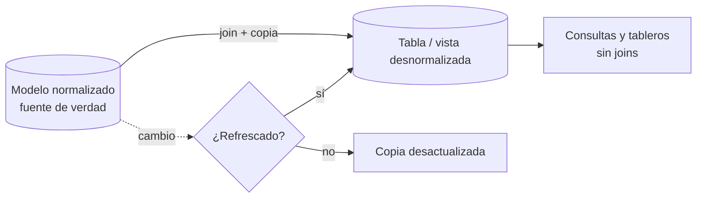

## 1. Resumen

Desnormalizar es **repetir datos a propósito**: copiar a una tabla los atributos que de otro modo se leerían con un join. En sistemas transaccionales casi nunca conviene, porque cada dato repetido es una actualización más que puede fallar. En analítica es la norma: dimensiones aplanadas en un modelo estrella, tablas o vistas para lectura y campos anidados en BigQuery. La desnormalización compra lecturas más simples y rápidas, y paga con redundancia, más almacenamiento y copias que hay que refrescar.

## 2. Qué es

Es la operación inversa de normalizar. Formas habituales:

- **Dimensión aplanada:**
  - la jerarquía producto → subcategoría → categoría como columnas de una sola tabla;
  - Kimball la recomienda para el modelado dimensional.
- **Tabla o vista materializada para lectura:** el resultado de joins frecuentes guardado como tabla, que se refresca.
- **Campos anidados y repetidos (BigQuery):**
  - las líneas de un pedido como un arreglo dentro de la fila del pedido;
  - BigQuery lo describe como la forma recomendada de desnormalizar.
- **One Big Table:** toda la estrella en una sola tabla (ver `one-big-table`).

## 3. Problema que resuelve

Un modelo normalizado obliga a hacer muchos joins para responder preguntas analíticas simples, como ventas por región y categoría. Esos joins cuestan en el motor y complican cada consulta. Según la documentación:

- en BigQuery los joins requieren coordinación entre slots, y desnormalizar localiza los datos para ejecutar en paralelo;
- en Azure Databricks, tener más campos en una sola tabla permite saltar datos con estadísticas de archivo.

## 4. Cómo funciona

1. Se identifican las consultas frecuentes y los joins que repiten.
2. Se elige la forma:
   - aplanar una dimensión;
   - materializar un resultado;
   - anidar una relación padre-hijo (en BigQuery);
   - construir una tabla ancha.
3. Se define cómo se mantiene la copia: reconstrucción completa, refresco de una vista materializada o carga incremental.
4. La fuente de verdad sigue siendo el modelo normalizado o la dimensión de origen. Un cambio allí, como la región de un cliente, no llega a la copia hasta que se refresca.
5. Se acepta el costo: más almacenamiento y más trabajo al escribir o refrescar.

## 5. Cuándo utilizarlo

- En modelos analíticos: dimensiones de un esquema estrella, tablas para tableros, datasets para modelos de ML.
- Cuando una relación padre-hijo se consulta casi siempre junta (pedido y sus líneas), en motores que soportan anidamiento.
- Cuando el costo de los joins domina en las consultas frecuentes.

## 6. Cuándo no utilizarlo

- En sistemas transaccionales con muchas escrituras: cada dato repetido multiplica las actualizaciones y las anomalías (ver `normalization`).
- Cuando los atributos cambian a menudo y la copia tendría que refrescarse constantemente.
- Cuando no hay forma de refrescar la copia de manera confiable: una tabla desnormalizada desactualizada responde con datos viejos sin avisar.

## 7. Ejemplo sencillo

Una dimensión de producto aplanada guarda `categoria` en cada producto. «Ventas por categoría» necesita un join en lugar de tres. El nombre de cada categoría se repite en todos sus productos.

## 8. Ejemplo de producción

El warehouse de un e-commerce mantiene el modelo de pedidos normalizado en la capa de integración. Para análisis:

- publica una dimensión de cliente aplanada (región, segmento, canal);
- en BigQuery, una tabla de pedidos con las líneas como campo repetido.

Ambas se reconstruyen cada noche desde la capa normalizada. Un chequeo compara conteos y montos entre las dos. Cuando un cliente cambia de región, el cambio aparece en la vista analítica después de la carga nocturna, y el equipo lo documenta como latencia aceptada.

## 9. Arquitectura



## 10. Código

```sql
-- PostgreSQL 17 (ejecutado): de un modelo normalizado a una copia desnormalizada para lectura,
-- y el costo que trae: la copia queda desactualizada hasta que se refresca.
CREATE TABLE cliente (cliente_id integer PRIMARY KEY, nombre text NOT NULL, region text NOT NULL);
CREATE TABLE pedido  (pedido_id integer PRIMARY KEY, cliente_id integer NOT NULL REFERENCES cliente, fecha date NOT NULL);
CREATE TABLE linea   (pedido_id integer REFERENCES pedido, nro smallint, producto text NOT NULL, monto numeric(10,2) NOT NULL,
                      PRIMARY KEY (pedido_id, nro));

INSERT INTO cliente VALUES (1, 'Ana', 'Norte'), (2, 'Beto', 'Sur');
INSERT INTO pedido  VALUES (10, 1, '2026-10-07'), (11, 2, '2026-10-07');
INSERT INTO linea   VALUES (10, 1, 'P1', 100), (10, 2, 'P2', 50), (11, 1, 'P1', 40);

-- Desnormalizado: una fila por línea con los atributos del cliente repetidos; la consulta ya no necesita joins.
CREATE MATERIALIZED VIEW ventas_planas AS
SELECT l.pedido_id, l.nro, p.fecha, c.nombre AS cliente, c.region, l.producto, l.monto
FROM linea l JOIN pedido p USING (pedido_id) JOIN cliente c USING (cliente_id);

SELECT region, sum(monto) FROM ventas_planas GROUP BY region ORDER BY region;
-- Norte | 150.00
-- Sur   |  40.00

UPDATE cliente SET region = 'Centro' WHERE cliente_id = 1;   -- el dato cambia en el modelo normalizado
SELECT DISTINCT region FROM ventas_planas WHERE cliente = 'Ana';   -- Norte: la copia está desactualizada
REFRESH MATERIALIZED VIEW ventas_planas;                     -- hay que reconstruirla
SELECT DISTINCT region FROM ventas_planas WHERE cliente = 'Ana';   -- Centro

SELECT count(*) AS filas, count(DISTINCT region) AS regiones_distintas FROM ventas_planas;
-- 3 | 2: la región se repite en cada línea del mismo cliente
```

Ejecutado en PostgreSQL 17.11 local, en un esquema desechable. Después del `UPDATE`, la vista materializada sigue mostrando `Norte` hasta el `REFRESH`, y la región se repite en cada línea. Ese es el costo de la desnormalización. En BigQuery, la forma recomendada sería anidar las líneas como campo repetido dentro del pedido. Esta ficha no incluye ese DDL ni lo ejecuta (ver §11).

## 11. GCP

En **BigQuery**, la documentación recomienda desnormalizar con **campos anidados y repetidos**, sobre todo en relaciones padre-hijo que se consultan juntas. Según la misma página:

- el mayor costo de almacenamiento compensa la ganancia de rendimiento;
- aplanar por completo puede obligar a agrupar con shuffle, por ejemplo por `order_id`. Por eso anidar suele ser mejor que una tabla completamente plana.

## 12. AWS

Esta ficha no cita una fuente de AWS específica sobre desnormalización. Para la distribución de tablas en Redshift, que influye en el costo de los joins, ver `physical-data-model`.

## 13. Azure

**Azure Databricks** recomienda no usar un modelo muy normalizado (3NF) en un lakehouse. Modelos estrella o copo de nieve rinden bien porque hay menos joins y menos claves que sincronizar, y más campos en una sola tabla permiten saltar datos con estadísticas de archivo. En **Power BI**, la guía de esquema estrella indica que, ante dimensiones copo de nieve, en general conviene combinarlas en una sola tabla de modelo desnormalizada.

## 14. Buenas prácticas

- Desnormalizar en la capa de consumo, manteniendo una fuente normalizada o una dimensión de origen como verdad.
- Definir y automatizar el refresco de cada copia, con su latencia documentada.
- Reconciliar conteos y montos entre la copia y la fuente después de cada refresco.
- Aplanar jerarquías de profundidad fija; evitar repetir atributos que cambian a cada rato.
- **Seguridad:** cada copia desnormalizada replica los datos sensibles de las tablas que une; aplicar los mismos permisos y enmascaramiento que en la fuente, o excluir esas columnas.
- **Observabilidad:** registrar la hora del último refresco de cada copia y alertar si se atrasa; una copia vieja no falla, solo responde mal.
- **Costo:** más almacenamiento y más cómputo de refresco, a cambio de consultas con menos joins; medir ambos lados antes de desnormalizar una tabla grande.

## 15. Errores frecuentes

- Desnormalizar en el sistema transaccional y sufrir anomalías de actualización.
- Copias sin proceso de refresco: datos viejos que nadie detecta.
- Aplanar en BigQuery una relación uno a muchos en lugar de anidarla, y luego agrupar con shuffle.
- Tratar la copia desnormalizada como fuente de verdad y actualizarla a mano.

## 16. Trade-offs

Lecturas más simples y rápidas, a cambio de redundancia, almacenamiento, refrescos y riesgo de inconsistencia. En motores analíticos modernos la balanza suele favorecer desnormalizar para consumo, como dicen BigQuery y Azure Databricks. En sistemas con muchas escrituras, la normalización sigue ganando.

## 17. Conceptos relacionados

- `normalization`: el punto de partida.
- `star-schema` y `snowflake-schema`: dimensiones aplanadas o normalizadas.
- `one-big-table`: la desnormalización completa.
- `materialization-strategies`: cómo se mantienen las copias.
- `oltp-vs-olap`: por qué cada mundo elige distinto.

## 18. Preguntas técnicas abiertas

1. ¿Qué atributo desnormalizado de tu warehouse cambia tan seguido que la copia casi siempre está desactualizada?
2. ¿Anidarías o aplanarías las líneas de un pedido en tu motor, y por qué?
3. ¿Cómo comprobarías que una tabla desnormalizada sigue cuadrando con su fuente?

## 19. Laboratorio relacionado

Pendiente (F4).

## 20. Fuentes

- Google Cloud: *Use nested and repeated fields* (BigQuery).
- Microsoft Learn: *Data modeling* (Azure Databricks) y *Understand star schema and the importance for Power BI*.
- Kimball Group: *Denormalized Flattened Dimensions* (Nivel 4, conceptual).
- PostgreSQL 17: *CREATE MATERIALIZED VIEW*.

El detalle de cada fuente está en `sources` del frontmatter.

## 21. Fecha de última verificación

2026-10-11. Pasa a `verified`: revisión B-F3.1 del lote F3b-04a aplicada, sin VERIFY pendientes.

## 22. Historial de cambios importantes

- 2026-10-10: creación (lote F3b-04a).
- 2026-10-11: revisión B-F3.1 del lote F3b-04a aplicada (docs/reviews/cards-f3b-04a.md): filas aprobadas sin cambios en esta ficha.
- 2026-10-11: `verification_status: verified` (sin VERIFY pendientes).
- 2026-10-13: `page_title` en cada cita, con el título de la página citada (ADR-012); sin cambios de contenido.
