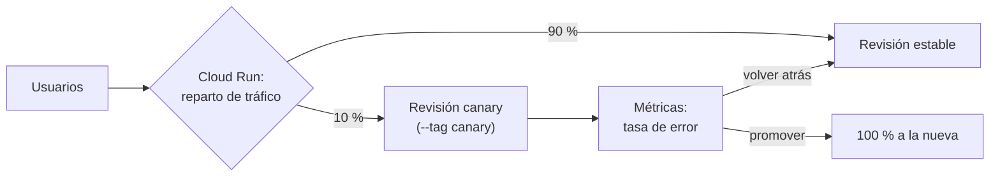

## 1. Resumen

Una estrategia de despliegue decide cómo llega una versión nueva a producción. Cloud Deploy la define como una técnica para desplegar cambios minimizando el impacto en los usuarios. Las que aparecen en las páginas citadas:

- **estándar (todo a la vez):** reemplaza la versión sin progresión;
- **canary:** una parte del tráfico va a la versión nueva antes de pasar todo;
- **rolling:** se actualizan las instancias de a grupos;
- **blue/green:** la versión nueva se instala aparte y el tráfico se redirige a ella.

Para datos importa un límite: el canary reparte **tráfico**. Cloud Deploy lo soporta en Cloud Run para servicios y worker pools, **no para jobs**. Un job de carga batch no tiene tráfico que repartir.

## 2. Qué es

| Estrategia | Qué hace (según las páginas) | Dónde aparece |
|---|---|---|
| Estándar / runOnce / AllAtOnce | Despliega sin progresión | Cloud Deploy, Azure Pipelines, CodeDeploy |
| Canary | Un subconjunto del tráfico primero, después todo | Cloud Deploy, Cloud Run, CodeDeploy, Azure Pipelines |
| Lineal | Un porcentaje cada tantos minutos | CodeDeploy (Lambda y ECS) |
| Rolling | Instancias actualizadas de a grupos | CodeDeploy (in-place), Azure Pipelines |
| Blue/green | Versión nueva en reemplazo, tráfico redirigido | CodeDeploy |

## 3. Problema que resuelve

Desplegar todo de una vez hace que un error llegue a todos los usuarios al mismo tiempo. Una API de datos que empieza a devolver respuestas malas, o un consumidor de eventos que descarta mensajes, rompe a todos sus clientes. Una estrategia progresiva limita el daño a una parte del tráfico y da tiempo para medir antes de seguir.

## 4. Cómo funciona

Canary en Cloud Run, con los comandos de su página:

1. `gcloud run deploy … --no-traffic --tag canary`: la revisión nueva queda desplegada sin tráfico, con una URL propia para probarla.
2. `gcloud run services update-traffic … --to-tags canary=10`: recibe el 10 % del tráfico.
3. Se comparan las métricas del canary con las de la versión estable.
4. Si van bien, se le pasa el resto; si no, el tráfico vuelve a la revisión anterior.

En CodeDeploy, una configuración predefinida hace los pasos 2 a 4 por porcentaje y tiempo (por ejemplo, 10 % y el resto cinco minutos después).

## 5. Cuándo utilizarlo

- **Canary o lineal:** APIs y servicios con tráfico suficiente para medir.
- **Blue/green:** cuando conviene tener la versión anterior entera lista para volver.
- **Estándar:** jobs batch, que no reciben tráfico; servicios internos de bajo riesgo.

## 6. Cuándo no utilizarlo

- Canary para un job de Cloud Run: Cloud Deploy no lo soporta en jobs.
- Canary con poco tráfico: no hay datos para decidir.
- Canary sin métricas para comparar: es un despliegue lento, no uno seguro.
- Versiones que cambian el esquema de una tabla de forma incompatible: durante el canary corren las dos.

## 7. Ejemplo sencillo

Una API que sirve features a un modelo se despliega con canary: 10 % del tráfico a la versión nueva. La tasa de error del canary queda igual a la estable, así que se le pasa el 100 %.

## 8. Ejemplo de producción

Una plataforma con:

- APIs en Cloud Run con canary del 10 % y una decisión automática por tasa de error;
- jobs batch con despliegue estándar y su propia forma de volver atrás (ver `rollback`);
- consumidores de eventos con rolling, para no tener dos versiones procesando con lógica incompatible mucho tiempo;
- el mismo artifact en todos los entornos.

## 9. Arquitectura



## 10. Código

```python
# Python 3.12, solo biblioteca estándar (ejecutado en la CI; mypy --strict sin errores): decide si un canary avanza,
# espera o vuelve atrás comparando su tasa de error con la de la versión estable. Los umbrales son del equipo, no de
# ninguna plataforma; las métricas vendrían del monitoreo.
from __future__ import annotations

from dataclasses import dataclass
from enum import Enum


class Decision(Enum):
    PROMOTE = "promote"
    WAIT = "wait"
    ROLLBACK = "rollback"


@dataclass(frozen=True)
class Window:
    requests: int
    errors: int

    @property
    def error_rate(self) -> float:
        return self.errors / self.requests if self.requests else 0.0


def decide(canary: Window, stable: Window, min_requests: int = 500, max_ratio: float = 1.5,
           max_error_rate: float = 0.05) -> Decision:
    """Vuelve atrás si el canary falla mucho o bastante más que la estable; espera si aún no hay tráfico suficiente."""
    if canary.error_rate > max_error_rate:
        return Decision.ROLLBACK
    if canary.requests < min_requests:
        return Decision.WAIT
    if stable.error_rate and canary.error_rate > stable.error_rate * max_ratio:
        return Decision.ROLLBACK
    return Decision.PROMOTE
```

```yaml
# GitHub Actions (.github/workflows/canary.yml; validado con actionlint en la CI, no ejecutado): despliega una revisión
# de un servicio de Cloud Run sin tráfico, le pasa el 10 % con su tag y, a mano, el resto o la vuelta atrás.
name: canary

on:
  workflow_dispatch:
    inputs:
      image:
        description: Imagen a desplegar (Artifact Registry)
        required: true

permissions:
  contents: read
  id-token: write

jobs:
  canary:
    runs-on: ubuntu-24.04
    environment: production
    steps:
      - uses: google-github-actions/auth@7c6bc770dae815cd3e89ee6cdf493a5fab2cc093 # v3
        with:
          workload_identity_provider: ${{ vars.GCP_WIF_PROVIDER }}
          service_account: ${{ vars.GCP_DEPLOY_SA }}
      - uses: google-github-actions/setup-gcloud@aa5489c8933f4cc7a4f7d45035b3b1440c9c10db # v3.0.1
      - name: Revisión nueva sin tráfico, con tag
        env:
          IMAGE: ${{ inputs.image }}
        run: gcloud run deploy api-datos --image "$IMAGE" --region us-central1 --no-traffic --tag canary
      - name: 10 % del tráfico a la revisión con tag
        run: gcloud run services update-traffic api-datos --region us-central1 --to-tags canary=10
```

El script de Python se **ejecuta en la CI** y pasa `mypy --strict`: el test comprueba que el canary espera sin tráfico suficiente, vuelve atrás si falla bastante más que la estable y avanza si no. Los umbrales son de ejemplo; ninguna plataforma citada los fija. El workflow se **valida con actionlint en la CI y no se ejecutó**: usa los comandos `--no-traffic --tag` y `update-traffic --to-tags` de *Rollbacks, gradual rollouts, and traffic migration*. Se autentica con Workload Identity Federation (ver `ci-cd-secrets`).

## 11. GCP

En GCP, **Cloud Deploy** y el reparto de tráfico de **Cloud Run**. Las diferencias, según sus páginas:

| | Cloud Deploy | Cloud Run (sin Cloud Deploy) |
|---|---|---|
| Estrategias | Estándar y canary (automatizado con porcentajes) | Reparto manual de tráfico entre revisiones |
| Alcance | GKE y Cloud Run: servicios y worker pools, no jobs | Revisiones de un servicio |
| Volver atrás | Todas las estrategias soportan rollback | Tráfico a una revisión anterior |

## 12. AWS

En AWS, **CodeDeploy**. Las diferencias con Cloud Deploy, según sus páginas:

| | Cloud Deploy | AWS CodeDeploy |
|---|---|---|
| Estrategias | Estándar y canary | In-place (rolling sobre instancias), blue/green; canary, lineal y AllAtOnce para Lambda y ECS |
| Destinos | GKE y Cloud Run | EC2, servidores propios, Lambda y ECS |
| Configuración | Porcentajes del canary en el pipeline | Configuraciones de despliegue predefinidas o propias, con condiciones de éxito y falla |

## 13. Azure

En **Azure Pipelines**, los deployment jobs soportan las estrategias `runOnce`, `rolling` y `canary`, con hooks de ciclo de vida (`preDeploy`, `deploy`, `routeTraffic`, `postRouteTraffic`) y `on: failure` para pasos de rollback (*Deployment jobs*). La página pide que todo despliegue pueda probar la versión después de enrutar tráfico y restaurar la última versión buena si falla.

## 14. Buenas prácticas

- Elegir la estrategia por tipo de carga: servicios con tráfico (canary), jobs (estándar).
- Definir antes del despliegue qué métrica decide y con qué umbral.
- Probar la revisión nueva sin tráfico, por su URL con tag, antes de darle tráfico.
- Cambios de esquema compatibles hacia atrás mientras conviven dos versiones.
- **Seguridad:** el job de despliegue en un environment protegido y con credenciales de corta vida.
- **Observabilidad:** métricas separadas por revisión; sin ellas el canary no decide nada.
- **Costo:** blue/green duplica la infraestructura mientras dura; el canary, solo una parte.

## 15. Errores frecuentes

- Querer hacer canary de un job batch.
- Canary sin comparar contra la versión estable.
- Dar el 100 % sin mirar las métricas «porque el 10 % no falló».
- Olvidar que durante el canary las dos versiones escriben en el mismo destino.

## 16. Trade-offs

El canary limita el daño de un error a una parte del tráfico, a cambio de un despliegue más largo y de convivir con dos versiones. Blue/green da una vuelta atrás inmediata, a cambio de duplicar la infraestructura. El despliegue estándar es simple y rápido, pero un error llega a todos.

## 17. Conceptos relacionados

- `rollback`: cómo se vuelve atrás en cada estrategia.
- `environment-promotion`: los entornos por los que pasa el despliegue.
- `build-artifacts`: el artifact que se despliega.
- `ci-cd-pipelines`: la etapa de CD.
- `ci-cd-secrets`: las credenciales del job de despliegue.
- `cloud-run-for-data`: servicios y jobs de Cloud Run.

## 18. Preguntas técnicas abiertas

1. ¿Qué servicios de tu plataforma tienen tráfico suficiente para un canary?
2. ¿Qué métrica decidiría si un canary avanza?
3. ¿Qué pasa con los datos que escribió la versión nueva si vuelves atrás?

## 19. Laboratorio relacionado

Pendiente (F4).

## 20. Fuentes

- Google Cloud: *Use a deployment strategy*, *Use a canary deployment strategy* y *Rollbacks, gradual rollouts, and traffic migration*.
- AWS: *What is CodeDeploy?* y *Working with deployment configurations in CodeDeploy*.
- Microsoft Learn: *Deployment jobs*. GitHub Docs: *Deployments and environments*.

El detalle de cada fuente está en `sources` del frontmatter.

## 21. Fecha de última verificación

2026-10-14. `review_required`: pendiente de revisión B-F3.1 del lote F3b-11b.

## 22. Historial de cambios importantes

- 2026-10-14: creación (lote F3b-11b).
