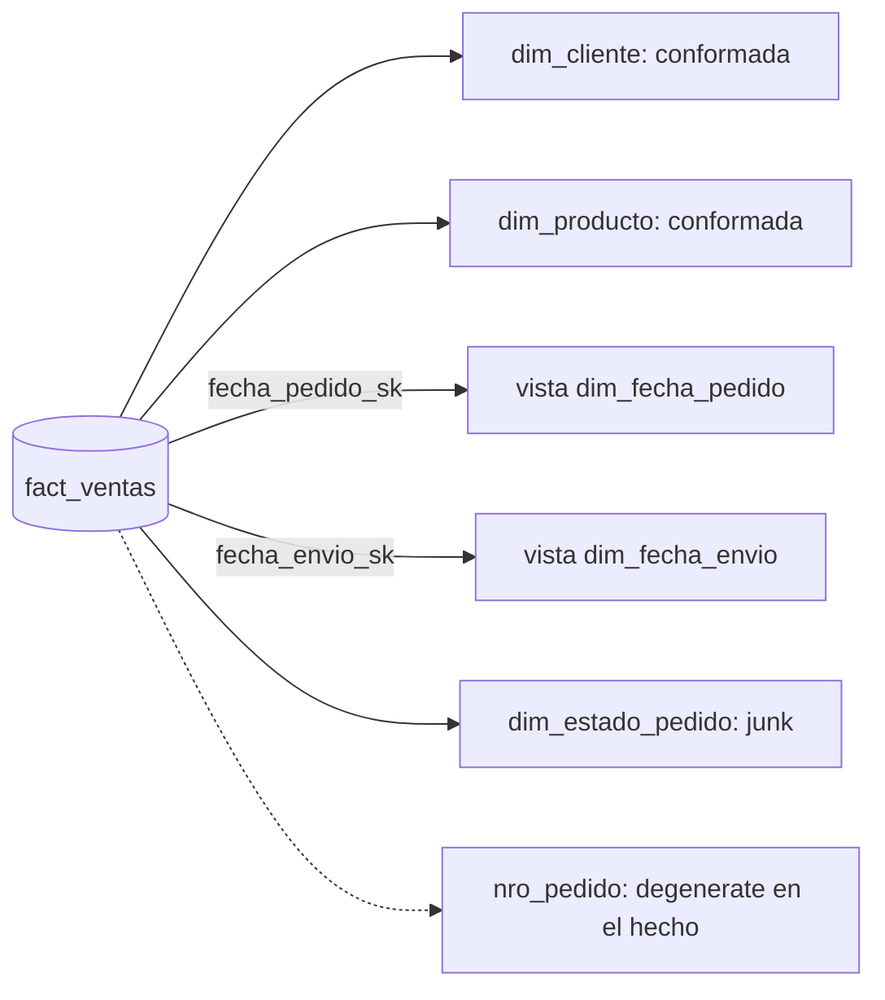

## 1. Resumen

Una tabla de dimensión da contexto a los hechos: el cliente, el producto, la tienda, la fecha. Es ancha y desnormalizada, con una clave sustituta como clave primaria y muchos atributos descriptivos, que son los que se usan para filtrar y agrupar en los reportes. Más allá de la dimensión básica, el modelado dimensional define variantes para casos concretos: conformadas, role-playing, junk, degenerate y bridge.

## 2. Qué es

En un modelo dimensional, los **hechos** registran mediciones (montos, cantidades) y las **dimensiones** las describen. Una dimensión tiene:

- una **clave primaria** (sustituta) que va como clave foránea en los hechos;
- la **clave natural** del origen;
- **atributos** descriptivos, preferentemente textos legibles y no códigos;
- opcionalmente, columnas de historia (SCD tipo 2) y de auditoría.

## 3. Problema que resuelve

Los sistemas transaccionales están normalizados: describir una venta requiere unir muchas tablas, con códigos difíciles de leer. Una dimensión desnormalizada reúne todo el contexto en una tabla, así las consultas son simples y los reportes muestran descripciones comprensibles.

## 4. Cómo funciona

Variantes principales:

- **Conformada:** la misma dimensión (mismos nombres y contenidos) usada por varias tablas de hechos; permite cruzar procesos en un reporte (drill-across).
- **Role-playing:** una dimensión física usada varias veces con roles distintos; por ejemplo, fecha de pedido, de envío y de entrega, cada una con una vista y nombres de columna propios.
- **Junk:** junta banderas e indicadores de baja cardinalidad en una sola dimensión, solo con las combinaciones que aparecen.
- **Degenerate:** una clave sin atributos (el número de factura) que va directamente en la tabla de hechos.
- **Bridge:** cuando un hecho tiene varios valores de una dimensión (varios diagnósticos), una tabla puente con una fila por valor.

Además, conviene reservar **miembros especiales** para casos sin dato: por ejemplo, `-1` desconocido cuando el lookup falla al cargar hechos.

## 5. Cuándo utilizarlo

- Modelos analíticos orientados a reportes y BI.
- Cuando los usuarios filtran y agrupan por atributos descriptivos.
- Cuando varios procesos (ventas, devoluciones) deben compararse con las mismas dimensiones.

## 6. Cuándo no utilizarlo

- Atributos que cambian en cada transacción (por ejemplo, el precio de una línea): son hechos, no dimensiones.
- Sistemas transaccionales: allí corresponde un modelo normalizado.
- Dimensiones con millones de filas y atributos muy volátiles sin separarlos: conviene una minidimensión.

## 7. Ejemplo sencillo

`dim_producto` tiene `producto_sk`, `sku` (clave natural), `nombre`, `categoria` y `marca`. La tabla de ventas guarda `producto_sk`; un reporte de ventas por categoría solo une ventas con `dim_producto`.

## 8. Ejemplo de producción

Un warehouse de retail:

- **Conformadas:** `dim_cliente` y `dim_producto`, compartidas por ventas, devoluciones e inventario.
- **Role-playing:** la tabla de ventas usa `dim_fecha` tres veces mediante vistas (fecha de pedido, de envío y de entrega).
- **Junk:** `dim_estado_pedido` reúne canal, medio de pago y si tuvo cupón.
- **Degenerate:** el número de pedido va como columna en la tabla de hechos.
- **Miembros especiales:** al cargar hechos, si un cliente no se encuentra, la venta apunta a `-1` (desconocido) y una alerta avisa para corregir el dato.

## 9. Arquitectura



## 10. Código

```sql
-- BigQuery: dimensión con miembros especiales y vistas de una dimensión role-playing.
-- Requiere: dataset proyecto.dwh; dim_fecha(fecha_sk INT64, fecha DATE, mes INT64, anio INT64) ya cargada.
CREATE TABLE IF NOT EXISTS `proyecto.dwh.dim_cliente` (
  cliente_sk INT64 NOT NULL,          -- clave sustituta
  cliente_id STRING NOT NULL,         -- clave natural del origen
  nombre STRING,
  segmento STRING,
  region STRING
);

-- Miembros especiales: se insertan solo si no existen (repetir no duplica).
MERGE `proyecto.dwh.dim_cliente` AS d
USING (
  SELECT -1 AS cliente_sk, 'DESCONOCIDO' AS cliente_id, 'Desconocido' AS nombre, 'Desconocido' AS segmento, 'Desconocida' AS region
  UNION ALL
  SELECT -2, 'NO_APLICA', 'No aplica', 'No aplica', 'No aplica'
) AS s
ON d.cliente_sk = s.cliente_sk
WHEN NOT MATCHED THEN
  INSERT (cliente_sk, cliente_id, nombre, segmento, region)
  VALUES (s.cliente_sk, s.cliente_id, s.nombre, s.segmento, s.region);

-- Role-playing: una vista por rol, con nombres de columna propios.
CREATE OR REPLACE VIEW `proyecto.dwh.dim_fecha_pedido` AS
SELECT fecha_sk AS fecha_pedido_sk, fecha AS fecha_pedido, mes AS mes_pedido, anio AS anio_pedido
FROM `proyecto.dwh.dim_fecha`;
```

Todas las sentencias son repetibles: `CREATE TABLE IF NOT EXISTS`, un `MERGE` que solo inserta lo que falta y `CREATE OR REPLACE VIEW`.

## 11. GCP

En **BigQuery** se modelan igual que en cualquier warehouse: tablas para las dimensiones, vistas para los roles y `MERGE` para cargarlas. Las claves sustitutas se generan con funciones (ver `surrogate-keys`).

## 12. AWS

En **Redshift**, las dimensiones son tablas y las claves sustitutas suelen ser columnas `IDENTITY`, con valores únicos pero no consecutivos (ver `surrogate-keys`). El modelo dimensional es el mismo; cambian la generación de claves y las opciones físicas de la tabla.

## 13. Azure

La documentación de **Fabric Warehouse** describe una dimensión con clave sustituta, claves naturales, atributos, claves foráneas, columnas de historia tipo 2 y columnas de auditoría, y propone **miembros especiales** con claves reservadas: `0` faltante, `-1` desconocido (fallo de lookup al cargar hechos), `-2` no aplica y `-3` error. También describe role-playing, junk y degenerate dimensions con los mismos criterios.

## 14. Buenas prácticas

- Clave sustituta como clave primaria y la clave natural como atributo.
- Atributos descriptivos legibles en lugar de códigos.
- Miembros especiales para desconocido y no aplica, en vez de nulos en las claves de los hechos.
- Dimensiones conformadas compartidas entre procesos.
- **Seguridad:** las dimensiones suelen contener datos personales (nombres, emails); aplicar controles de acceso a nivel de columna o vistas para los atributos sensibles.
- **Observabilidad:** contar los hechos que apuntan al miembro desconocido en cada carga.
- **Costo:** las dimensiones anchas son baratas de unir; evitar copiar sus atributos a los hechos.

## 15. Errores frecuentes

- Normalizar la dimensión en varias tablas (copo de nieve) sin necesidad.
- Hechos con claves nulas en lugar de miembros especiales.
- Una dimensión de fecha por cada rol en lugar de vistas sobre una sola.
- Crear una dimensión para cada bandera en lugar de una junk dimension.

## 16. Trade-offs

Desnormalizar repite datos y hace la dimensión más ancha, a cambio de consultas simples y rápidas. Las dimensiones conformadas exigen acordar definiciones entre equipos, a cambio de reportes comparables entre procesos.

## 17. Conceptos relacionados

- `slowly-changing-dimensions`: cómo cambia una dimensión en el tiempo.
- `surrogate-keys`: la clave primaria de la dimensión.
- `scd-type-2`: las columnas de historia.
- Con ficha: `fact-tables`, `star-schema`, `grain`.

## 18. Preguntas técnicas abiertas

1. ¿Qué atributos de cliente pondrías en la dimensión y cuáles dejarías fuera?
2. ¿Cómo tratarías una venta cuyo cliente todavía no llegó a la dimensión?
3. ¿Cuándo usarías una bridge table en lugar de duplicar filas de hechos?

## 19. Laboratorio relacionado

Pendiente (F4): modelo dimensional de ventas (lab de tipo A).

## 20. Fuentes

- Kimball Group: *Dimension table structure*, *Conformed dimensions*, *Role-playing dimensions*, *Junk dimensions*, *Degenerate dimensions* y *Multivalued dimensions and bridge tables*. Referencia conceptual canónica (Nivel 4).
- Microsoft Learn: *Modeling dimension tables in Warehouse* (Fabric).
- Google Cloud: *Data definition language* y *DML syntax* (BigQuery).
- AWS: *CREATE TABLE* (Redshift).

El detalle de cada fuente está en `sources` del frontmatter.

## 21. Fecha de última verificación

2026-10-01. Pasa a `verified`: revisión B-F3.1 del lote 4 aplicada, sin VERIFY pendientes.

## 22. Historial de cambios importantes

- 2026-10-01: creación (lote 4 de F3).
- 2026-10-01: `verification_status: verified` (revisión B-F3.1 del lote 4 aplicada; sin VERIFY pendientes).
- 2026-10-06: la sección de conceptos relacionados ya no lista como pendientes de ficha a `fact-tables`, `star-schema`, `grain`, que ya tienen ficha.
- 2026-10-13: `page_title` en cada cita, con el título de la página citada (ADR-012); sin cambios de contenido.
