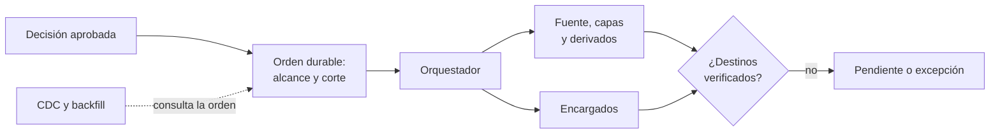

## 1. Resumen

Esta ficha no es asesoría legal: si una supresión procede, con qué alcance y con qué excepciones lo decide el responsable con el área legal; aquí se explica cómo llevar esa decisión a cada sistema y demostrar que llegó.

**Cómo leerla.** *Comprender* (§1–6): qué es una orden de privacidad, un tombstone y una reconciliación. *Aplicar* (§7–13): estados por destino, idempotencia, eventos tardíos y cierre. *Demostrar*: la evidencia del §8, el código del §10 y los criterios del §18.

Un derecho aprobado se propaga a cada representación del titular: fuente, CDC, bronze, silver, gold, features, cachés, exportaciones y encargados. Hace falta un **alcance autorizado**, una **orden durable**, una **ejecución idempotente** y una **verificación por destino**. Un DELETE aislado no basta: un backfill o un evento CDC retrasado pueden traer de vuelta al titular.

**Idea central:** la supresión no termina cuando el job termina, sino cuando cada destino del alcance está verificado o tiene una excepción aprobada.

## 2. Qué es

- **[Obligación legal · art. 7]** La supresión procede por las causales del artículo y no procede en los casos que enumera, como una obligación legal o la ejecución de un contrato.
- **[Obligación legal · art. 8 ter]** El bloqueo suspende temporalmente el tratamiento mientras se resuelve la solicitud, o alternativamente a la supresión, sin afectar el almacenamiento.
- **[Obligación legal · art. 11]** Si el responsable comunicó los datos a otros, les comunica los cambios por rectificación, supresión u oposición.
- **[Decisión de arquitectura]** Tres piezas:

| Pieza | Qué es | Qué no es | Etiqueta |
|---|---|---|---|
| Orden de privacidad | Instrucción aprobada con `request_id`, acción, llave seudónima del titular, alcance, destinos, excepciones y corte de versión | Un script puntual | **[Decisión de arquitectura]** |
| Tombstone | Evento durable que avisa a los consumidores que un registro se suprimió o restringió | La supresión física | **[Decisión de arquitectura]** |
| Reconciliación | Comparación entre el estado esperado y el observado en cada destino | Un conteo de filas borradas | **[Decisión de arquitectura]** |

- **[Buena práctica]** El índice de titulares y el linaje ayudan a localizar, pero no prueban que la cobertura sea completa: las copias fuera del catálogo no aparecen.

## 3. Problema que resuelve

**[Buena práctica]** Una supresión en silver reaparece con un backfill desde bronze; un CDC retrasado reinserta la fila con una versión vieja; un proveedor conserva la exportación de la semana pasada. Cada job terminó bien y la solicitud quedó incompleta.

## 4. Cómo funciona

1. **[Buena práctica]** Recibir la decisión aprobada y acotada por finalidad y destino; verificar identidad, autorización y excepciones.
2. **[Buena práctica]** Resolver identificadores y dependencias con el inventario, el índice de titulares y el linaje; registrar lo que no se pudo localizar.
3. **[Decisión de arquitectura]** Crear una orden durable y única (`request_id` y corte de versión) con estados por destino: `PENDING`, `VERIFIED`, `EXCEPTION`, `FAILED`.
4. **[Decisión de arquitectura]** Emitir eventos idempotentes y aplicar la acción de cada destino: suprimir, rectificar, bloquear o conservar con acceso restringido cuando haya una excepción aprobada.
5. **[Decisión de arquitectura]** En el CDC y en los backfills, consultar la orden vigente antes de publicar: un evento con una versión anterior al corte no reintroduce al titular.
6. **[Obligación legal · art. 11]** Comunicar los cambios a quienes recibieron los datos. **[Buena práctica]** Cada encargado es un destino con su estado; un HTTP 200 sin constancia no lo verifica.
7. **[Buena práctica]** Reconciliar filas, derivados, snapshots, respaldos restaurables, exportaciones y terceros según el alcance, y guardar evidencia mínima.
8. **[Buena práctica]** Cerrar solo cuando todos los destinos obligatorios estén verificados o con excepción aprobada; un pendiente no se convierte en éxito.

## 5. Cuándo utilizarlo

- Para supresiones, rectificaciones y bloqueos aprobados que alcanzan más de un sistema.
- Ante cambios de finalidad, revocaciones cuando procedan, correcciones en la fuente y restauraciones posteriores a una supresión (`privacy-backup-and-recovery`).

## 6. Cuándo no utilizarlo

- Para decidir procedencia, excepciones o plazos: lo decide el área legal.
- Como lista global que impida tratamientos nuevos y lícitos sin analizar su finalidad: la orden tiene alcance.
- Como prueba de purga física: la verificación lógica y la purga diferida (time travel, versiones, VACUUM) son cosas distintas (`retention-and-erasure`).

## 7. Ejemplo sencillo

| Paso | Qué pasa | Resultado |
|---|---|---|
| Orden | `SOL-2026-0042` suprime al titular hasta la versión 2 de su registro en la fuente | Tres destinos en `PENDING` |
| Silver | Se aplica; el orquestador reintenta | Una sola aplicación: idempotente |
| CDC tardío | Llega la versión 2 del registro | Rechazada: no es posterior al corte |
| Proveedor | Responde 200 sin constancia | Sigue en `PENDING` |
| Cierre | Falta el proveedor | No procede |

## 8. Ejemplo de producción

Escenario genérico: una aerolínea aprueba una supresión parcial. La reserva operacional se suprime donde corresponde; los documentos con obligación de conservar se aíslan con acceso restringido. Airflow orquesta; BigQuery guarda los datasets; Cloud Storage, los objetos; una cola lleva las órdenes a los terceros. La llave seudónima vive en un registro restringido de órdenes, no en logs abiertos.

| Componente | Implementación posible |
|---|---|
| Registro de órdenes | Tabla transaccional con `request_id`, corte, alcance, destinos y estados |
| Eventos | Tópico con la llave del titular como clave de orden, para que los eventos de un titular lleguen en orden |
| Aplicación por destino | Operaciones idempotentes por `request_id` + destino + acción |
| Ingesta y backfill | Consultan la orden vigente antes de publicar |
| Reconciliación | Consultas de control por destino y constancias de terceros |

### Evidencia de cumplimiento

| Evidencia | Dónde queda | Quién la produce | Qué demuestra | Qué no demuestra |
|---|---|---|---|---|
| Orden con alcance, excepciones y corte | Registro de órdenes | Pipeline de derechos | Qué se aprobó y a qué destinos llega | Que el inventario de destinos esté completo |
| Prueba de idempotencia | Log de la CI | CI | Que reejecutar no duplica efectos | El comportamiento con fallos parciales reales |
| Prueba de CDC tardío y de backfill | Log de la CI | CI | Que una versión anterior no restaura el dato | Otras rutas de reingesta |
| Estado por destino y constancias | Registro de órdenes | Ingeniería y encargados | Qué destino está verificado y cuál pendiente | La eliminación física en el tercero |
| Reproducción tras una restauración | Log del job de recuperación | Plataforma | Que las órdenes posteriores al respaldo se aplicaron | Que se probaron todos los respaldos |

## 9. Arquitectura



## 10. Código

```python
# Python 3.12+, biblioteca estándar. Propagación de una supresión aprobada a destinos distribuidos: una orden
# durable (request_id y corte de versión en la fuente) con estado por destino, aplicación idempotente, un evento CDC
# tardío con una versión anterior que no resucita al titular, y un cierre que no procede con un destino pendiente.
from dataclasses import dataclass, field


@dataclass(frozen=True)
class Orden:
    request_id: str
    corte: int                # última versión del registro en la fuente que la orden alcanza
    titular: str              # llave seudónima, nunca el RUT
    accion: str               # "suprimir", "rectificar" o "bloquear"
    destinos: tuple[str, ...]


@dataclass
class Destino:
    nombre: str
    filas: dict[str, int] = field(default_factory=dict)   # titular → versión de la fila
    estado: str = "PENDING"   # PENDING, VERIFIED, EXCEPTION o FAILED
    aplicaciones: int = 0


def aplicar(destino: Destino, orden: Orden, confirmado: bool = True) -> None:
    if destino.estado == "VERIFIED":
        return                                            # reintento idempotente: no repite el efecto
    destino.filas.pop(orden.titular, None)
    destino.aplicaciones += 1
    destino.estado = "VERIFIED" if confirmado and orden.titular not in destino.filas else "PENDING"


def evento_cdc(destino: Destino, titular: str, version: int, ordenes: dict[str, Orden]) -> str:
    """Antes de publicar, la ingesta consulta la orden vigente del titular: una versión anterior no lo reintroduce."""
    vigente = ordenes.get(titular)
    if vigente is not None and vigente.accion == "suprimir" and version <= vigente.corte:
        return f"rechazado (versión {version} ≤ corte de la orden {vigente.corte})"
    destino.filas[titular] = version
    return "aplicado"


def puede_cerrar(destinos: dict[str, Destino]) -> list[str]:
    return [f"{d.nombre}: {d.estado}" for d in destinos.values() if d.estado not in ("VERIFIED", "EXCEPTION")]


def main() -> None:
    orden = Orden("SOL-2026-0042", 2, "c3d3a94d7560c6ae", "suprimir", ("bigquery.silver", "gcs.exportes", "proveedor_email"))
    ordenes = {orden.titular: orden}
    destinos = {n: Destino(n, {orden.titular: 2, "a1b2c3d4e5f60718": 5}) for n in orden.destinos}
    aplicar(destinos["bigquery.silver"], orden)
    aplicar(destinos["bigquery.silver"], orden)            # el orquestador reintenta
    aplicar(destinos["gcs.exportes"], orden)
    aplicar(destinos["proveedor_email"], orden, confirmado=False)   # respondió 200, sin constancia
    print("aplicaciones en bigquery.silver tras el reintento:", destinos["bigquery.silver"].aplicaciones)
    print("CDC tardío con la versión 2:", evento_cdc(destinos["bigquery.silver"], orden.titular, 2, ordenes))
    print("¿reaparece en bigquery.silver?:", orden.titular in destinos["bigquery.silver"].filas)
    print("otro titular intacto:", destinos["bigquery.silver"].filas)
    print("cierre de SOL-2026-0042:", puede_cerrar(destinos) or "permitido")


if __name__ == "__main__":
    main()
```

El script se **ejecuta en la CI** con la biblioteca estándar y pasa `mypy --strict`:

```text
aplicaciones en bigquery.silver tras el reintento: 1
CDC tardío con la versión 2: rechazado (versión 2 ≤ corte de la orden 2)
¿reaparece en bigquery.silver?: False
otro titular intacto: {'a1b2c3d4e5f60718': 5}
cierre de SOL-2026-0042: ['proveedor_email: PENDING']
```

**Limitaciones:** el ejemplo no implementa la purga física, la validación de identidad, la aprobación ni la consistencia transaccional entre sistemas.

## 11. GCP

En GCP, **Pub/Sub**. Según *Order messages* (no ejecutado):

| Necesidad | Servicio | Etiqueta |
|---|---|---|
| Eventos de un titular en orden | Ordering key con la llave seudónima: el suscriptor recibe los mensajes en el orden en que se publicaron, si se publican en la misma región | **[Buena práctica]** |
| Rechazar eventos anteriores al corte | La ingesta consulta la orden vigente; el orden de entrega no reemplaza esa consulta | **[Decisión de arquitectura]** |

## 12. AWS

En AWS, **Amazon S3**. Según *Deleting object versions from a versioning-enabled bucket* (no ejecutado):

| Necesidad | Servicio | Etiqueta |
|---|---|---|
| Suprimir un objeto versionado | Un DELETE simple agrega un delete marker; las versiones no actuales se borran con `NoncurrentVersionExpiration` | **[Buena práctica]** |
| Estado del destino | `VERIFIED` para la lectura; la purga de versiones sigue su propia ventana | **[Decisión de arquitectura]** |

## 13. Azure

En Azure, **Delta** en Azure Databricks. Según *Remove unused data files with vacuum* (no ejecutado):

| Necesidad | Servicio | Etiqueta |
|---|---|---|
| Archivos y change data feed | VACUUM borra los archivos fuera del umbral de retención, incluidos los del change data feed (`_change_data`) | **[Buena práctica]** |
| Consumidores del feed | Un consumidor que ya leyó el feed es un destino más de la orden | **[Decisión de arquitectura]** |

**Criterio común:** ningún servicio cierra una orden; cada uno aporta la acción o la evidencia de un destino.

## 14. Buenas prácticas

- **[Decisión de arquitectura]** Diseñar órdenes durables antes que scripts puntuales.
- **[Buena práctica]** Correlacionar por `request_id` sin exponer identificadores directos en los logs.
- **[Buena práctica]** Probar CDC fuera de orden, duplicados, fallos parciales y reejecuciones.
- **[Buena práctica]** **Seguridad:** los tombstones y el registro de órdenes son datos personales seudónimos: retención y acceso restringido.
- **[Buena práctica]** **Observabilidad:** órdenes abiertas por antigüedad y destinos pendientes por proveedor.
- **[Buena práctica]** **Costo:** reconciliar por destino y por muestreo de riesgo, no recorrer toda la plataforma en cada orden.

## 15. Errores frecuentes

- **Cerrar al recibir un HTTP 200 del proveedor sin constancia:** el dato sigue en el tercero y la solicitud figura como cumplida.
- **Tombstones sin retención ni control de acceso:** el registro de supresiones se vuelve otra copia personal.
- **Suprimir datos con conservación autorizada:** se incumple la obligación que justificaba la excepción.
- **Asumir que el linaje detecta copias fuera del catálogo:** la cobertura reportada es mayor que la real.
- **Ingesta que no consulta la orden:** un backfill o un CDC tardío reintroduce al titular.

## 16. Trade-offs

| Decisión | Beneficio | Costo |
|---|---|---|
| Consistencia eventual | Escala entre muchos sistemas | Estados intermedios y reconciliación |
| Bloqueo inmediato | Reduce el uso mientras se completa la supresión | No la reemplaza |
| Orquestación central | Un solo estado por orden | Conectores para cada destino |

## 17. Conceptos relacionados

- `chile-data-protection`: ficha padre.
- `data-subject-rights-pipeline`: la decisión y el seguimiento de la solicitud.
- `retention-and-erasure`: la supresión en cada copia y la purga física.
- `change-data-capture`: los eventos que pueden reintroducir al titular.
- `data-lineage`: localizar dependencias.
- `privacy-controls-as-code`: el cierre sin destinos pendientes como regla.
- `privacy-backup-and-recovery`: reproducir las órdenes tras una restauración.

## 18. Preguntas técnicas abiertas

1. ¿Qué pasa con una orden cuando falla un solo destino?
2. ¿Qué ocurre si llega un evento CDC de una versión anterior?
3. ¿Cómo se prueba que una restauración reproduce las órdenes posteriores al respaldo?

**Criterio de dominio:** dominas esta ficha si puedes explicar qué guarda una orden durable, por qué la aplicación debe ser idempotente, cómo la ingesta evita resucitar a un titular y por qué una orden no cierra con un destino pendiente.

## 19. Laboratorio relacionado

Propuesta para F4 (laboratorio integral, `docs/briefs/privacy-program/06-laboratorio-integral-gcp.md`): una supresión con un backfill, un CDC fuera de orden, un proveedor que falla y la reconciliación final. Datos ficticios.

## 20. Fuentes

- BCN Ley Chile: *Ley 19628 SOBRE PROTECCION DE LOS DATOS PERSONALES* (versión con vigencia diferida desde 2026-12-01).
- Google Cloud: *Order messages*.
- AWS: *Deleting object versions from a versioning-enabled bucket*.
- Microsoft Learn: *Remove unused data files with vacuum*.

El detalle de cada fuente está en `sources` del frontmatter.

## 21. Fecha de última verificación

2026-10-28: arts. 7, 8 ter y 11 consultados ese día en BCN; *Order messages* consultada ese día. `review_required`: pasa a `verified` solo con la aprobación explícita de Felipe (`owner_approved_at`). Revisión mensual.

## 22. Historial de cambios importantes

- 2026-10-28: creación (lote P2, dominio 24, ADR-027) desde `docs/briefs/privacy-program/01-propagacion-derechos-supresion-distribuida.md`, que es un guion, no una fuente.
