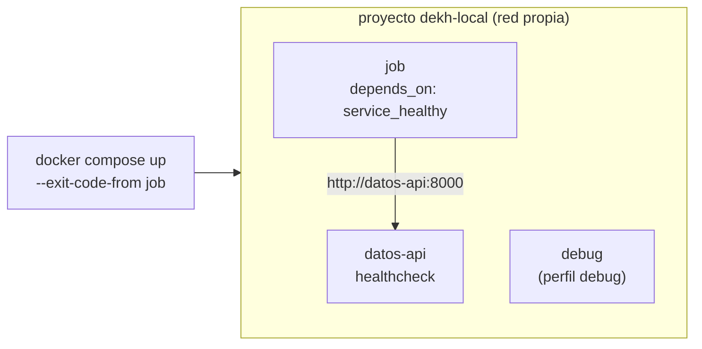

## 1. Resumen

«Docker Compose is a tool for defining and running multi-container applications». En Data Engineering sirve para tener en la laptop y en la CI el entorno que un pipeline necesita: una base de datos, una API de origen, un broker, el propio job.

Cuatro piezas resuelven casi todo:

- **servicios en un `compose.yaml`**, con imagen, comando, variables y montajes;
- **una red por proyecto**, en la que cada servicio se encuentra por su nombre;
- **`depends_on` con `service_healthy`**, para que el job no arranque antes de que su dependencia esté lista;
- **perfiles** para lo opcional, como un servicio de depuración.

## 2. Qué es

- **Proyecto:** el conjunto de servicios de un `compose.yaml`, con un nombre (`name:`).
- **Servicio:** una definición de contenedor (imagen, comando, entorno, montajes, healthcheck).
- **Healthcheck:** un comando que Compose corre para saber si el servicio está sano.
- **`depends_on`:** el orden de arranque; con `condition: service_healthy`, espera el healthcheck.
- **Perfil:** una etiqueta que deja un servicio apagado salvo que se active con `--profile`.

## 3. Problema que resuelve

Para probar un job de ingesta hace falta la API de origen y una base de destino. Instalarlas a mano en cada laptop deja versiones distintas y pasos que nadie documenta. Con Compose, `docker compose up` levanta todo con las mismas imágenes, y `docker compose down` lo borra.

## 4. Cómo funciona

1. Compose lee `compose.yaml` y crea una red para el proyecto.
2. Arranca los servicios en orden de dependencias.
3. Con `condition: service_healthy`, espera a que el healthcheck de la dependencia pase antes de arrancar el servicio que depende de ella.
4. Cada servicio encuentra a los demás por su nombre en la red del proyecto.
5. `docker compose up --exit-code-from job` termina cuando termina el job y devuelve su código de salida; `docker compose down` borra contenedores y red.

## 5. Cuándo utilizarlo

- Entornos locales de desarrollo con varias dependencias.
- Tests de integración en la CI que necesitan servicios reales (una base, una API, un emulador).
- Reproducir un error con las mismas versiones que en otro equipo.

## 6. Cuándo no utilizarlo

- Como plataforma de producción en la nube: cada nube agrupa contenedores a su manera (ver §11 a §13).
- Para pasar contraseñas en `environment`: la documentación pide usar secrets.
- Con `depends_on` sin condición cuando el servicio tarda en estar listo: arrancado no es listo.

## 7. Ejemplo sencillo

Un proyecto `dekh-local` con una API de datos (`python -m http.server`) con healthcheck, un job que espera a que la API esté sana y la llama por `http://datos-api:8000/`, y un servicio `debug` con perfil. Sin perfil, los servicios activos son `datos-api` y `job`; con `--profile debug`, también `debug`.

## 8. Ejemplo de producción

El repositorio de un pipeline:

- tiene un `compose.yaml` con PostgreSQL, un emulador de almacenamiento y la API de origen, todas fijadas por digest;
- la CI corre `docker compose up --wait` antes de los tests de integración y `docker compose down` al final;
- las credenciales de desarrollo llegan como secrets, no como variables de entorno;
- un perfil `tools` agrega herramientas de inspección que no arrancan por defecto.

## 9. Arquitectura



## 10. Código

```yaml
# Docker Compose (ejecutado en la CI con docker compose up; ADR-016): un entorno local con una API de datos y un job que
# espera a que la API esté sana. El servicio de depuración solo arranca con su perfil.
name: dekh-local
services:
  datos-api:
    image: python:3.12-slim@sha256:a6e34c598f2467ed0e9a8d349809fcd8b5c603269512df273a0bb1784edc11b1
    command: ["python", "-m", "http.server", "8000"]
    healthcheck:
      test: ["CMD", "python", "-c", "import urllib.request; urllib.request.urlopen('http://localhost:8000/')"]
      interval: 2s
      retries: 15
  job:
    image: alpine:3.22@sha256:5291449c3df73caf6ed85e649dec1b9e818b39a5d8c871e97afc13e9cd5e8fa8
    depends_on:
      datos-api:
        condition: service_healthy   # no arranca hasta que el healthcheck de la API pase
    environment:
      API_URL: http://datos-api:8000/   # el nombre del servicio resuelve en la red del proyecto
    command: ["sh", "-c", "wget -q -O /dev/null \"$$API_URL\" && echo \"job: la API respondió en $$API_URL\""]
  debug:
    image: alpine:3.22@sha256:5291449c3df73caf6ed85e649dec1b9e818b39a5d8c871e97afc13e9cd5e8fa8
    profiles: [debug]
    command: ["sleep", "3600"]
```

```bash
# Bash y Docker Compose (ejecutado en la CI; ADR-016): levanta el entorno, termina cuando termina el job y devuelve su
# código de salida. Corre en la carpeta del compose.yaml.
set -euo pipefail
trap 'docker compose down --remove-orphans > /dev/null 2>&1' EXIT

echo "servicios activos: $(docker compose config --services | sort | tr '\n' ' ')"
echo "con el perfil debug: $(docker compose --profile debug config --services | sort | tr '\n' ' ')"
docker compose up --exit-code-from job 2>/dev/null | grep "job: "
```

El `compose.yaml` y el script se **ejecutan en la CI con `docker compose up`** (ADR-016), con Python y Alpine fijadas por digest. Imprimen `servicios activos: datos-api job`, `con el perfil debug: datos-api debug job` y la línea del job `job: la API respondió en http://datos-api:8000/`. El proyecto se borra al salir.

## 11. GCP

En GCP, **Cloud Run** agrupa contenedores en una instancia. Las diferencias con Compose, según *Container runtime contract*:

| | Docker Compose | Cloud Run |
|---|---|---|
| Varios contenedores | Servicios independientes en una red del proyecto | Una instancia con un contenedor de ingreso y, opcionalmente, sidecars |
| Quién recibe tráfico | Cualquier servicio que publique un puerto | Solo el contenedor de ingreso |

## 12. AWS

En AWS, **ECS con Fargate** agrupa contenedores en una tarea. Las diferencias, según *Amazon ECS task definitions* y *Amazon ECS task networking options for Fargate*:

| | Docker Compose | ECS con Fargate |
|---|---|---|
| Varios contenedores | Servicios de un `compose.yaml` | Uno o más contenedores en una task definition |
| Cómo se encuentran | Por nombre de servicio | Los de la misma tarea, por `localhost` |

## 13. Azure

En Azure, **Container Apps** agrupa contenedores en una app. Las diferencias, según *Containers in Azure Container Apps*:

| | Docker Compose | Container Apps |
|---|---|---|
| Varios contenedores | Servicios independientes | Sidecars e init containers en una app, con disco, red y ciclo de vida compartidos |
| Orden de arranque | `depends_on`, con o sin healthcheck | Los init containers corren antes, en orden, y deben terminar bien |
| Recomendación | Un servicio por componente | Una app por servicio en la mayoría de los casos |

## 14. Buenas prácticas

- Imágenes fijadas por digest en el `compose.yaml`.
- Healthcheck en cada dependencia y `condition: service_healthy` en quien la usa.
- Nombre de proyecto explícito (`name:`) para no chocar con otros proyectos.
- Servicios principales sin perfil; lo opcional, con perfil.
- **Seguridad:** contraseñas como secrets, no en `environment` ni en un `.env` versionado.
- **Observabilidad:** la salida de `docker compose up` marca cada línea con su servicio (`job-1 |` en el ejemplo); un healthcheck que no pasa explica por qué el servicio que depende de él no arrancó.
- **Costo:** el entorno corre en la laptop o en el runner de la CI; `docker compose down` al terminar libera el runner y evita contenedores olvidados.

## 15. Errores frecuentes

- `depends_on` sin condición y un job que falla porque la base todavía no acepta conexiones.
- Llamar a `localhost` desde un contenedor para llegar a otro servicio, en lugar de usar su nombre.
- Olvidar `$$` en un comando y que Compose reemplace la variable antes que el contenedor.
- Dejar proyectos levantados que ocupan puertos y memoria.

## 16. Trade-offs

Compose da un entorno reproducible con un solo comando y un archivo legible, a cambio de correr en una sola máquina. Los healthchecks hacen el arranque confiable y lo alargan. En la nube no hay Compose: cada plataforma agrupa contenedores con su propio modelo, así que el `compose.yaml` documenta el entorno, pero no se despliega tal cual.

## 17. Conceptos relacionados

- `containers`: lo que Compose arranca.
- `container-networking`: la red del proyecto y los nombres de servicio.
- `container-volumes`: montajes por servicio.
- `automated-testing-in-ci`: dependencias reales para los tests.
- `ci-cd-secrets`: credenciales fuera de las variables de entorno.
- `container-apps-for-data`: sidecars e init containers en Azure.

## 18. Preguntas técnicas abiertas

1. ¿Qué pasos manuales hace hoy alguien nuevo para levantar tu entorno local?
2. ¿Qué dependencia de tu pipeline tarda en estar lista y cómo lo sabe Compose?
3. ¿Qué parte de tu `compose.yaml` no tiene equivalente en la plataforma donde corre producción?

## 19. Laboratorio relacionado

Pendiente (F4).

## 20. Fuentes

- Docker: *Docker Compose*, *How Compose works*, *Control startup and shutdown order in Compose*, *Networking in Compose*, *Using profiles with Compose*, *Set environment variables within your container's environment* y *docker compose up*.
- Google Cloud: *Container runtime contract*.
- AWS: *Amazon ECS task definitions* y *Amazon ECS task networking options for Fargate*.
- Microsoft Learn: *Containers in Azure Container Apps*.

El detalle de cada fuente está en `sources` del frontmatter.

## 21. Fecha de última verificación

2026-10-19. Pasa a `verified`: revisión B-F3.1 del lote F3b-13b aplicada, sin VERIFY pendientes.

## 22. Historial de cambios importantes

- 2026-10-19: creación (lote F3b-13b).
- 2026-10-19: revisión B-F3.1 del lote F3b-13b aplicada (docs/reviews/cards-f3b-13b.md): sin hallazgos en esta ficha; sin cambios.
- 2026-10-19: `verification_status: verified` (sin VERIFY pendientes).
