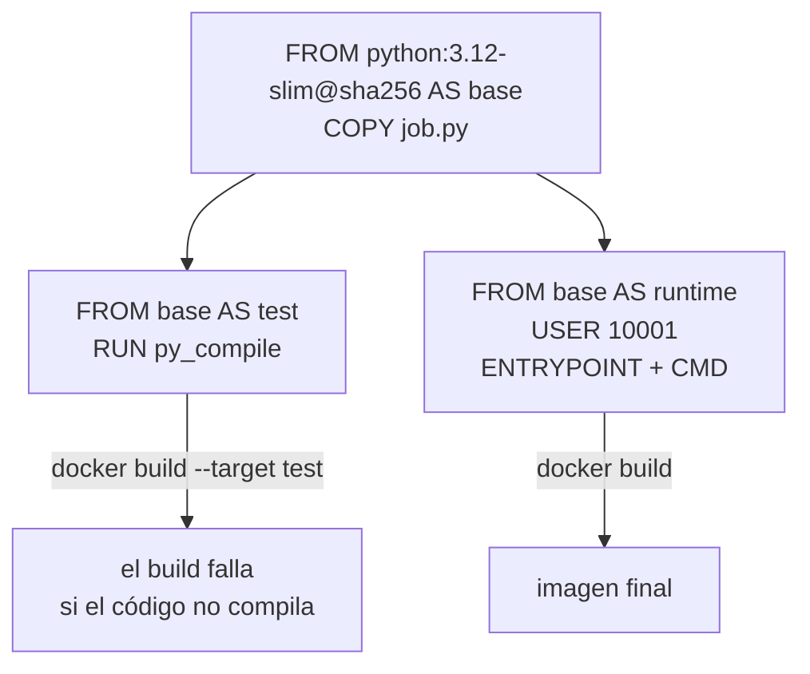

## 1. Resumen

Un Dockerfile es la receta de una imagen: cada instrucción agrega una capa. Para un job de datos, la documentación de Docker deja cinco prácticas claras:

- **base fijada por digest**, porque los tags son mutables;
- **multi-stage**, para que la imagen final lleve solo lo que el job necesita y una etapa previa pueda verificar el código;
- **orden pensado para la caché**: lo que cambia poco, primero, porque «Once a layer changes, then all downstream layers need to be rebuilt as well»;
- **`USER` sin root** cuando el proceso no necesita privilegios;
- **`ENTRYPOINT` en forma exec**, para que el job sea el PID 1 y reciba SIGTERM.

## 2. Qué es

- **`FROM`:** la imagen base; cada `FROM` empieza una etapa.
- **`COPY` y `RUN`:** copian archivos y ejecutan comandos en el build; cada uno es una capa.
- **`WORKDIR`, `USER`:** directorio de trabajo y usuario para el resto de la etapa.
- **`ENTRYPOINT` y `CMD`:** el ejecutable del contenedor y sus argumentos por defecto, que se reemplazan al correrlo.
- **Forma exec y forma shell:** `["python", "job.py"]` ejecuta el programa directamente; `python job.py` lo corre bajo `/bin/sh -c`.
- **`.dockerignore`:** lo que no entra al contexto del build.

## 3. Problema que resuelve

Una imagen construida con `pip install` y el código en una sola capa, como root y con `latest` como base, pesa más de lo necesario, cambia sola cuando cambia la base y corre con privilegios que no hacen falta. Un Dockerfile ordenado da una imagen chica, reproducible y que se reconstruye rápido cuando solo cambia el código.

## 4. Cómo funciona

1. `docker build` lee el Dockerfile y ejecuta las instrucciones en orden, con el contexto del directorio.
2. Cada instrucción produce una capa; si la instrucción y sus entradas no cambiaron, Docker reusa la capa de la caché.
3. Si una capa cambia, todas las siguientes se reconstruyen.
4. Con varias etapas, `--target` construye hasta la etapa pedida; sin `--target`, la última.
5. `docker run` arranca el `ENTRYPOINT` con los argumentos de `CMD`, o con los que se pasen.

## 5. Cuándo utilizarlo

- Todo job o servicio que se despliega como contenedor.
- Para fijar en el repositorio cómo se construye el entorno del job, con revisión en pull requests.
- Con una etapa de verificación cuando el build debe fallar si el código no compila o no pasa sus pruebas.

## 6. Cuándo no utilizarlo

- Para guardar secretos: lo que entra en una capa queda en la imagen.
- Para instalar herramientas de desarrollo en la imagen final: van en una etapa previa.
- Como reemplazo de la CI: el Dockerfile construye; las pruebas largas y los despliegues son del pipeline.

## 7. Ejemplo sencillo

Un job que suma los montos de un CSV. El Dockerfile tiene tres etapas: `base` copia el código, `test` lo compila y `runtime` crea un usuario `10001`, lo usa y define `ENTRYPOINT` y `CMD`. Al correr la imagen con la entrada en solo lectura, escribe `{"rows": 2, "total": 14.75}`.

## 8. Ejemplo de producción

El Dockerfile de un job de transformación:

- parte de una base fijada por digest, que se actualiza con un pull request;
- copia primero el archivo de dependencias y las instala, y después el código, para que un cambio de código no reinstale todo;
- tiene una etapa de pruebas que la CI construye con `--target test`;
- termina con un usuario sin root y `ENTRYPOINT` en forma exec;
- pasa hadolint en la CI.

## 9. Arquitectura



## 10. Código

```dockerfile
# Dockerfile (revisado con hadolint y construido y ejecutado en la CI; ADR-016): base fijada por digest, una etapa que
# verifica el código y una final con solo lo necesario, sin root.
FROM python:3.12-slim@sha256:a6e34c598f2467ed0e9a8d349809fcd8b5c603269512df273a0bb1784edc11b1 AS base
WORKDIR /app
COPY job.py .

# Etapa de verificación: si el código no compila, el build falla y no hay imagen.
FROM base AS test
RUN python -m py_compile job.py

# Etapa final: la imagen que corre en producción.
FROM base AS runtime
RUN useradd --create-home --uid 10001 pipeline
USER 10001
ENTRYPOINT ["python", "/app/job.py"]
CMD ["--input", "/data/in/ventas.csv", "--output", "/data/out/resumen.json"]
```

```python
# Python 3.12, solo biblioteca estándar (ejecutado en la CI dentro de la imagen del Dockerfile de abajo; mypy --strict
# sin errores): un job de carga mínimo. Suma los montos de un CSV y escribe el resultado en JSON.
from __future__ import annotations

import argparse
import csv
import json
from pathlib import Path


def summarize(path: Path) -> dict[str, float | int]:
    with path.open(newline="", encoding="utf-8") as f:
        rows = list(csv.DictReader(f))
    return {"rows": len(rows), "total": round(sum(float(r["monto"]) for r in rows), 2)}


def main() -> None:
    parser = argparse.ArgumentParser()
    parser.add_argument("--input", type=Path, required=True)
    parser.add_argument("--output", type=Path, required=True)
    args = parser.parse_args()
    args.output.write_text(json.dumps(summarize(args.input)), encoding="utf-8")


if __name__ == "__main__":
    main()
```

```bash
# Bash y Docker (ejecutado en la CI con Docker real; ADR-016): construye la etapa de verificación y la final, y corre
# el job con la entrada en solo lectura. Corre en la carpeta del Dockerfile y de job.py; DATA_DIR tiene in/ y out/.
set -euo pipefail
DATA_DIR="${DATA_DIR:-$PWD/data}"

docker build -q --target test -t dekh/job:test . > /dev/null && echo "etapa test: el código compila"
docker build -q -t dekh/job:1.0 . > /dev/null                      # sin --target: la última etapa, runtime
echo "usuario de la imagen: $(docker image inspect --format '{{.Config.User}}' dekh/job:1.0)"

docker run --rm \
  --mount "type=bind,src=$DATA_DIR/in,dst=/data/in,readonly" \
  --mount "type=bind,src=$DATA_DIR/out,dst=/data/out" \
  dekh/job:1.0                                                      # usa el CMD por defecto
echo "resultado: $(cat "$DATA_DIR/out/resumen.json")"
docker image rm dekh/job:1.0 dekh/job:test > /dev/null
```

El Dockerfile se **revisa con hadolint** (2.15.1, ADR-016) y, con `job.py`, se **construye y se ejecuta en la CI con Docker real**: la etapa `test` compila el código, la imagen final corre como el usuario `10001` y escribe `{"rows": 2, "total": 14.75}`. `job.py` pasa `mypy --strict`.

## 11. GCP

En GCP, **Cloud Run** corre la imagen y le pide al contenedor un contrato. Según *Container runtime contract*:

| | Docker local | Cloud Run |
|---|---|---|
| Servicio | Escucha en un puerto que se publica con `-p` | Escucha en `0.0.0.0`, en el puerto de `PORT` (por defecto 8080) |
| Job | Termina cuando termina el proceso | Sale con código 0 si terminó bien y con otro si falló; no escucha en un puerto |
| Apagado | `docker stop` envía SIGTERM al PID 1 | SIGTERM y 10 segundos después SIGKILL |

## 12. AWS

En AWS, **ECS con Fargate** toma la imagen y puede reemplazar su comando. Según *Amazon ECS task definitions*:

| | Docker local | ECS con Fargate |
|---|---|---|
| Comando | `ENTRYPOINT` y `CMD` de la imagen, o los de `docker run` | El comando que indica la task definition al arrancar el contenedor |
| Si el contenedor termina | Se reinicia según `--restart` (por defecto, no) | La task definition indica si la tarea sigue corriendo cuando el contenedor termina o falla |

## 13. Azure

En Azure, **Container Apps** toma la imagen y su definición de contenedor. Según *Containers in Azure Container Apps*:

| | Docker local | Container Apps |
|---|---|---|
| Comando | `ENTRYPOINT` y `CMD` | `command` («Equivalent to Docker's entrypoint field») y `args` |
| Privilegios | `--privileged` da privilegios extendidos | No se permiten contenedores privilegiados con acceso al host |

## 14. Buenas prácticas

- `FROM` fijado por digest, con el tag al lado.
- Lo que cambia poco primero (dependencias), lo que cambia seguido al final (código).
- Multi-stage: herramientas de build y pruebas en etapas previas; la final, mínima.
- `.dockerignore` para que el contexto no lleve `.git`, datos de prueba ni secretos.
- **Seguridad:** `USER` con un UID explícito sin root; nada de secretos en `COPY`, `ARG` ni `ENV`; hadolint en la CI.
- **Observabilidad:** `ENTRYPOINT` en forma exec, para que el job reciba SIGTERM y pueda registrar que lo apagan.
- **Costo:** una imagen final chica baja y arranca más rápido; en plataformas que cobran desde la descarga, eso es tiempo cobrado (ver `container-images`).

## 15. Errores frecuentes

- `ENTRYPOINT` en forma shell: el job no es el PID 1 y no se entera del SIGTERM.
- `COPY . .` antes de instalar dependencias, lo que invalida la caché en cada cambio de código.
- Correr como root sin necesidad.
- Varios `CMD` creyendo que se suman: vale el último.
- Copiar un `.env` con credenciales al contexto del build.

## 16. Trade-offs

Más etapas dan una imagen final más chica y un build que prueba, a cambio de un Dockerfile más largo. Ordenar para la caché acelera los builds, aunque obliga a separar dependencias y código. Una base mínima reduce lo que hay que parchear, y puede no traer herramientas que el job necesita.

## 17. Conceptos relacionados

- `container-images`: lo que produce el Dockerfile.
- `containers`: el proceso que definen `ENTRYPOINT` y `CMD`.
- `container-volumes`: dónde lee y escribe el job.
- `ci-cd-pipelines`: build, hadolint y pruebas de la imagen.
- `python-pipeline-structure`: el job con entrada de línea de comandos.

## 18. Preguntas técnicas abiertas

1. ¿Qué instrucción de tu Dockerfile invalida la caché en cada cambio de código?
2. ¿Tu job recibe SIGTERM cuando la plataforma lo apaga?
3. ¿Qué lleva tu imagen final que el job no usa?

## 19. Laboratorio relacionado

Pendiente (F4).

## 20. Fuentes

- Docker: *Dockerfile reference*, *Building best practices*, *Multi-stage builds*, *Docker build cache* y *docker container run*.
- Google Cloud: *Container runtime contract*.
- AWS: *Amazon ECS task definitions*.
- Microsoft Learn: *Containers in Azure Container Apps*.

El detalle de cada fuente está en `sources` del frontmatter.

## 21. Fecha de última verificación

2026-10-19. Pasa a `verified`: revisión B-F3.1 del lote F3b-13a aplicada, sin VERIFY pendientes.

## 22. Historial de cambios importantes

- 2026-10-19: creación (lote F3b-13a).
- 2026-10-19: revisión B-F3.1 del lote F3b-13a aplicada (docs/reviews/cards-f3b-13a.md): la cita de *Docker build cache* termina en «as well», como en la página.
- 2026-10-19: `verification_status: verified` (sin VERIFY pendientes).
