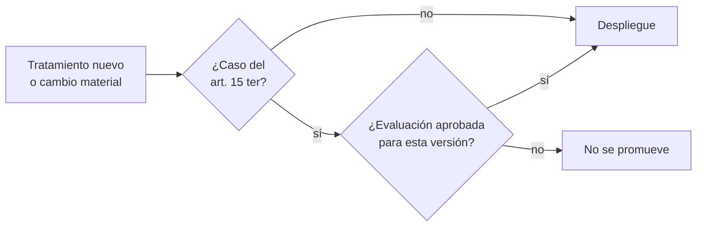
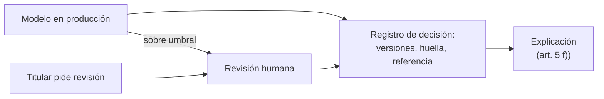

## 1. Resumen

Esta ficha no es asesoría legal: si corresponde una evaluación de impacto y qué régimen aplica a una decisión automatizada lo determina el responsable con el área legal; ingeniería aporta la descripción técnica del tratamiento, los riesgos y los controles, y construye lo que el art. 8 bis exige en los modelos. La aprobación no la decide el pipeline.

**Cómo leerla.** *Comprender* (§1–6): qué es un perfil, una evaluación de impacto y una decisión automatizada, y en qué se diferencian. *Aplicar* (§7–13): la puerta de despliegue y el registro por decisión. *Demostrar*: la evidencia del §8, el código del §10 y los criterios del §18.

Los equipos de datos e IA construyen exactamente lo que la ley regula con más rigor: perfiles, scoring y decisiones automatizadas a gran escala. Dos capacidades marcan la diferencia: una **puerta de evaluación de impacto** antes de pasar a producción, también ante cambios materiales del modelo, y un **registro por decisión** que permite reconstruir, explicar y revisar cualquier resultado que afecte a una persona.

**Distinción esencial:** la evaluación de impacto analiza los riesgos del *tratamiento*; la trazabilidad reconstruye *cada decisión*. Puede hacer falta una evaluación sin que haya un modelo predictivo, y un modelo puede necesitar controles aunque no active por sí solo una evaluación obligatoria.

## 2. Qué es

- **[Obligación legal · art. 2]** **Elaboración de perfiles:** tratamiento automatizado para evaluar, analizar o predecir aspectos de una persona (letra w)). **[Buena práctica]** Tratar como perfiles el scoring, la segmentación y la recomendación; un perfil no es necesariamente una decisión exclusivamente automatizada con efectos significativos.
- **[Obligación legal · art. 15 ter]** **Evaluación de impacto:** previa al tratamiento si es probable un alto riesgo, y siempre en cuatro casos: a) perfiles con efectos significativos, b) tratamiento masivo o a gran escala, c) monitoreo sistemático de zonas públicas, d) sensibles en las excepciones al consentimiento.
- **[Obligación legal · art. 8 bis]** **Decisión automatizada:** el titular puede oponerse y no ser objeto de decisiones basadas en el tratamiento automatizado de sus datos, incluidos los perfiles, que le produzcan efectos jurídicos o lo afecten significativamente; aun en las excepciones (contrato, consentimiento, ley), tiene derecho a explicación, intervención humana, expresar su punto de vista y pedir revisión. **[Buena práctica]** Casos típicos: aprobar o rechazar un crédito, bloquear una transacción, fijar un precio individual, filtrar candidatos.
- **[Obligación legal · art. 14 ter]** La política de tratamiento informa las decisiones automatizadas, su lógica y consecuencias (letra l)).
- **[Decisión de arquitectura]** **Registro de decisión:** versiones de modelo y reglas, huella de las entradas y referencia a ellas guardadas aparte, puntaje, resultado, variables principales y estado de revisión humana.

| Noción | Mira | Pregunta que responde |
|---|---|---|
| Evaluación de impacto | El tratamiento | ¿Qué riesgos tiene para los titulares y cómo se mitigan? |
| Trazabilidad por decisión | Cada caso | ¿Qué datos, versión y reglas produjeron este resultado, y quién lo revisó? |
| Revisión humana efectiva | Cada caso derivado o pedido | ¿Alguien con información y facultad real puede cambiar el resultado? |

## 3. Problema que resuelve

**[Buena práctica]** Sin esto: modelos en producción sin evaluación previa, imposibilidad de explicar por qué se bloqueó un pago o se rechazó a una persona, reentrenamientos y cambios de umbral que cambian decisiones sin trazabilidad, y ninguna forma de revisar un caso cuando el titular lo pide. Una revisión humana puramente formal no corrige nada de eso.

**[Obligación legal · art. 34 quáter]** No hacer la evaluación de impacto cuando corresponde es infracción gravísima (letra k)). **[Decisión de arquitectura]** Por eso la puerta es bloqueante.

## 4. Cómo funciona

1. **[Buena práctica]** Registrar el tratamiento: finalidad, base validada, categorías de titulares, fuentes, variables, destinatarios y retención (`processing-activities-inventory`).
2. **[Obligación legal · art. 15 ter]** Clasificar cada tratamiento nuevo contra los cuatro casos obligatorios; si alguno aplica, la evaluación es requisito para desplegar. **[Buena práctica]** El área legal determina la aplicabilidad; ingeniería aporta hechos verificables.
3. **[Buena práctica]** Ingeniería aporta a la evaluación: flujo de datos, fuentes, variables, sensibles o variables que los revelan (proxies), errores de datos, retención, accesos, terceros, métricas del modelo, falsos positivos y prueba de reidentificación.
4. **[Decisión de arquitectura]** La puerta de despliegue no promueve una versión mayor del modelo sin una evaluación aprobada para ella: nuevas fuentes, variables, poblaciones o umbrales son cambios materiales que piden reevaluar.
5. **[Decisión de arquitectura]** En producción, registrar cada decisión con versiones de modelo y reglas, huella de las entradas y referencia a esas entradas guardadas aparte, con acceso restringido.
6. **[Obligación legal · art. 8 bis]** El responsable asegura la intervención humana y el derecho a pedir revisión. **[Decisión de arquitectura]** Umbrales que derivan a revisión, con una persona que tiene información suficiente y facultad para cambiar el resultado, y un flujo para que el titular pida revisar su caso.
7. **[Obligación legal · art. 5]** El acceso incluye información significativa sobre la lógica aplicada (letra f)). **[Decisión de arquitectura]** Generarla por titular desde el registro: variables principales y lógica general.

## 5. Cuándo utilizarlo

- En scoring, fraude, riesgo, precios, segmentación con efectos, monitoreo con cámaras o sensores, y tratamientos masivos.
- En sistemas GenAI que clasifican o priorizan personas (por ejemplo, filtrar postulantes o reclamos).
- La aplicabilidad se analiza caso a caso: estos ejemplos no determinan por sí solos una obligación.

## 6. Cuándo no utilizarlo

- Tableros agregados sin decisiones individuales ni perfiles normalmente no caen en los casos obligatorios, aunque puede haber alto riesgo por otras razones (por ejemplo, reidentificación por cruces).
- No aplicar automáticamente el régimen de decisiones significativas a cualquier segmentación o recomendación; tampoco leer la ausencia de un caso tasado como prueba de bajo riesgo.
- La decisión final sobre la evaluación no es de ingeniería.

## 7. Ejemplo sencillo

| Tratamiento | Caso del art. 15 ter | ¿Evaluación obligatoria? | Pregunta técnica |
|---|---|---|---|
| Score de fraude que bloquea pagos | a) y b) | Sí | ¿El bloqueo es automático y afecta significativamente? |
| Tablero de ocupación de vuelos | Ninguno | No por casos tasados | ¿Puede identificar pasajeros por cruces? |
| Cámaras con analítica en un aeropuerto | c) | Sí | ¿Qué se registra y por cuánto tiempo? |
| Clasificación de reclamos con un LLM | Depende del efecto | A evaluar | ¿Solo ordena una cola o decide un resultado? |

## 8. Ejemplo de producción

Escenario genérico: una aerolínea con un modelo antifraude. BigQuery prepara las variables autorizadas; un pipeline versiona el conjunto de entrenamiento y las transformaciones; el registro de modelos identifica el artefacto desplegado; el servicio de inferencia escribe por decisión su identificador, versiones, resultado y referencia a la evidencia; una cola independiente permite revisar los bloqueos. Un cambio de umbral o de fuente pasa por la puerta de despliegue. La retención del registro de decisiones se define por finalidad, no por un plazo arbitrario.

| Componente | Implementación posible |
|---|---|
| Puerta de evaluación | Check en el pipeline de despliegue del modelo: sin evaluación aprobada para la versión mayor, no se promueve |
| Registro de modelos | Registro de modelos de la nube, con versión, datos de entrenamiento y métricas |
| Registro de decisiones | Tabla particionada por fecha: titular seudónimo, versiones, huella, referencia a entradas, puntaje, resultado |
| Explicaciones | Importancia de variables por decisión, guardada con el registro |
| Revisión humana | Cola de casos derivados y casos pedidos por titulares, con resultado, autoridad y justificación |

### Evidencia de cumplimiento

| Evidencia | Dónde queda | Quién la produce | Qué demuestra | Qué no demuestra |
|---|---|---|---|---|
| Evaluación aprobada por versión mayor del modelo | Repositorio de evaluaciones | Responsable, con aporte técnico | Qué riesgos se evaluaron y quién aprobó | Que las mitigaciones funcionen |
| Resultado de la puerta de despliegue | Log de la CI | CI | Que no se promovió una versión sin evaluación | Que no haya cambios materiales fuera del versionado |
| Registro de cada decisión | Registro de decisiones | Servicio del modelo | Qué versión y reglas produjeron cada resultado | Que la explicación sea fiel al modelo |
| Entradas guardadas por referencia | Almacenamiento protegido | Servicio del modelo | Que la decisión se puede reconstruir | Que sigan disponibles si la retención las borró |
| Revisiones humanas y su resultado | Cola de revisión | Operación | Cuántas decisiones se revisaron y cuántas cambiaron | Que la revisión sea efectiva y no un visto bueno |

## 9. Arquitectura

**Antes de producción.**



**En producción.**



## 10. Código

```python
# Python 3.12+, biblioteca estándar. (1) Qué tratamientos exigen evaluación de impacto según los casos del
# art. 15 ter, (2) una puerta de despliegue que bloquea una versión mayor del modelo sin evaluación aprobada, y
# (3) un registro de decisión automatizada con lo necesario para reconstruir, explicar y revisar (art. 8 bis).
import hashlib
import json
from dataclasses import dataclass
from datetime import datetime


@dataclass(frozen=True)
class Tratamiento:
    nombre: str
    perfilamiento_con_efectos: bool       # 15 ter a)
    gran_escala: bool                     # 15 ter b)
    monitoreo_zona_publica: bool          # 15 ter c)
    sensibles_sin_consentimiento: bool    # 15 ter d)


def requiere_eipd(t: Tratamiento) -> list[str]:
    casos = {"a) perfilamiento con efectos significativos": t.perfilamiento_con_efectos,
             "b) tratamiento masivo o a gran escala": t.gran_escala,
             "c) monitoreo de zona de acceso público": t.monitoreo_zona_publica,
             "d) sensibles sin consentimiento": t.sensibles_sin_consentimiento}
    return [k for k, v in casos.items() if v]


TRATAMIENTOS = [
    Tratamiento("score_fraude_pagos", True, True, False, False),
    Tratamiento("tablero_ocupacion_vuelos", False, False, False, False),
]
# Evaluaciones aprobadas por el responsable: (tratamiento, versión mayor del modelo). Un cambio de versión mayor
# (variables, fuente, población o umbral) es un cambio material que pide reevaluar.
APROBADAS = {("score_fraude_pagos", "3")}


def puerta_despliegue(t: Tratamiento, modelo: str) -> str:
    mayor = modelo.rsplit("-v", 1)[1].split(".")[0]
    if not requiere_eipd(t) or (t.nombre, mayor) in APROBADAS:
        return "permitido"
    return f"bloqueado: EIPD obligatoria sin aprobación vigente para la versión mayor {mayor}"


def registrar_decision(titular: str, entradas: dict[str, float], modelo: str, reglas: str, puntaje: float,
                       umbral: float) -> dict[str, object]:
    """Registro por decisión: versiones de modelo y reglas, huella y referencia a las entradas, resultado y revisión."""
    automatica = puntaje < umbral
    huella = hashlib.sha256(json.dumps(entradas, sort_keys=True).encode()).hexdigest()[:12]
    return {
        "titular": titular,                                # llave seudónima
        "momento": datetime(2026, 10, 22, 10, 5).isoformat(timespec="minutes"),
        "modelo": modelo,
        "reglas": reglas,
        "huella_entradas": huella,                         # verifica que las entradas recuperadas son las usadas
        "variables_principales": sorted(entradas, key=lambda k: -abs(entradas[k]))[:2],
        "puntaje": puntaje,
        "entradas_ref": f"evidencia://decisiones/{huella}",  # entradas guardadas aparte, con acceso restringido
        "resultado": "aprobada" if automatica else "derivada a revisión humana",
        "titular_puede_pedir_revision": True,
    }


if __name__ == "__main__":
    for t in TRATAMIENTOS:
        print(t.nombre, "→ EIPD obligatoria por:", requiere_eipd(t) or "ningún caso tasado")
    for modelo in ("fraude-v3.3", "fraude-v4.0"):
        print(f"despliegue {modelo}:", puerta_despliegue(TRATAMIENTOS[0], modelo))
    print(registrar_decision("c3d3a94d7560c6ae", {"monto_relativo": 0.9, "pais_tarjeta_distinto": 1.0,
                                                  "antiguedad_cliente": -0.2}, "fraude-v3.2", "r7", 0.81, 0.7))
```

El script se **ejecuta en la CI** con la biblioteca estándar y pasa `mypy --strict`. Imprime que el score de fraude exige evaluación por los casos a) y b), que el tablero de ocupación no cae en ningún caso tasado, la puerta de despliegue y un registro de decisión derivado a revisión humana:

```text
despliegue fraude-v3.3: permitido
despliegue fraude-v4.0: bloqueado: EIPD obligatoria sin aprobación vigente para la versión mayor 4
```

El registro guarda una huella de las entradas y una referencia a ellas, no las entradas: la huella verifica que las entradas recuperadas son las que se usaron; la reconstrucción y la explicación necesitan las entradas guardadas aparte, con acceso restringido. **Limitaciones:** que el registro tenga todos sus campos no demuestra que la evidencia exista, que la explicación sea fiel ni que la revisión humana sea efectiva; el ejemplo no decide obligaciones legales ni mide sesgo.

## 11. GCP

En GCP, **Model Registry on Gemini Enterprise Agent Platform** y **Sensitive Data Protection**. Según *Introduction to Model Registry* y *Re-identification risk analysis* (no ejecutado):

| Necesidad | Servicio |
|---|---|
| Registro de modelos | Model Registry: repositorio central del ciclo de vida, con versiones |
| Prueba de reidentificación | Análisis de riesgo de Sensitive Data Protection (k-anonimato, l-diversidad); apoya la evaluación, no la certifica |
| Registro de decisiones y puerta | Tabla y check de CI propios; no los da el registro de modelos |

## 12. AWS

En AWS, **SageMaker Model Registry**. Según *Model Registration Deployment with Model Registry* (no ejecutado):

| Necesidad | Servicio |
|---|---|
| Registro de modelos | Versiones, métricas, Model Cards y linaje del modelo |
| Registro de decisiones y puerta | Tabla y check de CI propios |

## 13. Azure

En Azure, **Azure Machine Learning**. Según *MLOps model management with Azure Machine Learning* (no ejecutado):

| Necesidad | Servicio |
|---|---|
| Linaje y auditoría del ciclo de vida | Quién publicó, por qué cambió y cuándo se desplegó cada modelo |
| Explicaciones | Interpretabilidad de modelos |
| Registro de decisiones y puerta | Tabla y check de CI propios |

**Criterio común:** ningún registro de modelos determina el cumplimiento ni garantiza explicaciones suficientes por decisión; versiona el artefacto, no el caso.

## 14. Buenas prácticas

- **[Buena práctica]** Versionar modelo, reglas, esquema y transformaciones, no solo el archivo del modelo.
- **[Buena práctica]** Revisar variables que revelan datos sensibles: comuna o nivel de ingreso pueden revelar la situación socioeconómica, que la ley trata como sensible.
- **[Buena práctica]** **Seguridad:** el registro de decisiones y las entradas guardadas son datos personales; un identificador seudónimo sigue siéndolo; retención por finalidad y acceso restringido.
- **[Buena práctica]** **GenAI:** tratar como decisión automatizada (art. 8 bis) la de un LLM que clasifica o prioriza personas con efectos significativos; registrar el prompt (sin datos personales o seudonimizado), la versión del modelo y el resultado.
- **[Decisión de arquitectura]** Definir de antemano los disparadores de reevaluación: fuentes, finalidades, variables, umbrales o poblaciones nuevas.
- **[Buena práctica]** **Observabilidad:** porcentaje de decisiones trazables, tiempo de reconstrucción, tasa de derivación a revisión humana y tasa de decisiones revertidas por la revisión.
- **[Buena práctica]** **Costo:** guardar explicaciones solo para decisiones con efecto (rechazos, bloqueos), no para todas las inferencias.

## 15. Errores frecuentes

- **Hacer la evaluación después de desplegar:** el riesgo ya está en producción y la puerta no sirvió.
- **Revisión humana que solo confirma lo que dice el modelo:** no hay intervención humana real.
- **Reentrenar o cambiar el umbral sin nueva versión registrada:** las decisiones cambian sin trazabilidad.
- **Guardar solo la huella de las entradas y decir que explica el resultado:** sin las entradas no hay reconstrucción.
- **Confundir la importancia de variables con una explicación causal:** la explicación al titular queda engañosa.
- **Tratar cualquier score como decisión significativa, o ninguno:** se sobrecarga la revisión o se omiten garantías.
- **Conservar las trazas indefinidamente «por auditoría»:** sin plazo aprobado, el registro se vuelve un riesgo.

## 16. Trade-offs

| Elección | Ventaja | Riesgo o costo |
|---|---|---|
| Más revisión humana | Menos decisiones solo automatizadas | Costo y latencia; derivar por umbral y tipo de efecto, y medir si la revisión cambia resultados |
| Evidencia detallada | Mejor reconstrucción | Más exposición y retención de datos |
| Referencias a evidencia protegida | Menos duplicación en el registro | Depende de la disponibilidad y el versionado del almacenamiento |
| Reevaluar ante cambios | Riesgo controlado | Más coordinación y tiempo de despliegue |

## 17. Conceptos relacionados

- `chile-data-protection`: ficha padre.
- `k-anonymity`: prueba de reidentificación.
- `processing-activities-inventory`: la descripción del tratamiento.
- `data-subject-rights-pipeline`: el acceso a la lógica.
- `chilean-identifier-pseudonymization`: el titular seudonimizado.
- `data-lineage`: de qué datos sale cada decisión.
- `privacy-controls-as-code`: la puerta de despliegue.

## 18. Preguntas técnicas abiertas

1. ¿Qué modelos tuyos toman decisiones con efecto sobre personas sin revisión humana?
2. ¿Podrías explicar hoy una decisión de hace seis meses, con sus entradas y versiones?
3. ¿Tu pipeline de despliegue sabe si existe una evaluación de impacto para la versión que promueve?
4. ¿Qué cambios cuentan como materiales en tus modelos?

**Criterio de dominio:** dominas esta ficha si puedes describir el flujo y las variables de un tratamiento, identificar sus dependencias y riesgos de datos, controlar la promoción de un modelo sujeto a aprobación, reconstruir una decisión histórica con versiones y entradas, y distinguir un control técnico de una garantía jurídica.

## 19. Laboratorio relacionado

Propuesta para F4: un modelo antifraude simulado con dos versiones de reglas, cinco decisiones registradas y una revisión humana; una promoción bloqueada por falta de evaluación y la reconstrucción de una decisión anterior sin copiar datos sensibles a los logs. Se aprueba si la evidencia queda completa, versionada y accesible solo a roles autorizados.

## 20. Fuentes

- BCN Ley Chile: *Ley 19628 SOBRE PROTECCION DE LOS DATOS PERSONALES* (versión con vigencia diferida desde 2026-12-01).
- Google Cloud: *Introduction to Model Registry* y *Re-identification risk analysis*.
- AWS: *Model Registration Deployment with Model Registry*.
- Microsoft Learn: *MLOps model management with Azure Machine Learning*.

El detalle de cada fuente está en `sources` del frontmatter.

## 21. Fecha de última verificación

2026-10-25: textos legales vueltos a consultar en BCN, sin cambios. Antes, 2026-10-22: arts. 2, 5, 8 bis, 14 ter, 15 ter y 34 quáter consultados ese día en BCN. `review_required`: pasa a `verified` solo con la aprobación explícita de Felipe (`owner_approved_at`). Revisión mensual.

## 22. Historial de cambios importantes

- 2026-10-22: creación (upgrade de 19); reemplaza a `dpia-technical-input` y `automated-decision-traceability`, que quedan como alias.
- 2026-10-24: `PART_OF` hacia `chile-data-protection` (ADR-024) e `implication` por artículo en `legal_basis` (enmienda de ADR-023). Sin cambios de contenido legal ni de código.
- 2026-10-25: revisión del upgrade (`docs/reviews/cards-f3b-19-upgrade.md`) y auditoría de las etiquetas «Obligación legal»: cada una afirma solo lo que dice su artículo; lo demás pasa a buena práctica o decisión de arquitectura. Textos de BCN y del Senado consultados el 2026-10-25, sin cambios desde el 2026-10-22.
- 2026-10-25: §9 con el estándar de diagramas (máximo 8 nodos, CLAUDE.md): dos diagramas: antes de producción (puerta del art. 15 ter) y en producción.
- 2026-10-28: mejora de contenido (lote P1) con tres niveles de lectura: §1 (la evaluación mira el tratamiento; la trazabilidad, cada decisión), §2 (perfil no es decisión significativa; tabla de evaluación, trazabilidad y revisión efectiva), §3, §4 (registro del tratamiento, cambios materiales en la puerta, entradas guardadas por referencia, revisión con facultad real), §5, §6, §7 (reclamos con LLM y pregunta técnica por caso), §8 (escenario y evidencia «qué demuestra y qué no»), §9 (puerta por versión y vuelta de la revisión al registro), §10 (puerta de despliegue por versión mayor y registro con versión de reglas y referencia a las entradas, sobre el mismo ejemplo; la huella sola no reconstruye), §11–13 (criterio común), §14–16, §17 (relación con `privacy-controls-as-code`), §18 (criterio de dominio) y §19 (laboratorio para F4). Sin cambios en `legal_basis`, etiquetas, aviso ni vigencia; Model Registry se sigue nombrando como en su página (Gemini Enterprise Agent Platform).
- 2026-10-28: pasa al dominio 24-privacy-engineering, tramo `riesgo-terceros-incidentes` (ADR-027), desde 19-compliance; sin cambios de contenido. La URL de la ficha (`/concepts/dpia-and-automated-decisions/`) no cambia.
- 2026-10-30: Enmienda 4 de ADR-023: 4 tabla(s) sin columna ni línea «Etiqueta»; la fila con origen legal lleva «Obligación legal» al inicio de su primera celda. Sin cambios de contenido.
