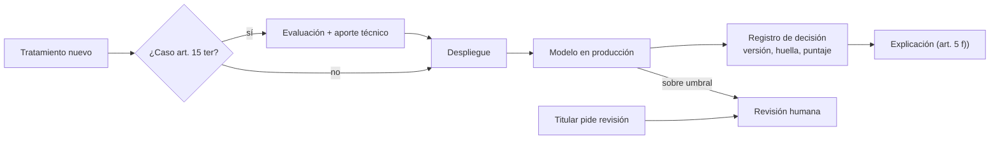

## 1. Resumen

Esta ficha no es asesoría legal: la evaluación de impacto la firma el responsable; ingeniería aporta la descripción técnica del tratamiento, los riesgos y los controles, y construye lo que el art. 8 bis exige en los modelos.

Los equipos de datos e IA construyen exactamente lo que la ley regula con más rigor: perfiles, scoring y decisiones automatizadas a gran escala. Dos capacidades marcan la diferencia: una **puerta de evaluación de impacto** antes de pasar a producción, y un **registro por decisión** que permite explicar y revisar cualquier resultado que afecte a una persona.

## 2. Qué es

- **[Obligación legal · art. 2]** **Elaboración de perfiles:** tratamiento automatizado para evaluar, analizar o predecir aspectos de una persona (letra w)). **[Buena práctica]** Tratar como perfiles el scoring, la segmentación y la recomendación.
- **[Obligación legal · art. 15 ter]** **Evaluación de impacto:** previa al tratamiento si es probable un alto riesgo, y siempre en cuatro casos: a) perfiles con efectos significativos, b) tratamiento masivo o a gran escala, c) monitoreo sistemático de zonas públicas, d) sensibles en las excepciones al consentimiento.
- **[Obligación legal · art. 8 bis]** **Decisión automatizada:** el titular puede oponerse y no ser objeto de decisiones basadas en el tratamiento automatizado de sus datos, incluidos los perfiles, que le produzcan efectos jurídicos o lo afecten significativamente; aun en las excepciones (contrato, consentimiento, ley), tiene derecho a explicación, intervención humana, expresar su punto de vista y pedir revisión. **[Buena práctica]** Casos típicos: aprobar o rechazar un crédito, bloquear una transacción, fijar un precio individual, filtrar candidatos.
- **[Obligación legal · art. 14 ter]** La política de tratamiento informa las decisiones automatizadas, su lógica y consecuencias (letra l)).
- **[Decisión de arquitectura]** **Registro de decisión:** versión del modelo, huella de las entradas, puntaje, resultado, variables principales y estado de revisión humana.

## 3. Problema que resuelve

**[Buena práctica]** Sin esto: modelos en producción sin evaluación previa, imposibilidad de explicar por qué se rechazó a una persona, reentrenamientos que cambian decisiones sin trazabilidad, y ninguna forma de revisar un caso cuando el titular lo pide.

**[Obligación legal · art. 34 quáter]** No hacer la evaluación de impacto cuando corresponde es infracción gravísima (letra k)). **[Decisión de arquitectura]** Por eso la puerta es bloqueante.

## 4. Cómo funciona

1. **[Obligación legal · art. 15 ter]** Clasificar cada tratamiento nuevo contra los cuatro casos obligatorios; si alguno aplica, la evaluación es requisito para desplegar.
2. **[Buena práctica]** Ingeniería aporta a la evaluación: flujo de datos, fuentes, variables, sensibles o variables que los revelan, retención, accesos, terceros, métricas del modelo y prueba de reidentificación.
3. **[Decisión de arquitectura]** En producción, registrar cada decisión con versión de modelo y huella de las entradas.
4. **[Obligación legal · art. 8 bis]** El responsable asegura la intervención humana y el derecho a pedir revisión. **[Decisión de arquitectura]** Umbrales que derivan a revisión y un flujo para que el titular pida revisar su caso.
5. **[Obligación legal · art. 5]** El acceso incluye información significativa sobre la lógica aplicada (letra f)). **[Decisión de arquitectura]** Generarla por titular desde el registro: variables principales y lógica general.

## 5. Cuándo utilizarlo

- En scoring, fraude, riesgo, precios, segmentación con efectos, monitoreo con cámaras o sensores, y tratamientos masivos.
- En sistemas GenAI que clasifican o priorizan personas (por ejemplo, filtrar postulantes o reclamos).

## 6. Cuándo no utilizarlo

- Tableros agregados sin decisiones individuales ni perfiles normalmente no caen en los casos obligatorios, aunque puede haber alto riesgo por otras razones.
- La decisión final sobre la evaluación no es de ingeniería.

## 7. Ejemplo sencillo

| Tratamiento | Caso del art. 15 ter | ¿Evaluación obligatoria? |
|---|---|---|
| Score de fraude que bloquea pagos | a) y b) | Sí |
| Tablero de ocupación de vuelos | Ninguno | No por casos tasados |
| Cámaras con analítica en un aeropuerto | c) | Sí |

## 8. Ejemplo de producción

| Componente | Implementación posible |
|---|---|
| Puerta de evaluación | Check en el pipeline de despliegue del modelo: sin evaluación aprobada, no se promueve |
| Registro de modelos | Registro de modelos de la nube, con versión, datos de entrenamiento y métricas |
| Registro de decisiones | Tabla particionada por fecha: titular seudónimo, versión, huella, puntaje, resultado |
| Explicaciones | Importancia de variables por decisión, guardada con el registro |
| Revisión humana | Cola de casos derivados y casos pedidos por titulares, con resultado registrado |

### Evidencia de cumplimiento

| Evidencia | Dónde queda | Quién la produce |
|---|---|---|
| Evaluación aprobada por versión mayor del modelo | Repositorio de evaluaciones | Responsable, con aporte técnico |
| Registro de cada decisión | Registro de decisiones | Servicio del modelo |
| Revisiones humanas y su resultado | Cola de revisión | Operación |

## 9. Arquitectura



## 10. Código

```python
# Python 3.12+, biblioteca estándar. (1) Qué tratamientos exigen evaluación de impacto según los casos del
# art. 15 ter, y (2) un registro de decisión automatizada con lo necesario para explicar y revisar (art. 8 bis).
import hashlib
import json
from dataclasses import dataclass
from datetime import datetime


@dataclass(frozen=True)
class Tratamiento:
    nombre: str
    perfilamiento_con_efectos: bool       # 15 ter a)
    gran_escala: bool                     # 15 ter b)
    monitoreo_zona_publica: bool          # 15 ter c)
    sensibles_sin_consentimiento: bool    # 15 ter d)


def requiere_eipd(t: Tratamiento) -> list[str]:
    casos = {"a) perfilamiento con efectos significativos": t.perfilamiento_con_efectos,
             "b) tratamiento masivo o a gran escala": t.gran_escala,
             "c) monitoreo de zona de acceso público": t.monitoreo_zona_publica,
             "d) sensibles sin consentimiento": t.sensibles_sin_consentimiento}
    return [k for k, v in casos.items() if v]


TRATAMIENTOS = [
    Tratamiento("score_fraude_pagos", True, True, False, False),
    Tratamiento("tablero_ocupacion_vuelos", False, False, False, False),
]


def registrar_decision(titular: str, entradas: dict[str, float], modelo: str, puntaje: float,
                       umbral: float) -> dict[str, object]:
    """Registro por decisión: versión del modelo, huella de las entradas, resultado y ruta de revisión humana."""
    automatica = puntaje < umbral
    return {
        "titular": titular,                                # llave seudónima
        "momento": datetime(2026, 10, 22, 10, 5).isoformat(timespec="minutes"),
        "modelo": modelo,
        "huella_entradas": hashlib.sha256(json.dumps(entradas, sort_keys=True).encode()).hexdigest()[:12],
        "variables_principales": sorted(entradas, key=lambda k: -abs(entradas[k]))[:2],
        "puntaje": puntaje,
        "resultado": "aprobada" if automatica else "derivada a revisión humana",
        "titular_puede_pedir_revision": True,
    }


if __name__ == "__main__":
    for t in TRATAMIENTOS:
        print(t.nombre, "→ EIPD obligatoria por:", requiere_eipd(t) or "ningún caso tasado")
    print(registrar_decision("c3d3a94d7560c6ae", {"monto_relativo": 0.9, "pais_tarjeta_distinto": 1.0,
                                                  "antiguedad_cliente": -0.2}, "fraude-v3.2", 0.81, 0.7))
```

El script se **ejecuta en la CI** con la biblioteca estándar y pasa `mypy --strict`. Imprime que el score de fraude exige evaluación por los casos a) y b), que el tablero de ocupación no cae en ningún caso tasado, y un registro de decisión derivado a revisión humana. El registro guarda una huella de las entradas, no las entradas: permite verificar qué se usó sin duplicar datos personales.

## 11. GCP

En GCP, **Model Registry on Gemini Enterprise Agent Platform** y **Sensitive Data Protection**. Según *Ley 19628 SOBRE PROTECCION DE LOS DATOS PERSONALES*, *Introduction to Model Registry* y *Re-identification risk analysis* (no ejecutado):

| Necesidad | Servicio | Etiqueta |
|---|---|---|
| Registro de modelos | Model Registry: repositorio central del ciclo de vida, con versiones | **[Buena práctica]** |
| Prueba de reidentificación | Análisis de riesgo de Sensitive Data Protection (k-anonimato, l-diversidad) | **[Buena práctica]** |
| Registro de decisiones | Tabla propia; no lo da el registro de modelos | **[Decisión de arquitectura]** |

## 12. AWS

En AWS, **SageMaker Model Registry**. Según *Ley 19628 SOBRE PROTECCION DE LOS DATOS PERSONALES* y *Model Registration Deployment with Model Registry* (no ejecutado):

| Necesidad | Servicio | Etiqueta |
|---|---|---|
| Registro de modelos | Versiones, métricas, Model Cards y linaje del modelo | **[Buena práctica]** |
| Registro de decisiones | Tabla propia | **[Decisión de arquitectura]** |

## 13. Azure

En Azure, **Azure Machine Learning**. Según *Ley 19628 SOBRE PROTECCION DE LOS DATOS PERSONALES* y *MLOps model management with Azure Machine Learning* (no ejecutado):

| Necesidad | Servicio | Etiqueta |
|---|---|---|
| Linaje y auditoría del ciclo de vida | Quién publicó, por qué cambió y cuándo se desplegó cada modelo | **[Buena práctica]** |
| Explicaciones | Interpretabilidad de modelos | **[Buena práctica]** |

## 14. Buenas prácticas

- **[Buena práctica]** Revisar variables que revelan datos sensibles: comuna o nivel de ingreso pueden revelar la situación socioeconómica, que la ley trata como sensible.
- **[Buena práctica]** **Seguridad:** el registro de decisiones es dato personal; retención y acceso restringido.
- **[Buena práctica]** **GenAI:** tratar como decisión automatizada (art. 8 bis) la de un LLM que clasifica o prioriza personas con efectos significativos; registrar el prompt (sin datos personales o seudonimizado), la versión del modelo y el resultado.
- **[Buena práctica]** **Observabilidad:** tasa de derivación a revisión humana y tasa de decisiones revertidas por la revisión.
- **[Buena práctica]** **Costo:** guardar explicaciones solo para decisiones con efecto (rechazos, bloqueos), no para todas las inferencias.

## 15. Errores frecuentes

- Hacer la evaluación después de desplegar.
- Revisión humana que solo confirma lo que dice el modelo.
- Reentrenar sin nueva versión registrada.
- Explicaciones genéricas que no sirven para un caso concreto.

## 16. Trade-offs

Más revisión humana reduce el riesgo y el número de decisiones solo automatizadas, pero agrega costo y latencia. Conviene derivar por umbral y por tipo de efecto, y medir si la revisión cambia resultados.

## 17. Conceptos relacionados

- `chile-data-protection`: ficha padre.
- `k-anonymity`: prueba de reidentificación.
- `processing-activities-inventory`: la descripción del tratamiento.
- `data-subject-rights-pipeline`: el acceso a la lógica.
- `chilean-identifier-pseudonymization`: el titular seudonimizado.
- `data-lineage`: de qué datos sale cada decisión.

## 18. Preguntas técnicas abiertas

1. ¿Qué modelos tuyos toman decisiones con efecto sobre personas sin revisión humana?
2. ¿Podrías explicar hoy una decisión de hace seis meses?
3. ¿Tu pipeline de despliegue sabe si existe una evaluación de impacto?

## 19. Laboratorio relacionado

Pendiente (F4).

## 20. Fuentes

- BCN Ley Chile: *Ley 19628 SOBRE PROTECCION DE LOS DATOS PERSONALES* (versión con vigencia diferida desde 2026-12-01).
- Google Cloud: *Introduction to Model Registry* y *Re-identification risk analysis*.
- AWS: *Model Registration Deployment with Model Registry*.
- Microsoft Learn: *MLOps model management with Azure Machine Learning*.

El detalle de cada fuente está en `sources` del frontmatter.

## 21. Fecha de última verificación

2026-10-25: textos legales vueltos a consultar en BCN, sin cambios. Antes, 2026-10-22: arts. 2, 5, 8 bis, 14 ter, 15 ter y 34 quáter consultados ese día en BCN. `review_required`: pasa a `verified` solo con la aprobación explícita de Felipe (`owner_approved_at`). Revisión mensual.

## 22. Historial de cambios importantes

- 2026-10-22: creación (upgrade de 19); reemplaza a `dpia-technical-input` y `automated-decision-traceability`, que quedan como alias.
- 2026-10-24: `PART_OF` hacia `chile-data-protection` (ADR-024) e `implication` por artículo en `legal_basis` (enmienda de ADR-023). Sin cambios de contenido legal ni de código.
- 2026-10-25: revisión del upgrade (`docs/reviews/cards-f3b-19-upgrade.md`) y auditoría de las etiquetas «Obligación legal»: cada una afirma solo lo que dice su artículo; lo demás pasa a buena práctica o decisión de arquitectura. Textos de BCN y del Senado consultados el 2026-10-25, sin cambios desde el 2026-10-22.
