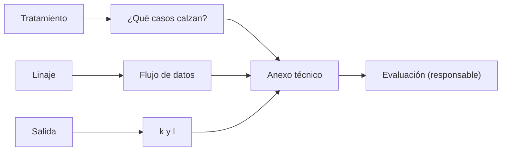

## 1. Resumen

Esta ficha no es asesoría legal: cubre el aporte técnico de ingeniería de datos a una evaluación de impacto.

La ley exige una **evaluación de impacto** antes de un tratamiento que pueda producir alto riesgo, y la exige **siempre** en cuatro casos: decisiones automatizadas o perfiles con efectos significativos, tratamiento masivo, monitoreo de zonas públicas, y datos sensibles en las excepciones del consentimiento. La hace el responsable. Ingeniería de datos aporta un **anexo técnico** que nadie más puede producir:

- qué casos de la ley calzan con el tratamiento, como insumo para la decisión;
- el **flujo de datos** desde el linaje;
- una **prueba de reidentificación** de lo que sale (k y l).

## 2. Qué es

- **[Obligación legal · art. 15 ter]** La evaluación se hace antes de iniciar un tratamiento de alto riesgo, y siempre en los cuatro casos que enumera la ley.
- **[Obligación legal · art. 15 ter]** Las orientaciones que publicará la Agencia considerarán, al menos, la descripción de las operaciones, su finalidad, la necesidad y proporcionalidad, los riesgos y las medidas de mitigación.
- **[Decisión de arquitectura]** El anexo técnico se genera desde el linaje y los datos reales de salida, no se redacta a mano.

## 3. Problema que resuelve

**[Buena práctica]** Un modelo de riesgo de crédito va a producción y alguien pregunta si necesitaba evaluación de impacto. El equipo de datos no sabe qué tablas alimentan el modelo ni si la salida que se comparte con un tercero permite reidentificar a alguien.

## 4. Cómo funciona

1. **[Obligación legal · art. 15 ter]** Revisar contra qué casos de la ley calza el tratamiento; la conclusión la valida el área legal.
2. **[Decisión de arquitectura]** Armar el flujo de datos desde el linaje: de qué tablas sale cada salida.
3. **[Buena práctica]** Medir el riesgo de reidentificación de la salida: k y l sobre los cuasi-identificadores.
4. **[Buena práctica]** Proponer medidas técnicas para los riesgos encontrados (generalizar, suprimir, agregar).
5. **[Decisión de arquitectura]** Versionar el anexo junto al pipeline y regenerarlo en cada cambio.

## 5. Cuándo utilizarlo

- Antes de poner en producción modelos que deciden sobre personas o tratamientos masivos.
- Antes de compartir una salida con un tercero.

## 6. Cuándo no utilizarlo

- Para decidir si el riesgo es aceptable: lo decide el responsable.
- Como la evaluación completa: es solo su anexo técnico.

## 7. Ejemplo sencillo

| Revisión | Resultado |
|---|---|
| Casos de la ley que calzan | a) decisiones automatizadas; b) masivo (con el umbral interno) |
| Flujo de `gold.puntajes` | `modelo_riesgo`, `silver.clientes`, `silver.creditos` |
| Riesgo de la salida | k = 1, l = 1 |
| Clases únicas | `norte, 50-59, M` y `sur, 40-49, F` |

## 8. Ejemplo de producción

- Un job que genera el anexo (casos, flujo, k y l) y lo deja junto a la definición del pipeline.
- El área legal y el responsable usan el anexo en la evaluación.
- Si k o l bajan de un umbral, la salida no se comparte hasta mitigarlo.

### Evidencia de cumplimiento

| Evidencia | Dónde queda | Quién la produce |
|---|---|---|
| Anexo técnico con fecha y versión del pipeline | Repositorio | Ingeniería de datos |
| Evaluación de impacto | Registro del responsable | Responsable y área legal |
| Medidas de mitigación aplicadas | Cambios del pipeline | Ingeniería de datos |

## 9. Arquitectura



## 10. Código

```python
# Python 3.12, biblioteca estándar (ejecutado en la CI): aporte técnico a la evaluación de impacto. Revisa contra
# qué casos de la ley calza el tratamiento, arma el flujo de datos desde el linaje y prueba el riesgo de
# reidentificación de la salida (k y l sobre cuasi-identificadores). La decisión y la evaluación las hace el
# responsable; esto es el anexo técnico.
from collections import defaultdict

TRATAMIENTO = {"decisiones_automatizadas_con_efectos": True, "titulares": 250_000, "monitoreo_zona_publica": False,
               "sensibles_sin_consentimiento": False}
UMBRAL_MASIVO = 100_000  # criterio interno de «gran escala»; la ley no fija un número
LINAJE = {"modelo_riesgo": ["silver.clientes", "silver.creditos"], "gold.puntajes": ["modelo_riesgo"]}
SALIDA = [  # (región, tramo de edad, sexo, resultado) que se compartiría con un tercero
    ("norte", "30-39", "F", "aprobado"), ("norte", "30-39", "F", "rechazado"), ("norte", "50-59", "M", "aprobado"),
    ("sur", "20-29", "M", "rechazado"), ("sur", "20-29", "M", "rechazado"), ("sur", "40-49", "F", "aprobado"),
]

casos = {
    "a) decisiones automatizadas o perfiles con efectos significativos": TRATAMIENTO["decisiones_automatizadas_con_efectos"],
    "b) tratamiento masivo o a gran escala": int(TRATAMIENTO["titulares"]) >= UMBRAL_MASIVO,
    "c) monitoreo sistemático de una zona de acceso público": TRATAMIENTO["monitoreo_zona_publica"],
    "d) datos sensibles en excepción del consentimiento": TRATAMIENTO["sensibles_sin_consentimiento"],
}
print("casos que exigen evaluación:", [c for c, aplica in casos.items() if aplica])


def origenes(nodo: str) -> list[str]:
    fuentes = LINAJE.get(nodo, [])
    return sorted({f for fuente in fuentes for f in ([fuente] + origenes(fuente))})


print("flujo de datos de gold.puntajes:", origenes("gold.puntajes"))
clases: dict[tuple[str, str, str], list[str]] = defaultdict(list)
for region, edad, sexo, resultado in SALIDA:
    clases[(region, edad, sexo)].append(resultado)
k = min(len(v) for v in clases.values())
l_div = min(len(set(v)) for v in clases.values() if len(v) >= 2)
print(f"riesgo de reidentificación de la salida: k={k}, l={l_div} entre las clases con 2 o más filas")
print("clases únicas (k=1):", sorted(c for c, v in clases.items() if len(v) == 1))
```

El script se **ejecuta en la CI** con la biblioteca estándar y pasa `mypy --strict`. Imprime los dos casos que calzan, el flujo de `gold.puntajes`, k = 1 y l = 1, y las dos clases únicas. El umbral de «gran escala» es un criterio interno: la ley no fija un número.

## 11. GCP

En GCP, **Sensitive Data Protection**. Según *Ley 19628 SOBRE PROTECCION DE LOS DATOS PERSONALES* y *Re-identification risk analysis* (no ejecutado):

| | Anexo (este ejemplo) | Sensitive Data Protection | Etiqueta |
|---|---|---|---|
| Riesgo de reidentificación | k y l en Python | k-anonimato, l-diversidad, k-map y δ-presence sobre BigQuery | **[Buena práctica]** |
| Decisión | Del responsable | Del responsable | **[Decisión de arquitectura]** |

## 12. AWS

En AWS, **AWS Clean Rooms**. Según *Ley 19628 SOBRE PROTECCION DE LOS DATOS PERSONALES* y *Aggregation analysis rule* (no ejecutado):

| | Anexo (este ejemplo) | Clean Rooms | Etiqueta |
|---|---|---|---|
| Compartir con un tercero | Salida a nivel de fila, medida | Solo resultados agregados con un mínimo de valores distintos | **[Decisión de arquitectura]** |

## 13. Azure

En Azure, **Azure confidential computing**. Según *Ley 19628 SOBRE PROTECCION DE LOS DATOS PERSONALES* y *Confidential AI* (no ejecutado):

| | Anexo (este ejemplo) | Confidential AI | Etiqueta |
|---|---|---|---|
| Desidentificar | Medir k y l | La página dice que la desidentificación sola ha demostrado ser frágil | **[Buena práctica]** |

## 14. Buenas prácticas

- **[Obligación legal · art. 15 ter]** Hacer el anexo antes de iniciar el tratamiento, no después.
- **[Buena práctica]** Regenerar el anexo en cada cambio del pipeline o del modelo.
- **[Buena práctica]** **Seguridad:** el anexo describe datos sin contenerlos; no copiar filas reales.
- **[Buena práctica]** **Observabilidad:** alertar si k o l de una salida compartida bajan del umbral.
- **[Buena práctica]** **Costo:** medir sobre la salida que se comparte, no sobre todo el warehouse.

## 15. Errores frecuentes

- Hacer la evaluación después de lanzar.
- Medir k sin medir l.
- Decidir desde ingeniería que no hace falta evaluación.

## 16. Trade-offs

Un anexo automático se mantiene al día y cubre solo lo que se puede medir; los riesgos de discriminación o de uso indebido los evalúa el responsable con otras herramientas.

## 17. Conceptos relacionados

- `k-anonymity`: la medida de reidentificación.
- `data-lineage`: el flujo.
- `pseudonymization-vs-anonymization`: qué tan identificable queda la salida.
- `processing-activities-inventory`: la descripción del tratamiento.

## 18. Preguntas técnicas abiertas

1. ¿Tienes tratamientos que caen en alguno de los cuatro casos?
2. ¿Puedes generar hoy el flujo de datos de un modelo?
3. ¿Cuál es el k de lo que compartes con terceros?

## 19. Laboratorio relacionado

Pendiente (F4).

## 20. Fuentes

- BCN Ley Chile: *Ley 19628 SOBRE PROTECCION DE LOS DATOS PERSONALES* (versión con vigencia diferida desde 2026-12-01).
- Google Cloud: *Re-identification risk analysis*.
- AWS: *Aggregation analysis rule*.
- Microsoft Learn: *Confidential AI*.

El detalle de cada fuente está en `sources` del frontmatter.

## 21. Fecha de última verificación

2026-10-21: texto legal consultado ese día en BCN. `review_required`: pendiente de revisión B-F3.1 del lote F3b-19c; pasa a `verified` solo con la aprobación explícita de Felipe (`owner_approved_at`). Revisión mensual.

## 22. Historial de cambios importantes

- 2026-10-21: creación (lote F3b-19c).
