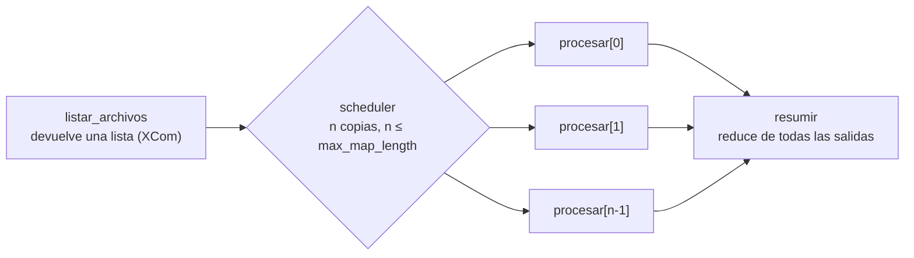

## 1. Resumen

En un Dag fijo, el autor sabe cuántas tareas hay. Pero a veces la cantidad depende de los datos de la corrida: hoy llegaron 3 archivos, mañana 40. En Airflow 3.3.2, **Dynamic Task Mapping** resuelve eso en tiempo de ejecución:

- una tarea devuelve una lista;
- `expand()` crea una copia de la tarea siguiente por cada elemento;
- una tarea final puede reunir la salida de todas las copias (map y reduce).

La diferencia clave con un bucle `for` en el Dag file es **cuándo** se decide la cantidad: el bucle corre al parsear el Dag; el mapeo, al ejecutar, con la salida real de la tarea anterior.

## 2. Qué es

- **Tarea mapeada:** una tarea con `expand(param=lista)`. Justo antes de ejecutarla, el scheduler crea `n` copias, una por elemento.
- **`partial()`:** fija argumentos que son iguales para todas las copias, como el destino o un `conn_id`.
- **Varios parámetros en `expand`:** producto cruzado de todas las combinaciones.
- **Reduce:** una tarea que recibe la salida reunida de todas las copias.
- **Límites:**
  - `[core] max_map_length` (por defecto 1024): si la lista es más larga, **falla la tarea que la produjo**;
  - `max_active_tis_per_dag` en la tarea mapeada: cuántas copias corren a la vez.

## 3. Problema que resuelve

Sin mapeo dinámico, hay dos salidas malas:

- Una sola tarea procesa todos los archivos en un bucle. Si falla el archivo 37, se reintenta todo y no se ve cuál falló.
- El Dag file lista los archivos al parsear y crea una tarea por cada uno. Eso consulta el almacenamiento en cada parseo, que la documentación desaconseja porque afecta el rendimiento, y la lista puede cambiar entre el parseo y la ejecución.

Con el mapeo, cada archivo es una instancia con su estado y sus reintentos, y la lista sale de la corrida.

## 4. Cómo funciona

1. `listar_archivos` corre y devuelve una lista (vía XCom).
2. El scheduler lee esa salida y crea una copia de `procesar` por elemento, con los argumentos de `partial` iguales en todas.
3. Las copias corren en paralelo, como máximo `max_active_tis_per_dag` a la vez.
4. Cada copia tiene su estado; una que falla se reintenta sola.
5. `resumir` depende de todas las copias y recibe sus salidas reunidas.
6. Si la lista supera `max_map_length`, falla `listar_archivos`, antes de crear las copias.

## 5. Cuándo utilizarlo

- Una cantidad variable de archivos, particiones, tablas o clientes por corrida.
- Cuando cada elemento debe reintentarse y observarse por separado.
- Map y reduce: procesar en paralelo y luego consolidar.

## 6. Cuándo no utilizarlo

- Si la cantidad es fija y conocida, un Dag estático es más fácil de leer.
- Para millones de elementos pequeños: cada copia es una instancia de tarea con su sobrecarga; mejor agrupar en lotes o delegar a un motor de procesamiento (ver `pyspark-dataframes`).
- No generar tareas leyendo sistemas externos en el nivel superior del Dag file.

## 7. Ejemplo sencillo

`listar_archivos` devuelve `["ventas_1.csv", "ventas_2.csv", "ventas_3.csv"]`. `procesar.partial(destino="validado/ventas").expand(archivo=...)` crea tres copias de `procesar`, cada una con un archivo y el mismo destino. `resumir` suma lo que devolvió cada una.

## 8. Ejemplo de producción

Cada día llegan entre 5 y 200 archivos de sucursales. El Dag `procesar_archivos_del_dia`:

1. lista los archivos del día;
2. mapea `procesar` sobre ellos, con `max_active_tis_per_dag=4` para no saturar la base destino;
3. resume las filas procesadas.

Si el archivo de una sucursal está corrupto, falla solo su copia; las demás terminan. Tras corregir el archivo, se relanza esa copia sin repetir las otras.

El equipo sabe que un día con más de 1024 archivos haría fallar el listado. Por eso agrupa los archivos por sucursal antes de mapear.

## 9. Arquitectura



## 10. Código

```python
# Airflow 3.3.2 (cargado en la CI con DagBag, sin errores de import; las tareas no se ejecutan): Dynamic Task
# Mapping. Cuántas copias de "procesar" hay se decide al ejecutar, según la salida de listar_archivos, no al parsear.
import datetime

from airflow.sdk import DAG, task

with DAG(
    dag_id="procesar_archivos_del_dia",
    start_date=datetime.datetime(2026, 10, 1),
    schedule="@daily",
    catchup=False,
):

    @task
    def listar_archivos() -> list[str]:
        # En un Dag real, listaría el prefijo del día en el almacenamiento; aquí, una lista fija.
        return ["ventas_1.csv", "ventas_2.csv", "ventas_3.csv"]

    @task(max_active_tis_per_dag=4)              # como máximo 4 copias corriendo a la vez
    def procesar(archivo: str, destino: str) -> int:
        print(f"procesando {archivo} hacia {destino}")
        return 1

    @task
    def resumir(procesados: list[int]) -> int:    # reduce: recibe la salida de todas las copias
        return sum(procesados)

    # partial: argumentos iguales para todas las copias; expand: una copia por elemento de la lista.
    procesados = procesar.partial(destino="validado/ventas").expand(archivo=listar_archivos())
    resumir(procesados)
```

```python
# Python 3.12, solo biblioteca estándar (ejecutado; mypy --strict sin errores): map y reduce con un límite de copias
# y de concurrencia, como hace el scheduler con una tarea mapeada. Simulación didáctica, no es Airflow.
import threading
from concurrent.futures import ThreadPoolExecutor

MAX_MAP_LENGTH = 1024        # en Airflow, [core] max_map_length (por defecto 1024)
MAX_ACTIVAS = 4              # en Airflow, max_active_tis_per_dag de la tarea mapeada
activas, pico = 0, 0
candado = threading.Lock()


def procesar(archivo: str) -> int:
    global activas, pico
    with candado:
        activas += 1
        pico = max(pico, activas)
    filas = len(archivo)     # trabajo simulado
    with candado:
        activas -= 1
    return filas


def mapear(archivos: list[str]) -> int:
    if len(archivos) > MAX_MAP_LENGTH:
        raise ValueError(f"{len(archivos)} elementos superan el máximo de {MAX_MAP_LENGTH}")
    with ThreadPoolExecutor(max_workers=MAX_ACTIVAS) as pool:
        return sum(pool.map(procesar, archivos))      # reduce sobre la salida de todas las copias


print(mapear([f"ventas_{i}.csv" for i in range(1, 11)]), "filas; nunca más de 4 copias a la vez:", pico <= MAX_ACTIVAS)
# 121 filas; nunca más de 4 copias a la vez: True
try:
    mapear([f"ventas_{i}.csv" for i in range(2000)])
except ValueError as error:
    print(error)             # 2000 elementos superan el máximo de 1024
```

El primer bloque es un Dag de **Airflow 3.3.2**. La CI lo carga con `DagBag` en cada push (`make check-airflow-dag`, entorno aparte con la versión fijada). La prueba verifica:

- que no haya errores de import;
- que `procesar` sea una tarea mapeada (en 3.3.2, un `DecoratedMappedOperator`, subclase de `MappedOperator`) que depende de `listar_archivos`;
- que `resumir` dependa de `procesar`.

Las tareas no se ejecutan, así que la cantidad de copias, que se decide al ejecutar, no se prueba. El Dag no se cargó en local.

El segundo bloque, en Python 3.12 sin Airflow, está ejecutado y pasa `mypy --strict` sin errores. Es una simulación didáctica de map y reduce con un tope de elementos y de concurrencia, no el scheduler de Airflow.

## 11. GCP

No aplica de forma específica: el mapeo es de Airflow. Ver `open-source-vs-managed-orchestration` para la versión de Airflow de cada servicio.

## 12. AWS

No aplica de forma específica (ver §11).

## 13. Azure

No aplica de forma específica (ver §11).

## 14. Buenas prácticas

- La lista de elementos sale de una tarea, no del nivel superior del Dag file.
- Argumentos comunes en `partial`; solo lo que varía, en `expand`.
- `max_active_tis_per_dag` para proteger el sistema destino.
- Agrupar elementos si la cantidad puede acercarse a `max_map_length`.
- Cada copia idempotente: se reintenta sola (ver `orchestration-task`).
- **Seguridad:** todas las copias usan las mismas credenciales; el tope de concurrencia evita también que muchas copias abran conexiones a la vez contra un sistema que limita sesiones.
- **Observabilidad:** mirar cuántas copias se crearon y cuántas fallaron por corrida; un salto en la cantidad suele ser un problema aguas arriba.
- **Costo:** muchas copias a la vez acortan la corrida pero exigen más workers a la vez; el tope de concurrencia es también un tope de capacidad.

## 15. Errores frecuentes

- Listar archivos en el nivel superior del Dag file para crear tareas con un `for`.
- Pasar por XCom la lista de datos completos en vez de referencias (rutas, claves).
- Mapear millones de elementos diminutos.
- No limitar la concurrencia y saturar la base destino.

## 16. Trade-offs

El mapeo da paralelismo, reintentos por elemento y un Dag que se adapta a los datos. A cambio, la forma de la corrida no se ve hasta ejecutar, y hay sobrecarga por instancia. Agrupar elementos reduce esa sobrecarga, pero los fallos y reintentos vuelven a ser por grupo.

## 17. Conceptos relacionados

- `dag` y `orchestration-task`: el grafo y sus instancias.
- `pipeline-dependencies`: el reduce depende de todas las copias.
- `retries` e `idempotency`: reintentar una copia sin duplicar.

## 18. Preguntas técnicas abiertas

1. ¿Qué tarea de tu pipeline procesa en un bucle elementos que convendría mapear?
2. ¿Cuál es el máximo realista de elementos por corrida, y qué harías si supera el límite?
3. ¿Qué tope de concurrencia tolera tu sistema destino?

## 19. Laboratorio relacionado

Pendiente (F4).

## 20. Fuentes

- Apache Airflow 3.3.2: *Dynamic Task Mapping*, *TaskFlow* y *Best Practices*.

El detalle de cada fuente está en `sources` del frontmatter.

## 21. Fecha de última verificación

2026-10-11. Pasa a `verified`: revisión B-F3.1 del lote F3b-06a aplicada, sin VERIFY pendientes.

## 22. Historial de cambios importantes

- 2026-10-11: creación (lote F3b-06a).
- 2026-10-11: revisión B-F3.1 del lote F3b-06a aplicada (docs/reviews/cards-f3b-06a.md): filas aprobadas sin cambios en esta ficha.
- 2026-10-11: `verification_status: verified` (sin VERIFY pendientes).
