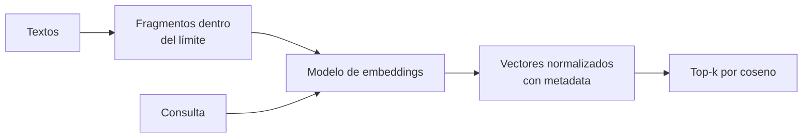

## 1. Resumen

Un **embedding** es un vector de números que representa un texto (o una imagen) de modo que textos de significado parecido quedan **cerca**. La cercanía se mide con la **similitud coseno**: con vectores normalizados, el producto punto. Es la base de la búsqueda semántica, de la deduplicación aproximada y de RAG (`rag`).

Para un data engineer, generar embeddings es un **pipeline más**: leer textos, dividirlos en fragmentos que respeten el límite de tokens del modelo, llamar al modelo por lotes, guardar los vectores con su metadata y versionar el modelo usado. Un vector de un modelo no se compara con uno de otro.

## 2. Qué es

- **Vector:** una lista de números de dimensión fija; 3072 para `gemini-embedding-001`, 1024 por defecto en Titan Text Embeddings V2 (*Get text embeddings*, *Amazon Titan Text Embeddings models*).
- **Norma L2 y coseno:** con vectores de norma 1, el producto punto es la similitud coseno.
- **Modelo de embeddings:** distinto de un modelo generativo; no escribe texto, devuelve vectores.
- **Dimensión reducida:** algunos modelos permiten menos dimensiones (`output_dimensionality`, 512 o 256 en Titan V2), con menos almacenamiento.
- **Vectores léxicos frente a semánticos:** un vector por hashing de n-gramas mide palabras compartidas; un modelo de embeddings mide significado.

## 3. Problema que resuelve

Buscar «ventas por región» en un catálogo de 5 000 tablas con `LIKE` encuentra las que tienen esas palabras, no la tabla `ingresos_por_zona_geografica`. Con embeddings, la consulta y las descripciones se comparan por significado.

## 4. Cómo funciona

1. Se dividen los textos en fragmentos dentro del límite del modelo: 2048 tokens por texto en Agent Platform, 8192 en Titan V2 y en los modelos actuales de Azure OpenAI.
2. Se llama al modelo por lotes, respetando el máximo por solicitud: 250 textos y 20 000 tokens en Agent Platform, 2048 entradas y 300 000 tokens en Azure OpenAI.
3. Se normalizan los vectores y se guardan con el texto, la metadata y el modelo usado.
4. La consulta se vectoriza con el mismo modelo.
5. Se ordena por similitud coseno y se devuelven los k más cercanos (`vector-databases`).

## 5. Cuándo utilizarlo

- Búsqueda por significado sobre descripciones, documentación o tickets.
- Encontrar duplicados aproximados o agrupar textos parecidos.
- Como paso previo de RAG.

## 6. Cuándo no utilizarlo

- Búsqueda exacta por código, ID o nombre: un índice normal o búsqueda léxica es mejor.
- Comparar vectores de modelos distintos o de versiones distintas del mismo modelo.
- Con datos personales en el texto sin seudonimizar antes (`chilean-identifier-pseudonymization`): el vector y su texto quedan en el índice.

## 7. Ejemplo sencillo

Consulta «ventas por región» contra cuatro descripciones:

| Documento | Léxico (opción A) | Modelo local (opción B) |
|---|---|---|
| ventas mensuales por región | 0.81 | 0.91 |
| ingresos por zona geográfica | 0.30 | 0.54 |
| ventas canceladas por error del job | 0.52 | 0.38 |
| inventario de bodegas | 0.21 | 0.46 |

Los vectores léxicos ponen segundo a «ventas canceladas…» porque comparte «ventas»; el modelo pone segundo a «ingresos por zona geográfica», que significa lo mismo con otras palabras.

## 8. Ejemplo de producción

Un pipeline semanal mantiene los embeddings de las descripciones del catálogo:

- lee las descripciones nuevas o cambiadas desde la última corrida;
- las vectoriza por lotes con el modelo de la nube (no ejecutado) o con un modelo local;
- guarda el vector con `tabla`, `modelo`, `version` y `actualizado`;
- si cambia el modelo, reindexa todo: los vectores viejos no son comparables con los nuevos.

En BigQuery, `AI.GENERATE_EMBEDDING` hace este paso en SQL contra un modelo remoto (*The AI.GENERATE_EMBEDDING function*).

## 9. Arquitectura



## 10. Código

Opción A, vectores léxicos con numpy (ADR-025):

```python
# Python 3.12 y numpy (ejecutado en la CI; ADR-025, opción A): vectores deterministas por hashing de n-gramas de
# caracteres, normalizados en L2, y búsqueda por similitud coseno. Son vectores LÉXICOS, no un modelo de embeddings:
# sirven para ver la mecánica (vector, norma, coseno, top-k), no la calidad semántica.
import zlib

import numpy as np
import numpy.typing as npt

DIMENSIONES = 256
Vector = npt.NDArray[np.float64]


def vectorizar(texto: str, n: int = 3) -> Vector:
    limpio = f" {texto.lower()} "
    v = np.zeros(DIMENSIONES)
    for i in range(len(limpio) - n + 1):
        v[zlib.crc32(limpio[i:i + n].encode()) % DIMENSIONES] += 1.0  # crc32: el mismo índice en cada corrida
    return v / np.linalg.norm(v)


DOCUMENTOS = [
    "ventas mensuales por región",
    "ingresos por zona geográfica",
    "ventas canceladas por error del job",
    "inventario de bodegas",
]
matriz = np.vstack([vectorizar(d) for d in DOCUMENTOS])
consulta = vectorizar("ventas por región")
puntajes = matriz @ consulta  # vectores normalizados: el producto punto es el coseno

print(f"dimensiones: {matriz.shape[1]}; norma de cada vector: {np.linalg.norm(matriz, axis=1).round(6).tolist()}")
for i in np.argsort(-puntajes):
    print(f"  {puntajes[i]:.2f}  {DOCUMENTOS[i]}")
```

Opción B, el mismo cálculo con un modelo local de embeddings (ADR-025):

```python
# Python 3.12, fastembed 0.9.0 y un modelo local (ejecutado en la CI si la descarga funciona; ADR-025, opción B):
# los mismos documentos con un modelo de embeddings multilingüe, fijado por revisión de Hugging Face. Sin API pagada.
import os

import numpy as np
from fastembed import TextEmbedding
from huggingface_hub import snapshot_download

REPO = "Qdrant/paraphrase-multilingual-MiniLM-L12-v2-onnx-Q"
REVISION = "faf4aa4225822f3bc6376869cb1164e8e3feedd0"
CACHE = os.environ.get("DEKH_MODEL_CACHE", os.path.expanduser("~/.cache/dekh-models"))

ruta = snapshot_download(REPO, revision=REVISION, cache_dir=CACHE)
modelo = TextEmbedding("sentence-transformers/paraphrase-multilingual-MiniLM-L12-v2", specific_model_path=ruta)

DOCUMENTOS = [
    "ventas mensuales por región",
    "ingresos por zona geográfica",
    "ventas canceladas por error del job",
    "inventario de bodegas",
]
matriz = np.vstack(list(modelo.embed(DOCUMENTOS)))
matriz = matriz / np.linalg.norm(matriz, axis=1, keepdims=True)
consulta = next(iter(modelo.embed(["ventas por región"])))
consulta = consulta / np.linalg.norm(consulta)
puntajes = matriz @ consulta

print(f"dimensiones: {matriz.shape[1]}")
for i in np.argsort(-puntajes):
    print(f"  {puntajes[i]:.2f}  {DOCUMENTOS[i]}")
```

Los dos scripts se **ejecutan en la CI** sin API pagada y pasan `mypy --strict`. La opción A imprime `dimensiones: 256`, las cuatro normas en 1.0 y el orden de la columna «Léxico» del §7. La opción B descarga el modelo `paraphrase-multilingual-MiniLM-L12-v2` en la revisión fijada (*Download files from the Hub*), lo carga con fastembed (*⚡️ What is FastEmbed?*) e imprime `dimensiones: 384` y el orden de la columna «Modelo local». Si la descarga falla en la CI, el test de la opción B queda «no ejecutado» y no rompe el build (ADR-025).

## 11. GCP

En GCP, **Gemini Enterprise Agent Platform** y **BigQuery**. Según *Get text embeddings* y *The AI.GENERATE_EMBEDDING function* (no ejecutado):

| | Este concepto | Agent Platform y BigQuery |
|---|---|---|
| Dimensión | Fija por modelo | 3072 en `gemini-embedding-001`, 768 en los demás; `output_dimensionality` la reduce |
| Límites | Respetar los del modelo | 250 textos y 20 000 tokens por solicitud; 2048 tokens por texto |
| Exceso | Fallar o dividir | Truncado silencioso salvo `autoTruncate: false` |
| En SQL | — | `AI.GENERATE_EMBEDDING` contra un modelo remoto de BigQuery ML |

## 12. AWS

En AWS, **Titan Text Embeddings V2** en Amazon Bedrock. Según *Amazon Titan Text Embeddings models* (no ejecutado):

| | Este concepto | Titan Text Embeddings V2 |
|---|---|---|
| Dimensión | Fija por modelo | 1024 por defecto; 512 o 256 |
| Límite por entrada | El del modelo | 8192 tokens o 50 000 caracteres |
| Documentos largos | Fragmentar | La página recomienda segmentar aunque quepan |

## 13. Azure

En Azure, **Azure OpenAI en Microsoft Foundry**. Según *Generate embeddings with Azure OpenAI* (no ejecutado):

| | Este concepto | Azure OpenAI |
|---|---|---|
| Límite por entrada | El del modelo | 8192 tokens en los modelos actuales |
| Lote | Respetar el máximo | Hasta 2048 entradas y 300 000 tokens por solicitud; si se pasa, HTTP 400 |

## 14. Buenas prácticas

- Guardar el modelo y su versión con cada vector, y reindexar al cambiarlos.
- Fragmentar antes de llamar: no depender del truncado silencioso.
- Normalizar los vectores y usar la misma métrica al indexar y al consultar.
- Vectorizar solo lo nuevo o cambiado en cada corrida.
- **Seguridad:** seudonimizar o quitar datos personales antes de vectorizar; el índice guarda el texto original junto al vector.
- **Observabilidad:** textos procesados, rechazados por límite y tiempo por lote.
- **Costo:** se paga por token vectorizado; reprocesar todo en cada corrida multiplica el costo.

## 15. Errores frecuentes

- Mezclar vectores de dos modelos en el mismo índice.
- Confiar en el truncado silencioso y perder el final de los documentos.
- Comparar sin normalizar y con métricas distintas.
- Usar vectores léxicos creyendo que son semánticos.

## 16. Trade-offs

Más dimensiones guardan más matices y ocupan más; reducir dimensiones ahorra almacenamiento y cómputo. Un modelo de la nube no requiere infraestructura y cobra por token; uno local no tiene costo por llamada y hay que operarlo. Los vectores léxicos son baratos y deterministas, pero no entienden sinónimos.

## 17. Conceptos relacionados

- `llm-fundamentals`: los modelos generativos.
- `tokens`: los límites por entrada.
- `chilean-identifier-pseudonymization`: antes de indexar.
- `vector-databases`, `chunking` y `rag`: el índice, la fragmentación y su uso principal.

## 18. Preguntas técnicas abiertas

1. ¿Qué textos de tu plataforma se buscarían mejor por significado?
2. ¿Dónde guardarías el modelo y la versión de cada vector?
3. ¿Qué pasa con tu índice si el proveedor retira el modelo de embeddings?

## 19. Laboratorio relacionado

Pendiente (F4).

## 20. Fuentes

- Google Cloud: *Get text embeddings* y *The AI.GENERATE_EMBEDDING function*.
- AWS: *Amazon Titan Text Embeddings models*.
- Microsoft Learn: *Generate embeddings with Azure OpenAI*.
- FastEmbed: *⚡️ What is FastEmbed?* (README, v0.9.0); Hugging Face: *Download files from the Hub* y el repositorio del modelo en la revisión fijada.

El detalle de cada fuente está en `sources` del frontmatter.

## 21. Fecha de última verificación

2026-10-25. Pasa a `verified` el 2026-10-26: revisión B-F3.1 del lote F3b-21a sin hallazgos en esta ficha (docs/reviews/cards-f3b-21a.md) y CI en verde (run 40368698140).

## 22. Historial de cambios importantes

- 2026-10-25: creación (lote F3b-21a).
- 2026-10-25: §17 y `relations` enlazan `vector-databases`, `chunking` y `rag`, creadas en el lote F3b-21b (regla del §17); sin otros cambios.
- 2026-10-26: `verification_status: verified` (revisión sin hallazgos en esta ficha; CI en verde, run 40368698140).
