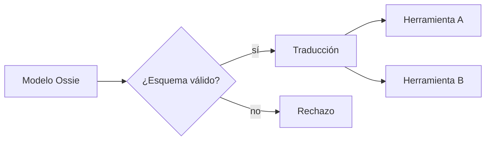

## 1. Resumen

`semantic-layer` define cada métrica una vez, pero dentro de una herramienta: el YAML de dbt, el modelo LookML, el semantic model de Power BI. Cuando la misma métrica vive en tres herramientas, se redefine tres veces. Las **nuevas semantic layers** buscan un formato abierto para **intercambiar** el modelo. El caso es **Apache Ossie (incubating)**, «formerly known as Open Semantic Interchange (OSI)» (*Apache Ossie (incubating)*), una especificación en JSON y YAML para datasets, métricas, relaciones y contexto para IA.

Es emergente de verdad: la especificación está en «DRAFT version — in development, schema may change before 0.2.0 is released» (*Apache Ossie - Core Metadata Specification*), y las páginas de las nubes revisadas no lo tratan. **No reemplaza** la capa semántica consolidada (`semantic-layer`): propone cómo moverla entre herramientas.

## 2. Qué es

- **Estado de la especificación:** Apache Ossie está en la incubadora de la ASF («Apache Ossie (incubating)») y su especificación es un borrador: «DRAFT version — in development, schema may change before 0.2.0 is released», versión 0.2.0.dev0. Todo lo de esta ficha puede cambiar.
- **Modelo semántico portable:** datasets, campos, métricas y relaciones en un archivo.
- **Expresiones por dialecto:** cada métrica trae su SQL por dialecto (por ejemplo, ANSI_SQL).
- **Contexto para IA:** descripciones y sinónimos para agentes (`data-agents`).
- **Esquema JSON:** permite validar el modelo antes de usarlo.
- **Convertidores:** traducen entre Ossie y otros formatos; viven en un repositorio aparte.

## 3. Problema que resuelve

«Ingresos» está definido en dbt, en LookML y en Power BI, con tres SQL apenas distintos. Un formato de intercambio permite definirlo una vez y que cada herramienta lo lea, en lugar de copiarlo a mano y que las copias diverjan.

## 4. Cómo funciona

1. El modelo se escribe en el formato de la especificación.
2. Se valida contra su esquema JSON.
3. Un convertidor o la propia herramienta lo traduce a su formato o a SQL.
4. Cada herramienta consulta con la misma definición.
5. Los cambios se versionan en el modelo, no en cada herramienta.

## 5. Cuándo utilizarlo

- Para evaluar y prototipar el intercambio entre herramientas.
- Cuando varias herramientas repiten las mismas métricas.
- Siguiendo la especificación, sabiendo que es un borrador.

## 6. Cuándo no utilizarlo

- Como base de producción mientras la especificación sea un borrador.
- Como reemplazo de la capa semántica de la herramienta que ya funciona.

## 7. Ejemplo sencillo

| Paso | Resultado |
|---|---|
| Modelo «Ventas» | Válido según el esquema de Ossie (0.2.0.dev0) |
| Modelo sin datasets | Inválido: `'datasets' is a required property` |
| Métrica `ingresos` traducida a SQL | `[('norte', 160), ('sur', 40)]` |

## 8. Ejemplo de producción

Un piloto de intercambio:

- modelo de ventas en el formato de Ossie, versionado en el repositorio;
- validación contra el esquema fijado por commit en la CI;
- traducción a la capa semántica de una herramienta y comparación de resultados;
- decisión de adoptarlo solo cuando la especificación publique una versión;
- en la nube (no ejecutado): las páginas revisadas de Looker, Amazon Quick y Power BI no tratan Ossie.

## 9. Arquitectura



## 10. Código

```python
# Python 3.12, PyYAML y jsonschema (dependencias del proyecto), ejecutado en la CI: un modelo semántico en el formato
# de Apache Ossie (incubating; antes Open Semantic Interchange, OSI) se valida contra el esquema JSON de la
# especificación, fijado por commit (DRAFT 0.2.0.dev0), y su métrica se traduce a SQL para un motor cualquiera
# (aquí SQLite). Un modelo sin datasets no pasa. Uso: ossie_model.py <ossie-schema.json>
import json
import sqlite3
import sys
from pathlib import Path
from typing import Any

import jsonschema  # type: ignore[import-untyped]  # jsonschema no publica stubs de tipos
import yaml  # type: ignore[import-untyped]  # PyYAML no publica stubs de tipos

MODELO = """
version: 0.2.0.dev0
name: Ventas
datasets:
  - name: pedidos
    source: pedidos
    fields:
      - name: region
        expression: {dialects: [{dialect: ANSI_SQL, expression: region}]}
metrics:
  - name: ingresos
    description: Suma del monto de los pedidos
    expression: {dialects: [{dialect: ANSI_SQL, expression: SUM(pedidos.monto)}]}
"""


def sql_de(modelo: dict[str, Any], metrica: str, por: str) -> str:
    (m,) = [x for x in modelo["metrics"] if x["name"] == metrica]
    (expr,) = [d["expression"] for d in m["expression"]["dialects"] if d["dialect"] == "ANSI_SQL"]
    (ds,) = modelo["datasets"]
    return f"SELECT {por}, {expr} AS {metrica} FROM {ds['source']} AS {ds['name']} GROUP BY {por} ORDER BY {por}"


esquema = json.loads(Path(sys.argv[1]).read_text(encoding="utf-8"))
modelo: dict[str, Any] = yaml.safe_load(MODELO)
jsonschema.validate(modelo, esquema)
print("modelo válido según el esquema de Ossie:", modelo["version"])
try:
    jsonschema.validate({"version": "0.2.0.dev0", "name": "Sin datasets"}, esquema)
except jsonschema.ValidationError as exc:
    print("modelo inválido:", exc.message)

sql = sql_de(modelo, "ingresos", "region")
with sqlite3.connect(":memory:") as conn:
    conn.execute("CREATE TABLE pedidos (region text, monto int)")
    conn.executemany("INSERT INTO pedidos VALUES (?, ?)", [("norte", 100), ("norte", 60), ("sur", 40)])
    print("SQL generado:", sql)
    print("resultado:", conn.execute(sql).fetchall())
```

El script se **ejecuta en la CI** con PyYAML y jsonschema (dependencias del proyecto) y pasa `mypy --strict`. El test descarga `ossie-schema.json` del commit `89e2e17` de `apache/ossie`; si la descarga falla, se salta como «no ejecutado». Imprime el modelo válido, el error del modelo sin datasets, el SQL y su resultado en SQLite. La traducción a SQL es de juguete: los convertidores oficiales están en otro repositorio.

## 11. GCP

En GCP, **LookML**. Según *Introduction to LookML* (no ejecutado):

| | Este concepto | Looker |
|---|---|---|
| Modelo semántico | Ossie | LookML |
| Intercambio con Ossie u OSI | Validación y traducción | No lo trata la página revisada |

## 12. AWS

En AWS, los **Topics de Amazon Quick**. Según *How Topics work - Amazon Quick* (no ejecutado):

| | Este concepto | Amazon Quick |
|---|---|---|
| Metadata semántica | Ossie | Enriquecida en Quick Sight o desde AWS Glue Data Catalog y Databricks Unity Catalog |
| Intercambio con Ossie u OSI | Validación y traducción | No lo trata la página revisada |

## 13. Azure

En Azure, los **semantic models de Power BI**. Según *Power BI semantic models in Microsoft Fabric* (no ejecutado):

| | Este concepto | Power BI |
|---|---|---|
| Modelo semántico | Ossie | Semantic model con métricas y terminología de negocio |
| Intercambio con Ossie u OSI | Validación y traducción | No lo trata la página revisada |

## 14. Buenas prácticas

- Fijar la especificación por commit o versión.
- Validar el modelo en la CI.
- Comparar los resultados de la traducción con la capa existente.
- **Seguridad:** el modelo no lleva credenciales ni datos, solo definiciones.
- **Observabilidad:** diferencias entre herramientas para la misma métrica.
- **Costo:** un piloto acotado antes de mover todas las métricas.

## 15. Errores frecuentes

- Adoptar un borrador como estándar estable.
- Mantener el modelo y las copias en cada herramienta a la vez.
- Citar el nombre anterior (OSI) como si fuera el actual.

## 16. Trade-offs

Un formato común evita definiciones divergentes a cambio de depender de convertidores y de una especificación que aún cambia. Esperar una versión estable reduce el riesgo y posterga el beneficio.

## 17. Conceptos relacionados

- `semantic-layer` y `semantic-models`: la capa consolidada.
- `interoperability-standards`: otro estándar abierto.
- `data-agents`: consumidores del contexto para IA.

## 18. Preguntas técnicas abiertas

1. ¿Qué métrica está definida en más de una herramienta?
2. ¿Qué herramienta tendría que leer el modelo primero?
3. ¿Qué te haría adoptar la especificación en producción?
4. **Riesgo de inestabilidad:** la especificación es un borrador (DRAFT 0.2.0.dev0) de un proyecto en incubación; el esquema puede cambiar antes de la 0.2.0. ¿Cómo aislarías tus modelos de un cambio de esquema (commit fijado, validación en la CI, convertidor propio)?

## 19. Laboratorio relacionado

Pendiente (F4).

## 20. Fuentes

- Apache Ossie: *Apache Ossie (incubating)* y *Apache Ossie - Core Metadata Specification* (commit `89e2e17`).
- Google Cloud: *Introduction to LookML*.
- AWS: *How Topics work - Amazon Quick*.
- Microsoft Learn: *Power BI semantic models in Microsoft Fabric*.

El detalle de cada fuente está en `sources` del frontmatter.

## 21. Fecha de última verificación

2026-10-27. `review_required`: pendiente de revisión B-F3.1 del lote F3b-23b.

## 22. Historial de cambios importantes

- 2026-10-27: creación (lote F3b-23b).
- 2026-10-28: el §2 dice explícitamente que la especificación es un borrador (DRAFT 0.2.0.dev0) de un proyecto en incubación, y el §18 lo registra como riesgo de inestabilidad (pedido de Felipe).
