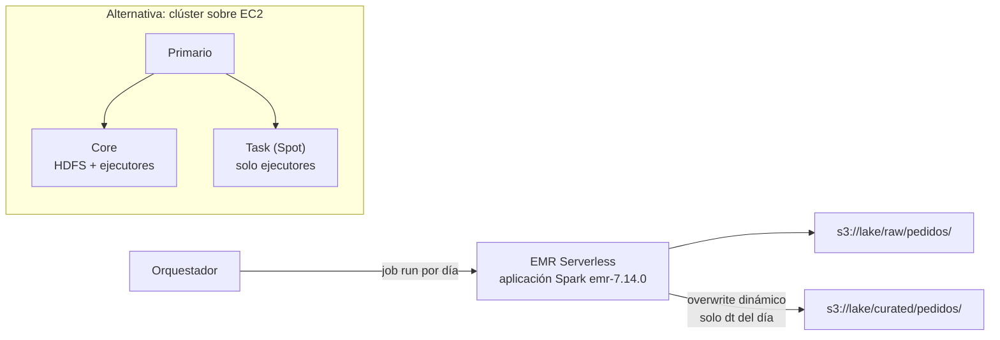

## 1. Resumen

**Amazon EMR** ejecuta Spark y otros frameworks de código abierto con tres opciones de despliegue:

- **EMR sobre EC2:** clústeres con nodos **primario**, **core** y **task**;
- **EMR Serverless:** sin clústeres, la capacidad escala con el job;
- **EMR on EKS:** sobre Kubernetes.

Cada **release** fija las versiones: según su página, `emr-7.14.0` trae Spark 3.5.8. Los datos persistentes van en **S3**, porque HDFS se pierde al terminar el clúster; desde EMR 7.10.0, `s3://` usa el conector **S3A**.

Para lotes diarios, el patrón es un job que reescribe solo la partición de su día con **overwrite dinámico**: re-ejecutar el día no duplica ni borra otros días.

## 2. Qué es

- **Nodo primario:** administra el clúster (YARN ResourceManager, HDFS NameNode). Puede haber tres para alta disponibilidad.
- **Nodos core:** guardan datos en HDFS y ejecutan tareas, como los ejecutores de Spark. Un solo grupo o flota core.
- **Nodos task:** solo cómputo, sin HDFS. Se pueden agregar y quitar, y mezclar On-Demand con Spot.
- **Spot:** desde EMR 5.19.0, los application masters corren solo en nodos core, así perder nodos task en Spot no hace fallar el job.
- **EMR Serverless:** una **aplicación** con un tipo (Spark) y una release; arranque y parada automáticos y capacidad preinicializada opcional.
- **Release:** `emr-7.14.0` incluye Spark 3.5.8, Hadoop 3.4.2, Iceberg 1.10.1, Delta 3.3.2 y Hudi 1.0.2.
- **Almacenamiento:** HDFS (efímero) y S3, con S3A desde 7.10.0 (antes, EMRFS).

## 3. Problema que resuelve

Procesar lotes grandes con Spark sin instalar ni mantener Hadoop. EMR provisiona el software de la release, separa almacenamiento (S3) de cómputo y permite clústeres efímeros por job o aplicaciones serverless que escalan solas.

## 4. Cómo funciona

1. Se elige la opción: clúster, aplicación serverless o EKS.
2. El job (un script PySpark) se envía con `spark-submit` o como job run.
3. Spark lee de S3, transforma y escribe en S3.
4. Con `partitionOverwriteMode=dynamic`, solo se reemplazan las particiones que el job escribe.
5. El clúster efímero termina, o la aplicación serverless se detiene sola tras el tiempo de inactividad.

## 5. Cuándo utilizarlo

- Spark con control de versiones, configuración e instancias.
- Lotes grandes con Spot en nodos task para bajar costo.
- Cargas variables sin administrar nodos: EMR Serverless.
- Equipos que ya operan Kubernetes: EMR on EKS.

## 6. Cuándo no utilizarlo

- Transformaciones SQL que caben en el warehouse.
- ETL simple sobre el catálogo sin necesidad de control del clúster: Glue (ver `glue-catalog-and-etl`).
- Datos en HDFS como almacenamiento permanente: se pierden al terminar el clúster.

## 7. Ejemplo sencillo

Un job lee los eventos de pedidos del 1 de octubre, se queda con la última versión de cada pedido y escribe `curated/pedidos/dt=2026-10-01/`. Si se re-ejecuta, reemplaza ese día y no toca el 2 de octubre.

## 8. Ejemplo de producción

Una aplicación de EMR Serverless `pedidos-spark` con `emr-7.14.0`:

- un orquestador envía un job run por día con el script de §10;
- la aplicación arranca con el primer job y se detiene a los 15 minutos sin trabajo;
- un tope de 64 vCPU y 256 GB limita el gasto de un job desbocado;
- si un día falla, se re-ejecuta y reemplaza solo su partición.

## 9. Arquitectura



## 10. Código

```python
# Python 3.12 y PySpark (ejecutado en la CI en modo local con PySpark 4.2.0 y Java 17; no se corrió en EMR).
# Job de Spark como el que se enviaría a EMR: lee eventos JSON de un día, se queda con la última versión de cada
# pedido y reescribe solo la partición de ese día (overwrite dinámico): re-ejecutar el día no duplica.
from __future__ import annotations

import sys

from pyspark.sql import DataFrame, SparkSession, Window
from pyspark.sql import functions as F


def latest_per_order(events: DataFrame) -> DataFrame:
    """Última versión de cada pedido según updated_at."""
    w = Window.partitionBy("id_pedido").orderBy(F.col("updated_at").desc())
    return events.withColumn("rn", F.row_number().over(w)).where("rn = 1").drop("rn")


def run(spark: SparkSession, source: str, target: str, day: str) -> int:
    events = spark.read.json(source).where(F.col("dt") == day)
    result = latest_per_order(events)
    (
        result.write.mode("overwrite")
        .partitionBy("dt")
        .option("partitionOverwriteMode", "dynamic")
        .parquet(target)
    )
    return result.count()


if __name__ == "__main__":
    # En EMR: spark-submit emr_job.py s3://.../raw/pedidos/ s3://.../curated/pedidos/ 2026-10-01
    src, dst, dia = sys.argv[1:4]
    session = SparkSession.builder.appName("pedidos-ultima-version").getOrCreate()
    print(run(session, src, dst, dia))
    session.stop()
```

```hcl
# Terraform (validado en la CI con terraform validate, sin credenciales; no se aplicó): aplicación de EMR Serverless
# para Spark, con arranque y parada automáticos y un tope de capacidad.
# Requiere: provider hashicorp/aws ~> 6.0.
terraform {
  required_providers {
    aws = {
      source  = "hashicorp/aws"
      version = "~> 6.0"
    }
  }
}

provider "aws" {
  region = "us-east-1"
}

resource "aws_emrserverless_application" "spark" {
  name          = "pedidos-spark"
  release_label = "emr-7.14.0"
  type          = "spark"

  auto_start_configuration {
    enabled = true
  }

  auto_stop_configuration {
    enabled              = true
    idle_timeout_minutes = 15
  }

  maximum_capacity {
    cpu    = "64 vCPU"
    memory = "256 GB"
  }
}
```

El job en PySpark se **ejecuta en la CI** en modo local, con PySpark 4.2.0 y Java 17. **No se corrió en EMR**, que en `emr-7.14.0` trae Spark 3.5.8; el código usa API presentes en ambas versiones. El test procesa el 2 de octubre, después el 1 de octubre dos veces, y comprueba que el resultado es el mismo y que la partición del 2 de octubre sigue ahí.

El bloque de Terraform se valida en la CI con `terraform validate`, sin credenciales (`make validate-terraform`), y **no se aplicó**.

## 11. GCP

No aplica de forma específica: esta ficha describe EMR. En GCP, Dataflow (ver `dataflow-execution-model`) es otro modelo de ejecución, basado en Beam, y no un Spark administrado; no es equivalente a EMR.

## 12. AWS

**Amazon EMR.** Las opciones de despliegue, los tipos de nodo, Spot, las releases (`emr-7.14.0`), el almacenamiento con S3A y EMR Serverless son los de sus páginas. Los precios por opción de despliegue y los de las instancias se consultan en la página de precios.

## 13. Azure

No aplica de forma específica.

## 14. Buenas prácticas

- Fijar la release en cada clúster o aplicación.
- S3 para todo lo persistente; HDFS solo para intermedios.
- Overwrite dinámico por partición para que re-ejecutar no duplique ni borre.
- Spot en nodos task, nunca como única capacidad de un job crítico.
- **Seguridad:** el clúster o la aplicación corre con un rol de IAM con acceso solo a sus prefijos; el acceso a tablas puede gobernarse con Lake Formation (ver `lake-formation-permissions`).
- **Observabilidad:** seguir la duración de cada job, los ejecutores perdidos y las particiones escritas por corrida.
- **Costo:** clústeres efímeros o serverless con parada automática; topes de capacidad. Los montos se consultan en la página de precios.

## 15. Errores frecuentes

- `mode("overwrite")` sin modo dinámico y borrar todas las particiones de la tabla.
- Guardar datos en HDFS y perderlos al terminar el clúster.
- Clústeres de larga vida encendidos sin trabajo.
- Todo el clúster en Spot, incluidos primario y core.

## 16. Trade-offs

EMR sobre EC2 da el mayor control (instancias, Spot, configuración), a cambio de administrar clústeres. EMR Serverless quita esa administración y cobra por uso, con menos control sobre la infraestructura. Frente a Glue, EMR da más control de versiones y configuración y exige más operación.

## 17. Conceptos relacionados

- `pyspark-dataframes`: el código de los jobs.
- `partitioning` e `idempotency`: overwrite dinámico por partición.
- `s3-data-lake`: el almacenamiento persistente.
- `glue-catalog-and-etl`: Spark serverless con menos control.
- `dataflow-execution-model`: otro modelo de ejecución, en GCP.
- `lake-formation-permissions`: el acceso a las tablas con Lake Formation (§14).

## 18. Preguntas técnicas abiertas

1. ¿Qué jobs de tu plataforma podrían correr en EMR Serverless en lugar de un clúster fijo?
2. ¿Qué pasa con tu tabla si un job usa overwrite estático por error?
3. ¿Qué parte de tu clúster pondrías en Spot?

## 19. Laboratorio relacionado

Pendiente (F4).

## 20. Fuentes

- AWS, Amazon EMR Management Guide: *Understanding how to create and work with Amazon EMR clusters*, *Understand node types*, *Instance types and best practices for Spot instances* y *Working with storage and file systems*.
- AWS, *What is Amazon EMR Serverless?*, *What is Amazon EMR on EKS?*, *About Amazon EMR Releases* y *Amazon EMR release 7.14.0*; *Amazon EMR pricing*.
- Apache Spark, *Spark Configuration* (4.2.0): `spark.sql.sources.partitionOverwriteMode`.

El detalle de cada fuente está en `sources` del frontmatter.

## 21. Fecha de última verificación

2026-10-13. Pasa a `verified`: revisión B-F3.1 del lote F3b-09a aplicada, sin VERIFY pendientes.

## 22. Historial de cambios importantes

- 2026-10-12: creación (lote F3b-09a).
- 2026-10-13: revisión B-F3.1 del lote F3b-09a aplicada (docs/reviews/cards-f3b-09a.md): filas aprobadas sin cambios en esta ficha.
- 2026-10-13: `verification_status: verified` (sin VERIFY pendientes).
- 2026-10-14: lote F3b-rel (regla del §17): relations incluye `lake-formation-permissions`; el §17 nombra `lake-formation-permissions`, que el cuerpo ya citaba.
