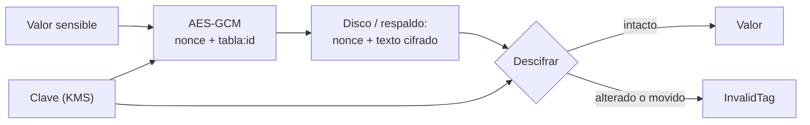

## 1. Resumen

**Cifrar en reposo** es guardar los datos cifrados en el disco, para que una copia robada del almacenamiento (un disco, un snapshot, un archivo de respaldo) no sirva sin la clave. Hay dos niveles:

- **el de la plataforma:** Google Cloud, Amazon S3 y Azure Storage ya cifran en reposo por defecto, con claves que administra el proveedor;
- **el de la aplicación:** el pipeline cifra campos o archivos antes de guardarlos, con claves que controla el equipo.

En el nivel de la aplicación conviene **cifrado autenticado** (AES-GCM): además de ocultar, detecta si alguien cambió el texto cifrado. Con un **nonce** distinto por mensaje y **datos asociados** que atan el registro a su lugar (tabla e id), alterar o mover un registro hace fallar el descifrado con `InvalidTag` (*Authenticated encryption*).

## 2. Qué es

- **Cifrado autenticado (AEAD):** cifra y verifica la integridad en una sola operación.
- **Nonce:** un valor que no se repite con la misma clave; repetirlo compromete la seguridad (*Authenticated encryption*).
- **Datos asociados:** datos que no se cifran pero se autentican (aquí, `tabla:id`).
- **Cifrado de la plataforma:** el proveedor cifra el almacenamiento; protege contra el robo del medio, no contra quien tiene acceso a la base.

## 3. Problema que resuelve

Un respaldo de la base de clientes queda en un bucket mal configurado. Con cifrado de plataforma, el bucket se lee igual si el permiso está mal: el proveedor descifra para quien tiene acceso. Con los campos sensibles cifrados por la aplicación, el respaldo filtrado tiene correos ilegibles sin la clave, que vive en otro lado.

## 4. Cómo funciona

1. La aplicación obtiene la clave (en producción, de un KMS: `key-management`).
2. Por cada valor genera un nonce aleatorio de 12 bytes.
3. Cifra con AES-GCM, usando `tabla:id` como datos asociados.
4. Guarda nonce y texto cifrado.
5. Al leer, descifra con el mismo nonce y los mismos datos asociados; cualquier cambio da `InvalidTag`.

## 5. Cuándo utilizarlo

- Campos sensibles que deben quedar ilegibles aunque se filtre la base o un respaldo.
- Archivos que se guardan o se comparten fuera del perímetro.
- Siempre, el de la plataforma (viene activado).

## 6. Cuándo no utilizarlo

- Para columnas por las que hay que filtrar o unir: un valor cifrado con nonce aleatorio no se puede comparar; ahí sirve otra técnica, como un hash con clave.
- Como reemplazo del control de acceso: quien tiene la clave y el acceso ve los datos.

## 7. Ejemplo sencillo

| Prueba | Resultado |
|---|---|
| ¿El texto cifrado contiene el correo? | no |
| Descifrar la fila 1 | `ana.perez@example.com` |
| Descifrar con un byte cambiado | `InvalidTag` |
| Descifrar como si fuera la fila 2 | `InvalidTag` |
| Cifrar el mismo valor dos veces | textos cifrados distintos |

## 8. Ejemplo de producción

- Cifrado de plataforma activado (por defecto) en buckets, discos y warehouse.
- Campos sensibles cifrados en el pipeline con AES-GCM antes de escribir; clave por dataset en un KMS.
- Nonce aleatorio por valor y `tabla:id` como datos asociados.
- Los respaldos llevan los campos ya cifrados; la clave no viaja con ellos.

## 9. Arquitectura



## 10. Código

```python
# Python 3.12 y cryptography (ejecutado en la CI; ADR-022): cifrado autenticado con AES-GCM. Un nonce distinto por
# mensaje, y datos asociados (tabla e id) que atan el cifrado a su fila: si alguien cambia el texto cifrado o lo mueve
# a otra fila, descifrar falla con InvalidTag en lugar de devolver basura.
import os

from cryptography.exceptions import InvalidTag
from cryptography.hazmat.primitives.ciphers.aead import AESGCM

clave = AESGCM.generate_key(bit_length=256)   # en producción la clave vive en un KMS (ver key-management)
aes = AESGCM(clave)


def cifrar(valor: str, tabla: str, fila: int) -> tuple[bytes, bytes]:
    nonce = os.urandom(12)                    # nunca repetir un nonce con la misma clave
    return nonce, aes.encrypt(nonce, valor.encode(), f"{tabla}:{fila}".encode())


def descifrar(nonce: bytes, cifrado: bytes, tabla: str, fila: int) -> str:
    try:
        return aes.decrypt(nonce, cifrado, f"{tabla}:{fila}".encode()).decode()
    except InvalidTag:
        return "InvalidTag"


nonce, cifrado = cifrar("ana.perez@example.com", "clientes", 1)
print("guardado en disco contiene el texto:", b"ana.perez" in cifrado)
print("descifrar fila 1:", descifrar(nonce, cifrado, "clientes", 1))
alterado = bytes([cifrado[0] ^ 1]) + cifrado[1:]
print("descifrar con un byte cambiado:", descifrar(nonce, alterado, "clientes", 1))
print("descifrar movido a la fila 2:", descifrar(nonce, cifrado, "clientes", 2))
n2, c2 = cifrar("ana.perez@example.com", "clientes", 1)
print("mismo valor, mismo cifrado:", c2 == cifrado)
```

El script se **ejecuta en la CI con cryptography** (ADR-022) y pasa `mypy --strict`. Imprime que el texto cifrado no contiene el correo, el descifrado correcto, `InvalidTag` para el byte cambiado y para la fila movida, y que el mismo valor cifrado dos veces da textos distintos.

## 11. GCP

En GCP, el **cifrado por defecto** y CMEK. Según *Authenticated encryption*, *Default encryption at rest* y *Customer-managed encryption keys (CMEK)* (no ejecutado):

| | Cifrado de la aplicación (este ejemplo) | Google Cloud |
|---|---|---|
| Quién cifra | El pipeline, campo por campo | La plataforma, todo el contenido en reposo, con AES-256 |
| Claves | Las del equipo, en un KMS | Por defecto, de Google; con CMEK, claves propias en Cloud KMS |
| Protege contra | Filtración de la base o de un respaldo | Robo del medio físico |

## 12. AWS

En AWS, **SSE-S3** por defecto. Según *Authenticated encryption* y *Protecting data with encryption* (no ejecutado):

| | Cifrado de la aplicación (este ejemplo) | Amazon S3 |
|---|---|---|
| Por defecto | No: hay que hacerlo | Sí: SSE-S3 en todo bucket; desde el 5 de enero de 2023, toda subida nueva |
| Verificación | El código | El estado se ve en CloudTrail, S3 Inventory, Storage Lens y un encabezado de respuesta |

## 13. Azure

En Azure, **Azure Storage encryption**. Según *Authenticated encryption* y *Azure Storage encryption for data at rest* (no ejecutado):

| | Cifrado de la aplicación (este ejemplo) | Azure Storage |
|---|---|---|
| Algoritmo | AES-GCM | AES de 256 bits, FIPS 140-2; AES-GCM para los objetos subidos |
| Transparencia | La aplicación cifra y descifra | Transparente para quien tiene acceso |

## 14. Buenas prácticas

- Cifrado autenticado, nunca un modo sin integridad.
- Nonce aleatorio por mensaje; nunca reusado con la misma clave.
- Datos asociados que aten el valor a su lugar.
- Claves en un KMS, separadas de los datos.
- **Seguridad:** el cifrado de plataforma no protege contra quien tiene acceso legítimo; el de aplicación, sí, si la clave está aparte.
- **Observabilidad:** registrar los `InvalidTag`: son datos alterados o un error de lectura.
- **Costo:** cifrar campos agrega cómputo y tamaño (nonce y etiqueta por valor); el cifrado de plataforma no tiene costo adicional en S3, según su página.

## 15. Errores frecuentes

- Reusar el nonce.
- Guardar la clave junto a los datos.
- Creer que el cifrado por defecto del proveedor protege contra un permiso mal dado.

## 16. Trade-offs

Cifrar en la aplicación protege más y quita la posibilidad de filtrar o unir por ese campo. El cifrado de plataforma es gratuito y transparente, y no protege contra el acceso legítimo.

## 17. Conceptos relacionados

- `key-management`: las claves.
- `crypto-shredding`: borrar la clave.
- `encryption-in-transit`: en tránsito.
- `gcp-cmek-with-kms`: claves propias en Google Cloud.

## 18. Preguntas técnicas abiertas

1. ¿Qué campos tuyos deberían quedar ilegibles si se filtra un respaldo?
2. ¿Dónde están hoy las claves de lo que cifras?
3. ¿Tu cifrado detecta alteraciones?

## 19. Laboratorio relacionado

Pendiente (F4).

## 20. Fuentes

- cryptography: *Authenticated encryption*.
- Google Cloud: *Default encryption at rest* y *Customer-managed encryption keys (CMEK)*.
- AWS: *Protecting data with encryption*.
- Microsoft Learn: *Azure Storage encryption for data at rest*.

El detalle de cada fuente está en `sources` del frontmatter.

## 21. Fecha de última verificación

2026-10-21. Pasa a `verified`: revisión B-F3.1 del lote F3b-18b aplicada y CI en verde (run 39677322697).

## 22. Historial de cambios importantes

- 2026-10-21: creación (lote F3b-18b).
- 2026-10-21: `verification_status: verified` (revisión aplicada; CI en verde, run 39677322697).
