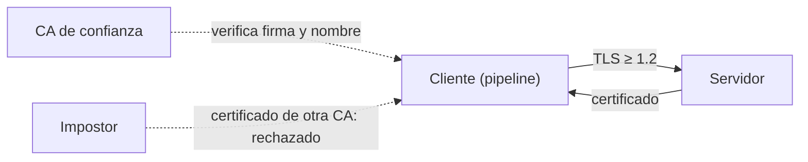

## 1. Resumen

**Cifrar en tránsito** es usar **TLS** en cada conexión que mueve datos: de la fuente al pipeline, del pipeline al warehouse, del warehouse al BI. Tres cosas hacen que sirva:

- **verificar el certificado** del otro lado contra una CA en la que se confía;
- **verificar el nombre** (`check_hostname`): el certificado debe ser del servidor al que se quiso conectar;
- una **versión mínima** (TLS 1.2; Azure Storage la recomienda como mínima).

Sin verificación, TLS cifra pero no impide hablar con un impostor. En Python, `ssl.create_default_context()` ya trae verificación de certificado y de nombre (*ssl*).

## 2. Qué es

- **TLS:** el protocolo que cifra y autentica una conexión.
- **CA:** quien firma los certificados en los que se confía.
- **Verificación de nombre:** el certificado debe cubrir el nombre del servidor.
- **Versión mínima:** las versiones viejas se rechazan.

## 3. Problema que resuelve

Un pipeline se conecta a la base de origen con TLS pero sin verificar el certificado, «porque el certificado es interno». Alguien en la red intercepta la conexión con un certificado propio: el pipeline cifra, sí, pero con el intermediario, que ve la contraseña y los datos. Con verificación contra la CA interna, la conexión al impostor se rechaza.

## 4. Cómo funciona

1. El servidor presenta un certificado firmado por una CA.
2. El cliente usa un contexto que exige certificado (`CERT_REQUIRED`) y verifica el nombre.
3. El cliente confía en la CA correcta (la pública del sistema, o la interna cargada explícitamente).
4. Se negocia una versión de TLS igual o mayor que la mínima.
5. Si algo falla, la conexión no se establece.

## 5. Cuándo utilizarlo

- En toda conexión que lleva datos o credenciales, también dentro de la red propia.
- En bases de origen, APIs, colas y warehouses.

## 6. Cuándo no utilizarlo

- Desactivando la verificación «para que funcione»: es peor que no tener TLS, porque da una falsa sensación de seguridad.

## 7. Ejemplo sencillo

Un servidor TLS local con un certificado para `localhost` firmado por una CA de prueba:

| Cliente | Resultado |
|---|---|
| Contexto por defecto: ¿verifica certificado y nombre? | sí |
| Contexto por defecto, sin confiar en la CA de prueba | rechazado: `unable to get local issuer certificate` |
| Contexto que confía en la CA de prueba | conectado con TLSv1.3 |

## 8. Ejemplo de producción

- Conexiones a bases de origen con verificación del certificado y del nombre contra la CA interna.
- Política del bucket que rechaza HTTP; versión mínima TLS 1.2 en las cuentas de almacenamiento.
- La CA interna se distribuye como un archivo de confianza en la imagen del pipeline.
- Alertas por intentos de conexión sin TLS.

## 9. Arquitectura



## 10. Código

```python
# Python 3.12, ssl de la biblioteca estándar y cryptography (ejecutado en la CI; ADR-022): TLS con verificación.
# Se crea una CA y un certificado de servidor para localhost, se levanta un servidor TLS local y se conecta un cliente
# con ssl.create_default_context: sin confiar en la CA, la conexión se rechaza; confiando en ella, se establece.
import datetime
import socket
import ssl
import sys
import tempfile
import threading
from pathlib import Path

from cryptography import x509
from cryptography.hazmat.primitives import hashes, serialization
from cryptography.hazmat.primitives.asymmetric import ec
from cryptography.x509.oid import NameOID

base = Path(sys.argv[1] if len(sys.argv) > 1 else tempfile.mkdtemp())
ahora = datetime.datetime.now(datetime.timezone.utc)


def certificado(nombre: str, clave: ec.EllipticCurvePrivateKey, emisor: x509.Name, clave_emisor: ec.EllipticCurvePrivateKey,
                es_ca: bool) -> x509.Certificate:
    sujeto = x509.Name([x509.NameAttribute(NameOID.COMMON_NAME, nombre)])
    b = (x509.CertificateBuilder().subject_name(sujeto).issuer_name(emisor if not es_ca else sujeto)
         .public_key(clave.public_key()).serial_number(x509.random_serial_number())
         .not_valid_before(ahora - datetime.timedelta(minutes=5)).not_valid_after(ahora + datetime.timedelta(days=1))
         .add_extension(x509.BasicConstraints(ca=es_ca, path_length=None), critical=True))
    if not es_ca:
        b = b.add_extension(x509.SubjectAlternativeName([x509.DNSName("localhost")]), critical=False)
    return b.sign(clave_emisor, hashes.SHA256())


clave_ca, clave_srv = ec.generate_private_key(ec.SECP256R1()), ec.generate_private_key(ec.SECP256R1())
ca = certificado("CA de prueba", clave_ca, x509.Name([]), clave_ca, es_ca=True)
srv = certificado("localhost", clave_srv, ca.subject, clave_ca, es_ca=False)
(base / "ca.pem").write_bytes(ca.public_bytes(serialization.Encoding.PEM))
(base / "srv.pem").write_bytes(srv.public_bytes(serialization.Encoding.PEM))
(base / "srv.key").write_bytes(clave_srv.private_bytes(serialization.Encoding.PEM, serialization.PrivateFormat.PKCS8,
                                                       serialization.NoEncryption()))

servidor = ssl.SSLContext(ssl.PROTOCOL_TLS_SERVER)
servidor.minimum_version = ssl.TLSVersion.TLSv1_2
servidor.load_cert_chain(base / "srv.pem", base / "srv.key")
escucha = socket.create_server(("127.0.0.1", 0))
puerto = escucha.getsockname()[1]


def atender() -> None:
    for _ in range(2):
        conexion, _direccion = escucha.accept()
        try:
            with servidor.wrap_socket(conexion, server_side=True) as tls:
                tls.sendall(b"hola")
        except (ssl.SSLError, OSError):
            pass                                       # el cliente que no confía corta el handshake


hilo = threading.Thread(target=atender, daemon=True)
hilo.start()


def conectar(contexto: ssl.SSLContext) -> str:
    with socket.create_connection(("127.0.0.1", puerto)) as crudo:
        try:
            with contexto.wrap_socket(crudo, server_hostname="localhost") as tls:
                return f"conectado con {tls.version()}, recibido {tls.recv(4)!r}"
        except ssl.SSLCertVerificationError as exc:
            return f"rechazado: {exc.verify_message}"


sin_ca = ssl.create_default_context()                  # verifica certificado y nombre con las CA del sistema
con_ca = ssl.create_default_context(cafile=str(base / "ca.pem"))
con_ca.minimum_version = ssl.TLSVersion.TLSv1_2
print("verifica certificado y nombre por defecto:", sin_ca.verify_mode == ssl.CERT_REQUIRED and sin_ca.check_hostname)
print("cliente sin confiar en la CA:", conectar(sin_ca))
print("cliente con la CA:", conectar(con_ca))
hilo.join(timeout=5)
```

El script se **ejecuta en la CI** con el módulo `ssl` y `cryptography` (ADR-022), y pasa `mypy --strict`. Genera una CA y un certificado de servidor, levanta un servidor TLS en `127.0.0.1` e imprime que el contexto por defecto verifica certificado y nombre, que el cliente sin la CA se rechaza y que el cliente con la CA se conecta con TLSv1.3.

## 11. GCP

En GCP, **Encryption in transit for Google Cloud**. Según *ssl* y *Encryption in transit for Google Cloud* (no ejecutado):

| | TLS verificado (este ejemplo) | Google Cloud |
|---|---|---|
| Por defecto | Lo configura el cliente | Protección en tránsito de Google (TLS, ALTS, PSP); los Google Front Ends terminan TLS de los usuarios |
| Excepción | — | La página no aplica a interconexiones entre redes del cliente y de Google |

## 12. AWS

En AWS, **Amazon S3**. Según *ssl* y *Security best practices for Amazon S3* (no ejecutado):

| | TLS verificado (este ejemplo) | Amazon S3 |
|---|---|---|
| Exigir TLS | El cliente rechaza conexiones sin verificar | Política de bucket con `aws:SecureTransport` que niega HTTP |
| Detectar | — | Alarmas de CloudWatch sobre `tlsDetails.tlsVersion NOT EXISTS` |

## 13. Azure

En Azure, **Azure Storage**. Según *ssl* y *Enforce a minimum required version of Transport Layer Security (TLS) for requests to a storage account* (no ejecutado):

| | TLS verificado (este ejemplo) | Azure Storage |
|---|---|---|
| Versión mínima | `minimum_version = TLSv1_2` en el contexto | Versión mínima en la cuenta; recomendada TLS 1.2 |
| Antes de exigir | — | Medir el tráfico con versiones viejas |

## 14. Buenas prácticas

- Verificar certificado y nombre siempre; nunca desactivarlo.
- Confiar explícitamente en la CA interna cuando aplica.
- Versión mínima TLS 1.2.
- **Seguridad:** credenciales solo por conexiones verificadas.
- **Observabilidad:** alertar por conexiones sin TLS y por fallas de verificación.
- **Costo:** TLS agrega poco; el costo real es operar la CA y renovar certificados.

## 15. Errores frecuentes

- Desactivar la verificación del certificado (`verify=False` y equivalentes).
- Certificados vencidos que alguien «arregla» desactivando la verificación.
- TLS solo hacia afuera y texto plano dentro de la red.

## 16. Trade-offs

Verificar exige distribuir la CA y renovar certificados; no verificar es más simple y no protege contra un intermediario. Exigir versiones nuevas rompe clientes viejos; medir antes de exigir.

## 17. Conceptos relacionados

- `encryption-at-rest`: en reposo.
- `secrets-management`: credenciales.
- `database-ingestion`: conexiones a orígenes.

## 18. Preguntas técnicas abiertas

1. ¿Tus conexiones a bases de origen verifican el certificado?
2. ¿Hay buckets o cuentas que acepten HTTP?
3. ¿Qué versión mínima de TLS aceptan tus servicios?

## 19. Laboratorio relacionado

Pendiente (F4).

## 20. Fuentes

- Python 3.12: *ssl — TLS/SSL wrapper for socket objects*.
- cryptography: *Tutorial* (X.509).
- Google Cloud: *Encryption in transit for Google Cloud*.
- AWS: *Security best practices for Amazon S3*.
- Microsoft Learn: *Enforce a minimum required version of Transport Layer Security (TLS) for requests to a storage account*.

El detalle de cada fuente está en `sources` del frontmatter.

## 21. Fecha de última verificación

2026-10-21. `review_required`: pendiente de revisión B-F3.1 del lote F3b-18b.

## 22. Historial de cambios importantes

- 2026-10-21: creación (lote F3b-18b).
