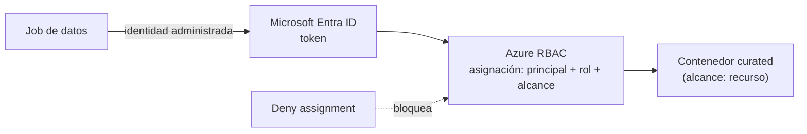

## 1. Resumen

En Azure, la identidad es **Microsoft Entra ID**. Su página de cambio de nombre dice: «Microsoft renamed Azure Active Directory (Azure AD) to Microsoft Entra ID»; los nombres Azure Active Directory, Azure AD y AAD se reemplazan.

Para una plataforma de datos, según su documentación:

- cada job, función o servicio usa una **identidad administrada**: obtiene tokens de Entra **sin credenciales que administrar**;
- la autorización es **Azure RBAC**: una **asignación de rol** une un principal, una definición de rol y un **alcance**;
- el alcance tiene cuatro niveles (grupo de administración, suscripción, grupo de recursos y recurso): cuanto más bajo, más acotado;
- una **deny assignment** bloquea el acceso aunque un rol lo permita.

## 2. Qué es

- **Microsoft Entra ID:** el servicio de identidad (antes Azure AD); parte de la familia Microsoft Entra.
- **Identidad administrada:**
  - *asignada por el sistema*: ligada a un recurso; se borra con él;
  - *asignada por el usuario*: recurso propio, que se asigna a uno o más recursos.
- **Asignación de rol:** principal (usuario, grupo, service principal o identidad administrada) + definición de rol + alcance.
- **Alcance:** grupo de administración, suscripción, grupo de recursos o recurso; las asignaciones se heredan hacia abajo.
- **Deny assignment:** si aplica, el acceso se bloquea.

## 3. Problema que resuelve

Los jobs de datos necesitan leer y escribir en el lake, las bases y los secretos. Sin identidades administradas, terminan con claves y contraseñas en la configuración; sin alcances acotados, un job puede leer todo lo de la suscripción.

## 4. Cómo funciona

1. Se crea una identidad administrada asignada por el usuario para el job.
2. Se le asigna el rol «Storage Blob Data Reader» con alcance en el contenedor `curated`, no en la cuenta ni en la suscripción.
3. El job, al correr, obtiene un token de Entra con esa identidad.
4. Azure RBAC evalúa la solicitud: si una asignación la permite y ninguna deny assignment la bloquea, accede.

## 5. Cuándo utilizarlo

- Siempre: todo acceso a recursos de Azure pasa por Entra ID y Azure RBAC.
- Identidad asignada por el usuario cuando varios recursos comparten la misma identidad o cuando debe sobrevivir al recurso.
- Identidad asignada por el sistema para un recurso con su propia identidad.

## 6. Cuándo no utilizarlo

- Claves de cuenta o contraseñas en la configuración del job: identidades administradas.
- Roles con alcance de suscripción para un job que lee un contenedor.
- Un rol amplio «por si acaso».

## 7. Ejemplo sencillo

La identidad `id-job-ventas` tiene «Storage Blob Data Reader» sobre el contenedor `curated`. El job lee `curated/ventas/` sin ninguna clave; si intenta leer otro contenedor, no tiene permiso.

## 8. Ejemplo de producción

Una plataforma define en Terraform, revisado en cada cambio:

- una identidad administrada por job o servicio;
- asignaciones con el alcance más chico posible: contenedor, vault o base;
- grupos de Entra para las personas, con roles por grupo de recursos;
- nada de claves de cuenta en la configuración.

## 9. Arquitectura



## 10. Código

```hcl
# Terraform (validado en la CI con terraform validate, sin credenciales; no se aplicó): identidad administrada asignada
# por el usuario para un job, con el rol «Storage Blob Data Reader» solo sobre un contenedor (el alcance más chico).
# Requiere: provider hashicorp/azurerm ~> 5.0; grupo de recursos y contenedor existentes.
terraform {
  required_providers {
    azurerm = {
      source  = "hashicorp/azurerm"
      version = "~> 5.0"
    }
  }
}

provider "azurerm" {
  features {}
}

variable "resource_group_name" {
  type = string
}

variable "location" {
  type    = string
  default = "eastus2"
}

variable "curated_container_id" {
  type        = string
  description = "ID de recurso del contenedor curated (alcance del rol)"
}

resource "azurerm_user_assigned_identity" "job_ventas" {
  name                = "id-job-ventas"
  resource_group_name = var.resource_group_name
  location            = var.location
}

resource "azurerm_role_assignment" "leer_curated" {
  scope                = var.curated_container_id
  role_definition_name = "Storage Blob Data Reader"
  principal_id         = azurerm_user_assigned_identity.job_ventas.principal_id
  principal_type       = "ServicePrincipal"
}
```

El bloque de Terraform se valida en la CI con `terraform validate`, sin credenciales (`make validate-terraform`), y **no se aplicó**. Asigna el rol con alcance en el contenedor, el nivel más bajo de los que describe *Understand scope for Azure RBAC*.

## 11. GCP

No aplica de forma específica: esta ficha describe Entra ID y Azure RBAC. En GCP es IAM (ver `gcp-iam-for-data`). Las diferencias, según sus páginas:

| | Entra ID / Azure RBAC | IAM de GCP |
|---|---|---|
| Identidad de cargas de trabajo | Identidad administrada (del sistema o del usuario) | Cuenta de servicio, identificada por un email y adjunta al recurso |
| Concesión | Asignación de rol: principal + definición de rol + alcance | Rol concedido a un principal sobre un recurso, en una política de permisos |
| Bloqueo explícito | Deny assignments | Deny policies: impiden usar ciertos permisos aunque el principal tenga un rol que los conceda (*IAM overview*) |

## 12. AWS

No aplica de forma específica. En AWS es IAM (ver `aws-iam-for-data`). Las diferencias, según sus páginas:

| | Entra ID / Azure RBAC | IAM de AWS |
|---|---|---|
| Identidad de cargas de trabajo | Identidad administrada, que obtiene tokens de Entra | Rol que se asume y entrega credenciales temporales |
| Concesión | Asignación de rol en un alcance jerárquico | Políticas de identidad y de recurso en JSON |
| Bloqueo explícito | Deny assignments | Un Deny explícito en una política prevalece sobre el Allow |

## 13. Azure

**Microsoft Entra ID y Azure RBAC.** El cambio de nombre, las identidades administradas, las asignaciones de rol, los alcances y las deny assignments son los de sus páginas.

## 14. Buenas prácticas

- Una identidad administrada por job o servicio.
- El alcance más chico posible para cada asignación.
- Grupos para las personas; nada de asignaciones a usuarios uno por uno.
- Identidades y asignaciones como código, revisadas.
- **Seguridad:** sin claves de cuenta ni contraseñas en la configuración; revisar asignaciones con alcance de suscripción.
- **Observabilidad:** revisar periódicamente las asignaciones de rol y las identidades sin uso.
- **Costo:** el costo que importa de un permiso amplio es el riesgo de un borrado o una fuga, y lo que cuesta recuperarse.

## 15. Errores frecuentes

- Usar la clave de la cuenta de almacenamiento en lugar de una identidad.
- Asignar roles en la suscripción para un job que lee un contenedor.
- Identidades del sistema en recursos que se recrean, perdiendo las asignaciones.
- Llamar «Azure AD» al servicio en documentación nueva.

## 16. Trade-offs

Las identidades administradas eliminan las credenciales del código, a cambio de definir una identidad y sus asignaciones por carga. Los alcances bajos reducen el daño posible, con más asignaciones que mantener. Las identidades asignadas por el usuario sobreviven al recurso; las del sistema son más simples.

## 17. Conceptos relacionados

- `gcp-iam-for-data` y `aws-iam-for-data`: IAM en GCP y AWS.
- `adls-gen2-storage` y `key-vault-secrets`: recursos que se autorizan con Azure RBAC.
- `infrastructure-as-code`: identidades y roles como código.

## 18. Preguntas técnicas abiertas

1. ¿Qué jobs de tu plataforma usan todavía claves o contraseñas?
2. ¿Qué asignaciones podrías bajar de alcance?
3. ¿Cuándo usarías una identidad asignada por el usuario?

## 19. Laboratorio relacionado

Pendiente (F4).

## 20. Fuentes

- Microsoft Learn: *New name for Azure Active Directory*, *What is managed identities for Azure resources?*, *What is Azure role-based access control (Azure RBAC)?* y *Understand scope for Azure RBAC*.
- Google Cloud: *IAM overview* y *Service accounts overview*. AWS: *IAM roles* y *Policy evaluation logic*.

El detalle de cada fuente está en `sources` del frontmatter.

## 21. Fecha de última verificación

2026-10-14. Pasa a `verified`: revisión B-F3.1 del lote F3b-10b aplicada, sin VERIFY pendientes.

## 22. Historial de cambios importantes

- 2026-10-13: creación (lote F3b-10b), con el nombre actual del servicio según su página de cambio de nombre.
- 2026-10-14: revisión B-F3.1 del lote F3b-10b aplicada (docs/reviews/cards-f3b-10b.md): la celda de bloqueo explícito del §11 dice las deny policies de IAM, citadas de *IAM overview*.
- 2026-10-14: `verification_status: verified` (sin VERIFY pendientes).
