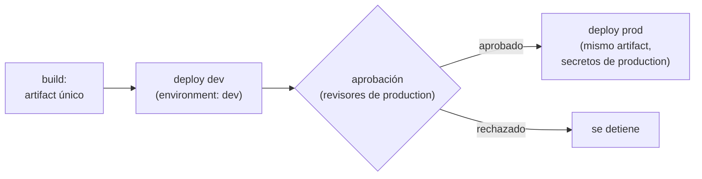

## 1. Resumen

Un cambio pasa por varios **entornos** (desarrollo, staging, producción) antes de llegar a los usuarios. **Promover** es llevar el mismo artifact de un entorno al siguiente, con controles en cada paso. Según las páginas citadas, cada plataforma lo modela así:

- **GitHub:** environments con reglas de protección. Los secretos de un environment llegan al job solo después de la aprobación.
- **Cloud Deploy:** un delivery pipeline con una secuencia de targets. La release se promueve de uno al siguiente, y un target puede exigir aprobación.
- **CodePipeline:** una acción de aprobación manual detiene la ejecución hasta que alguien apruebe.
- **Azure Pipelines:** environments con aprobaciones y checks antes de que corra un stage.

## 2. Qué es

- **Entorno:** destino de despliegue con su configuración y sus credenciales (GitLab lo define como «a specific deployment target for your application»).
- **Promoción:** desplegar en el entorno siguiente lo que ya pasó por el anterior.
- **Regla de protección / aprobación:** condición que un despliegue debe cumplir antes de entrar al entorno (aprobación, espera, rama permitida).
- **Secretos por entorno:** solo los ven los jobs que despliegan en ese entorno.

## 3. Problema que resuelve

Sin entornos, un cambio va directo a producción. Con entornos pero sin promoción, cada entorno recibe una construcción distinta, y lo que se probó en staging no es lo que corre en producción. La promoción asegura que el artifact probado es el que llega, y la aprobación pone una persona o un check entre staging y producción.

## 4. Cómo funciona

En GitHub Actions:

1. Un job construye el artifact una vez.
2. `deploy-dev` referencia `environment: dev` y despliega.
3. `deploy-prod` (con `needs: deploy-dev`) referencia `environment: production`.
4. Si `production` tiene revisores obligatorios, el job espera. Según *Deployments and environments*, no accede a los secretos del environment hasta que un revisor aprueba.
5. Aprobado, despliega el mismo artifact.

En Cloud Deploy, el pipeline `dev → prod` hace lo mismo con `gcloud deploy releases promote`, y el target `prod` con `requireApproval: true`.

## 5. Cuándo utilizarlo

- En toda plataforma con más de un entorno.
- Aprobación manual antes de producción para cambios con impacto en datos de negocio.
- Ramas permitidas para que solo main pueda desplegar en producción.

## 6. Cuándo no utilizarlo

- Una rama por entorno para un equipo con un solo servicio: la promoción del mismo artifact es más simple (la guía de GitLab ubica la rama por entorno en organizaciones con varios servicios interdependientes; ver `git-branching-strategies`).
- Aprobaciones que alguien aprueba sin mirar: mejor un check automático.
- Reconstruir el artifact en cada entorno.

## 7. Ejemplo sencillo

Un pipeline de datos se despliega en `dev` al integrar en main. Un revisor del equipo aprueba el despliegue a `production`, y el job despliega el mismo `pipeline.zip`.

## 8. Ejemplo de producción

Una plataforma con tres entornos:

- `dev`: despliegue automático al integrar en main;
- `staging`: despliegue automático tras `dev`, con tests contra datos de muestra;
- `production`: revisores obligatorios, solo desde main y con auto-aprobación impedida;
- cada entorno con sus propias credenciales (ver `ci-cd-secrets`) y su propio proyecto o cuenta de nube.

## 9. Arquitectura



## 10. Código

```yaml
# GitHub Actions (.github/workflows/promote.yml; validado con actionlint en la CI, no ejecutado): el mismo artifact
# pasa de dev a prod. Cada job referencia un environment; las reglas de protección (revisores, ramas permitidas) se
# configuran en el repositorio, no en este archivo, y el job de prod espera la aprobación antes de ver sus secretos.
name: promote

on:
  push:
    branches: [main]

permissions:
  contents: read

jobs:
  build:
    runs-on: ubuntu-24.04
    steps:
      - uses: actions/checkout@v7
      - run: python package.py build src dist/pipeline.zip
      - uses: actions/upload-artifact@v7
        with:
          name: pipeline
          path: dist/

  deploy-dev:
    needs: build
    runs-on: ubuntu-24.04
    environment: dev
    steps:
      - uses: actions/download-artifact@v8
        with:
          name: pipeline
      - run: echo "desplegar pipeline.zip en dev con ${{ vars.DEPLOY_TARGET }}"

  deploy-prod:
    needs: deploy-dev
    runs-on: ubuntu-24.04
    environment: production
    steps:
      - uses: actions/download-artifact@v8
        with:
          name: pipeline
      - run: echo "desplegar el mismo pipeline.zip en prod con ${{ vars.DEPLOY_TARGET }}"
```

```yaml
# Cloud Deploy (clouddeploy.yaml; no ejecutado): un delivery pipeline con la secuencia dev → prod. El target de prod
# exige aprobación (requireApproval), y una release se promueve de un target al siguiente.
apiVersion: deploy.cloud.google.com/v1
kind: DeliveryPipeline
metadata:
  name: api-datos
serialPipeline:
  stages:
    - targetId: dev
    - targetId: prod
---
apiVersion: deploy.cloud.google.com/v1
kind: Target
metadata:
  name: dev
run:
  location: projects/mi-proyecto/locations/us-central1
---
apiVersion: deploy.cloud.google.com/v1
kind: Target
metadata:
  name: prod
requireApproval: true
run:
  location: projects/mi-proyecto/locations/us-central1
```

El workflow de GitHub Actions se **valida con actionlint en la CI y no se ejecutó**. Las reglas de protección (revisores, ramas permitidas) no van en el YAML: se configuran en el environment del repositorio. La configuración de Cloud Deploy **no se ejecutó** ni se validó. Usa `serialPipeline` con `stages`, `requireApproval: true` y un target de Cloud Run con `run: location`, como los describen *Configuration schema reference* y *Promote your release and manage approvals*.

## 11. GCP

En GCP, **Cloud Deploy**. Las diferencias, según sus páginas:

| | GitHub environments | Cloud Deploy |
|---|---|---|
| Secuencia | Jobs encadenados con `needs` | Delivery pipeline con la secuencia de targets en YAML |
| Promoción | El job siguiente despliega el mismo artifact | `gcloud deploy releases promote` al target siguiente |
| Aprobación | Revisores obligatorios del environment | `requireApproval: true` en el target; aprobación también vía Pub/Sub y la API |

## 12. AWS

En AWS, **CodePipeline**. Las diferencias, según sus páginas:

| | GitHub environments | AWS CodePipeline |
|---|---|---|
| Aprobación | Revisores del environment; hasta seis, basta uno | Acción de aprobación manual en un stage; aprueba alguien con los permisos de IAM necesarios |
| Secretos por entorno | Secretos del environment, después de la aprobación | Las páginas citadas de CodePipeline no lo tratan |

## 13. Azure

En **Azure Pipelines**, un environment es un destino lógico (Dev, Test, Staging, Production) y no existe en los pipelines clásicos (*Create and target Azure DevOps environments*). Las aprobaciones y checks se configuran en el environment y controlan cuándo corre un stage, incluso si quien lanzó la corrida puede aprobarla (*Define approvals and checks*).

## 14. Buenas prácticas

- Un artifact, promovido sin reconstruir.
- Aprobación antes de producción, sin auto-aprobación.
- Solo main despliega en producción.
- Credenciales y secretos distintos por entorno.
- **Seguridad:** los secretos de producción solo en el environment de producción, que GitHub entrega después de aprobar.
- **Observabilidad:** saber qué versión está en cada entorno (GitLab lo lista como uso de sus environments).
- **Costo:** cada entorno permanente cuesta; staging no necesita el tamaño de producción.

## 15. Errores frecuentes

- Compilar de nuevo en cada entorno.
- Secretos de producción a nivel de repositorio, visibles para cualquier job.
- Aprobaciones que aprueba la misma persona que hizo el cambio.
- Asumir que los revisores obligatorios están en cualquier plan de GitHub: en Free, Pro y Team, varias reglas solo están en repositorios públicos.

## 16. Trade-offs

Más entornos y aprobaciones reducen el riesgo de llegar a producción con un error, a cambio de tiempo y de mantener entornos. Una aprobación manual agrega criterio humano, pero también espera. Un pipeline administrado como Cloud Deploy da la secuencia y las aprobaciones hechas, a cambio de atarse a los destinos que soporta.

## 17. Conceptos relacionados

- `deployment-strategies`: cómo se despliega en cada entorno.
- `build-artifacts`: el artifact que se promueve.
- `ci-cd-secrets`: las credenciales de cada entorno.
- `git-branching-strategies`: la alternativa de una rama por entorno.
- `ci-cd-pipelines`: el pipeline de CD.

## 18. Preguntas técnicas abiertas

1. ¿Lo que corre en producción es el mismo artifact que se probó en staging?
2. ¿Quién puede aprobar un despliegue a producción en tu equipo?
3. ¿Qué secretos de producción podría leer hoy un job de pull request?

## 19. Laboratorio relacionado

Pendiente (F4).

## 20. Fuentes

- GitHub Docs: *Deployments and environments*. GitLab Docs: *Environments*.
- Google Cloud: *Overview of Cloud Deploy*, *Promote your release and manage approvals* y *Configuration schema reference*.
- AWS: *Add a manual approval action to a stage*. Microsoft Learn: *Create and target Azure DevOps environments* y *Define approvals and checks*.

El detalle de cada fuente está en `sources` del frontmatter.

## 21. Fecha de última verificación

2026-10-14. Pasa a `verified`: revisión B-F3.1 del lote F3b-11b aplicada, sin VERIFY pendientes.

## 22. Historial de cambios importantes

- 2026-10-14: creación (lote F3b-11b).
- 2026-10-14: revisión B-F3.1 del lote F3b-11b aplicada (docs/reviews/cards-f3b-11b.md): filas aprobadas sin cambios en esta ficha.
- 2026-10-14: `verification_status: verified` (sin VERIFY pendientes).
