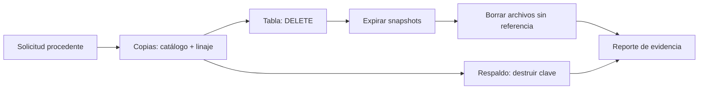

## 1. Resumen

Esta ficha no es asesoría legal: cubre cómo se suprime técnicamente un dato en todas sus copias.

La ley define la eliminación como la destrucción de los datos almacenados, cualquiera sea el procedimiento, y pide suprimir lo que ya no se necesita y lo que el titular pide suprimir cuando procede. En una plataforma moderna, un `DELETE` no basta:

- en un **formato de tabla** (Iceberg, Delta), el dato sigue en el snapshot anterior hasta expirarlo y en sus archivos hasta borrarlos;
- en **BigQuery**, sigue dentro de la ventana de time travel y del fail-safe;
- en **S3 con versionado**, un `DELETE` agrega un delete marker y la versión queda;
- los **respaldos** no se reescriben fila por fila.

Por eso la supresión se diseña **por copia**, con un reporte de evidencia.

## 2. Qué es

- **[Obligación legal · art. 2]** Eliminar es destruir los datos almacenados, cualquiera sea el procedimiento.
- **[Obligación legal · art. 3]** Cumplido el plazo necesario, los datos se suprimen o anonimizan.
- **[Obligación legal · art. 7]** El titular puede pedir la supresión por las causales de la ley; no procede, entre otros casos, si hay una obligación legal de conservar.
- **[Decisión de arquitectura]** Cada copia tiene un método de supresión propio y una verificación.

## 3. Problema que resuelve

**[Buena práctica]** El equipo ejecuta `DELETE FROM clientes WHERE cliente_id = 1` y cierra la solicitud. Una semana después, una consulta de time travel muestra la fila; el Parquet original sigue en el bucket, y el respaldo del mes la tiene completa.

## 4. Cómo funciona

1. **[Decisión de arquitectura]** Ubicar todas las copias del dato con el catálogo y el linaje: tablas, snapshots, archivos, exports y respaldos.
2. **[Obligación legal · art. 7]** Confirmar con el área legal qué se conserva por una excepción (por ejemplo, una obligación legal).
3. **[Buena práctica]** En la tabla: `DELETE`, y comprobar que el snapshot anterior todavía tiene el dato.
4. **[Buena práctica]** Expirar los snapshots que lo contienen y borrar los archivos de datos que quedan sin referencia.
5. **[Decisión de arquitectura]** En copias que no se reescriben (respaldos, logs inmutables), crypto-shredding: destruir la clave del titular.
6. **[Obligación legal · art. 2]** Verificar cada copia y registrar método y resultado en el reporte de evidencia.

## 5. Cuándo utilizarlo

- En toda supresión por solicitud o por vencimiento de plazo.
- Al diseñar tablas y respaldos con datos personales: decidir antes cómo se suprimirá en cada copia.

## 6. Cuándo no utilizarlo

- Sin confirmar las excepciones de conservación con el área legal.
- Si hay copias fuera del catálogo: primero encontrarlas.

## 7. Ejemplo sencillo

| Copia | Paso | Resultado |
|---|---|---|
| Tabla Iceberg | `DELETE` | La tabla actual ya no tiene a la titular |
| Snapshot anterior | Time travel | Todavía la tiene |
| Snapshot anterior | Expirar | Expiró |
| Archivos Parquet | Después de expirar | 1 archivo todavía con el correo |
| Archivos Parquet | Borrar los sin referencia | 0 con el correo |
| Respaldo cifrado | Destruir la clave | Ilegible |

## 8. Ejemplo de producción

- Retención de time travel y de versiones acorde a los plazos de supresión.
- Un job de supresión por titular: `DELETE` en cada tabla, expiración de snapshots, limpieza de archivos sin referencia y verificación.
- Respaldos cifrados con una clave por titular o por grupo, para suprimir con crypto-shredding.
- Un reporte por solicitud, con cada copia, su método y su verificación.

### Evidencia de cumplimiento

| Evidencia | Dónde queda | Quién la produce |
|---|---|---|
| Reporte por copia: método y verificación | Log de evidencia | Job de supresión |
| Snapshots expirados y archivos borrados | Metadatos de la tabla y log del job | Job de supresión |
| Destrucción de la clave del titular | Auditoría del KMS | KMS |
| Copias conservadas y su motivo | Log de evidencia | Área legal |

## 9. Arquitectura



## 10. Código

```python
# Python 3.12, PyIceberg 0.12, PyArrow y cryptography (ejecutado en la CI; ADR-018 y ADR-022): suprimir a un titular
# en todas las copias. En la tabla Iceberg, DELETE crea un snapshot nuevo pero el anterior sigue legible (time travel)
# hasta expirarlo; en el respaldo cifrado, que no se reescribe, se destruye la clave del titular (crypto-shredding).
# Al final, un reporte de evidencia por copia.
from __future__ import annotations

import os
import sys
import tempfile
from pathlib import Path

import pyarrow as pa  # type: ignore[import-untyped]  # pyarrow no publica stubs de tipos
from cryptography.exceptions import InvalidTag
from cryptography.hazmat.primitives.ciphers.aead import AESGCM
from pyiceberg.catalog.sql import SqlCatalog

base = Path(sys.argv[1] if len(sys.argv) > 1 else tempfile.mkdtemp())
warehouse = base / "warehouse"
warehouse.mkdir(parents=True, exist_ok=True)
catalog = SqlCatalog("local", uri=f"sqlite:///{(base / 'catalog.db').as_posix()}", warehouse=warehouse.as_uri())
catalog.create_namespace("crm")
datos = pa.table({"cliente_id": pa.array([1, 2], pa.int64()), "email": pa.array(["ana@example.com", "luis@example.org"])})
tabla = catalog.create_table("crm.clientes", schema=datos.schema)
tabla.append(datos)
antes = tabla.current_snapshot()
assert antes is not None


def ve_a_ana(snapshot_id: int) -> bool:
    return "ana@example.com" in tabla.scan(snapshot_id=snapshot_id).to_arrow()["email"].to_pylist()


tabla.delete("cliente_id = 1")  # supresión: snapshot nuevo sin la fila
despues = tabla.current_snapshot()
assert despues is not None
print("tabla actual tiene a la titular:", ve_a_ana(despues.snapshot_id))
print("snapshot anterior (time travel) todavía la tiene:", ve_a_ana(antes.snapshot_id))
tabla.maintenance.expire_snapshots().by_id(antes.snapshot_id).commit()
tabla = catalog.load_table("crm.clientes")
print("snapshots que quedan:", len(tabla.snapshots()), "| el anterior expiró:", tabla.snapshot_by_id(antes.snapshot_id) is None)


def con_el_correo() -> list[Path]:
    return [p for p in warehouse.rglob("*.parquet") if b"ana@example.com" in p.read_bytes()]


print("tras expirar, archivos Parquet que todavía contienen el correo:", len(con_el_correo()))
referenciados = {ruta.rsplit("/", 1)[-1] for ruta in tabla.inspect.all_data_files()["file_path"].to_pylist()}
huerfanos = [p for p in warehouse.rglob("*.parquet") if p.name not in referenciados]  # sin referencia de ningún snapshot
for archivo in huerfanos:
    archivo.unlink()
print(f"archivos sin referencia borrados: {len(huerfanos)}; con el correo: {len(con_el_correo())}")

claves = {1: AESGCM.generate_key(bit_length=256), 2: AESGCM.generate_key(bit_length=256)}  # en producción, en un KMS
respaldo = []
for cid, email in [(1, "ana@example.com"), (2, "luis@example.org")]:
    nonce = os.urandom(12)
    respaldo.append((cid, nonce, AESGCM(claves[cid]).encrypt(nonce, email.encode(), str(cid).encode())))
del claves[1]  # crypto-shredding: el respaldo no se toca


def leer(cid: int, nonce: bytes, cifrado: bytes) -> str:
    if cid not in claves:
        return "ilegible (clave destruida)"
    try:
        return AESGCM(claves[cid]).decrypt(nonce, cifrado, str(cid).encode()).decode()
    except InvalidTag:
        return "alterado"


print("respaldo:", [leer(*fila) for fila in respaldo])
reporte = {
    "tabla actual": "DELETE",
    "snapshots anteriores": "expirados",
    "archivos de datos": f"{len(huerfanos)} sin referencia borrados",
    "respaldo": "crypto-shredding",
}
print("evidencia:", reporte)
```

El script se **ejecuta en la CI con PyIceberg 0.12 y cryptography** (ADR-018 y ADR-022) y pasa `mypy --strict`. Imprime que la tabla actual ya no tiene a la titular y el snapshot anterior sí; que el snapshot expiró pero el archivo Parquet con el correo seguía en disco; que borrar los archivos sin referencia lo elimina; el respaldo con la titular ilegible; y el reporte de evidencia. La página de mantenimiento de Iceberg (Java) dice que expirar snapshots borra los archivos que ya no se usan; en PyIceberg 0.12.0 el ejemplo comprobó que el archivo quedó, y por eso el paso de borrar archivos sin referencia es explícito.

## 11. GCP

En GCP, **BigQuery**. Según *Ley 19628 SOBRE PROTECCION DE LOS DATOS PERSONALES* y *Data retention with time travel and fail-safe* (no ejecutado):

| | Iceberg (este ejemplo) | BigQuery | Etiqueta |
|---|---|---|---|
| Después del `DELETE` | Snapshot anterior hasta expirarlo | Ventana de time travel: 7 días por defecto, configurable de 2 a 7 | **[Buena práctica]** |
| Después de esa ventana | Archivos sin referencia, hasta borrarlos | Fail-safe de 7 días más, no configurable | **[Decisión de arquitectura]** |

## 12. AWS

En AWS, **Amazon S3** con versionado. Según *Ley 19628 SOBRE PROTECCION DE LOS DATOS PERSONALES* y *Deleting object versions from a versioning-enabled bucket* (no ejecutado):

| | Iceberg (este ejemplo) | Amazon S3 | Etiqueta |
|---|---|---|---|
| Borrado simple | `DELETE` crea un snapshot nuevo | `DELETE` agrega un delete marker; la versión queda | **[Buena práctica]** |
| Borrado permanente | Expirar y borrar archivos | Lifecycle `NoncurrentVersionExpiration` sobre las versiones no actuales | **[Decisión de arquitectura]** |

## 13. Azure

En Azure, **Azure Databricks**. Según *Ley 19628 SOBRE PROTECCION DE LOS DATOS PERSONALES* y *VACUUM* (no ejecutado):

| | Iceberg (este ejemplo) | `VACUUM` | Etiqueta |
|---|---|---|---|
| Archivos sin referencia | Borrado explícito en el ejemplo | Borra los que superan la retención: 7 días por defecto en Delta, fija de 7 días en Iceberg | **[Buena práctica]** |
| Time travel | Hasta expirar el snapshot | Se pierde para versiones anteriores a la retención | **[Decisión de arquitectura]** |

## 14. Buenas prácticas

- **[Obligación legal · art. 3]** Alinear la retención de time travel y de versiones con los plazos de supresión.
- **[Decisión de arquitectura]** Para lo que no se reescribe, cifrar desde el inicio con una clave por titular o grupo.
- **[Buena práctica]** **Seguridad:** el job de supresión borra en masa; corre con una cuenta propia y con verificación previa del alcance.
- **[Buena práctica]** **Observabilidad:** el reporte por copia es la evidencia; una copia sin verificación es una supresión incompleta.
- **[Buena práctica]** **Costo:** expirar snapshots y borrar archivos también ahorra almacenamiento; una retención corta reduce lo que hay que suprimir.

## 15. Errores frecuentes

- Cerrar la solicitud después del `DELETE`.
- Suponer que expirar un snapshot borró sus archivos.
- Olvidar exports, sandboxes y respaldos.

## 16. Trade-offs

Una ventana de time travel larga protege contra errores y retrasa la supresión efectiva; una corta suprime antes y deja menos margen para recuperar. Crypto-shredding suprime sin reescribir y exige diseñar las claves desde el principio.

## 17. Conceptos relacionados

- `crypto-shredding`: suprimir en copias inmutables.
- `data-retention`: suprimir al vencer el plazo.
- `open-table-formats`: snapshots y time travel.
- `data-subject-requests`: la solicitud.
- `data-lineage`: encontrar las copias.

## 18. Preguntas técnicas abiertas

1. ¿Cuántos días de time travel tienen tus tablas con datos personales?
2. ¿Tus respaldos permiten suprimir a un titular?
3. ¿Qué evidencia guardas de que cada copia quedó sin el dato?

## 19. Laboratorio relacionado

Pendiente (F4).

## 20. Fuentes

- BCN Ley Chile: *Ley 19628 SOBRE PROTECCION DE LOS DATOS PERSONALES* (versión con vigencia diferida desde 2026-12-01).
- PyIceberg: *API*. Apache Iceberg: *Maintenance*.
- cryptography: *Authenticated encryption*.
- Google Cloud: *Data retention with time travel and fail-safe*.
- AWS: *Deleting object versions from a versioning-enabled bucket*.
- Microsoft Learn: *VACUUM* (Azure Databricks).

El detalle de cada fuente está en `sources` del frontmatter.

## 21. Fecha de última verificación

2026-10-21: texto legal consultado ese día en BCN. `review_required`: pendiente de revisión B-F3.1 del lote F3b-19b; pasa a `verified` solo con la aprobación explícita de Felipe (`owner_approved_at`). Revisión mensual.

## 22. Historial de cambios importantes

- 2026-10-21: creación (lote F3b-19b).
