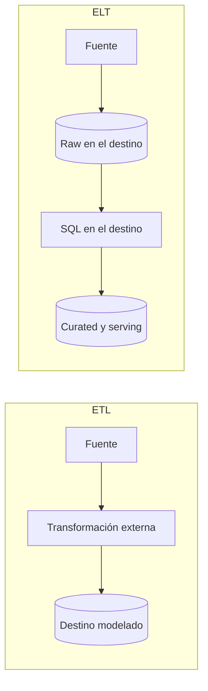

## 1. Resumen

**ETL** extrae, transforma fuera del destino y carga el resultado. **ELT** extrae, carga los datos crudos en el warehouse o el lake y los transforma allí, normalmente con SQL. ELT es la opción natural cuando el destino tiene cómputo escalable; ETL sigue siendo necesario cuando hay que filtrar, anonimizar o reducir antes de cargar. Es un criterio de diseño, no una medición del mercado.

## 2. Qué es

Son dos órdenes posibles de las mismas etapas. No son productos ni herramientas: la misma herramienta puede usarse en ambos estilos, y un pipeline real suele mezclarlos (limpieza ligera antes de cargar y modelado dentro del warehouse).

## 3. Problema que resuelve

Obliga a decidir **dónde** se transforma, y eso define costo, latencia, trazabilidad y seguridad:

- Transformar fuera (ETL) evita cargar datos que no deben estar en el destino.
- Transformar dentro (ELT) aprovecha el motor del warehouse, conserva el dato crudo para reprocesar y deja las transformaciones en SQL versionado.

## 4. Cómo funciona

- **ETL**: fuente → motor de transformación (Spark, Beam, un script) → destino con datos ya modelados.
- **ELT**: fuente → carga cruda (capa raw) → transformaciones SQL dentro del destino (capas curated y serving) → consumo.

## 5. Cuándo utilizarlo

- **ELT**: el destino es un warehouse con cómputo escalable, se quiere conservar el crudo para reprocesos y el equipo trabaja en SQL.
- **ETL**: datos sensibles que no deben aterrizar sin tratar, volúmenes que conviene reducir antes (filtrado, agregación) o transformaciones que SQL expresa mal (parsing complejo, ML, enriquecimiento con servicios externos).

## 6. Cuándo no utilizarlo

- **ELT** no conviene si cargar el crudo viola requisitos de privacidad o si el destino no tiene cómputo suficiente.
- **ETL** no conviene si obliga a reconstruir toda la lógica fuera del warehouse para cada cambio, o si se pierde el crudo necesario para auditar y reprocesar.

## 7. Ejemplo sencillo

Pedidos de una base operacional:

- En **ELT** se cargan tal cual en `raw.orders` y una vista o tabla SQL calcula `curated.orders_daily`.
- En **ETL** un script calcula los totales diarios y solo carga `orders_daily`.

## 8. Ejemplo de producción

CDC de PostgreSQL a BigQuery con Datastream (capa raw) y transformaciones versionadas en Dataform hacia las capas curated y serving: ELT. En el mismo proyecto, un pipeline de Dataflow anonimiza datos personales de un feed externo antes de cargarlo: ETL. Ambos conviven.

## 9. Arquitectura



## 10. Código

```sql
-- ELT en BigQuery (ejecutable adaptando nombres): la transformación vive dentro del warehouse.
-- Requiere: raw.orders(order_id, created_at TIMESTAMP, amount NUMERIC).
CREATE OR REPLACE TABLE `proyecto.curated.orders_daily`
PARTITION BY dia AS
SELECT DATE(created_at) AS dia, COUNT(*) AS pedidos, SUM(amount) AS monto
FROM `proyecto.raw.orders`
GROUP BY dia;
```

## 11. GCP

- **Datastream** se presenta en su documentación como base de pipelines ELT de baja latencia hacia BigQuery.
- **Dataform** compila definiciones SQLX y crea las tablas en BigQuery: es transformación dentro del warehouse (la T de ELT).
- **Dataflow** ejecuta pipelines de Apache Beam y sirve para ETL cuando hay que transformar antes de cargar.

## 12. AWS

- **AWS Glue** es, según su documentación, un servicio serverless de integración de datos para crear, ejecutar y monitorear pipelines ETL que cargan datos en data lakes: es la pieza habitual cuando hay que transformar **antes** de cargar.
- En **Redshift**, la transformación **dentro** del warehouse se hace con SQL, incluido `MERGE`: es el lado ELT.

No son lo mismo que Dataflow y Dataform: el reparto de funciones es parecido, pero cambian el modelo de ejecución, el lenguaje y la facturación.

## 13. Azure

En Azure, Microsoft presenta **Data Factory en Microsoft Fabric** como la siguiente generación de Azure Data Factory: recomienda empezar por Fabric y permite migrar las cargas de ADF existentes (documentación consultada el 2026-09-30). El reparto sigue el mismo par: Data Factory mueve y transforma antes de cargar, y el SQL de Fabric Warehouse (o de Synapse en instalaciones existentes) transforma dentro. Es un ecosistema en evolución: esta sección se revisa con las fuentes, no se da por estable.

## 14. Buenas prácticas

- Conservar siempre una capa raw inmutable cuando la privacidad lo permita: habilita reprocesos.
- Versionar las transformaciones (SQL en Git, Dataform o dbt) y probarlas.
- Decidir por dato qué debe transformarse antes de aterrizar (PII, volumen) y documentarlo.
- **Costo:** en ELT las transformaciones se pagan con el cómputo del warehouse en cada ejecución: hacer incrementales las pesadas; conservar la capa raw suma almacenamiento, que conviene acotar con retención.
- **Observabilidad:** medir por capa (raw, curated, serving) conteos, frescura y errores de transformación, y alertar cuando una capa deja de avanzar respecto de la anterior.
- **Seguridad:** en ELT, la capa raw contiene el dato sin tratar: restringir su acceso más que el de las capas modeladas; en ETL, el motor intermedio también ve el dato crudo.

## 15. Errores frecuentes

- Cargar datos personales crudos a un warehouse amplio "porque es ELT".
- Duplicar la misma lógica en el ETL y en el SQL del warehouse.
- Perder el crudo y no poder reconstruir tras un error de transformación.
- Tratar ELT como "no modelar": el modelado sigue siendo necesario, solo cambia dónde ocurre.

## 16. Trade-offs

ELT gana en agilidad, trazabilidad y uso del cómputo del warehouse, a cambio de almacenar más (crudo y capas) y de pagar cómputo del warehouse en cada transformación. ETL reduce lo que se almacena y protege datos sensibles, a cambio de mantener otro motor y otra base de código.

## 17. Conceptos relacionados

- `incremental-load`: cómo hacer incremental la transformación.
- `change-data-capture`: fuente habitual de la capa raw en ELT.
- Con ficha: `data-transformation`.
- `pipeline-layers`: las capas cruda, validada y de consumo de un pipeline.
- Del blueprint, pendientes de ficha: `medallion-architecture`, `analytics-engineering`.

## 18. Preguntas técnicas abiertas

1. ¿Qué datos de tu organización no deberían aterrizar crudos en el warehouse, y cómo cambia eso el diseño?
2. ¿Cómo reprocesarías seis meses de datos si descubres un error en una transformación de un pipeline ETL sin capa raw?
3. ¿En qué casos combinarías ETL y ELT en el mismo flujo?

## 19. Laboratorio relacionado

Pendiente (F4): arquitectura "API → Data Warehouse" (§24).

## 20. Fuentes

- Google Cloud: *Datastream overview*; *Create tables* (Dataform); *Programming model for Apache Beam* (Dataflow).
- AWS: *What is AWS Glue?*; *MERGE* (Amazon Redshift).
- Microsoft Learn: *Introduction to Azure Data Factory*; *What is Data Factory* (Microsoft Fabric).

El detalle de cada fuente está en `sources` del frontmatter.

## 21. Fecha de última verificación

2026-09-30. Los dos puntos VERIFY (AWS y Azure) se resolvieron con documentación oficial. Pasa a `verified`: revisión B-F3.1 aprobada y aplicada, sin VERIFY pendientes.

## 22. Historial de cambios importantes

- 2026-09-30: creación (lote 1 de F3).
- 2026-09-30: revisión B-F3.1 aplicada (docs/reviews/cards-lote1.md): relaciones completas, seguridad, observabilidad y costo, notas de fuentes y ejemplos corregidos.
- 2026-09-30: VERIFY de AWS (Glue, Redshift) y de Azure (Data Factory frente a Fabric) resueltos con documentación oficial.
- 2026-09-30: `verification_status: verified` (revisión B-F3.1 aprobada y aplicada; VERIFY resueltos).
- 2026-10-04: §14 con las viñetas Seguridad, Observabilidad y Costo (regla nueva de `validate`).
- 2026-10-06: la sección de conceptos relacionados ya no lista como pendiente de ficha a `data-transformation`, que ya tiene ficha.
- 2026-10-11: §17 enlaza `pipeline-layers`, que ya tiene ficha (lote F3b-05a); antes figuraba como pendiente de ficha.
- 2026-10-13: `page_title` en cada cita, con el título de la página citada (ADR-012); sin cambios de contenido.
