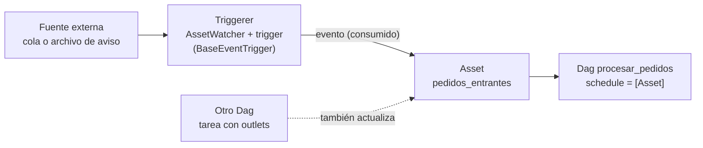

## 1. Resumen

En la **orquestación event-driven**, el orquestador inicia una corrida cuando ocurre un evento externo, como un mensaje en una cola o un archivo de aviso, en vez de a una hora fija. En Airflow 3.3.2 se hace con **Assets** y **AssetWatcher**:

- el watcher vigila una fuente externa con un trigger;
- cuando hay un evento, actualiza el Asset;
- el Dag programado por ese Asset se ejecuta.

Solo sirven triggers que heredan de `BaseEventTrigger`. El riesgo principal es la **programación infinita**: un trigger que vigila una condición que queda verdadera («el archivo existe») dispara el Dag en cada revisión.

Esta ficha trata el lado del orquestador. La fuente del evento, el enrutamiento (Pub/Sub, EventBridge, Event Grid) y el manejador idempotente están en `event-driven-pipelines`.

## 2. Qué es

- **Evento externo:** algo que pasa fuera del orquestador (un mensaje, un archivo de aviso) y que debe iniciar un flujo.
- **AssetWatcher:** vigila una fuente externa con un trigger asíncrono que corre en el triggerer. Un Asset puede tener varios watchers.
- **`BaseEventTrigger`:** la clase base de los triggers compatibles. La documentación restringe el uso a esa clase porque otros triggers podrían programar el Dag de forma inesperada.
- **Dag programado por Asset:** `schedule=[Asset(...)]`. Se ejecuta cuando el Asset se actualiza, sea por un watcher (evento externo) o por una tarea con `outlets` en otro Dag (dependencia de datos, ver `pipeline-dependencies`).
- **Diferencia con un sensor:**
  - el sensor espera **dentro** de una corrida que el scheduler ya inició por horario;
  - el evento **inicia** la corrida.

## 3. Problema que resuelve

Un Dag programado cada 5 minutos con un sensor al inicio corre 288 veces al día aunque los datos lleguen tres veces, y cada corrida ocupa recursos para descubrir que no hay nada. Con un evento:

- la corrida existe solo cuando hay algo que procesar;
- la latencia baja: no hay que esperar al próximo horario;
- el historial de corridas refleja eventos reales, no revisiones vacías.

## 4. Cómo funciona

1. Se define un Asset con `watchers=[AssetWatcher(name=..., trigger=...)]`, con un trigger que hereda de `BaseEventTrigger`.
2. Un Dag declara `schedule=[ese Asset]`.
3. El triggerer ejecuta el trigger del watcher, que vigila la fuente.
4. Cuando el trigger emite un evento, Airflow actualiza el Asset y programa el Dag.
5. Para no repetir el disparo, el evento tiene que **consumirse**:
   - `FileDeleteTrigger`, del provider standard, se dispara una vez al encontrar el archivo y lo borra;
   - con colas, el mensaje se lee y se confirma. El provider `common.messaging` se instala aparte y tiene extras para Amazon y Kafka.

## 5. Cuándo utilizarlo

- Ingesta que debe empezar cuando llegan los datos, sin horario fijo.
- Flujos que reaccionan a mensajes de otros sistemas (microservicios, aplicaciones).
- Cuando un Dag programado con un sensor al inicio corre muchas veces sin nada que hacer.

## 6. Cuándo no utilizarlo

- Si el negocio necesita una corrida por intervalo (un reporte diario, aunque no haya datos nuevos), el horario es lo correcto: ver `scheduler`.
- Si el flujo necesita `catchup` o backfill por intervalos de tiempo, un horario los modela mejor que eventos sueltos.
- Si basta con reaccionar con una función pequeña por evento, un manejador directo (ver `event-driven-pipelines`) puede bastar sin orquestador.
- No vigilar condiciones que quedan verdaderas: causan programación infinita.

## 7. Ejemplo sencillo

Un sistema de pedidos deja el archivo `pedidos.listo` cuando termina de exportar. Con `FileDeleteTrigger`:

- el trigger encuentra el archivo, lo borra y emite un evento;
- el Asset `pedidos_entrantes` se actualiza y `procesar_pedidos` corre una vez.

Con un trigger que solo revisa «¿existe el archivo?», el archivo seguiría ahí y el Dag correría en cada revisión.

## 8. Ejemplo de producción

Una plataforma recibe pedidos desde una cola de mensajes. El Dag `procesar_pedidos` se programa con un Asset cuyo watcher lee la cola con un trigger compatible del provider `common.messaging`. Cada evento crea una corrida, y la corrida procesa lo recibido de forma idempotente, porque las colas pueden entregar un mensaje más de una vez (ver `event-driven-pipelines`).

Junto a ese Dag queda un Dag diario de conciliación, programado por horario. Revisa que no se haya perdido ningún pedido: el evento da latencia y el horario da una red de seguridad.

## 9. Arquitectura



## 10. Código

```python
# Airflow 3.3.2 (cargado en la CI con DagBag, sin errores de import; las tareas no se ejecutan): event-driven
# scheduling. Un AssetWatcher vigila una fuente externa con un trigger compatible (hereda de BaseEventTrigger);
# cuando hay un evento, actualiza el Asset, y el Asset programa el Dag.
import datetime

from airflow.providers.standard.triggers.file import FileDeleteTrigger
from airflow.sdk import DAG, Asset, AssetWatcher, task

# FileDeleteTrigger se dispara una vez al encontrar el archivo y lo borra: la condición no queda verdadera
# y el Dag no se programa una y otra vez por el mismo aviso.
aviso = FileDeleteTrigger(filepath="/datos/entrada/pedidos.listo")
PEDIDOS = Asset("pedidos_entrantes", watchers=[AssetWatcher(name="vigila_pedidos", trigger=aviso)])

with DAG(
    dag_id="procesar_pedidos",
    start_date=datetime.datetime(2026, 10, 1),
    schedule=[PEDIDOS],                      # sin horario: corre cuando llega un evento
):

    @task
    def procesar() -> None:
        print("procesando los pedidos recibidos")

    procesar()
```

```python
# Python 3.12, solo biblioteca estándar (ejecutado; mypy --strict sin errores): por qué un trigger de eventos no
# debe vigilar una condición que queda verdadera. Simulación didáctica: el trigger real corre en el triggerer.
import tempfile
from pathlib import Path


def vigilar(aviso: Path, revisiones: int, consumir: bool) -> int:
    disparos = 0
    for _ in range(revisiones):
        if aviso.exists():
            disparos += 1                # cada disparo programaría una corrida del Dag
            if consumir:
                aviso.unlink()           # como FileDeleteTrigger: el evento se consume al dispararse
    return disparos


with tempfile.TemporaryDirectory() as carpeta:
    aviso = Path(carpeta) / "pedidos.listo"
    aviso.touch()
    print("condición «el archivo existe»:", vigilar(aviso, revisiones=5, consumir=False), "corridas")  # 5 corridas
    print("evento consumido:", vigilar(aviso, revisiones=5, consumir=True), "corrida")                 # 1 corrida
```

El primer bloque es un Dag de **Airflow 3.3.2**. La CI lo carga con `DagBag` en cada push (`make check-airflow-dag`, entorno aparte con la versión fijada). La prueba verifica:

- que no haya errores de import;
- que el trigger del watcher sea instancia de `BaseEventTrigger`;
- que el Dag esté programado por el Asset.

El trigger no se ejecuta y el Dag no se cargó en local.

El segundo bloque, en Python 3.12 sin Airflow, está ejecutado y pasa `mypy --strict` sin errores. Es una simulación didáctica de por qué el evento debe consumirse: la misma señal da 5 corridas si se vigila la condición y 1 si se consume.

## 11. GCP

**Workflows** es un orquestador administrado de servicios; su documentación indica que la orquestación de servicios puede ser event-driven y explica cómo disparar un workflow con un evento o un mensaje de Pub/Sub. Es otro modelo, no un Dag de Airflow; la comparación con Managed Airflow está en `orchestration-landscape`. Para Airflow, el mecanismo de esta ficha se configura en el Dag.

## 12. AWS

No aplica de forma específica en esta ficha: los mecanismos de eventos de S3 y EventBridge están en `event-driven-pipelines`. Del lado de Airflow, el provider `common.messaging` tiene un extra `amazon`; qué fuentes cubre está en la documentación del provider.

## 13. Azure

**Azure Data Factory** ofrece triggers de eventos personalizados (*Custom Event Triggers*) para ejecutar una acción cuando ocurre un evento. La misma página recomienda Data Factory en Microsoft Fabric como su siguiente generación.

## 14. Buenas prácticas

- Triggers que consumen el evento (borrar el aviso, confirmar el mensaje), nunca condiciones que quedan verdaderas.
- Procesamiento idempotente: el evento puede llegar repetido (ver `event-driven-pipelines`).
- Un Dag de conciliación por horario como red de seguridad ante eventos perdidos.
- Enlazar Dags internos por Assets con `outlets`, y reservar los watchers para eventos externos.
- **Seguridad:** el trigger lee la cola o la carpeta con una identidad de solo lectura sobre esa fuente (más el permiso de borrar o confirmar, si el consumo lo exige).
- **Observabilidad:** comparar los eventos recibidos con las corridas creadas; una ráfaga de corridas sin datos nuevos indica una condición que no se consume.
- **Costo:** un evento por corrida evita corridas vacías; una ráfaga de eventos puede crear muchas corridas seguidas, así que conviene agrupar o limitar la concurrencia del Dag.

## 15. Errores frecuentes

- Usar un trigger cuya condición queda verdadera y programar el Dag sin fin.
- Usar un trigger que no hereda de `BaseEventTrigger`.
- Confundir esta ficha con `event-driven-pipelines`: allí está la fuente y el manejador; aquí, cómo el orquestador inicia la corrida.
- Quitar el horario de un flujo que necesitaba una corrida por intervalo.

## 16. Trade-offs

El evento da baja latencia y corridas solo cuando hay datos. A cambio, cada corrida deja de corresponder a un intervalo de tiempo, lo que complica el backfill y la conciliación. Además, hay que operar el triggerer y las fuentes de eventos. El horario es predecible y fácil de reprocesar, pero corre aunque no haya nada nuevo. Una combinación frecuente es evento para la latencia y horario para conciliar.

## 17. Conceptos relacionados

- `event-driven-pipelines`: fuente, enrutamiento y manejador del evento.
- `scheduler`, `dag` y `catchup`: el horario como alternativa y lo que se pierde sin él.
- `sensors`: esperar dentro de una corrida.
- `pipeline-dependencies`: Assets entre Dags.
- `airflow-architecture`: el triggerer.

## 18. Preguntas técnicas abiertas

1. ¿Qué Dag tuyo corre por horario solo para descubrir si llegó algo?
2. ¿Cómo se consume el evento en tu fuente, y qué pasa si llega dos veces?
3. ¿Qué red de seguridad tendrías si se pierde un evento?

## 19. Laboratorio relacionado

Pendiente (F4).

## 20. Fuentes

- Apache Airflow 3.3.2: *Event-driven scheduling* y *Asset-Aware Scheduling*.
- Providers de Airflow: standard 1.19.0 (*FileDeleteTrigger*) y common.messaging 2.1.0.
- Google Cloud: *Workflows overview*.
- Microsoft Learn: *Introduction to Azure Data Factory*.

El detalle de cada fuente está en `sources` del frontmatter.

## 21. Fecha de última verificación

2026-10-11. `review_required`: pendiente de revisión B-F3.1 del lote F3b-06a.

## 22. Historial de cambios importantes

- 2026-10-11: creación (lote F3b-06a).
