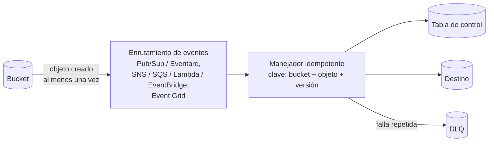

## 1. Resumen

Un pipeline dirigido por eventos arranca **cuando ocurre algo**, como un archivo nuevo en un bucket o un mensaje en una cola, en vez de a una hora fija. Reduce la latencia y evita correr cuando no hay nada nuevo. Las notificaciones de almacenamiento de las tres nubes comparten una propiedad clave: entregan **al menos una vez**, así que un mismo evento puede llegar repetido. En Cloud Storage, además, no hay orden garantizado. Por eso el manejador tiene que ser **idempotente** y tolerar eventos viejos que llegan tarde.

## 2. Qué es

- **Fuente de eventos:**
  - un bucket que publica «objeto creado»;
  - una base que publica cambios;
  - una aplicación que publica mensajes.
- **Enrutamiento:**
  - notificaciones de Cloud Storage a un tema de Pub/Sub, o Eventarc (otro mecanismo, que enruta eventos a destinos);
  - en S3, destinos SNS, SQS, Lambda o EventBridge;
  - Event Grid en Azure.
- **Manejador:** el código que recibe el evento y ejecuta el paso del pipeline (cargar el archivo, transformar, avisar).
- **Garantías documentadas:**
  - Cloud Storage → Pub/Sub, S3 Event Notifications y los eventos de Blob Storage vía Event Grid: entrega **al menos una vez**, con posibles duplicados;
  - Cloud Storage: tampoco garantiza el orden.

## 3. Problema que resuelve

Un pipeline programado cada hora llega tarde si el archivo aparece un minuto después de la corrida, y gasta cómputo si no llegó nada. Disparar por evento procesa cada archivo cuando llega. Además escala con el volumen: muchos archivos generan muchos eventos que se procesan en paralelo.

## 4. Cómo funciona

1. Se configura la fuente para publicar el evento: notificación del bucket, regla de Eventarc o EventBridge, suscripción de Event Grid.
2. El evento llega al manejador con los datos del objeto: bucket, nombre y, en Cloud Storage, `generation` y `metageneration`.
3. El manejador decide si ya lo procesó:
   - el id del mensaje **no sirve** para eso, porque una reentrega puede traer otro id (lo dice la documentación de Cloud Storage);
   - se usa la identidad del cambio (bucket, objeto y versión).
4. Si es nuevo, procesa y registra que lo hizo, idealmente en la misma transacción que la carga.
5. Si llega una versión más vieja que la ya procesada, porque no hay orden garantizado, se descarta.
6. Los eventos que fallan siempre se apartan a una DLQ para revisión, en lugar de reintentarse sin fin (ver `dead-letter-queue`).

## 5. Cuándo utilizarlo

- Ingesta de archivos que llegan en horarios irregulares.
- Pasos que deben ocurrir poco después de un cambio: refrescar un agregado, validar un archivo, avisar.
- Volúmenes variables, donde un horario fijo desperdicia corridas o se queda corto.

## 6. Cuándo no utilizarlo

- Cuando el proceso necesita **todos** los archivos de un período juntos (un cierre diario): un evento por archivo no sabe cuándo llegó el último. Conviene una corrida programada o un marcador de «lote completo».
- Cuando el orden importa estrictamente y la fuente no lo garantiza.
- Para dependencias complejas entre muchos pasos: un orquestador las expresa mejor (ver `pipeline-dependencies`).

## 7. Ejemplo sencillo

Llega `ventas.csv` y el bucket publica «objeto creado». El manejador lo carga y anota `(bucket, ventas.csv, generación 1)`. Si el mismo evento llega otra vez, ve la anotación y no hace nada.

## 8. Ejemplo de producción

Tiendas suben su archivo de cierre a un bucket, cada una cuando termina. Cada archivo dispara un evento que ejecuta un servicio de carga:

- el servicio registra cada objeto con su versión en una tabla de control, en la misma transacción que la carga;
- los duplicados y las versiones viejas que llegan tarde se descartan;
- un archivo que falla tres veces va a una DLQ con el error, y alguien lo revisa por la mañana.

El cierre consolidado de la cadena, que necesita todas las tiendas, no depende de estos eventos. Corre a las 06:00 y verifica que estén todos los archivos.

## 9. Arquitectura



## 10. Código

```python
# Python 3.12, solo biblioteca estándar (ejecutado; mypy --strict sin errores): manejador de eventos
# "objeto creado" con entrega al menos una vez y sin orden garantizado. Es idempotente por
# (bucket, objeto, generación) y descarta generaciones viejas que llegan tarde.
import sqlite3
from dataclasses import dataclass


@dataclass(frozen=True)
class Evento:
    evento_id: str          # el id del mensaje puede cambiar en una reentrega: no sirve para deduplicar
    bucket: str
    objeto: str
    generacion: int         # versión del objeto; crece con cada escritura


class Manejador:
    def __init__(self, db: sqlite3.Connection) -> None:
        self.db = db
        db.execute("CREATE TABLE IF NOT EXISTS procesado (bucket TEXT, objeto TEXT, generacion INTEGER, "
                   "PRIMARY KEY (bucket, objeto))")
        self.cargas: list[tuple[str, int]] = []

    def manejar(self, e: Evento) -> str:
        fila = self.db.execute("SELECT generacion FROM procesado WHERE bucket = ? AND objeto = ?",
                               (e.bucket, e.objeto)).fetchone()
        if fila is not None and fila[0] >= e.generacion:
            return "omitido"                                  # duplicado o versión más vieja que la ya cargada
        self.cargas.append((e.objeto, e.generacion))          # aquí iría la carga real (idempotente por objeto)
        with self.db:                                          # la marca y la carga, en la misma transacción si es posible
            self.db.execute("INSERT INTO procesado VALUES (?, ?, ?) ON CONFLICT (bucket, objeto) "
                            "DO UPDATE SET generacion = excluded.generacion", (e.bucket, e.objeto, e.generacion))
        return "cargado"


m = Manejador(sqlite3.connect(":memory:"))
eventos = [
    Evento("m1", "entrada", "ventas.csv", 1),
    Evento("m2", "entrada", "ventas.csv", 1),     # reentrega del mismo cambio con otro id
    Evento("m3", "entrada", "ventas.csv", 3),     # llega antes que la generación 2
    Evento("m4", "entrada", "ventas.csv", 2),     # versión vieja que llega tarde
    Evento("m5", "entrada", "clientes.csv", 1),
]
print([m.manejar(e) for e in eventos])   # ['cargado', 'omitido', 'cargado', 'omitido', 'cargado']
print(m.cargas)                          # [('ventas.csv', 1), ('ventas.csv', 3), ('clientes.csv', 1)]
```

Ejecutado con Python 3.12.3 y `mypy --strict` sin errores. Simula lo que documentan las nubes:

- una reentrega del mismo cambio con otro id de mensaje (`m2`);
- una versión vieja que llega después de una más nueva (`m4`).

Las dos se omiten, y cada versión se carga una sola vez. En producción, la tabla de control vive en la misma base que el destino para que la marca y la carga sean una transacción. El registro por versión sigue la recomendación de Cloud Storage de usar `generation`.

## 11. GCP

**Pub/Sub notifications for Cloud Storage** publica en un tema de Pub/Sub los cambios de los objetos de un bucket. La entrega es al menos una vez, en los dos tramos (Cloud Storage → Pub/Sub → suscriptor), así que puede haber varios mensajes con ids distintos para el mismo evento. Tampoco hay orden garantizado, y la documentación recomienda usar `generation` y `metageneration` como precondiciones. **Eventarc** es otro mecanismo, no el de las notificaciones del bucket a Pub/Sub. Es un servicio administrado y serverless, con ediciones **Advanced** y **Standard**, que enruta eventos de forma asíncrona desde proveedores hacia destinos: servicios de Google Cloud, aplicaciones propias, aplicaciones SaaS y servicios de terceros.

## 12. AWS

**S3 Event Notifications** publica eventos del bucket (objeto creado, borrado y otros) hacia **SNS, SQS, Lambda o EventBridge**. La entrega está diseñada como al menos una vez. Normalmente llega en segundos, pero a veces tarda un minuto o más, algo a considerar si el pipeline tiene un plazo.

## 13. Azure

**Event Grid** es el servicio de publicación y suscripción de Azure, con entrega push o pull y soporte de CloudEvents 1.0. Para eventos de **Blob Storage**, la documentación indica entrega al menos una vez, con posibles duplicados por reintentos entre nodos o por la disponibilidad de las suscripciones.

## 14. Buenas prácticas

- Idempotencia por la identidad del cambio (bucket, objeto, versión), nunca por el id del mensaje.
- Descartar versiones más viejas que la ya procesada.
- Marca de procesado y carga en la misma transacción cuando el destino lo permite.
- DLQ para eventos que fallan de forma repetida.
- Una corrida programada de reconciliación que busque archivos sin evento procesado.
- **Seguridad:** el manejador necesita permiso de lectura solo sobre el bucket o prefijo que le corresponde; validar el contenido antes de cargarlo, porque cualquiera con permiso de escritura en el bucket puede disparar el pipeline.
- **Observabilidad:** contar eventos recibidos, procesados, duplicados omitidos y enviados a la DLQ; medir la demora entre la creación del objeto y la carga.
- **Costo:** se paga por evento procesado en lugar de por corridas vacías; muchos archivos pequeños generan muchas invocaciones, y agruparlos o filtrar eventos por prefijo puede reducirlo.

## 15. Errores frecuentes

- Deduplicar por el id del mensaje y cargar dos veces la reentrega.
- Suponer orden y sobrescribir una versión nueva con una vieja.
- Disparar un proceso que necesita todos los archivos de un período con el evento de cada archivo.
- Reintentar sin fin un archivo corrupto en lugar de mandarlo a una DLQ.
- No tener reconciliación, y perder en silencio un archivo cuyo evento no llegó o falló.

## 16. Trade-offs

Los eventos dan baja latencia y escalan con el volumen, a cambio de duplicados, desorden posible y más piezas (enrutamiento, DLQ, tabla de control). Un horario fijo es más simple de razonar, sobre todo para procesos que necesitan el lote completo, pero llega tarde o corre en vacío. Muchos pipelines combinan los dos: eventos para cada archivo y una corrida programada que cierra y reconcilia.

## 17. Conceptos relacionados

- `streaming-ingestion` y `file-ingestion`: lo que suele disparar el evento.
- `idempotency` y `dead-letter-queue`: tolerar duplicados y apartar fallas.
- `pubsub-delivery-semantics`: entrega al menos una vez en Pub/Sub.
- `pipeline-dependencies`: cuando hay que coordinar varios pasos.
- Del blueprint (dominio 06), pendiente de ficha: `event-driven-orchestration`.

## 18. Preguntas técnicas abiertas

1. ¿Cómo sabrías que un archivo llegó pero su evento nunca se procesó?
2. ¿Qué harías si el proceso necesita los archivos de todas las tiendas del día y cada uno dispara su propio evento?
3. ¿Qué campo de tu fuente identifica una versión de un objeto, y qué pasa si no existe?

## 19. Laboratorio relacionado

Pendiente (F4).

## 20. Fuentes

- Google Cloud: *Pub/Sub notifications for Cloud Storage* y *Eventarc overview*.
- AWS: *Amazon S3 Event Notifications*.
- Microsoft Learn: *Introduction to Azure Event Grid* y *Blob storage events*.

El detalle de cada fuente está en `sources` del frontmatter.

## 21. Fecha de última verificación

2026-10-11. Pasa a `verified`: revisión B-F3.1 del lote F3b-05a aplicada, sin VERIFY pendientes.

## 22. Historial de cambios importantes

- 2026-10-11: creación (lote F3b-05a).
- 2026-10-11: revisión B-F3.1 del lote F3b-05a aplicada (docs/reviews/cards-f3b-05a.md): Eventarc distinguido de las notificaciones de Cloud Storage a Pub/Sub, con sus ediciones y los destinos de su página.
- 2026-10-11: `verification_status: verified` (sin VERIFY pendientes).
