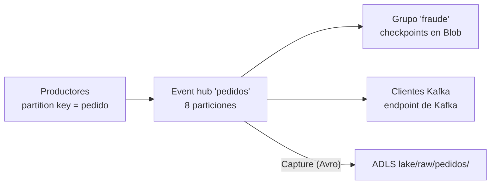

## 1. Resumen

**Azure Event Hubs** es la plataforma de streaming administrada de Azure. Según su documentación:

- un event hub tiene **particiones**; con una **partition key**, una función de hash estática elige la partición, así los eventos de una misma clave van juntos; sin clave, la asignación es round-robin;
- cada **grupo de consumidores** es una vista independiente del stream, y el **checkpoint** (dónde quedó cada consumidor) lo guarda el consumidor;
- la **retención** es por tiempo: en Standard, de 1 hora por defecto a 7 días; en Premium y Dedicated, hasta 90 días;
- expone un **endpoint de Kafka**: muchas aplicaciones de Kafka se conectan cambiando solo la configuración;
- **Capture** guarda el stream en Blob o ADLS en Avro, sin código.

## 2. Qué es

- **Namespace y event hub:** el namespace agrupa event hubs y define el nivel (Basic, Standard, Premium, Dedicated).
- **Partición:** secuencia ordenada de eventos; la partition key decide la partición por hash.
- **Grupo de consumidores:** vista independiente; hasta 5 receptores sin epoch por partición dentro de un grupo. Standard admite 20 grupos por event hub; Basic, 1.
- **Checkpoint:** el servicio da offsets; el consumidor los guarda, por ejemplo en Blob Storage, un contenedor por grupo.
- **Capacidad:** en Standard, throughput units: cada una, hasta 1 MB/s o 1.000 eventos/s de entrada y 2 MB/s o 4.096 eventos/s de salida. Premium usa processing units.
- **Tamaño de evento:** hasta 1 MB en Standard y Premium (256 KB en Basic).
- **Kafka:** endpoint de Kafka por event hub; no disponible en Basic.
- **Capture:** entrega a Blob o ADLS en Avro, por tiempo o tamaño.

## 3. Problema que resuelve

Recibir eventos continuos de muchos productores, guardarlos ordenados por clave durante un tiempo y dejar que varias aplicaciones los lean a su ritmo, sin operar brokers. Para equipos con clientes de Kafka, sin migrar el código.

## 4. Cómo funciona

1. El productor envía eventos con una partition key (por ejemplo, el id del pedido).
2. Event Hubs aplica el hash y escribe en la partición, en orden.
3. Cada aplicación consumidora tiene su grupo y lee las particiones desde su último checkpoint.
4. Si la entrada supera las throughput units, se limita con `ServiceBusy`.
5. Capture, si está activo, escribe el stream en ADLS en archivos Avro.

## 5. Cuándo utilizarlo

- Ingesta de eventos en Azure con orden por clave y varios consumidores.
- Aplicaciones de Kafka que se quieren llevar a un servicio administrado.
- Archivar el stream en el lake sin escribir un consumidor: Capture.

## 6. Cuándo no utilizarlo

- Retener eventos meses en Standard: el máximo es 7 días.
- Usar el stream como base de datos: los eventos no se pueden borrar ni consultar por clave.
- Necesitar Kafka en Basic: no tiene endpoint de Kafka.

## 7. Ejemplo sencillo

Los eventos de un pedido (`creado`, `pagado`) llevan como partition key el id del pedido, así caen en la misma partición y se leen en orden. Pedidos distintos se reparten entre particiones y se leen en paralelo.

## 8. Ejemplo de producción

Un namespace Standard con 2 throughput units tiene el event hub `pedidos` con 8 particiones y 7 días de retención:

- el grupo `fraude` lee en tiempo real y guarda checkpoints en un contenedor propio;
- Capture escribe en `lake/raw/pedidos/` cada pocos minutos, en Avro;
- una alarma vigila las respuestas `ServiceBusy`, que indican que faltan unidades.

## 9. Arquitectura



## 10. Código

```python
# Python 3.12 y azure-eventhub (no ejecutado: el SDK de Event Hubs no tiene emulador en la CI y no se corrió contra
# Azure). Productor: un lote por pedido con partition_key, así todos los eventos de un pedido van a la misma partición.
import json

from azure.eventhub import EventData, EventHubProducerClient
from azure.identity import DefaultAzureCredential

producer = EventHubProducerClient(
    fully_qualified_namespace="dekh-eventos.servicebus.windows.net",
    eventhub_name="pedidos",
    credential=DefaultAzureCredential(),
)
eventos = [{"id_pedido": 7, "estado": "creado"}, {"id_pedido": 7, "estado": "pagado"}]
with producer:
    batch = producer.create_batch(partition_key="7")
    for evento in eventos:
        batch.add(EventData(json.dumps(evento)))
    producer.send_batch(batch)
```

```hcl
# Terraform (validado en la CI con terraform validate, sin credenciales; no se aplicó): namespace Standard, un event
# hub con particiones y retención, y un grupo de consumidores por aplicación.
# Requiere: provider hashicorp/azurerm ~> 5.0; un grupo de recursos existente.
terraform {
  required_providers {
    azurerm = {
      source  = "hashicorp/azurerm"
      version = "~> 5.0"
    }
  }
}

provider "azurerm" {
  features {}
}

variable "resource_group_name" {
  type = string
}

variable "location" {
  type    = string
  default = "eastus2"
}

resource "azurerm_eventhub_namespace" "eventos" {
  name                = "dekh-eventos"
  location            = var.location
  resource_group_name = var.resource_group_name
  sku                 = "Standard"
  capacity            = 2 # throughput units
}

resource "azurerm_eventhub" "pedidos" {
  name              = "pedidos"
  namespace_id      = azurerm_eventhub_namespace.eventos.id
  partition_count   = 8
  message_retention = 7 # días; el máximo de Standard
}

resource "azurerm_eventhub_consumer_group" "fraude" {
  name                = "fraude"
  namespace_name      = azurerm_eventhub_namespace.eventos.name
  eventhub_name       = azurerm_eventhub.pedidos.name
  resource_group_name = var.resource_group_name
}
```

El script en Python 3.12 con `azure-eventhub` **no se ejecutó**: Event Hubs no tiene emulador en la CI (ADR-013) y no se corrió contra Azure. Usa `create_batch(partition_key=...)` para que todos los eventos del pedido vayan a la misma partición.

El bloque de Terraform se valida en la CI con `terraform validate`, sin credenciales (`make validate-terraform`), y **no se aplicó**. La retención de 7 días es el máximo de Standard según *Event Hubs features and terminology*.

## 11. GCP

No aplica de forma específica: esta ficha describe Event Hubs. El equivalente es Pub/Sub (ver `pubsub-topics-and-subscriptions`). Las diferencias, según sus páginas:

| | Event Hubs | Pub/Sub |
|---|---|---|
| Unidad de paralelismo | Particiones; la partition key elige la partición por hash | Sin particiones que elegir; el orden se pide con ordering key y se habilita en la suscripción |
| Lectores | Grupos de consumidores con checkpoints propios | Suscripciones; varios suscriptores de una suscripción pull se reparten los mensajes |
| Retención | Standard: 1 hora por defecto, hasta 7 días; Premium y Dedicated, hasta 90 | En la suscripción: 7 días por defecto, de 10 minutos a 31 días |

## 12. AWS

No aplica de forma específica. Lo más cercano es Kinesis Data Streams (ver `kinesis-data-streams`), y para Kafka, MSK (ver `msk-managed-kafka`). Las diferencias, según sus páginas:

| | Event Hubs | Kinesis Data Streams | MSK |
|---|---|---|---|
| Capacidad | Throughput units (Standard): 1 MB/s o 1.000 eventos/s de entrada cada una | Shards (1 MB/s o 1.000 registros/s de escritura cada uno) o modos on-demand | Brokers de Kafka (provisionado) o serverless |
| Retención | 7 días máximo en Standard, 90 en Premium y Dedicated | De 24 horas a 365 días | Las páginas citadas de MSK no la tratan |
| API de los clientes | La de Event Hubs o el endpoint de Kafka, sin brokers que operar | Su propia API (`PutRecords`, `GetRecords`) | La de Kafka de código abierto |

## 13. Azure

**Azure Event Hubs.** Las particiones, la partition key, los grupos de consumidores, los checkpoints, la retención por nivel, las throughput units, el endpoint de Kafka y Capture son los de sus páginas. Los precios por nivel y unidades se consultan en la página de precios.

## 14. Buenas prácticas

- Partition key con muchos valores y tráfico parejo; no cambiar el número de particiones si importa el orden.
- Un grupo de consumidores por aplicación, con su contenedor de checkpoints.
- Consumidores idempotentes: un consumidor que retoma desde su checkpoint puede releer eventos.
- Capture para archivar en el lake en lugar de un consumidor propio.
- **Seguridad:** identidades administradas y roles por namespace o event hub; nada de cadenas de conexión con claves en el código.
- **Observabilidad:** seguir el retraso de cada grupo de consumidores y las respuestas `ServiceBusy`.
- **Costo:** depende del nivel, las unidades de capacidad, los eventos y Capture. Los montos se consultan en la página de precios.

## 15. Errores frecuentes

- Una partition key constante que manda todo a una partición.
- Varias aplicaciones en el mismo grupo de consumidores pisándose los checkpoints.
- Contar con más de 7 días de retención en Standard.
- Elegir Basic y descubrir que no tiene endpoint de Kafka.

## 16. Trade-offs

Event Hubs no exige operar brokers y acepta clientes de Kafka, a cambio de límites por nivel (retención, grupos, tamaño de evento) y de capacidad comprada en unidades. MSK da Kafka completo con más que operar; Kinesis y Pub/Sub tienen sus propios modelos de capacidad y de lectura.

## 17. Conceptos relacionados

- `streaming-ingestion`: el patrón.
- `kinesis-data-streams`, `msk-managed-kafka` y `pubsub-topics-and-subscriptions`: los equivalentes en AWS y GCP.
- `checkpoints`: el avance del consumidor.
- `avro-format` y `adls-gen2-storage`: el destino de Capture.

## 18. Preguntas técnicas abiertas

1. ¿Qué partition key usarías para tus eventos?
2. ¿Cuántos grupos de consumidores necesitas, y quién guarda sus checkpoints?
3. ¿Te alcanzan 7 días de retención o necesitas Premium?

## 19. Laboratorio relacionado

Pendiente (F4).

## 20. Fuentes

- Microsoft Learn, Azure Event Hubs: *What is Azure Event Hubs?*, *Event Hubs features and terminology*, *What is Azure Event Hubs for Apache Kafka?*, *Azure Event Hubs quotas and limits*, *Scaling with Event Hubs* y *Capture events through Azure Event Hubs in Azure Blob Storage or Azure Data Lake Storage*; *Event Hubs pricing*.
- AWS: *Amazon Kinesis Data Streams Terminology and concepts*, *Choose the right mode to stream in* y *Welcome to the Amazon MSK Developer Guide*.
- Google Cloud, Pub/Sub: *Subscription properties*, *Order messages* y la página de suscriptores; AWS, *PutRecords* (API Reference).

El detalle de cada fuente está en `sources` del frontmatter.

## 21. Fecha de última verificación

2026-10-14. Pasa a `verified`: revisión B-F3.1 del lote F3b-10a aplicada, sin VERIFY pendientes.

## 22. Historial de cambios importantes

- 2026-10-13: creación (lote F3b-10a).
- 2026-10-14: revisión B-F3.1 del lote F3b-10a aplicada (docs/reviews/cards-f3b-10a.md): filas aprobadas sin cambios en esta ficha.
- 2026-10-14: `verification_status: verified` (sin VERIFY pendientes).
