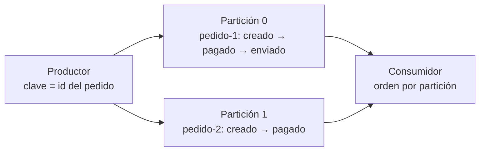

## 1. Resumen

Un broker no ordena «todo»: ordena dentro de una unidad. En Kafka, todo consumidor de una partición lee sus eventos «in exactly the same order as they were written». Entre particiones distintas no hay orden.

Por eso, para que los eventos de una entidad (un pedido, un cliente) lleguen en orden:

- **se usa la entidad como clave**, así todos sus eventos van a la misma partición;
- **el productor idempotente** de Kafka conserva ese orden aunque reintente;
- **el consumidor procesa cada partición en orden**, sin repartir los eventos de una misma clave entre hilos.

## 2. Qué es

- **Orden por partición:** el orden de escritura dentro de una partición, que el consumidor respeta.
- **Orden global:** el de todo el topic; con varias particiones, no existe.
- **Orden por clave:** consecuencia de que la misma clave vaya siempre a la misma partición.
- **Productor idempotente:** `enable.idempotence`, que evita duplicados y conserva el orden con hasta 5 pedidos en vuelo.
- **Fuera de orden:** un evento que llega después de otro que ocurrió más tarde (ver `late-arriving-data`).

## 3. Problema que resuelve

Los estados de un pedido son `creado`, `pagado`, `enviado`, `entregado`. Si el consumidor recibe `enviado` antes de `pagado`, la tabla de pedidos queda con un estado imposible. Con el id del pedido como clave, sus cuatro eventos van a la misma partición y se leen en el orden en que se escribieron.

## 4. Cómo funciona

1. El productor escribe con clave = id del pedido.
2. El hash de la clave elige la partición; todos los eventos de ese pedido van ahí.
3. La partición los agrega en orden.
4. El consumidor de esa partición los lee en el mismo orden.
5. Eventos de pedidos distintos, en particiones distintas, pueden leerse intercalados de cualquier forma.

## 5. Cuándo utilizarlo

- Cambios de estado de una entidad (pedidos, cuentas, dispositivos).
- Replicación de cambios de una base (CDC), donde el orden por fila importa.
- Cuando el consumidor aplica eventos sobre un estado y no puede reordenarlos.

## 6. Cuándo no utilizarlo

- Exigir orden global en un topic con varias particiones: no existe; con una sola partición, se pierde paralelismo.
- Ordenar por clave cuando los eventos son independientes entre sí: limita el reparto sin ganar nada.
- Confiar en el orden de llegada para calcular por tiempo del evento: para eso están el event time y las watermarks.

## 7. Ejemplo sencillo

Tres pedidos con cuatro estados cada uno, escritos intercalados en un topic de 3 particiones, con el id del pedido como clave. Al leer, cada pedido aparece con sus estados en orden: `creado pagado enviado entregado`.

## 8. Ejemplo de producción

Un topic de cambios de pedidos alimenta una tabla de estado:

- clave = id del pedido, productor idempotente (el valor por defecto);
- el consumidor procesa cada partición en un solo hilo;
- el destino aplica el cambio solo si es más nuevo que el que ya tiene, por si un reprocesamiento repite eventos;
- el número de particiones no se cambia en caliente.

## 9. Arquitectura



## 10. Código

```bash
# Bash y Kafka (ejecutado en la CI con un broker Kafka 4.3.1 en KRaft, en Docker; ADR-017): con varias particiones no
# hay un orden global, pero los eventos de una misma clave se leen en el orden en que se escribieron.
set -euo pipefail
K="${KAFKA_CONTAINER:-dekh-kafka}"
kafka() { docker exec -i "$K" /opt/kafka/bin/"$1" --bootstrap-server localhost:9092 "${@:2}"; }
trap 'kafka kafka-topics.sh --delete --topic estados > /dev/null 2>&1 || true' EXIT

kafka kafka-topics.sh --create --topic estados --partitions 3 > /dev/null
for step in creado pagado enviado entregado; do
  for order in pedido-1 pedido-2 pedido-3; do echo "$order|$step"; done
done | kafka kafka-console-producer.sh --topic estados --reader-property parse.key=true --reader-property key.separator='|'

events=$(kafka kafka-console-consumer.sh --topic estados --group lector --from-beginning --max-messages 12 \
           --timeout-ms 20000 --formatter-property print.key=true 2> /dev/null)
for order in pedido-1 pedido-2 pedido-3; do
  echo "$order: $(echo "$events" | awk -F'\t' -v k="$order" '$1 == k {printf "%s ", $2}')"
done
```

El script se **ejecuta en la CI contra un broker Kafka 4.3.1 en KRaft, en Docker** (ADR-017). Para cada pedido imprime `creado pagado enviado entregado`, el orden en que se escribieron.

## 11. GCP

En GCP, **Pub/Sub** no ordena por defecto. Según *Subscription overview* y *Order messages* (no ejecutado):

| | Kafka | Pub/Sub |
|---|---|---|
| Por defecto | Orden dentro de cada partición | Sin garantías de orden |
| Cómo pedir orden | Usar la entidad como clave | Ordering key, publicar en la misma región y habilitar el orden en la suscripción |
| Ante una reentrega | El consumidor retoma desde su offset | Se reentregan todos los mensajes posteriores de esa clave, incluso los ya confirmados |

## 12. AWS

En AWS, **Kinesis Data Streams** ordena por shard. Según *PutRecords* (no ejecutado):

| | Kafka | Kinesis Data Streams |
|---|---|---|
| Escritura en lote | Con productor idempotente, el orden se conserva con reintentos | `PutRecords` no garantiza el orden: un registro que falla no detiene a los demás |
| Para leer en orden | Misma clave, misma partición | `PutRecord` escribiendo al mismo shard |

## 13. Azure

En Azure, **Event Hubs** ordena por partición. Según *Event Hubs features and terminology* (no ejecutado):

| | Kafka | Event Hubs |
|---|---|---|
| Cómo se mantiene el orden | Misma clave, misma partición | Misma partition key; sin clave, round-robin |
| Riesgo | Agregar particiones cambia a dónde va cada clave | Cambiar el mapeo de claves a particiones cambia la distribución, a evitar si importa el orden |

## 14. Buenas prácticas

- Elegir la clave por la entidad cuyo orden importa.
- Mantener el productor idempotente (es el valor por defecto en Kafka).
- Procesar cada partición en orden y aplicar en el destino solo cambios más nuevos.
- **Seguridad:** la clave suele ser un identificador de negocio; no usar datos personales.
- **Observabilidad:** contar eventos que llegan con una versión más vieja que la del destino.
- **Costo:** ordenar todo en una sola partición o shard limita el throughput; más particiones cuestan más recursos.

## 15. Errores frecuentes

- Esperar orden global con varias particiones.
- `PutRecords` en Kinesis esperando que el lote llegue en orden.
- Repartir los eventos de una partición entre varios hilos y perder el orden.
- Ordering key en Pub/Sub sin habilitar el orden en la suscripción.

## 16. Trade-offs

Más orden es menos paralelismo: una sola partición ordena todo y no escala; muchas particiones escalan y ordenan solo por clave. El orden por clave obliga a elegir bien la clave y a no cambiar el número de particiones. Un destino que aplica solo cambios más nuevos tolera desorden y repeticiones, a cambio de guardar una versión por fila.

## 17. Conceptos relacionados

- `topics-and-partitions`: dónde vive el orden.
- `pubsub-delivery-semantics`: orden por ordering key en Pub/Sub.
- `late-arriving-data`: eventos que llegan tarde.
- `delivery-semantics`: reintentos y repetidos.

## 18. Preguntas técnicas abiertas

1. ¿Qué entidad de tu pipeline necesita sus eventos en orden?
2. ¿Tu consumidor procesa una partición en un hilo o en varios?
3. ¿Cómo se comporta tu destino si recibe un estado más viejo que el que ya tiene?

## 19. Laboratorio relacionado

Pendiente (F4).

## 20. Fuentes

- Apache Kafka 4.3: *Introduction*, *Design* y *Producer Configs*.
- Google Cloud: *Subscription overview* y *Order messages*.
- AWS: *PutRecords*.
- Microsoft Learn: *Event Hubs features and terminology*.

El detalle de cada fuente está en `sources` del frontmatter.

## 21. Fecha de última verificación

2026-10-19. `review_required`: pendiente de revisión B-F3.1 del lote F3b-14a.

## 22. Historial de cambios importantes

- 2026-10-19: creación (lote F3b-14a).
