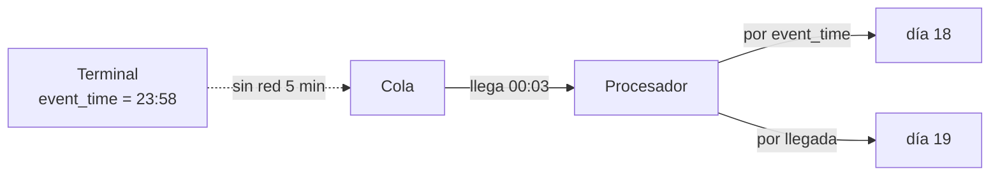

## 1. Resumen

Un evento tiene dos tiempos:

- **tiempo de evento:** cuándo ocurrió, un dato que viaja dentro del registro; según Flink, «the time that each individual event occurred on its producing device»;
- **tiempo de procesamiento:** el reloj de la máquina que lo procesa; según Flink, «the system time of the machine that is executing the respective operation».

En un sistema real, los eventos llegan tarde y desordenados: un terminal sin red, un reintento, una cola atrasada. Si el resultado depende del tiempo de procesamiento, cambia según cuándo llegó cada evento. Si depende del tiempo de evento, es el mismo aunque lleguen tarde, a cambio de decidir cuánto esperar (ver `watermarks`).

## 2. Qué es

- **Tiempo de evento:** el timestamp del hecho, en una columna del registro.
- **Tiempo de procesamiento:** el reloj del sistema en el momento de procesar.
- **Tiempo de ingesta:** cuándo el evento entró al sistema; Managed Service for Apache Flink lo distingue de los otros dos.
- **Dato tardío:** un evento cuyo tiempo de evento es anterior a lo que el sistema ya dio por visto (ver `late-arriving-data`).
- **Desfase:** la diferencia entre los dos tiempos de un evento.

## 3. Problema que resuelve

Un reporte de ventas por día cuenta lo que llegó cada día. Un terminal que perdió la red a las 23:55 manda sus ventas a las 00:03: con tiempo de procesamiento, quedan en el día siguiente y el cierre de caja no coincide. Con tiempo de evento, cada venta queda en el día en que ocurrió.

## 4. Cómo funciona

1. El productor pone el tiempo de evento en el registro.
2. El procesador lee esa columna como tiempo de evento.
3. Las ventanas y agregados por tiempo usan esa columna, no el reloj.
4. Como los eventos llegan desordenados, el motor necesita saber cuánto esperar antes de cerrar un período: la watermark.
5. Con tiempo de procesamiento, en cambio, cada evento cae en el período en que llegó y no hay nada que esperar.

## 5. Cuándo utilizarlo

- **Tiempo de evento:** reportes de negocio por hora o día, sesiones de usuario, métricas que deben coincidir con un cierre.
- **Tiempo de procesamiento:** monitoreo operativo («cuántos eventos procesé en el último minuto»), donde importa el ritmo del sistema.

## 6. Cuándo no utilizarlo

- Tiempo de procesamiento para métricas de negocio: el resultado depende de atrasos de la red o de la cola.
- Tiempo de evento sin una watermark: el motor no sabe cuándo cerrar una ventana y el estado crece.
- Un tiempo de evento puesto por el consumidor: debe venir del origen.

## 7. Ejemplo sencillo

Tres ventas: `v1` a las 23:40 del 18, `v2` a las 23:58 del 18 que llega a las 00:03 del 19, y `v3` a las 00:10 del 19. Por tiempo de evento hay 2 ventas el 18 y 1 el 19. Por hora de llegada hay 1 el 18 y 2 el 19.

## 8. Ejemplo de producción

Una ingesta de ventas de tiendas:

- cada terminal pone `event_time` al registrar la venta, en UTC;
- el pipeline guarda además `ingested_at`, para medir el desfase;
- los agregados por día usan `event_time`, con una watermark de una hora;
- una alerta si el desfase de una tienda pasa de la watermark, porque sus ventas se pierden de los agregados.

## 9. Arquitectura



## 10. Código

```python
# Python 3.12 y PySpark 4.2.0 en modo local (ejecutado en la CI con Java 17): las mismas ventas contadas por hora de
# ocurrencia (tiempo de evento) y por hora de llegada (tiempo de procesamiento, aquí el momento en que el sistema las
# recibió). Una venta de las 23:58 que llega a las 00:03 cambia de hora, y de día, según cuál se use.
import json
import sys
import tempfile
from pathlib import Path

from pyspark.sql import SparkSession
from pyspark.sql import functions as F

SALES = [   # (id, cuándo ocurrió, cuándo llegó)
    ("v1", "2026-10-18 23:40:00", "2026-10-18 23:40:02"),
    ("v2", "2026-10-18 23:58:00", "2026-10-19 00:03:10"),   # el terminal estuvo sin red 5 minutos
    ("v3", "2026-10-19 00:10:00", "2026-10-19 00:10:01"),
]

base = Path(sys.argv[1] if len(sys.argv) > 1 else tempfile.mkdtemp())
src = base / "ventas"
src.mkdir(parents=True, exist_ok=True)
(src / "ventas.json").write_text(
    "\n".join(json.dumps({"id": i, "event_time": e, "arrival_time": a}) for i, e, a in SALES), encoding="utf-8")

spark = (SparkSession.builder.master("local[2]").config("spark.sql.shuffle.partitions", "2")
         .config("spark.ui.showConsoleProgress", "false").getOrCreate())
spark.sparkContext.setLogLevel("ERROR")
sales = spark.readStream.schema("id STRING, event_time TIMESTAMP, arrival_time TIMESTAMP").json(str(src))
for column in ("event_time", "arrival_time"):
    per_day = sales.groupBy(F.to_date(column).alias("day")).count()
    query = (per_day.writeStream.outputMode("complete").format("memory").queryName(column)
             .option("checkpointLocation", str(base / f"checkpoint-{column}")).trigger(availableNow=True).start())
    query.awaitTermination()
    rows = spark.sql(f"SELECT day, count FROM {column} ORDER BY day").collect()
    print(f"por {column}: " + ", ".join(f"{r.day} {r['count']}" for r in rows))
spark.stop()
```

El script se **ejecuta en la CI con PySpark 4.2.0 en modo local y Java 17**, sobre un stream de archivos con `trigger(availableNow=True)`. Imprime `por event_time: 2026-10-18 2, 2026-10-19 1` y `por arrival_time: 2026-10-18 1, 2026-10-19 2`. La hora de llegada es una columna del archivo para que el resultado sea reproducible; en producción la pone el sistema que recibe.

## 11. GCP

En GCP, **Dataflow** procesa por tiempo de evento con watermarks. Según *Streaming pipelines* (no ejecutado):

| | Spark Structured Streaming | Dataflow |
|---|---|---|
| Tiempo de evento | Una columna de la fila | El timestamp de cada elemento |
| Orden de llegada | Los datos pueden llegar tarde; Spark actualiza agregados viejos | Los datos no llegan garantizadamente en orden; lo que llega después de la watermark dentro de una ventana es late data |

## 12. AWS

En AWS, **Managed Service for Apache Flink** corre Flink. Según *Track events in Managed Service for Apache Flink using the DataStream API* y *Timely Stream Processing* (no ejecutado):

| | Spark Structured Streaming | Managed Service for Apache Flink |
|---|---|---|
| Tiempos | Tiempo de evento como columna; el de procesamiento es el reloj | Processing time, event time e ingestion time |
| Cómo avanza el tiempo de evento | Con la watermark de la consulta | Con watermarks que genera el programa; en tiempo de evento, el tiempo avanza con los datos |

## 13. Azure

En Azure, **Azure Databricks** corre Structured Streaming. Según *Apply watermarks to control data processing thresholds* (no ejecutado):

| | Spark Structured Streaming | Azure Databricks |
|---|---|---|
| Tiempo de evento | Columna de la fila | Columna `event_time`, que define la watermark y la ventana |
| Hasta cuándo se acepta un evento | Según la watermark | El estado de una ventana se mantiene hasta que su fin queda más viejo que el último `event_time` menos el umbral |

## 14. Buenas prácticas

- El tiempo de evento lo pone el origen, en UTC.
- Guardar también el tiempo de ingesta, para medir el desfase.
- Métricas de negocio por tiempo de evento; métricas operativas por tiempo de procesamiento.
- **Seguridad:** el reloj del dispositivo puede estar mal o manipulado; validar rangos razonables.
- **Observabilidad:** el desfase entre tiempo de evento y de ingesta, por origen.
- **Costo:** esperar datos tardíos es guardar estado más tiempo, en memoria o en disco del motor.

## 15. Errores frecuentes

- Agregar por la hora de llegada y llamarlo «ventas del día».
- Timestamps en hora local sin zona.
- Usar `current_timestamp()` como tiempo de evento.
- No medir el desfase y no saber cuánto esperar.

## 16. Trade-offs

El tiempo de evento da resultados correctos e iguales aunque los datos lleguen tarde, a cambio de esperar y de guardar estado. El tiempo de procesamiento es inmediato y simple, y mezcla el negocio con los atrasos del sistema. Esperar más da resultados más completos y más tarde.

## 17. Conceptos relacionados

- `watermarks`: cuánto esperar en tiempo de evento.
- `windowing`: ventanas por tiempo de evento.
- `late-arriving-data`: lo que llega tarde.
- `streaming-ingestion`: dónde se guardan los dos tiempos.
- `sql-date-functions`: truncar por hora o día.
- `batch-vs-streaming`: por qué en streaming los tiempos se separan.

## 18. Preguntas técnicas abiertas

1. ¿Qué tiempo usan hoy tus agregados diarios?
2. ¿Cuál es el desfase máximo que ves entre que algo ocurre y que llega?
3. ¿Quién pone el timestamp de tus eventos y en qué zona horaria?

## 19. Laboratorio relacionado

Pendiente (F4).

## 20. Fuentes

- Apache Flink 2.3: *Timely Stream Processing*.
- Apache Spark 4.2.0: *Structured Streaming Programming Guide* (Getting Started).
- Google Cloud: *Streaming pipelines*.
- AWS: *Track events in Managed Service for Apache Flink using the DataStream API*.
- Microsoft Learn: *Apply watermarks to control data processing thresholds*.

El detalle de cada fuente está en `sources` del frontmatter.

## 21. Fecha de última verificación

2026-10-19. `review_required`: pendiente de revisión B-F3.1 del lote F3b-14b.

## 22. Historial de cambios importantes

- 2026-10-19: creación (lote F3b-14b).
