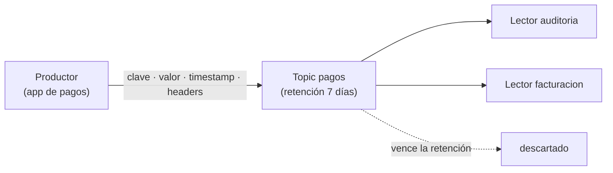

## 1. Resumen

Según la documentación de Kafka, «An event records the fact that “something happened” in the world or in your business». En la documentación también se le llama *record* o *message*.

Un evento tiene cuatro partes:

- **clave**, por ejemplo el id del cliente;
- **valor**, lo que pasó;
- **timestamp**;
- **headers** opcionales, con metadatos.

A diferencia de una cola tradicional, en Kafka un evento **no se borra al leerlo**: queda en el topic hasta que vence la retención, y cualquier lector puede leerlo.

## 2. Qué es

- **Evento:** un hecho que ocurrió, inmutable, como «el cliente 42 pagó 200».
- **Clave:** identifica a qué entidad se refiere; en Kafka decide la partición (ver `topics-and-partitions`).
- **Valor:** el contenido del hecho, en un formato acordado (JSON, Avro, Protobuf).
- **Timestamp:** cuándo ocurrió o cuándo se escribió el evento.
- **Headers:** metadatos que no son parte del valor, como el origen o la versión del esquema.
- **Retención:** cuánto tiempo guarda el topic los eventos; en Kafka, `retention.ms` por topic.

## 3. Problema que resuelve

Un sistema de pagos actualiza una fila de saldo y pisa el valor anterior. Si después alguien necesita saber qué pasó y en qué orden, no queda rastro. Si cada pago se registra como un evento, el historial queda, y varios sistemas (facturación, auditoría, el data warehouse) pueden leerlo por su cuenta.

## 4. Cómo funciona

1. Una aplicación escribe el evento en un topic, con clave, valor, timestamp y headers.
2. El broker lo agrega al final de una partición y lo guarda en forma durable.
3. Cada lector lee desde su propia posición; leer no borra nada.
4. Cuando el evento supera la retención del topic, el broker lo descarta.

## 5. Cuándo utilizarlo

- Registrar hechos de negocio (pagos, pedidos, clicks) que varios consumidores necesitan.
- Integrar sistemas sin que el que produce conozca a los que leen.
- Cuando hace falta volver a leer la historia reciente, por ejemplo para reprocesar.

## 6. Cuándo no utilizarlo

- Para pedir algo y esperar una respuesta inmediata: eso es una llamada, no un hecho que ocurrió.
- Como almacenamiento permanente sin revisar la retención: el evento se descarta al vencer.
- Con valores sin esquema acordado: cada lector termina interpretándolos distinto.

## 7. Ejemplo sencillo

En un topic `pagos`, dos eventos: `cliente-42` pagó 200 desde la web y `cliente-7` pagó 35 desde la app, cada uno con un header `origen`. El lector `auditoria` los lee con su timestamp, sus headers, su clave y su valor. El lector `facturacion` lee después los mismos dos eventos.

## 8. Ejemplo de producción

Un topic `pagos` en producción:

- clave = id del cliente, valor en Avro con un esquema versionado;
- headers con el sistema de origen y la versión del esquema;
- retención de 7 días, suficiente para reprocesar una semana;
- consumidores independientes: facturación, antifraude y la carga al data warehouse.

## 9. Arquitectura



## 10. Código

```bash
# Bash y Kafka (ejecutado en la CI con un broker Kafka 4.3.1 en KRaft, en Docker; ADR-017): un evento tiene clave, valor,
# timestamp y headers. Leerlo no lo borra: dos lectores distintos leen los mismos eventos.
set -euo pipefail
K="${KAFKA_CONTAINER:-dekh-kafka}"   # contenedor del broker (apache/kafka:4.3.1 fijada por digest)
kafka() { docker exec -i "$K" /opt/kafka/bin/"$1" --bootstrap-server localhost:9092 "${@:2}"; }
trap 'kafka kafka-topics.sh --delete --topic pagos > /dev/null 2>&1 || true' EXIT

kafka kafka-topics.sh --create --topic pagos --partitions 1 > /dev/null
# Cada línea: headers | clave | valor.
printf '%s\n' 'origen:web|cliente-42|{"evento": "pago", "monto": 200}' \
              'origen:app|cliente-7|{"evento": "pago", "monto": 35}' |
  kafka kafka-console-producer.sh --topic pagos \
    --reader-property parse.headers=true --reader-property headers.delimiter='|' \
    --reader-property parse.key=true --reader-property key.separator='|'

read_all() {   # lee el topic desde el principio con el grupo $1 e imprime timestamp, headers, clave y valor
  kafka kafka-console-consumer.sh --topic pagos --group "$1" --from-beginning --max-messages 2 --timeout-ms 20000 \
    --formatter-property print.timestamp=true --formatter-property print.headers=true \
    --formatter-property print.key=true 2> /dev/null
}
read_all auditoria
echo "otro lector, mismos eventos: $(read_all facturacion | wc -l)"
```

El script se **ejecuta en la CI contra un broker Kafka 4.3.1 en KRaft, en Docker** (ADR-017), con la imagen fijada por digest. Imprime los dos eventos con `CreateTime`, header, clave y valor, y `otro lector, mismos eventos: 2`.

## 11. GCP

En GCP, un evento de **Pub/Sub** es un mensaje. Las diferencias con Kafka, según *Class Message (2.42.0)* y *Subscription properties* (no ejecutado):

| | Kafka | Pub/Sub |
|---|---|---|
| Partes | Clave, valor, timestamp y headers | `data`, `attributes`, `message_id` y `publish_time` |
| Al leerlo | No se borra; vence por la retención del topic | El suscriptor lo confirma con `ack()`; la suscripción retiene mensajes 7 días por defecto, de 10 minutos a 31 días |

## 12. AWS

En AWS, un evento de **Kinesis Data Streams** es un registro. Las diferencias, según *Amazon Kinesis Data Streams Terminology and concepts* (no ejecutado):

| | Kafka | Kinesis Data Streams |
|---|---|---|
| Partes | Clave, valor, timestamp y headers | Número de secuencia, partition key y un blob inmutable de hasta 1 MB |
| Retención | `retention.ms` por topic | 24 horas por defecto, hasta 8.760 horas (365 días) |

## 13. Azure

En Azure, un evento de **Event Hubs** va a un event hub. Las diferencias, según *Event Hubs features and terminology* (no ejecutado):

| | Kafka | Event Hubs |
|---|---|---|
| Clave | Clave del evento, que decide la partición | Partition key del emisor, con una función de hash estática |
| Retención | `retention.ms` por topic | Standard: 1 hora por defecto y 7 días como máximo; Premium y Dedicated: hasta 90 días; no se borran a mano |

## 14. Buenas prácticas

- Un evento describe un hecho pasado, con un nombre en pasado (`pago_realizado`).
- Clave estable de la entidad y valor con esquema versionado.
- Headers para metadatos de transporte, no para datos de negocio.
- **Seguridad:** no poner datos sensibles en la clave ni en los headers sin necesidad; cualquiera que lea el topic los ve.
- **Observabilidad:** un header con el origen y un id del evento permiten rastrearlo de punta a punta.
- **Costo:** la retención es almacenamiento; en Pub/Sub, guardar mensajes tiene costo propio (ver `message-brokers`).

## 15. Errores frecuentes

- Usar un evento como orden («calcula el saldo») en lugar de un hecho («se registró un pago»).
- Cambiar el formato del valor sin versión y romper a los lectores.
- Suponer que el evento sigue en el topic después de vencer la retención.
- Datos personales en la clave.

## 16. Trade-offs

Guardar eventos en lugar de solo el estado actual da historia y lectores independientes, a cambio de almacenamiento y de reconstruir el estado cuando se necesita. Una retención larga permite reprocesar más atrás y cuesta más. Un esquema estricto protege a los lectores y obliga a versionarlo.

## 17. Conceptos relacionados

- `producers-and-consumers`: quién escribe y quién lee los eventos.
- `topics-and-partitions`: dónde se guardan.
- `event-driven-pipelines`: pipelines que reaccionan a eventos.
- `replay`: volver a leer eventos que siguen retenidos.
- `schema-evolution`: el esquema del valor a lo largo del tiempo.
- `message-brokers`: dónde se guardan y retienen.

## 18. Preguntas técnicas abiertas

1. ¿Qué hechos de tu negocio hoy solo existen como el último estado de una fila?
2. ¿Cuánto tiempo atrás necesitarías volver a leer los eventos?
3. ¿Qué va en la clave de tus eventos y por qué?

## 19. Laboratorio relacionado

Pendiente (F4).

## 20. Fuentes

- Apache Kafka 4.3: *Introduction* y *Topic Configs*.
- Google Cloud: *Class Message (2.42.0)* y *Subscription properties*.
- AWS: *Amazon Kinesis Data Streams Terminology and concepts*.
- Microsoft Learn: *Event Hubs features and terminology*.

El detalle de cada fuente está en `sources` del frontmatter.

## 21. Fecha de última verificación

2026-10-19. `review_required`: pendiente de revisión B-F3.1 del lote F3b-14a.

## 22. Historial de cambios importantes

- 2026-10-19: creación (lote F3b-14a).
