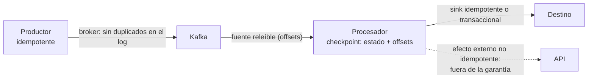

## 1. Resumen

«Exactly-once» no es una propiedad de un pipeline entero: es una garantía de **cada componente**, con su alcance. La documentación de Kafka lo advierte: «Many systems claim to provide “exactly-once” delivery semantics, but it is important to read the fine print».

Por componente:

- **broker (Kafka):** el productor idempotente no duplica al reintentar, y las transacciones dan exactly-once *entre topics de Kafka*; para otros destinos, Kafka dice que hace falta la cooperación de esos sistemas;
- **procesador (Spark, Flink, Dataflow):** el estado interno queda consistente tras una falla, gracias a checkpoints y a fuentes que se pueden releer;
- **sink:** cierra la garantía solo si es idempotente o transaccional. Spark lo dice sin rodeos: «using replayable sources and idempotent sinks, Structured Streaming can ensure end-to-end exactly-once semantics».

Lo que se repite entre componentes (llamadas a una API, un `INSERT` que solo agrega) queda fuera de la garantía.

## 2. Qué es

- **Exactly-once del estado:** el estado del procesador refleja cada evento una vez, aunque el evento se haya procesado más de una vez tras una falla.
- **Exactly-once de entrega:** el resultado llega al destino una sola vez; depende del sink.
- **Fuente que se puede releer:** con offsets o números de secuencia, como Kafka o Kinesis.
- **Sink idempotente:** escribir dos veces el mismo batch deja lo mismo (overwrite por id de batch, upsert por clave).
- **Sink transaccional:** confirma la escritura junto con el progreso (productor transaccional de Kafka, `txnVersion` en Delta).

## 3. Problema que resuelve

Un equipo activa «exactly-once» en su motor de streaming y aun así encuentra pagos duplicados en la tabla de destino. El motor reintentó un micro-batch tras una caída y el `foreachBatch` agregó las filas de nuevo. La garantía del motor cubría su estado, no lo que el código escribía afuera. Entender el alcance por componente evita ese error.

## 4. Cómo funciona

1. La fuente da offsets; el procesador registra en un checkpoint qué rango procesa cada micro-batch.
2. Si falla antes de confirmar el batch, al reiniciar vuelve a procesar ese mismo rango.
3. El estado interno se restaura del checkpoint: queda como si cada evento se hubiera procesado una vez.
4. El sink recibe el batch de nuevo. Si agrega filas, duplica; si escribe por id de batch o hace upsert, no.
5. Entre topics de Kafka, el productor transaccional y los consumidores `read_committed` hacen visible cada resultado una vez.

## 5. Cuándo utilizarlo

- Agregados y saldos donde un duplicado cambia el resultado.
- Pipelines Kafka a Kafka con transacciones.
- Sinks que admiten idempotencia: archivos con commit del motor, upsert por clave, Delta con versión de transacción.

## 6. Cuándo no utilizarlo

- Como promesa de extremo a extremo sin revisar el sink.
- Con efectos externos no idempotentes (enviar un correo, llamar a una API de pago): pueden repetirse.
- Cuando at-least-once con un destino idempotente alcanza y cuesta menos: Dataflow advierte que la deduplicación tiene costo.

## 7. Ejemplo sencillo

Tres pagos, un micro-batch que escribe y falla antes de confirmarse, y un reinicio con el mismo checkpoint. El motor vuelve a procesar el batch. Con un sink que agrega, quedan 6 filas para 3 pagos. Con un sink que reescribe el batch por `batch_id`, quedan 3.

## 8. Ejemplo de producción

Pagos de Kafka a una tabla Delta:

- productor idempotente con `acks=all`;
- Structured Streaming con checkpoint durable;
- `foreachBatch` con `MERGE` por id de pago y `txnAppId`/`txnVersion` ligado al `batchId`;
- los errores se dejan propagar para que el orquestador reintente el batch entero;
- ninguna llamada a servicios externos dentro del batch.

## 9. Arquitectura



## 10. Código

```python
# Python 3.12 y PySpark 4.2.0 en modo local (ejecutado en la CI con Java 17): el alcance de exactly-once en Structured
# Streaming. La fuente (archivos) se puede releer y el checkpoint guarda qué rango procesa cada micro-batch: si la
# consulta falla antes de confirmar un batch, al reiniciar ese batch se vuelve a procesar. Que el resultado quede una
# sola vez lo decide el sink: uno que agrega filas las repite; uno que escribe por batch_id (idempotente), no.
import json
import sys
import tempfile
from pathlib import Path

from pyspark.sql import DataFrame, SparkSession

base = Path(sys.argv[1] if len(sys.argv) > 1 else tempfile.mkdtemp())
src = base / "pagos"
src.mkdir(parents=True, exist_ok=True)
(src / "1.json").write_text("\n".join(json.dumps({"id": f"p{i}", "monto": 10 * i}) for i in range(1, 4)),
                            encoding="utf-8")

spark = (SparkSession.builder.master("local[2]").config("spark.sql.shuffle.partitions", "2")
         .config("spark.ui.showConsoleProgress", "false").getOrCreate())
spark.sparkContext.setLogLevel("ERROR")


def append_sink(out: Path):  # noqa: ANN201 - devuelve la función de foreachBatch
    def write(batch: DataFrame, batch_id: int) -> None:
        batch.write.mode("append").parquet(str(out))     # agrega: no sabe si ese batch ya se escribió
        fail_once(out)
    return write


def idempotent_sink(out: Path):  # noqa: ANN201
    def write(batch: DataFrame, batch_id: int) -> None:
        batch.write.mode("overwrite").parquet(str(out / f"batch_id={batch_id}"))   # reescribir el batch no duplica
        fail_once(out)
    return write


def fail_once(out: Path) -> None:
    """Simula una caída después de escribir y antes de que el motor confirme el batch."""
    marker = out.with_suffix(".fallo")
    if not marker.exists():
        marker.touch()
        raise RuntimeError("caída simulada")


def run(name: str, sink) -> int:  # noqa: ANN001
    out = base / name
    for _attempt in (1, 2):   # la primera corrida falla; la segunda reinicia con el mismo checkpoint
        query = (spark.readStream.schema("id STRING, monto INT").json(str(src)).writeStream.foreachBatch(sink(out))
                 .option("checkpointLocation", str(base / f"checkpoint-{name}")).trigger(availableNow=True).start())
        try:
            query.awaitTermination()
        except Exception:   # noqa: BLE001 - la falla simulada
            pass
    return spark.read.parquet(str(out)).count()


print(f"sink que agrega, tras una caída y un reinicio: {run('append', append_sink)} filas para 3 pagos")
print(f"sink idempotente por batch_id, tras una caída y un reinicio: {run('idempotente', idempotent_sink)} filas para 3 pagos")
spark.stop()
```

El script se **ejecuta en la CI con PySpark 4.2.0 en modo local y Java 17**. Simula una caída dentro de `foreachBatch`, después de escribir y antes de que el motor confirme el batch, y reinicia con el mismo checkpoint. Imprime `sink que agrega, tras una caída y un reinicio: 6 filas para 3 pagos` y `sink idempotente por batch_id, tras una caída y un reinicio: 3 filas para 3 pagos`.

## 11. GCP

En GCP, **Pub/Sub** y **Dataflow** tienen exactly-once con alcances distintos. Según *Exactly-once delivery* y *Exactly-once in Dataflow* (no ejecutado):

| | Pub/Sub | Dataflow |
|---|---|---|
| Qué cubre | La entrega a suscriptores: sin reentregas duplicadas, basado en el message ID | El procesamiento: los registros se procesan al menos una vez y los resultados se confirman exactamente una vez |
| Límites | Solo suscripciones pull (no push ni export), dentro de una región | Por defecto en streaming (at-least-once opcional); los efectos fuera del pipeline pueden repetirse |

## 12. AWS

En AWS, **Managed Service for Apache Flink** corre Flink con checkpoints. Según *Implement fault tolerance in Managed Service for Apache Flink* y *Fault Tolerance Guarantees of Data Sources and Sinks* de Flink 2.3 (no ejecutado):

| | Spark Structured Streaming | Managed Service for Apache Flink |
|---|---|---|
| Estado | Checkpoint y write-ahead log de offsets | Checkpoints que el servicio usa para recuperarse |
| Fuente | Debe poder releerse | Exactly-once del estado si la fuente participa del snapshot (Kinesis y Kafka sí) |
| Sink | Archivos: exactly-once; Kafka y foreach: at-least-once; foreachBatch: depende | El sink debe participar del checkpoint; productor de Kafka transaccional: exactly-once |

## 13. Azure

En Azure, **Azure Databricks** corre Structured Streaming. Según *Use foreachBatch to write to arbitrary data sinks* (no ejecutado):

| | Spark Structured Streaming | Azure Databricks |
|---|---|---|
| `foreachBatch` | «Depends on the implementation» | «foreachBatch() provides only at-least-once write guarantees»; con el `batchId` se puede deduplicar |
| Quién responde por el extremo a extremo | Fuente releíble más sink idempotente | «you will have to reason about the end-to-end semantics yourself» |

## 14. Buenas prácticas

- Decir siempre de qué componente es la garantía.
- Sink idempotente (por `batch_id` o upsert por clave) o transaccional.
- Kafka a Kafka: productor transaccional y consumidores `read_committed`.
- **Seguridad:** el id que hace idempotente la escritura no debe ser un dato sensible.
- **Observabilidad:** contar los batches reprocesados y los duplicados absorbidos por el destino.
- **Costo:** deduplicar y escribir de forma transaccional cuesta procesamiento y latencia; Dataflow lo advierte para su exactly-once.

## 15. Errores frecuentes

- Activar «exactly-once» en el motor y escribir con `append` desde `foreachBatch`.
- Consumidores con `read_uncommitted` (el valor por defecto) leyendo de un productor transaccional.
- Llamadas a APIs externas dentro del batch.
- Capturar el error dentro del batch y reintentar a mano, en vez de dejar que el motor reprocese.

## 16. Trade-offs

Exactly-once de punta a punta exige que cada componente participe: más configuración, más latencia y sinks con más restricciones. At-least-once con un destino idempotente da el mismo resultado visible en muchos casos y es más simple. El exactly-once del estado del motor es barato de usar y no alcanza para lo que se escribe afuera.

## 17. Conceptos relacionados

- `delivery-semantics`: at-most-once y at-least-once.
- `idempotency`: el sink que cierra la garantía.
- `checkpoints`: el estado del procesador.
- `stateful-stream-processing`: estado consistente tras una falla.
- `pubsub-delivery-semantics`: el exactly-once de Pub/Sub.
- `retries`: lo que la garantía tiene que absorber.
- `offsets`: guardar la posición junto con la salida.

## 18. Preguntas técnicas abiertas

1. ¿De qué componente es el «exactly-once» que dice tu pipeline?
2. ¿Qué pasa en tu destino si un micro-batch se procesa dos veces?
3. ¿Hay efectos externos en tu procesamiento que no se pueden repetir?

## 19. Laboratorio relacionado

Pendiente (F4).

## 20. Fuentes

- Apache Kafka 4.3: *Design* y *Consumer and Share Consumer Configs*.
- Apache Spark 4.2.0: *Structured Streaming Programming Guide* (Getting Started y APIs on DataFrames and Datasets).
- Apache Flink 2.3: *Fault Tolerance Guarantees of Data Sources and Sinks*.
- Google Cloud: *Exactly-once delivery* y *Exactly-once in Dataflow*.
- AWS: *Implement fault tolerance in Managed Service for Apache Flink*.
- Microsoft Learn: *Use foreachBatch to write to arbitrary data sinks*.

El detalle de cada fuente está en `sources` del frontmatter.

## 21. Fecha de última verificación

2026-10-19. `review_required`: pendiente de revisión B-F3.1 del lote F3b-14b.

## 22. Historial de cambios importantes

- 2026-10-19: creación (lote F3b-14b).
