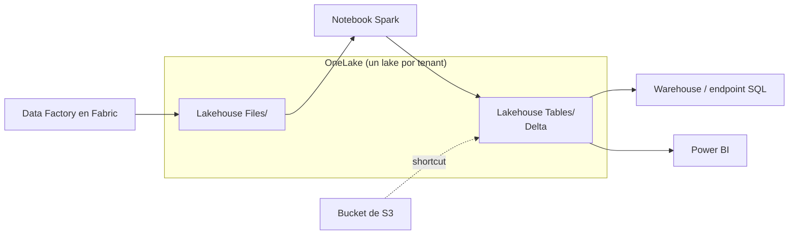

## 1. Resumen

**Microsoft Fabric** es una plataforma de analítica SaaS. Según su documentación, reúne experiencias (**Data Engineering**, **Data Factory**, **Data Science**, **Real-Time Intelligence**, **Data Warehouse** y **Databases**) que operan sobre un modelo compartido de cómputo y almacenamiento.

El almacenamiento es **OneLake**:

- un lake **único por tenant**, construido sobre ADLS;
- con las tablas en **Delta Parquet o Iceberg**, formatos abiertos que todas las experiencias leen y escriben;
- con **shortcuts**, que muestran datos de Azure, AWS u otros orígenes dentro de OneLake sin copiarlos.

Se accede con las **API y SDK de ADLS y Blob**, usando una URI de OneLake. El cómputo se compra como **capacidad** (SKU F, en Capacity Units) y la comparten todas las experiencias.

## 2. Qué es

- **Tenant, capacidad, workspace e ítem:** el tenant tiene uno o más capacidades; los workspaces usan una capacidad; los ítems (lakehouse, warehouse, pipeline, notebook) viven en un workspace.
- **OneLake:** un solo lake lógico por tenant. URI: `https://onelake.dfs.fabric.microsoft.com/<workspace>/<item>.<itemtype>/<path>`.
- **Formato de tablas:** Delta Lake es el estándar de Fabric; una tabla escrita por un motor la lee otro (por ejemplo, Spark escribe y Power BI lee). OneLake también guarda tablas Iceberg.
- **Shortcuts:** referencias a datos en Azure, AWS u otros orígenes, con permisos y credenciales administrados por OneLake.
- **Lakehouse:** archivos y tablas en OneLake, con un endpoint SQL de solo lectura sobre las tablas Delta.
- **Capacidad:** SKU F, de F2 en adelante, medidas en Capacity Units.
- **Gobierno:** OneLake Catalog para descubrir y gobernar; Microsoft Purview para protección de información, DLP y auditoría de datos de Fabric admitidos.

## 3. Problema que resuelve

Evitar un lake por equipo y copias de los mismos datos para cada motor. En OneLake, una tabla Delta escrita por Spark la leen el warehouse y Power BI sin copiarla, y los datos que viven en otra nube se ven por shortcuts.

## 4. Cómo funciona

1. La organización compra una capacidad F y crea workspaces por dominio.
2. Un pipeline de Data Factory en Fabric carga los archivos al lakehouse (`Files/`).
3. Un notebook de Spark los transforma y escribe tablas Delta (`Tables/`).
4. El warehouse, el endpoint SQL y Power BI leen esas tablas sin copiarlas.
5. Un shortcut muestra un bucket de S3 dentro del lakehouse, para leerlo sin moverlo.

## 5. Cuándo utilizarlo

- Plataformas nuevas en Azure que quieren un lake, un warehouse y reportes sobre el mismo almacenamiento.
- Equipos de Power BI que quieren datos en Delta sin copias.
- Leer datos de otras nubes sin moverlos (shortcuts).

## 6. Cuándo no utilizarlo

- Equipos que necesitan administrar el almacenamiento a nivel de cuenta (redundancia, red, claves) como en ADLS: Fabric es SaaS y algunas operaciones solo se hacen desde Fabric.
- Cargas que no comparten bien una capacidad con otras experiencias.
- Pensar que OneLake reemplaza el gobierno: los permisos se definen en Fabric.

## 7. Ejemplo sencillo

Un notebook escribe la tabla Delta `ventas` en el lakehouse `Lakehouse_ventas`. El warehouse del mismo workspace la consulta por SQL y un reporte de Power BI la lee, sin ninguna copia.

## 8. Ejemplo de producción

Una empresa tiene una capacidad F64 y workspaces `Ventas`, `Finanzas` y `Compartido`:

- cada dominio escribe sus tablas Delta en su lakehouse;
- `Compartido` tiene shortcuts a las tablas curadas de cada dominio, sin copias;
- un shortcut a S3 trae los datos de un sistema que vive en AWS;
- Purview aplica etiquetas de sensibilidad a los datos admitidos.

## 9. Arquitectura



## 10. Código

```python
# Python 3.12 y azure-storage-file-datalake (no ejecutado: requiere un tenant de Fabric; Azurite no emula OneLake).
# OneLake acepta las API y SDK de ADLS y Blob con una URI de OneLake: workspace / item.tipo / ruta.
from azure.identity import DefaultAzureCredential
from azure.storage.filedatalake import DataLakeServiceClient

onelake = DataLakeServiceClient("https://onelake.dfs.fabric.microsoft.com", credential=DefaultAzureCredential())
workspace = onelake.get_file_system_client("Ventas")  # el workspace hace de sistema de archivos
archivo = workspace.get_file_client("Lakehouse_ventas.lakehouse/Files/raw/ventas/dt=2026-10-01/part-0000.jsonl")
archivo.upload_data(b'{"id": 1, "monto": 120}\n', overwrite=True)
```

El script en Python 3.12 con `azure-storage-file-datalake` **no se ejecutó**: necesita un tenant de Fabric, y Azurite no emula OneLake (ADR-013). Usa el SDK de ADLS con la URI de OneLake, como describe *Connecting to Microsoft OneLake*: el workspace es el sistema de archivos y la ruta incluye el ítem con su tipo (`.lakehouse`).

## 11. GCP

No aplica de forma específica: esta ficha describe Fabric. Lo más cercano en GCP es BigQuery con tablas Iceberg administradas y tablas BigLake (ver `bigquery-biglake-tables`). Las diferencias, según sus páginas:

| | Fabric / OneLake | BigQuery / BigLake |
|---|---|---|
| Unidad de almacenamiento | Un OneLake por tenant, sobre ADLS | Datasets de BigQuery y buckets de Cloud Storage |
| Tablas abiertas | Delta Parquet (estándar de Fabric) o Iceberg | Apache Iceberg managed tables (antes BigLake tables for Apache Iceberg in BigQuery) |
| Datos externos sin copiar | Shortcuts a Azure, AWS y otros orígenes | Tablas BigLake sobre almacenes externos, con delegación de acceso |

## 12. AWS

No aplica de forma específica. Lo más cercano es S3 con S3 Tables y Athena (ver `s3-data-lake` y `athena-serverless-queries`). Las diferencias, según sus páginas:

| | Fabric / OneLake | S3 / S3 Tables / Athena |
|---|---|---|
| Modelo | SaaS: capacidad compartida por todas las experiencias | Servicios separados: almacenamiento, catálogo y motores |
| Tablas abiertas | Delta Parquet o Iceberg | S3 Tables guarda tablas Iceberg con mantenimiento automático |
| Leer otra nube | Shortcuts, por ejemplo a S3 | Las páginas citadas no lo tratan |

## 13. Azure

**Microsoft Fabric y OneLake.** Las experiencias, OneLake, los shortcuts, el acceso con las API de ADLS, Delta Lake, el lakehouse y las capacidades son los de sus páginas. Los precios de capacidad y almacenamiento se consultan en la página de precios.

## 14. Buenas prácticas

- Un workspace por dominio, con su capacidad elegida según la carga.
- Tablas en Delta y escritas por un solo dueño; los demás leen.
- Shortcuts en lugar de copias para compartir entre dominios o traer otras nubes.
- Revisar qué operaciones solo se hacen desde Fabric antes de automatizar con las API de ADLS.
- **Seguridad:** permisos por workspace e ítem en Fabric; Purview para etiquetas y DLP en los datos admitidos.
- **Observabilidad:** seguir el uso de la capacidad por experiencia; una carga que la satura afecta a las demás.
- **Costo:** se paga la capacidad (SKU F, en CU) y el almacenamiento de OneLake. Los montos se consultan en la página de precios.

## 15. Errores frecuentes

- Copiar las mismas tablas a varios workspaces en lugar de usar shortcuts.
- Una capacidad para todo, sin separar cargas pesadas.
- Intentar dar permisos con las API de ADLS: se hace desde Fabric.
- Tratar a OneLake como una cuenta de ADLS más.

## 16. Trade-offs

Fabric da un lake único con formatos abiertos y experiencias integradas sin administrar infraestructura, a cambio de un modelo SaaS con capacidad compartida y operaciones que solo se hacen desde Fabric. ADLS más servicios separados da más control y más que integrar.

## 17. Conceptos relacionados

- `lakehouse`: el patrón.
- `adls-gen2-storage`: el almacenamiento debajo de OneLake.
- `bigquery-biglake-tables` y `s3-data-lake`: lo más cercano en GCP y AWS.
- `azure-analytics-landscape`, `data-factory-pipelines` y `synapse-analytics`: Fabric en el mapa de Azure.

## 18. Preguntas técnicas abiertas

1. ¿Qué tablas copias hoy entre equipos que podrían ser shortcuts?
2. ¿Cómo separarías capacidades entre cargas de ingesta, warehouse y reportes?
3. ¿Qué datos de otra nube leerías por shortcut?

## 19. Laboratorio relacionado

Pendiente (F4).

## 20. Fuentes

- Microsoft Learn, Microsoft Fabric: *What is Microsoft Fabric?*, *What is OneLake?*, *OneLake shortcuts*, *Connecting to Microsoft OneLake*, *Delta Lake table format interoperability*, *What is a lakehouse in Microsoft Fabric?* y *Understand Microsoft Fabric licenses and capacity*; *Microsoft Fabric pricing*.
- Google Cloud, BigQuery: *Apache Iceberg managed tables* e *Introduction to BigLake tables*. AWS: *Working with Amazon S3 Tables and table buckets* y *What is Amazon Athena?*.

El detalle de cada fuente está en `sources` del frontmatter.

## 21. Fecha de última verificación

2026-10-13. `review_required`: pendiente de revisión B-F3.1 del lote F3b-10a.

## 22. Historial de cambios importantes

- 2026-10-13: creación (lote F3b-10a).
