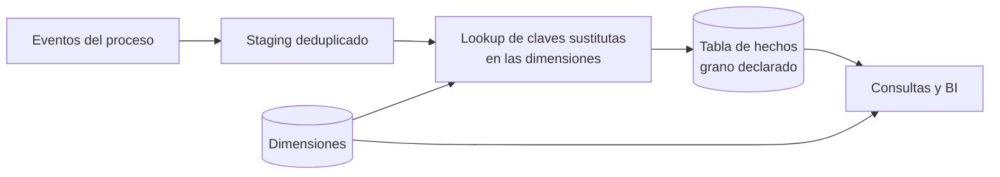

## 1. Resumen

Una tabla de hechos guarda las **medidas** de un proceso de negocio (montos, cantidades, duraciones) con un **grano** declarado: qué representa exactamente una fila. Cada fila lleva una clave foránea a cada dimensión que da contexto (fecha, cliente, producto). Hay cuatro tipos clásicos: transaccional, snapshot periódico, snapshot acumulativo y factless.

## 2. Qué es

Es el núcleo del modelado dimensional de Kimball, un concepto consolidado de la literatura, no una característica de un producto. Según Kimball Group, una tabla de hechos contiene las medidas numéricas producidas por un evento de medición del mundo real, y su diseño se basa en esa actividad, no en los reportes que se espera producir. Además de las medidas, contiene claves foráneas a sus dimensiones y, opcionalmente, dimensiones degeneradas (como el número de factura) y marcas de tiempo.

## 3. Problema que resuelve

Los sistemas operacionales registran eventos en estructuras pensadas para escribir rápido y sin redundancia. Para analizar (sumar ventas por región y mes, comparar saldos), hace falta una tabla donde cada fila sea un evento o un período medido con un significado inequívoco, y que se pueda filtrar y agrupar por cualquier dimensión sin ambigüedad sobre qué se está sumando.

## 4. Cómo funciona

**1. Declarar el grano, antes que nada.** Kimball lo describe como un contrato vinculante: toda dimensión y toda medida candidata debe ser coherente con él. Se recomienda el **grano atómico**, el nivel más bajo al que el proceso captura datos, porque resiste preguntas imprevistas.

**2. Elegir el tipo de tabla:**

| Tipo | Una fila es | Comportamiento |
|---|---|---|
| Transaccional | Un evento en un punto del tiempo (una línea de venta) | Solo existen filas si hubo evento; se insertan y no se actualizan |
| Snapshot periódico | Un período estándar (saldo de cuenta por día) | Densa: hay fila aunque no haya actividad, con cero o nulo |
| Snapshot acumulativo | Una instancia de un proceso con hitos (una línea de pedido de su creación a su entrega) | Una clave de fecha por hito; la fila **se actualiza** al avanzar el proceso |
| Factless | Un evento sin medida (una asistencia a clase) | Solo claves; se cuenta. También sirve para analizar lo que no ocurrió |

**3. Clasificar las medidas por aditividad:**

- **Aditivas:** se suman por cualquier dimensión (monto vendido).
- **Semiaditivas:** se suman por algunas dimensiones pero no por todas; el caso típico es un saldo, que no se suma en el tiempo (se promedia o se toma el último).
- **No aditivas:** ratios y porcentajes. Se guardan sus componentes aditivos (numerador y denominador) y el ratio se calcula al final.

## 5. Cuándo utilizarlo

- Al modelar un data warehouse o una capa de consumo para BI con esquema estrella.
- Cuando un proceso de negocio produce eventos medibles que se analizan por varias dimensiones.
- Para procesos con hitos (pedidos, reclamos, onboarding): snapshot acumulativo.
- Para estados que se miden periódicamente (inventario, saldos): snapshot periódico.

## 6. Cuándo no utilizarlo

- Para datos operacionales que se consultan por clave y se actualizan constantemente: una base transaccional o una tabla de estado actual sirve mejor.
- Cuando no hay medidas ni eventos que analizar, sino atributos descriptivos: eso es una dimensión.
- Mezclando granos en una misma tabla (líneas de pedido y totales de pedido): cada grano va en su propia tabla de hechos.

## 7. Ejemplo sencillo

Hecho transaccional de ventas, grano "una línea de ticket":

| fecha_sk | producto_sk | tienda_sk | ticket_id | cantidad | monto |
|---|---|---|---|---|---|
| 20261001 | 501 | 12 | T-9001 | 2 | 3980 |
| 20261001 | 733 | 12 | T-9001 | 1 | 1490 |

`ticket_id` es una dimensión degenerada: no tiene tabla propia, pero permite agrupar las líneas de un ticket.

## 8. Ejemplo de producción

Un retail tiene tres hechos sobre el mismo proceso de ventas:

- `fact_venta_linea` (transaccional, particionada por fecha), cargada cada hora;
- `fact_inventario_diario` (snapshot periódico), una fila por producto, tienda y día aunque no haya movimiento;
- `fact_pedido_online` (snapshot acumulativo), con fechas de compra, pago, despacho y entrega, que se actualiza en cada hito y calcula los días entre etapas.

Todos comparten las dimensiones conformadas de fecha, producto y tienda, de modo que un reporte combina ventas e inventario. Un control diario verifica que no haya claves foráneas huérfanas y que la suma del hecho cuadre con el sistema origen.

## 9. Arquitectura



## 10. Código

```sql
-- BigQuery (ejecutable adaptando nombres): hecho transaccional al grano de línea de ticket.
-- Las restricciones son informativas (NOT ENFORCED): BigQuery no las valida, solo puede usarlas
-- para optimizar. dim_producto y dim_tienda deben existir con su clave primaria declarada.
CREATE TABLE IF NOT EXISTS `proyecto.dwh.fact_venta_linea` (
  fecha DATE NOT NULL,
  producto_sk INT64 NOT NULL,
  tienda_sk INT64 NOT NULL,
  ticket_id STRING NOT NULL,      -- dimensión degenerada
  linea INT64 NOT NULL,
  cantidad INT64,                 -- aditiva
  monto NUMERIC,                  -- aditiva
  descuento NUMERIC,              -- aditiva; el % de descuento se calcula al consultar
  PRIMARY KEY (ticket_id, linea) NOT ENFORCED,
  FOREIGN KEY (producto_sk) REFERENCES `proyecto.dwh.dim_producto` (producto_sk) NOT ENFORCED,
  FOREIGN KEY (tienda_sk) REFERENCES `proyecto.dwh.dim_tienda` (tienda_sk) NOT ENFORCED
)
PARTITION BY fecha
CLUSTER BY tienda_sk, producto_sk;

-- Medida no aditiva: se suman los componentes y el ratio se calcula al final.
SELECT tienda_sk, SAFE_DIVIDE(SUM(descuento), SUM(monto + descuento)) AS pct_descuento
FROM `proyecto.dwh.fact_venta_linea`
WHERE fecha BETWEEN '2026-09-01' AND '2026-09-30'
GROUP BY tienda_sk;
```

## 11. GCP

En **BigQuery**, las claves primarias y foráneas se declaran `NOT ENFORCED`: no se validan, así que las claves huérfanas o duplicadas deben controlarse en el pipeline. Declararlas sí aporta: BigQuery puede usarlas para optimizar, por ejemplo eliminando joins innecesarios. La tabla de hechos se particiona por la fecha del evento y se clusteriza por las claves de dimensión más filtradas.

## 12. AWS

En **Redshift**, la decisión física central es la distribución. AWS recomienda distribuir la tabla de hechos y **una** dimensión por su columna común (el hecho solo puede tener una clave de distribución) y, si otra dimensión no puede colocarse junto al hecho, considerar distribución `ALL` para ella. A diferencia de BigQuery, aquí el modelado físico del hecho depende de cómo se reparte entre nodos. Con `AUTO`, Redshift elige el estilo.

## 13. Azure

La guía de **Fabric Warehouse** describe los mismos tres tipos de tabla de hechos de Kimball y explica que las claves de dimensión fijan la granularidad: por ejemplo, una clave de fecha de pedido deja los hechos a nivel de día. El modelo es el mismo; cambian las opciones físicas y de carga de cada motor.

## 14. Buenas prácticas

- Declarar el grano por escrito, en una frase, antes de elegir columnas.
- Empezar por el grano atómico; los agregados son tablas adicionales, no reemplazos.
- Guardar componentes aditivos en lugar de ratios.
- Usar un miembro "desconocido" en la dimensión en vez de dejar claves foráneas nulas.
- Controlar huérfanos y cuadrar totales contra el origen en cada carga.
- **Seguridad:** el hecho suele ser la tabla más grande y sensible (montos por cliente); aplicar seguridad a nivel de fila o columna en el motor, no solo en la herramienta de BI.
- **Observabilidad:** medir por carga filas insertadas, claves huérfanas y diferencia de totales contra el origen, y la frescura de la última partición cargada.
- **Costo:** particionar por fecha del evento y filtrar siempre por ella; en snapshots periódicos, la densidad multiplica filas: elegir el período con cuidado.

## 15. Errores frecuentes

- Mezclar granos en una tabla (líneas y totales), lo que duplica sumas.
- Sumar una medida semiaditiva en el tiempo (saldos de cada día sumados como si fueran ventas).
- Guardar porcentajes y luego promediarlos.
- Diseñar el hecho a partir de un reporte concreto en lugar del proceso.
- Actualizar filas de un hecho transaccional para "corregir" eventos en vez de insertar ajustes.

## 16. Trade-offs

El grano atómico da flexibilidad máxima a cambio de volumen; los agregados aceleran consultas pero hay que mantenerlos coherentes. El snapshot acumulativo responde preguntas de duración de procesos a cambio de actualizar filas, lo que en motores columnares cuesta más que insertar. El snapshot periódico simplifica las consultas de estado a cambio de densidad.

## 17. Conceptos relacionados

- `dimension-tables`: el contexto de cada medida.
- `surrogate-keys`: las claves que el hecho referencia.
- `star-schema`: la estructura que forman hechos y dimensiones.
- Con ficha: `grain`.

## 18. Preguntas técnicas abiertas

1. Un pedido se modifica después de facturado. ¿Lo modelarías como actualización o como fila de ajuste, y qué implica para los reportes ya emitidos?
2. ¿Cómo calcularías el saldo promedio mensual de una cuenta a partir de un snapshot periódico diario?
3. ¿Qué preguntas responde un snapshot acumulativo de pedidos que un hecho transaccional no responde fácilmente?

## 19. Laboratorio relacionado

Pendiente (F4).

## 20. Fuentes

- Kimball Group: *Fact Table Structure*, *Grain*, *Transaction*, *Periodic Snapshot*, *Accumulating Snapshot* y *Factless Fact Tables*, *Additive, Semi-Additive, and Non-Additive Facts* (referencia conceptual, Nivel 4).
- Microsoft Learn: *Dimensional modeling in Microsoft Fabric Warehouse: Fact tables*.
- AWS: *Choose the best distribution style* (Amazon Redshift).
- Google Cloud: *Use primary and foreign keys* (BigQuery).

El detalle de cada fuente está en `sources` del frontmatter.

## 21. Fecha de última verificación

2026-10-04. Pasa a `verified`: revisión B-F3.1 del lote 5 aplicada, sin VERIFY pendientes.

## 22. Historial de cambios importantes

- 2026-10-02: creación (lote 5 de F3).
- 2026-10-04: revisión B-F3.1 del lote 5 aplicada (docs/reviews/cards-lote5.md): viñeta de Observabilidad en §14.
- 2026-10-04: `verification_status: verified` (revisión B-F3.1 del lote 5 aplicada; sin VERIFY pendientes).
- 2026-10-06: la sección de conceptos relacionados ya no lista como pendiente de ficha a `grain`, que ya tiene ficha.
- 2026-10-13: `page_title` en cada cita, con el título de la página citada (ADR-012); sin cambios de contenido.
