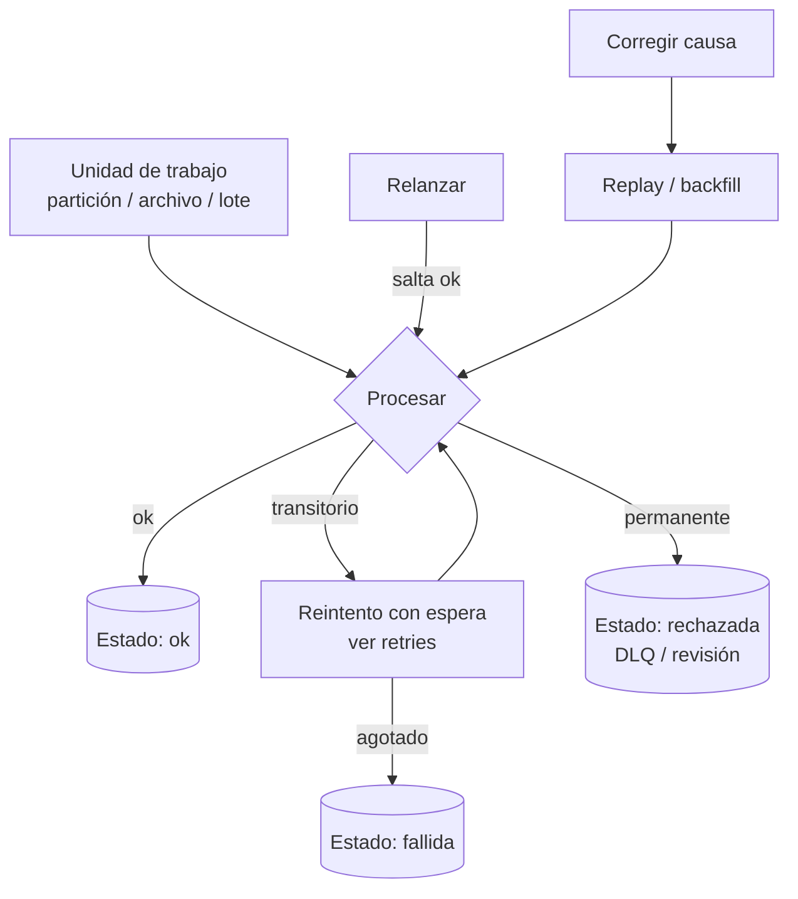

## 1. Resumen

Recuperarse de un fallo es volver a un estado correcto sin perder ni duplicar datos. No es una técnica sola, sino la combinación de piezas que tienen ficha propia:

- **reintentos** para lo transitorio (`retries`);
- **checkpoints** para no rehacer lo terminado (`checkpoints`);
- **DLQ** para lo que nunca va a funcionar (`dead-letter-queue`);
- **replay** y **backfill** para reprocesar después de corregir (`replay`, `backfill`).

Todo descansa en la **idempotencia**: repetir un paso no cambia el resultado. Esta ficha muestra cómo se combinan y cómo relanzar solo lo que falló.

## 2. Qué es

Ante un fallo hay que responder cuatro preguntas:

1. **¿Es transitorio o permanente?** Un timeout se reintenta; un archivo con esquema desconocido, no (ver `python-error-handling-and-retries`).
2. **¿Qué ya terminó bien?** Se conserva y no se rehace: estado por partición o checkpoint.
3. **¿Qué no se puede procesar?** Se aparta con su motivo a una DLQ o a una tabla de rechazos, sin detener el resto.
4. **¿Qué quedó mal o sin hacer?** Se reprocesa con replay (eventos ya capturados) o backfill (un rango histórico), cuando la causa está corregida.

## 3. Problema que resuelve

Sin una estrategia, cada fallo termina en una de dos situaciones malas:

- relanzar todo desde cero, que es caro, duplica si no es idempotente y puede volver a fallar en lo mismo;
- arreglar a mano, que es lento y deja datos inconsistentes.

Con estado por partición, reintentos acotados y separación de errores permanentes, relanzar el job hace exactamente lo que falta.

## 4. Cómo funciona

1. El job divide el trabajo en unidades: particiones por fecha, archivos, lotes.
2. Para cada unidad, intenta procesarla:
   - **Error transitorio:** reintenta con espera creciente, hasta un máximo.
   - **Error permanente:** no reintenta; marca la unidad como rechazada, con el motivo, para revisión.
   - **Éxito:** marca la unidad como terminada, junto con la escritura del resultado si es posible.
3. El estado de cada unidad se guarda en un lugar durable (tabla de control).
4. Al relanzar, el job salta lo terminado y reintenta lo que quedó fallido o rechazado. Lo rechazado vuelve a fallar si la causa no se corrigió.
5. Cada unidad escribe completa o no escribe, por ejemplo reemplazando su partición, así que repetirla es seguro.
6. Los orquestadores dan parte de esto. Step Functions tiene `Retry` y `Catch` por estado. Airflow tiene `retries` y el estado `up_for_retry`. Pub/Sub permite `seek` para reprocesar mensajes.

## 5. Cuándo utilizarlo

- En todo pipeline que se ejecuta sin supervisión y escribe en un destino compartido.
- Jobs con muchas unidades independientes, donde una falla no debe obligar a rehacer las demás.
- Flujos con fuentes inestables (APIs, redes) y datos que a veces vienen mal.

## 6. Cuándo no utilizarlo

- No reintentar errores permanentes: repiten el fallo y retrasan el diagnóstico.
- No relanzar un job no idempotente «para ver si ahora funciona»: puede duplicar.
- Para un job pequeño y barato que se puede repetir completo de forma idempotente, el estado por unidad puede ser exceso; repetirlo todo basta.

## 7. Ejemplo sencillo

Un job diario procesa cuatro fechas:

- **07:** sale bien.
- **08:** agota sus reintentos por timeouts del destino.
- **09:** sale bien.
- **10:** tiene un archivo con esquema desconocido.

Al relanzarlo, solo vuelve a intentar el 08 (ahora funciona) y el 10 (vuelve a rechazarse hasta que alguien corrija el archivo). El 07 y el 09 no se tocan.

## 8. Ejemplo de producción

Un pipeline de ingesta procesa una partición por día y fuente, con una tabla de control `(fuente, dia, estado, detalle, intentos)`. Los timeouts se reintentan tres veces con espera creciente, y los errores de esquema se marcan como rechazados con el archivo y el motivo. Cada mañana, un reporte lista lo rechazado. Cuando una fuente corrige su archivo, el equipo relanza el job, que solo procesa esa partición. Si se descubre un error de lógica en la transformación, el equipo corrige el código y hace un backfill del rango afectado, reemplazando particiones.

## 9. Arquitectura



## 10. Código

```python
# Python 3.12, solo biblioteca estándar (ejecutado; mypy --strict sin errores): un job por particiones con
# estado persistente. Reintenta lo transitorio, separa lo permanente y, al relanzarlo, solo vuelve a ejecutar
# las particiones que no terminaron. Cada partición se escribe completa o no se escribe.
import sqlite3
import time
from collections.abc import Callable


class Transitorio(Exception):
    pass


class Permanente(Exception):
    pass


def ejecutar(db: sqlite3.Connection, particiones: list[str], procesar: Callable[[str], int], intentos: int = 3) -> dict[str, str]:
    db.execute("CREATE TABLE IF NOT EXISTS estado (particion TEXT PRIMARY KEY, estado TEXT, detalle TEXT)")
    hechas = {p for (p,) in db.execute("SELECT particion FROM estado WHERE estado = 'ok'")}
    for p in particiones:
        if p in hechas:
            continue                                   # recuperación: no se rehace lo que ya terminó
        for intento in range(1, intentos + 1):
            try:
                filas = procesar(p)
                resultado, detalle = "ok", f"{filas} filas"
                break
            except Transitorio as e:
                resultado, detalle = "fallida", f"transitorio tras {intento} intentos: {e}"
                time.sleep(0.01 * 2 ** intento)        # espera creciente (ver la ficha retries)
            except Permanente as e:
                resultado, detalle = "rechazada", f"permanente: {e}"   # no se reintenta: va a revisión
                break
        with db:
            db.execute("INSERT INTO estado VALUES (?, ?, ?) ON CONFLICT (particion) DO UPDATE "
                       "SET estado = excluded.estado, detalle = excluded.detalle", (p, resultado, detalle))
    return {p: e for p, e in db.execute("SELECT particion, estado FROM estado ORDER BY particion")}


fallos = {"2026-10-08": 5, "2026-10-09": 1}            # 2026-10-08 falla 5 veces: más que los reintentos
def procesar(p: str) -> int:
    if p == "2026-10-10":
        raise Permanente("archivo con esquema desconocido")
    if fallos.get(p, 0) > 0:
        fallos[p] -= 1
        raise Transitorio("timeout del destino")
    return 100


db = sqlite3.connect(":memory:")
dias = ["2026-10-07", "2026-10-08", "2026-10-09", "2026-10-10"]
print(ejecutar(db, dias, procesar))
# {'2026-10-07': 'ok', '2026-10-08': 'fallida', '2026-10-09': 'ok', '2026-10-10': 'rechazada'}
llamadas: list[str] = []
def procesar_registrando(p: str) -> int:
    llamadas.append(p)
    return procesar(p)
print(ejecutar(db, dias, procesar_registrando), llamadas)
# {'2026-10-07': 'ok', '2026-10-08': 'ok', '2026-10-09': 'ok', '2026-10-10': 'rechazada'} ['2026-10-08', '2026-10-08', '2026-10-08', '2026-10-10']
```

Ejecutado con Python 3.12.3 y `mypy --strict` sin errores:

- **Primera corrida:** el 07 y el 09 terminan; el 08 agota sus 3 intentos por errores transitorios y queda `fallida`; el 10 queda `rechazada` sin reintentar.
- **Relanzamiento:** no toca el 07 ni el 09. Al 08, que todavía falla dos veces, lo intenta tres veces y lo completa. El 10 se rechaza de nuevo porque la causa no se corrigió.

Las esperas son de milisegundos para el ejemplo; la política real de espera está en `retries`.

## 11. GCP

En **Pub/Sub**, un snapshot guarda el estado de confirmación de una suscripción en un instante. Un `seek` a una marca de tiempo marca como confirmados los mensajes anteriores y como no confirmados los posteriores. Así se pueden reprocesar los mensajes después de corregir un error (ver `replay`), o purgarlos.

## 12. AWS

En **Step Functions**, por defecto un error en un estado hace fallar toda la ejecución. Los estados Task, Parallel y Map pueden declarar:

- `Retry`: errores a reintentar, intervalo, máximo de intentos y `BackoffRate`, que por defecto duplica el intervalo en cada intento;
- `Catch`: deriva a un estado de respaldo cuando los reintentos se agotan o el error no se reintenta.

Equivalen, de forma declarativa, a los reintentos y la separación de errores del ejemplo.

## 13. Azure

Esta ficha no cita una fuente de Azure sobre recuperación de pipelines. Para retomar el consumo de Event Hubs desde su checkpoint, ver `checkpoints`.

## 14. Buenas prácticas

- Clasificar los errores en transitorios y permanentes en el código, no reintentar todo.
- Estado por unidad de trabajo en un lugar durable, y escritura completa o nula por unidad.
- Reintentos acotados con espera creciente; nada de reintentos infinitos.
- Errores permanentes a una DLQ o tabla de rechazos con motivo y responsable.
- Procedimiento escrito para relanzar, hacer replay y hacer backfill.
- **Seguridad:** los rechazos y las DLQ guardan datos de la fuente; requieren el mismo control de acceso, y los relanzamientos manuales deben quedar registrados con quién y por qué.
- **Observabilidad:** alertar sobre unidades `fallida` y `rechazada`, no solo sobre el estado global del job; contar reintentos por causa para detectar un destino degradado.
- **Costo:** relanzar solo lo que falló evita reprocesar todo; reintentos sin tope o reprocesos completos innecesarios multiplican el cómputo.

## 15. Errores frecuentes

- Reintentar errores permanentes hasta agotar el tiempo del job.
- Relanzar todo el pipeline y duplicar lo que ya había terminado.
- Marcar una unidad como terminada antes de escribir su resultado.
- No guardar el motivo del rechazo y tener que investigar desde cero.
- Mezclar replay y backfill: reprocesar eventos ya capturados no es lo mismo que completar un rango que nunca se procesó.

## 16. Trade-offs

El estado por unidad y la separación de errores dan relanzamientos precisos, a cambio de una tabla de control y disciplina en el código. Los reintentos ocultan problemas transitorios, pero también pueden ocultar un destino degradado si no se miden. Los servicios gestionados (Step Functions, Airflow, Pub/Sub) dan piezas de la recuperación de forma declarativa. La idempotencia del destino sigue siendo responsabilidad del pipeline.

## 17. Conceptos relacionados

- `retries`, `checkpoints`, `dead-letter-queue`, `replay` y `backfill`: las piezas.
- `idempotency`: la condición para repetir.
- `python-error-handling-and-retries`: clasificar errores en Python.
- `pipeline-dependencies`: qué queda sin correr cuando un paso falla.

## 18. Preguntas técnicas abiertas

1. ¿Qué errores de tu pipeline son transitorios y cuáles permanentes, y cómo los distingue hoy el código?
2. Si relanzas tu job ahora, ¿qué rehace que ya estaba bien?
3. ¿Quién revisa los rechazos y en cuánto tiempo?

## 19. Laboratorio relacionado

Pendiente (F4).

## 20. Fuentes

- AWS: *Handling errors in Step Functions workflows*.
- Google Cloud: *Replay and purge messages with seek* (Pub/Sub).
- Apache Airflow 3.3.2: *Tasks*.

El detalle de cada fuente está en `sources` del frontmatter.

## 21. Fecha de última verificación

2026-10-11. `review_required`: pendiente de revisión B-F3.1 del lote F3b-05a.

## 22. Historial de cambios importantes

- 2026-10-11: creación (lote F3b-05a).
