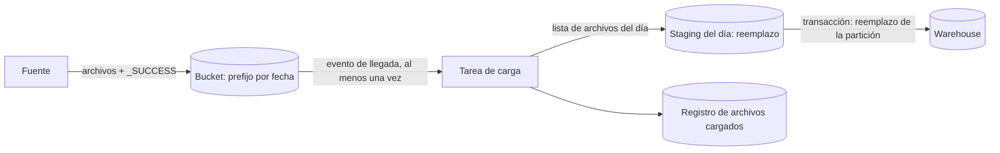

## 1. Resumen

Muchas fuentes entregan datos como archivos en un bucket: exportaciones de sistemas, envíos de socios, extracciones propias. Ingestar archivos bien significa:

- cargar exactamente los archivos del período, ni más ni menos;
- hacerlo de forma idempotente, para que repetir la carga o recibir un evento duplicado no duplique filas;
- controlar los registros inválidos en lugar de descartarlos sin aviso;
- vigilar los cambios de esquema entre entregas.

## 2. Qué es

Es una ingesta por lotes cuya unidad es el archivo. Tiene cuatro decisiones:

- **descubrimiento:** cómo se sabe qué archivos cargar (prefijo por fecha, lista explícita o manifest, evento de llegada);
- **disposición de escritura:** agregar, reemplazar la tabla o reemplazar solo la partición del período;
- **validación:** qué hacer con filas o archivos inválidos;
- **registro:** qué archivos ya se cargaron.

## 3. Problema que resuelve

Sin estas decisiones aparecen los errores clásicos:

- una carga que se reintenta y agrega los mismos datos dos veces;
- un patrón de prefijo que toma también un archivo a medio escribir o de otro día;
- un evento de llegada duplicado que dispara dos cargas;
- un CSV con una columna nueva que rompe la carga o, peor, se carga desalineado.

## 4. Cómo funciona

1. **Llegan los archivos** a un prefijo por período (`pedidos/fecha=2026-09-30/`).
2. **Se detecta la llegada**, por horario o por evento (notificación del bucket). Los eventos de almacenamiento se entregan al menos una vez y sin SLA de tiempo: hay que tolerar duplicados y demoras.
3. **Se decide qué cargar:** todo el prefijo del período o una lista explícita (manifest), para no tomar archivos de más.
4. **Se carga reemplazando el período** (sobrescritura de la partición o de la tabla de staging), no agregando.
5. **Se registran** los archivos cargados (nombre y, si existe, versión o generación) y los conteos.

## 5. Cuándo utilizarlo

- Fuentes que exportan archivos periódicamente.
- Intercambio con terceros por bucket o SFTP.
- Cargas iniciales o históricas grandes, donde los archivos son más eficientes que una API.

## 6. Cuándo no utilizarlo

- Cambios de alta frecuencia por registro: CDC o streaming son más adecuados.
- Fuentes con API incremental eficiente y volúmenes pequeños.
- Archivos diminutos y muy frecuentes: generan sobrecarga; conviene agruparlos o cambiar de mecanismo.

## 7. Ejemplo sencillo

Cada noche un sistema deja los pedidos del día en `gs://empresa-lake-raw/pedidos/fecha=2026-09-30/`. La carga reemplaza la tabla de staging del día con todos los archivos de ese prefijo, y luego un `MERGE` los lleva al warehouse.

## 8. Ejemplo de producción

Un socio envía archivos CSV a horas variables:

- **Detección:** una notificación de llegada al bucket dispara una tarea que espera a que llegue el archivo de control `_SUCCESS` del día.
- **Carga:** con la lista de archivos del día (el manifest), carga en una tabla de staging del día con reemplazo; los registros inválidos que superan un umbral hacen fallar la carga.
- **Destino:** la tabla del warehouse se actualiza reemplazando la partición del día en una transacción.
- **Registro:** una tabla guarda nombre, generación y filas de cada archivo cargado; un evento duplicado encuentra el archivo ya registrado y no hace nada.

## 9. Arquitectura



## 10. Código

```sql
-- BigQuery: carga de los archivos Parquet de un día reemplazando la tabla de staging de ese día.
-- Requiere: archivos en gs://empresa-lake-raw/pedidos/fecha=2026-09-30/ y permisos de carga
-- (bigquery.jobs.create, bigquery.tables.create/updateData) y de lectura en el bucket.
LOAD DATA OVERWRITE `proyecto.staging.pedidos_20260930`
FROM FILES (
  format = 'PARQUET',
  uris = ['gs://empresa-lake-raw/pedidos/fecha=2026-09-30/*.parquet']
);
```

`LOAD DATA OVERWRITE` reemplaza la tabla: repetir la carga del día deja el mismo resultado. Con `bq load`, el comportamiento por defecto es **agregar** (`WRITE_APPEND`); para que repetir no duplique hace falta `--replace` (`WRITE_TRUNCATE`).

## 11. GCP

En **BigQuery**, la carga por lotes desde Cloud Storage admite Avro, CSV, JSON delimitado por líneas, ORC y Parquet. La disposición de escritura decide la idempotencia: `WRITE_APPEND` es el valor por defecto de `bq load` y duplica si se repite; `WRITE_TRUNCATE` (`--replace`) reemplaza. Para CSV, `--allow_jagged_rows` y el límite de registros inválidos controlan qué filas se aceptan. Por defecto, los load jobs usan un pool compartido de slots sin capacidad garantizada. Las notificaciones de Cloud Storage a Pub/Sub (`OBJECT_FINALIZE`) permiten disparar la carga al llegar un archivo, sin SLA de entrega. **BigQuery Data Transfer Service** programa cargas recurrentes desde Cloud Storage.

## 12. AWS

En **Redshift**, `COPY` carga archivos desde S3. Para cargar exactamente los archivos correctos, un **manifest** JSON lista cada archivo por su URL completa (no un prefijo), con `mandatory` para exigir que exista. Las notificaciones de eventos de S3 se entregan **al menos una vez**: el proceso que dispara la carga debe tolerar duplicados. El manifest resuelve qué archivos entran; la idempotencia de la carga se resuelve aparte, como en las otras nubes.

## 13. Azure

En **Data Factory**, un **storage event trigger** dispara el pipeline cuando se crea (o borra) un blob, filtrado por inicio y fin de ruta y con la opción de ignorar blobs de cero bytes. Los eventos de Blob Storage se entregan al menos una vez y pueden duplicarse, así que la carga debe ser idempotente igual que en las otras nubes.

## 14. Buenas prácticas

- Prefijo por período y un archivo de control (`_SUCCESS`) o un manifest para saber cuándo y qué cargar.
- Cargar reemplazando el período, nunca agregando a ciegas.
- Registrar los archivos cargados para ignorar eventos duplicados.
- Umbral de registros inválidos explícito; nunca descartarlos en silencio.
- **Seguridad:** bucket de entrada separado para terceros, con permisos de solo escritura para ellos y de solo lectura para el pipeline.
- **Observabilidad:** alertar si no llegó el archivo esperado, si llegó vacío o si los conteos se desvían de lo habitual.
- **Costo:** preferir formatos columnares comprimidos (Parquet) y archivos de tamaño razonable; muchos archivos pequeños encarecen y enlentecen la carga.

## 15. Errores frecuentes

- `bq load` sin `--replace` en una carga que se reintenta.
- Cargar con un comodín que toma archivos incompletos o de otro día.
- Disparar una carga por cada evento sin tolerar duplicados.
- Aceptar CSV con columnas cambiadas sin validar el esquema.

## 16. Trade-offs

Disparar por evento reduce la latencia, a cambio de manejar duplicados, demoras y archivos parciales. Cargar por horario es simple y predecible, a cambio de esperar aunque el archivo ya esté.

## 17. Conceptos relacionados

- `parquet-format`: el formato recomendado.
- `schema-evolution`: cambios de esquema entre entregas.
- `gcs-buckets-and-objects`: dónde llegan los archivos.
- `idempotency`: por qué repetir la carga no debe duplicar.
- Del blueprint, pendientes de ficha: `csv-format`, `batch-ingestion`, `data-lake`.

## 18. Preguntas técnicas abiertas

1. ¿Cómo sabrías que un socio terminó de subir todos los archivos del día?
2. ¿Qué harías con un CSV que trae una columna nueva sin aviso?
3. ¿Cómo evitarías cargar dos veces un archivo si el evento llega duplicado?

## 19. Laboratorio relacionado

Pendiente (F4): lab de tipo B sobre duplicados tras un reproceso (§25).

## 20. Fuentes

- Google Cloud: *Batch load data*, *Load CSV data from Cloud Storage* y *Load Parquet data from Cloud Storage* (BigQuery); *Pub/Sub notifications for Cloud Storage*.
- AWS: *COPY* y *Using a manifest to specify data files* (Redshift); *Amazon S3 Event Notifications*.
- Microsoft Learn: *Create event-based triggers* (Data Factory) y *Reacting to Blob Storage events*.

El detalle de cada fuente está en `sources` del frontmatter.

## 21. Fecha de última verificación

2026-10-01. La ficha queda en `review_required` hasta la revisión humana (B-F3.1).

## 22. Historial de cambios importantes

- 2026-10-01: creación (lote 4 de F3).
