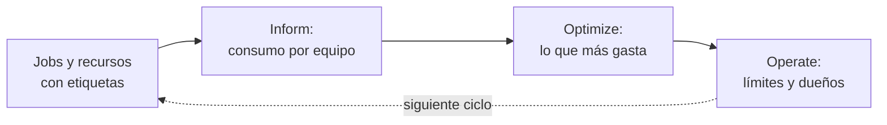

## 1. Resumen

FinOps para datos es tratar el costo de la plataforma como una **responsabilidad de ingeniería**, con un ciclo: **ver** quién consume qué, **optimizar** lo que más gasta y **operar** con límites y dueños. El FinOps Framework lo ordena en tres fases iterativas, Inform, Optimize y Operate (*FinOps Phases*); esta ficha toma de ahí solo los conceptos.

Para un data engineer, la pieza central es la **atribución**: sin etiquetas en cada consulta, job o recurso, el gasto no tiene dueño y no se puede optimizar. Toda cifra de costo y todo mecanismo sale de la documentación de cada nube, porque los modelos de cobro son distintos.

## 2. Qué es

- **Inform:** consumo por equipo, pipeline y tabla, desde las vistas de facturación o de jobs.
- **Atribución:** etiquetas o labels en cada consulta y recurso; lo no etiquetado es «sin dueño».
- **Optimize:** atacar primero lo que más consume: particiones, clustering, menos escaneo (`scan-reduction`, `partition-pruning`).
- **Operate:** límites por consulta, cuotas, presupuestos y dueños que revisan su gasto.
- **Unidad:** medir en la unidad que cobra el motor (bytes, slots, horas), no solo en dinero.

## 3. Problema que resuelve

La factura del warehouse sube 30 % y nadie sabe por qué. El 40 % del consumo no tiene etiquetas y la consulta que más escanea es de un notebook sin dueño. Con atribución, ese 40 % aparece como un número que alguien tiene que bajar, y la consulta tiene nombre.

## 4. Cómo funciona

1. Toda consulta y recurso lleva etiquetas de equipo y pipeline.
2. Un reporte diario suma el consumo por etiqueta, sin contar dos veces los scripts.
3. Se ataca lo sin dueño y las consultas que más escanean.
4. Se ponen límites: bytes máximos por consulta, cuotas y presupuestos.
5. Cada equipo revisa su consumo con regularidad; el ciclo vuelve a empezar.

## 5. Cuándo utilizarlo

- Plataformas con varios equipos que comparten warehouse o lakehouse.
- Cuando el costo crece más rápido que el uso.
- Antes de comprar capacidad reservada (`bigquery-slots`).

## 6. Cuándo no utilizarlo

- Como recorte sin datos: sin atribución, se recorta a ciegas.
- Para convertir bytes a dinero con una tarifa supuesta: la tarifa sale del contrato y de la página de precios de cada nube.

## 7. Ejemplo sencillo

| Equipo | TiB facturados |
|---|---|
| ventas | 4.0 |
| (sin etiqueta) | 4.0 |
| riesgo | 2.0 |

Sin dueño: 40 % del consumo. Consulta que más escanea: `j4`, 4 TiB, sin etiquetas. El job `SCRIPT` de 6 TiB no se suma: es el padre de consultas ya contadas.

## 8. Ejemplo de producción

FinOps del warehouse:

- etiquetas obligatorias en jobs y recursos, validadas en la CI;
- reporte diario de consumo por equipo desde la vista de jobs, sin SCRIPT;
- tablero con lo sin dueño y las 10 consultas que más escanean;
- límite de bytes por consulta en notebooks y BI;
- revisión mensual por equipo;
- en la nube (no ejecutado): vista JOBS de BigQuery, etiquetas de asignación en Cost Explorer de AWS o reglas de asignación de Microsoft Cost Management.

## 9. Arquitectura



## 10. Código

```python
# Python 3.12, biblioteca estándar (ejecutado en la CI): atribuir el consumo de un warehouse a equipos con las
# etiquetas de cada consulta, medir lo que no tiene dueño y encontrar las consultas que más escanean. Las filas imitan
# una vista de jobs (bytes facturados y etiquetas); el ejemplo no convierte bytes a dinero: esa tarifa depende del
# contrato y del modelo de cobro de cada nube y se lee de su documentación.
from collections import defaultdict
from dataclasses import dataclass

TIB = 2**40


@dataclass(frozen=True)
class Job:
    job_id: str
    statement: str
    bytes_billed: int
    labels: dict[str, str]


JOBS = [
    Job("j1", "SELECT", 3 * TIB, {"team": "ventas", "pipeline": "ventas_diarias"}),
    Job("j2", "SELECT", 1 * TIB, {"team": "ventas", "pipeline": "dashboard"}),
    Job("j3", "SELECT", 2 * TIB, {"team": "riesgo"}),
    Job("j4", "SELECT", 4 * TIB, {}),                                    # sin etiquetas: nadie es dueño
    Job("j5", "SCRIPT", 6 * TIB, {"team": "ventas"}),                    # el padre de un script suma a sus hijos
]


def attribute(jobs: list[Job]) -> dict[str, float]:
    """TiB facturados por equipo; los SCRIPT se excluyen para no contar dos veces a sus consultas hijas."""
    per_team: dict[str, float] = defaultdict(float)
    for job in jobs:
        if job.statement == "SCRIPT":
            continue
        per_team[job.labels.get("team", "(sin etiqueta)")] += job.bytes_billed / TIB
    return dict(sorted(per_team.items(), key=lambda kv: -kv[1]))


per_team = attribute(JOBS)
total = sum(per_team.values())
print("TiB por equipo:", per_team)
print(f"sin dueño: {per_team.get('(sin etiqueta)', 0) / total:.0%} del consumo")
top = max((j for j in JOBS if j.statement != "SCRIPT"), key=lambda j: j.bytes_billed)
print(f"consulta que más escanea: {top.job_id} ({top.bytes_billed / TIB:.0f} TiB, etiquetas {top.labels or 'ninguna'})")
```

El script se **ejecuta en la CI** con la biblioteca estándar y pasa `mypy --strict`. Imprime los TiB por equipo, `sin dueño: 40% del consumo` y la consulta que más escanea. Los jobs son fijos e imitan las columnas de la vista JOBS; el ejemplo no convierte a dinero.

## 11. GCP

En GCP, la vista **INFORMATION_SCHEMA.JOBS** y los controles de BigQuery. Según *JOBS view* y *Estimate and control costs* (no ejecutado):

| | Este concepto | BigQuery |
|---|---|---|
| Consumo | Bytes por job | `total_bytes_billed` (on-demand; informativo con flat-rate) |
| Atribución | Etiquetas | Columna `labels` del job |
| Doble conteo | Excluir scripts | Excluir `statement_type = SCRIPT` |
| Límite | Bytes máximos | maximum bytes billed: la consulta falla sin cargo |

## 12. AWS

En AWS, las **etiquetas de asignación de costos**. Según *Organizing and tracking costs using AWS cost allocation tags* (no ejecutado):

| | Este concepto | AWS |
|---|---|---|
| Etiquetas | De equipo y pipeline | Generadas por AWS (`aws:`) y del usuario (`user:`), activadas por separado |
| Dónde se ven | Reporte diario | Cost Explorer y el reporte de asignación; pueden tardar hasta 24 horas |

## 13. Azure

En Azure, las **reglas de asignación** de Microsoft Cost Management. Según *Create and manage Azure cost allocation rules* (no ejecutado):

| | Este concepto | Microsoft Cost Management |
|---|---|---|
| Servicios compartidos | Se reparten por consumo | Reglas que reasignan costos de suscripciones, grupos de recursos o etiquetas a quienes consumen |

## 14. Buenas prácticas

- Etiquetas obligatorias y validadas antes del despliegue.
- Medir en la unidad del motor y convertir con la tarifa del contrato.
- Atacar primero lo sin dueño y lo que más consume.
- **Seguridad:** no poner información sensible en las etiquetas; AWS lo advierte.
- **Observabilidad:** consumo por equipo en el mismo tablero que la frescura.
- **Costo:** límites por consulta en entornos interactivos.

## 15. Errores frecuentes

- Sumar el job padre de un script y sus hijos.
- Etiquetas opcionales que nadie completa.
- Optimizar consultas baratas mientras lo sin dueño crece.
- Calcular dinero con una tarifa supuesta.

## 16. Trade-offs

La atribución detallada da dueños claros y cuesta disciplina en cada despliegue. Límites estrictos protegen el presupuesto y frenan análisis legítimos. Capacidad reservada da previsibilidad y cuesta aunque no se use (`bigquery-slots`).

## 17. Conceptos relacionados

- `bigquery-cost-model` y `bigquery-slots`: cómo cobra el motor.
- `scan-reduction` y `partition-pruning`: escanear menos.
- `gcs-storage-classes-and-lifecycle`: el almacenamiento.

## 18. Preguntas técnicas abiertas

1. ¿Qué porcentaje de tu consumo no tiene dueño?
2. ¿Qué consulta escanea más en tu warehouse y de quién es?
3. ¿Qué límite pondrías en notebooks?

## 19. Laboratorio relacionado

Pendiente (F4).

## 20. Fuentes

- FinOps Foundation: *FinOps Phases* (solo conceptos).
- Google Cloud: *JOBS view* y *Estimate and control costs*.
- AWS: *Organizing and tracking costs using AWS cost allocation tags*.
- Microsoft Learn: *Create and manage Azure cost allocation rules*.

El detalle de cada fuente está en `sources` del frontmatter.

## 21. Fecha de última verificación

2026-10-26. `review_required`: pendiente de revisión B-F3.1 del lote F3b-22a.

## 22. Historial de cambios importantes

- 2026-10-26: creación (lote F3b-22a).
