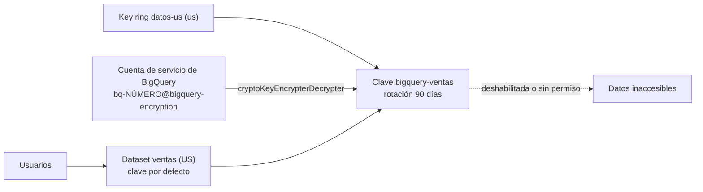

## 1. Resumen

Por defecto, Google Cloud cifra los datos en reposo con **claves de Google**, sin que haya que hacer nada. **CMEK** (*customer-managed encryption keys*) significa usar una clave **propia** en **Cloud KMS**. Así la organización controla:

- dónde vive la clave y cómo se protege;
- quién puede usarla, y cuándo se rota o se destruye;
- el registro de cada uso.

Sirve para cumplir regulaciones, para separar datos de clientes con claves distintas y para el **crypto-shredding**: destruir la clave para que los datos queden ilegibles.

En BigQuery, la cuenta de servicio de BigQuery necesita permiso sobre la clave, y la clave debe estar en la misma ubicación que el dataset. El riesgo central: **si BigQuery pierde el acceso a la clave, los datos dejan de ser accesibles**. Por eso la importancia de esta ficha es baja en el blueprint: el cifrado por defecto alcanza para la mayoría, y CMEK es para quien lo necesita de verdad.

## 2. Qué es

- **Cifrado de sobre (envelope encryption):** los datos se cifran con claves de datos, y esas claves se cifran con una **clave de cifrado de claves**. Con CMEK, la clave de cifrado de claves es la del cliente, en Cloud KMS.
- **Key ring y clave:**
  - el key ring agrupa claves en una ubicación;
  - la clave tiene versiones (ilimitadas), un período de rotación y un nivel de protección.
- **Agente o cuenta de servicio del servicio:** el servicio integrado (por ejemplo, BigQuery, con `bq-NÚMERO@bigquery-encryption.iam.gserviceaccount.com`) usa la clave en nombre del usuario. Necesita `roles/cloudkms.cryptoKeyEncrypterDecrypter` en ella.
- **Clave por defecto del dataset:** se aplica a las tablas nuevas del dataset, salvo que se indique otra al crearlas.
- **Autokey:** automatiza la creación y asignación de claves en servicios compatibles.

## 3. Problema que resuelve

Algunas regulaciones o contratos exigen que el cliente controle la clave que protege sus datos. Otras situaciones exigen poder borrar de forma verificable los datos de un cliente. Con la clave de Google, eso no es posible. Con CMEK:

- la organización decide la ubicación, la rotación y la destrucción de la clave;
- cada uso queda registrado;
- destruir la clave de un cliente hace ilegibles sus datos (crypto-shredding).

## 4. Cómo funciona

1. Se crea un key ring en la ubicación del dataset (US con `us`, EU con `europe`) y una clave con período de rotación.
2. Se da a la cuenta de servicio de BigQuery el rol de cifrar y descifrar con esa clave.
3. Se configura la clave por defecto del dataset, o la clave de cada tabla.
4. BigQuery cifra y descifra de forma transparente: los usuarios consultan igual.
5. Si se deshabilita la clave o se quita el permiso, el cambio se propaga en hasta una hora. Después, las tablas protegidas no se pueden consultar, copiar ni exportar.

## 5. Cuándo utilizarlo

- Cuando una regulación o un contrato exige claves controladas por el cliente.
- Para separar criptográficamente los datos de clientes distintos.
- Cuando hace falta poder destruir los datos de forma verificable (crypto-shredding).

## 6. Cuándo no utilizarlo

- Por defecto, sin un requisito: el cifrado de Google ya protege los datos en reposo, y CMEK agrega operación y riesgo.
- Si nadie va a operar las claves (rotación, permisos, monitoreo): una clave mal gestionada puede dejar los datos inaccesibles.
- Como control de acceso a los datos: quién lee qué lo siguen decidiendo IAM y las políticas (ver `bigquery-security`).

## 7. Ejemplo sencillo

El dataset `ventas`, en US, tiene como clave por defecto `bigquery-ventas`, del key ring `datos-us`, con rotación cada 90 días. Las tablas nuevas de `ventas` se cifran con esa clave, y los analistas consultan sin notar nada.

## 8. Ejemplo de producción

Una empresa que procesa datos de clientes regulados usa una clave por cliente:

- el key ring y las claves los gestiona un equipo de seguridad, en un proyecto separado de los datos;
- cada dataset de cliente tiene su clave por defecto, y la cuenta de servicio de BigQuery tiene permiso solo sobre esas claves;
- cuando un cliente se va y pide la eliminación, se destruye su clave.

Antes de deshabilitar cualquier clave, el equipo verifica qué tablas la usan, porque perder el acceso deja esos datos inaccesibles.

## 9. Arquitectura



## 10. Código

```hcl
# Terraform (validado en la CI con terraform validate, sin credenciales; no se aplicó): clave de Cloud KMS con
# rotación, permiso para la cuenta de servicio de BigQuery y un dataset con esa clave por defecto.
# Requiere: provider hashicorp/google; la API de Cloud KMS habilitada.
terraform {
  required_providers {
    google = {
      source  = "hashicorp/google"
      version = "~> 8.0"
    }
  }
}

variable "project_id" {
  type = string
}

resource "google_kms_key_ring" "datos" {
  project  = var.project_id
  name     = "datos-us"
  location = "us" # multirregión que corresponde a un dataset en US
}

resource "google_kms_crypto_key" "bigquery" {
  name            = "bigquery-ventas"
  key_ring        = google_kms_key_ring.datos.id
  rotation_period = "7776000s" # 90 días
}

# La cuenta de servicio de BigQuery del proyecto (bq-NUMERO@bigquery-encryption.iam.gserviceaccount.com).
data "google_bigquery_default_service_account" "bq" {
  project = var.project_id
}

resource "google_kms_crypto_key_iam_member" "bq_usa_la_clave" {
  crypto_key_id = google_kms_crypto_key.bigquery.id
  role          = "roles/cloudkms.cryptoKeyEncrypterDecrypter"
  member        = "serviceAccount:${data.google_bigquery_default_service_account.bq.email}"
}

# Las tablas nuevas del dataset usan esta clave, salvo que se indique otra al crearlas.
resource "google_bigquery_dataset" "ventas" {
  project    = var.project_id
  dataset_id = "ventas"
  location   = "US"
  default_encryption_configuration {
    kms_key_name = google_kms_crypto_key.bigquery.id
  }
  depends_on = [google_kms_crypto_key_iam_member.bq_usa_la_clave]
}
```

Este bloque de Terraform se valida en la CI con `terraform validate`, sin credenciales (`make validate-terraform`), y **no se aplicó**. La página *Customer-managed Cloud KMS keys* de BigQuery usa en sus ejemplos de Terraform los recursos `google_kms_key_ring` y `google_kms_crypto_key`. La cuenta de servicio de BigQuery se obtiene con el data source `google_bigquery_default_service_account`, y el dataset fija `default_encryption_configuration`.

## 11. GCP

**Cloud KMS** con **BigQuery**. La forma de la cuenta de servicio, la regla de ubicación, la clave por defecto del dataset y el efecto de perder el acceso son los de la página de BigQuery. **Autokey** puede automatizar el aprovisionamiento de claves en servicios compatibles.

## 12. AWS

No aplica de forma específica: esta ficha describe Cloud KMS y BigQuery. AWS KMS es otro servicio, con su propio modelo de claves.

## 13. Azure

No aplica de forma específica: Azure Key Vault es otro servicio, con su propio modelo.

## 14. Buenas prácticas

- Adoptar CMEK solo con un requisito claro y un equipo que opere las claves.
- Key ring en la misma ubicación que los datos.
- Rotación automática configurada en la clave.
- Permiso de la cuenta de servicio de BigQuery solo sobre sus claves.
- Inventario de qué tablas usa cada clave antes de deshabilitarla o destruirla.
- **Seguridad:** separar quién administra las claves de quién administra los datos; destruir una clave es irreversible para los datos que protege.
- **Observabilidad:** registrar y revisar los usos y cambios de las claves (Cloud KMS registra el acceso administrativo y a los datos de las claves, según su página); alertar sobre claves deshabilitadas o permisos quitados.
- **Costo:** las claves y sus operaciones tienen costo en Cloud KMS; una clave por cliente multiplica las claves.

## 15. Errores frecuentes

- Crear el key ring en otra ubicación que el dataset.
- Olvidar el permiso de la cuenta de servicio de BigQuery sobre la clave.
- Deshabilitar o destruir una clave sin saber qué tablas la usan.
- Creer que CMEK controla quién lee los datos.

## 16. Trade-offs

CMEK da control sobre la clave, registro de su uso y la posibilidad de destruir datos de forma verificable, a cambio de operar claves, permisos y rotación, y del riesgo de dejar datos inaccesibles por un error. El cifrado por defecto de Google no requiere nada y protege igual en reposo, pero no da ese control. Autokey reduce la operación manual, aunque las claves siguen siendo responsabilidad de la organización.

## 17. Conceptos relacionados

- `gcp-iam-for-data`: el permiso sobre la clave.
- `gcp-secret-manager-usage`: CMEK también para secretos.
- `bigquery-security`: el control de acceso a los datos, que CMEK no reemplaza.

## 18. Preguntas técnicas abiertas

1. ¿Qué requisito concreto de tu organización exige CMEK, si hay alguno?
2. ¿Quién podría deshabilitar una clave hoy, y qué datos dejaría inaccesibles?
3. ¿Cómo comprobarías qué tablas usan cada clave?

## 19. Laboratorio relacionado

Pendiente (F4).

## 20. Fuentes

- Google Cloud: *Customer-managed encryption keys (CMEK)* (Cloud KMS) y *Customer-managed Cloud KMS keys* (BigQuery).

El detalle de cada fuente está en `sources` del frontmatter.

## 21. Fecha de última verificación

2026-10-11. `review_required`: pendiente de revisión B-F3.1 del lote F3b-08b.

## 22. Historial de cambios importantes

- 2026-10-11: creación (lote F3b-08b).
