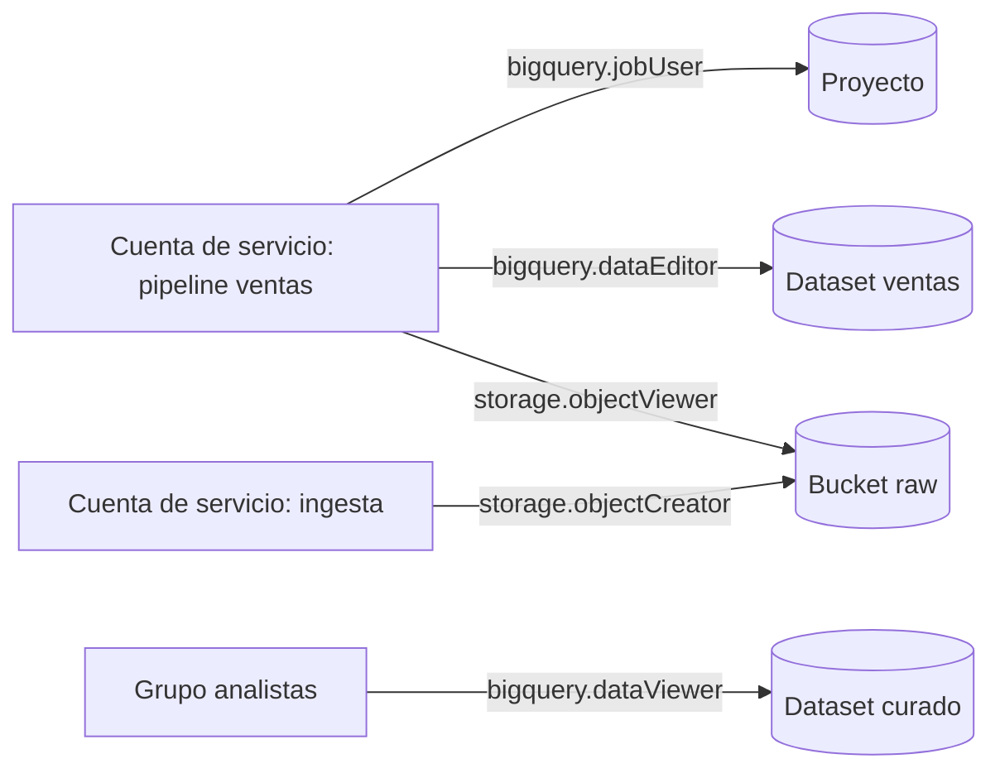

## 1. Resumen

En Google Cloud, el acceso a los datos se concede dando un **rol** a un **principal** sobre un **recurso**. Para una plataforma de datos, la práctica es: una cuenta de servicio por pipeline, roles predefinidos y lo más específicos posible (por ejemplo, `bigquery.dataEditor` sobre un dataset, no sobre el proyecto), nada de roles básicos en producción, y las concesiones declaradas como código y revisadas.

## 2. Qué es

IAM decide quién puede hacer qué sobre qué recursos. Tiene tres piezas:

- **principal:** una persona (cuenta, grupo, identidad federada) o una carga de trabajo (cuenta de servicio);
- **rol:** una colección de permisos (`servicio.recurso.verbo`); los permisos no se conceden sueltos;
- **recurso:** proyecto, dataset, bucket, tópico. La concesión se guarda en la *allow policy* del recurso.

Los recursos forman una jerarquía (organización, carpetas, proyectos, recursos), y los hijos heredan las políticas de sus padres.

## 3. Problema que resuelve

Una plataforma de datos con un único usuario "admin" compartido, o con todos los pipelines en la misma cuenta de servicio con rol de Editor, no permite saber quién hizo qué, y cualquier fallo o credencial filtrada expone todos los datos. IAM bien usado limita el daño de un error al recurso que esa identidad realmente necesita.

## 4. Cómo funciona

1. Se crea una **cuenta de servicio** por pipeline o componente y se adjunta al recurso que lo ejecuta (entorno de Airflow, Cloud Run, Dataflow).
2. Se le conceden **roles predefinidos** en el recurso más específico posible:
   - `roles/bigquery.jobUser` en el proyecto (para ejecutar consultas; solo se concede a nivel de proyecto, carpeta u organización);
   - `roles/bigquery.dataEditor` o `roles/bigquery.dataViewer` en el dataset que lee o escribe;
   - `roles/storage.objectViewer`, `roles/storage.objectCreator` u `roles/storage.objectAdmin` en el bucket.
3. Las personas acceden por **grupos**, no individualmente.
4. Todo se declara como código y se revisa.

## 5. Cuándo utilizarlo

En todo proyecto con datos: al crear pipelines, al dar acceso a analistas, al integrar herramientas externas y al auditar quién puede leer datos sensibles.

## 6. Cuándo no utilizarlo

IAM no reemplaza otros controles:

- para ocultar filas o columnas de una tabla hacen falta políticas de acceso a nivel de fila o columna, no solo roles de dataset;
- los **roles básicos** (Owner, Editor, Viewer) no deberían usarse en producción: son demasiado amplios.

## 7. Ejemplo sencillo

El pipeline de ventas tiene su propia cuenta de servicio, con `bigquery.jobUser` en el proyecto, `bigquery.dataEditor` en el dataset `ventas` y `storage.objectViewer` en el bucket raw. No puede leer el dataset de RR. HH. ni borrar archivos del lake.

## 8. Ejemplo de producción

- **Cuentas de servicio:** cada dominio de datos tiene su cuenta y su dataset; los permisos se declaran en Terraform con recursos de miembro, que agregan una concesión sin reemplazar la política completa.
- **Personas:** los analistas entran por un grupo con `bigquery.dataViewer` solo en los datasets curados.
- **Ingesta:** la cuenta que sube archivos al lake tiene `storage.objectCreator`, que permite crear objetos pero no verlos, borrarlos ni sobrescribirlos.
- **Auditoría:** una revisión trimestral compara las concesiones del código con las efectivas.

## 9. Arquitectura



## 10. Código

```bash
# gcloud: concesiones mínimas para la cuenta de servicio de un pipeline (aditivas: no reemplazan la política).
# Requiere: gcloud autenticado con permiso para modificar las políticas IAM del proyecto y del bucket.
PROJECT=mi-proyecto
SA=pipeline-ventas@${PROJECT}.iam.gserviceaccount.com

gcloud projects add-iam-policy-binding "$PROJECT" \
  --member="serviceAccount:${SA}" --role="roles/bigquery.jobUser"

gcloud storage buckets add-iam-policy-binding gs://empresa-lake-raw \
  --member="serviceAccount:${SA}" --role="roles/storage.objectViewer"
```

`add-iam-policy-binding` agrega una concesión (principal, rol y condición opcional) a la política del proyecto o del bucket, sin reemplazar las demás. El rol sobre el dataset (`bigquery.dataEditor`) se concede en el dataset; el snippet de Terraform para IAM del lote 4 lo declarará como código con recursos de miembro.

## 11. GCP

Esta ficha trata de **IAM de Google Cloud**. En datos, las decisiones clave son: cuenta de servicio por pipeline adjunta al recurso que lo ejecuta, roles predefinidos de BigQuery y Cloud Storage en el recurso más específico, grupos para personas, y acceso uniforme a nivel de bucket para que solo IAM controle Cloud Storage.

## 12. AWS

En **AWS IAM** el modelo es de **políticas** que listan acciones permitidas sobre recursos, bajo condiciones; la guía de buenas prácticas pide mínimo privilegio y credenciales temporales para personas. Los cambios de IAM tardan en replicarse, por eso AWS recomienda no hacerlos en caminos críticos de la aplicación. A diferencia de Google Cloud, donde se conceden roles sobre un recurso, en AWS se escriben o adjuntan políticas a identidades o recursos.

## 13. Azure

En **Azure RBAC**, una **asignación de rol** une un principal de seguridad (usuario, grupo, service principal o managed identity), una definición de rol y un **ámbito** en cuatro niveles: grupo de administración, suscripción, grupo de recursos y recurso. Existen además **deny assignments**, que bloquean el acceso aunque haya una asignación de rol; las allow policies de Google Cloud que describe esta ficha no tienen ese elemento.

## 14. Buenas prácticas

- Una cuenta de servicio por pipeline o componente; nunca compartida entre equipos.
- Roles predefinidos en el recurso más específico; personalizados solo si ninguno encaja.
- Personas por grupos; sin roles básicos en producción.
- Concesiones declaradas como código y revisadas; usar recursos o comandos aditivos para no borrar concesiones ajenas.
- **Seguridad:** preferir adjuntar la cuenta de servicio al recurso antes que descargar claves; revisar periódicamente las concesiones efectivas.
- **Observabilidad:** usar los registros de auditoría para saber qué identidad accedió a qué datos.
- **Costo:** `bigquery.jobUser` permite ejecutar consultas que se facturan al proyecto; concederlo solo a quien debe consumir capacidad de ese proyecto.

## 15. Errores frecuentes

- Dar Editor u Owner del proyecto a una cuenta de servicio "para que funcione".
- Conceder roles de BigQuery en el proyecto cuando bastaba el dataset.
- Reemplazar la política completa de un recurso desde IaC y borrar concesiones de otros equipos.
- Compartir una cuenta de servicio entre varios pipelines.

## 16. Trade-offs

Permisos granulares por dataset y bucket reducen el impacto de un error, a cambio de más concesiones que mantener. Permisos amplios a nivel de proyecto simplifican la operación, a cambio de que cualquier fallo o credencial filtrada alcance a todos los datos.

## 17. Conceptos relacionados

- `gcs-buckets-and-objects`: permisos por bucket con acceso uniforme.
- `infrastructure-as-code`: concesiones declaradas y revisadas.
- `service-accounts`: cuentas de servicio en general.
- `column-level-security`: seguridad a nivel de columna en general.
- Del blueprint, pendiente de ficha: `data-governance`.

## 18. Preguntas técnicas abiertas

1. ¿Qué roles mínimos necesita un pipeline que lee de un bucket y escribe una tabla de BigQuery?
2. ¿Cómo darías acceso de solo lectura a analistas sin exponer datos personales?
3. ¿Cómo detectarías concesiones creadas a mano fuera del código?

## 19. Laboratorio relacionado

Pendiente (F4): snippet de Terraform para IAM (lote 4).

## 20. Fuentes

- Google Cloud: *IAM overview*, *Roles overview*, *Service accounts overview*, *BigQuery IAM roles and permissions*, *Introduction to row-level security*, *Introduction to column-level access control*, *Introduction to audit logs in BigQuery*, *IAM roles for Cloud Storage*, *Uniform bucket-level access* y la referencia de `gcloud projects add-iam-policy-binding` y `gcloud storage buckets add-iam-policy-binding`.
- AWS: *What is IAM?* y *Security best practices in IAM*.
- Microsoft Learn: *What is Azure RBAC?* y *Understand scope for Azure RBAC*.

El detalle de cada fuente está en `sources` del frontmatter.

## 21. Fecha de última verificación

2026-10-01. Pasa a `verified`: revisión B-F3.1 del lote 4 aplicada, sin VERIFY pendientes.

## 22. Historial de cambios importantes

- 2026-10-01: creación (lote 4 de F3).
- 2026-10-01: `verification_status: verified` (revisión B-F3.1 del lote 4 aplicada; sin VERIFY pendientes).
- 2026-10-13: `page_title` en cada cita, con el título de la página citada (ADR-012); sin cambios de contenido.
- 2026-10-21: lote F3b-18a (regla del §17): relations y el §17 enlazan `service-accounts` y `column-level-security`, que ya tienen ficha; antes figuraban como pendientes de ficha.
