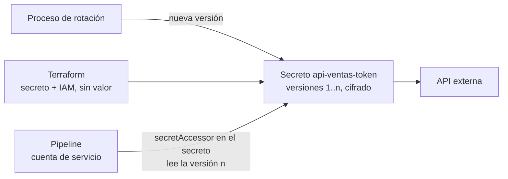

## 1. Resumen

**Secret Manager** guarda credenciales (API keys, contraseñas, certificados) como **secretos con versiones**. Un pipeline lee el secreto en tiempo de ejecución, en lugar de tenerlo en el código, en Terraform o en una variable de entorno. Según sus buenas prácticas:

- **Permisos de IAM por secreto:** cada cuenta lee solo lo suyo.
- **Referenciar por número de versión**, no por `latest`, y desplegar los cambios de versión con el proceso de releases.
- **Rotar periódicamente**, para limitar el impacto de una filtración.
- **No pasar secretos** por el sistema de archivos ni por variables de entorno.

Los secretos se cifran por defecto en tránsito y en reposo, y se pueden cifrar con claves propias (ver `gcp-cmek-with-kms`).

## 2. Qué es

- **Secreto:** un recurso global con metadatos (etiquetas, anotaciones, permisos) y versiones. Hay también un servicio regional aparte.
- **Versión:** el dato en sí, identificado por un ID o una marca de tiempo. Se puede deshabilitar o destruir, y fijar a una carga.
- **Alias:** un nombre para una versión. `latest` es el alias de la última versión.
- **Cifrado:** por defecto, TLS en tránsito y AES-256 en reposo, o CMEK.
- **Replicación:** el secreto se puede replicar entre regiones, para alta disponibilidad.
- **Permisos:** roles y condiciones de IAM a nivel de proyecto o de secreto. `roles/secretmanager.secretAccessor` permite leer el valor.

## 3. Problema que resuelve

Las credenciales en el código o en archivos de configuración terminan en el repositorio, en logs o en máquinas de desarrollo, y cambiarlas obliga a tocar todo eso. Con Secret Manager:

- la credencial vive en un solo lugar, con permisos y auditoría;
- cambiarla es agregar una versión nueva y desplegar la referencia;
- si se filtra, se deshabilita la versión y se vuelve a una buena.

## 4. Cómo funciona

1. Se crea el secreto (con Terraform, gcloud o la consola) con su replicación.
2. Se agrega el valor como una versión. Conviene hacerlo fuera de Terraform, porque una versión creada en Terraform queda en su estado.
3. Se da `secretAccessor` en ese secreto, no en el proyecto, a la cuenta de servicio del pipeline.
4. El pipeline lee una versión concreta (`…/versions/3`), autenticado con Application Default Credentials.
5. Para rotar, se agrega la versión 4, se actualiza la referencia con el proceso de releases y, cuando nadie usa la 3, se la deshabilita.

## 5. Cuándo utilizarlo

- Tokens de APIs externas, contraseñas de bases y certificados que usan los pipelines.
- Cualquier credencial que hoy esté en el código, en variables de entorno o en archivos.

## 6. Cuándo no utilizarlo

- Para acceder a servicios de Google Cloud: ahí corresponde la identidad de la cuenta de servicio con IAM, sin un secreto de por medio (ver `gcp-iam-for-data`).
- Como almacén de configuración no sensible: eso va en la configuración del pipeline.
- No referenciar `latest` en producción: un cambio de versión entra sin pasar por el proceso de releases.

## 7. Ejemplo sencillo

El token de la API de ventas está en el secreto `api-ventas-token`. El pipeline lee la versión 3 al iniciar, y solo su cuenta de servicio tiene `secretAccessor` en ese secreto.

## 8. Ejemplo de producción

Los secretos de producción están en un proyecto aparte de los de staging, como recomiendan las buenas prácticas:

1. Terraform crea el secreto y el permiso; el valor lo agrega el proceso de rotación, no Terraform.
2. Cada 90 días, el proceso agrega una versión nueva, abre un cambio que actualiza la referencia del pipeline y, tras el despliegue, deshabilita la versión anterior.
3. Si el proveedor avisa que el token se filtró, el equipo deshabilita esa versión y despliega una nueva.

El pipeline nunca escribe el token en logs ni lo deja en variables de entorno.

## 9. Arquitectura



## 10. Código

```hcl
# Terraform (validado en la CI con terraform validate, sin credenciales; no se aplicó): un secreto y el permiso para
# leerlo, solo para la cuenta de servicio del pipeline. El valor no va en Terraform: una versión creada aquí quedaría
# en el estado de Terraform; se agrega aparte (consola, gcloud o el proceso de rotación).
# Requiere: provider hashicorp/google; la API de Secret Manager habilitada.
terraform {
  required_providers {
    google = {
      source  = "hashicorp/google"
      version = "~> 8.0"
    }
  }
}

variable "project_id" {
  type = string
}

variable "pipeline_sa" {
  type = string # correo de la cuenta de servicio del pipeline
}

resource "google_secret_manager_secret" "api_ventas" {
  project   = var.project_id
  secret_id = "api-ventas-token"
  replication {
    auto {}
  }
  labels = {
    dominio = "ventas"
  }
}

# Permiso a nivel del secreto, no del proyecto: la cuenta solo puede leer este secreto.
resource "google_secret_manager_secret_iam_member" "pipeline_lee" {
  project   = var.project_id
  secret_id = google_secret_manager_secret.api_ventas.secret_id
  role      = "roles/secretmanager.secretAccessor"
  member    = "serviceAccount:${var.pipeline_sa}"
}
```

Este bloque de Terraform se valida en la CI con `terraform validate`, sin credenciales (`make validate-terraform`), y **no se aplicó**. Crea el secreto y el permiso a nivel de secreto, pero **no** la versión con el valor: así el valor no queda en el estado de Terraform.

## 11. GCP

**Secret Manager.** El servicio global es el de esta ficha; existe además un servicio regional, según su página de introducción. Las prácticas de IAM, versiones y rotación son las de *Secret Manager best practices*.

## 12. AWS

No aplica de forma específica: esta ficha describe Secret Manager de Google Cloud. AWS Secrets Manager es otro servicio, con su propio modelo, y se trata en sus fichas.

## 13. Azure

No aplica de forma específica: Azure Key Vault es otro servicio, con su propio modelo.

## 14. Buenas prácticas

- Un secreto por credencial, con permisos de IAM a nivel de secreto.
- Proyectos separados por entorno.
- Referencias por número de versión, desplegadas con el proceso de releases.
- Rotación periódica; deshabilitar las versiones viejas cuando ya no se usan.
- Nada de secretos en el código, en archivos ni en variables de entorno.
- **Seguridad:** mínimo privilegio y auditoría de quién accede; los valores fuera del estado de Terraform.
- **Observabilidad:** revisar los accesos a los secretos en los audit logs y alertar sobre accesos de cuentas inesperadas.
- **Costo:** las versiones activas y los accesos tienen costo; deshabilitar o destruir las versiones que ya no se usan.

## 15. Errores frecuentes

- Crear la versión con el valor en Terraform y dejar el secreto en el estado.
- Dar `secretAccessor` en el proyecto, lo que abre todos los secretos.
- Referenciar `latest` y que un cambio entre sin control.
- Pasar el secreto al proceso por una variable de entorno y terminar viéndolo en un volcado o en un log.

## 16. Trade-offs

Secret Manager centraliza, versiona y audita las credenciales, a cambio de una llamada extra al arrancar y de un proceso de rotación que hay que mantener. Referenciar números de versión da control y trazabilidad, pero cada rotación requiere un despliegue. `latest` simplifica la rotación y pierde ese control. Para servicios de Google Cloud, la identidad de la cuenta de servicio evita los secretos por completo.

## 17. Conceptos relacionados

- `gcp-iam-for-data`: permisos e identidades.
- `gcp-cmek-with-kms`: cifrar con claves propias.
- `python-api-consumption`: el consumo de APIs que usa estos tokens.
- `infrastructure-as-code` y `terraform-state`: por qué el valor no va en el estado.

## 18. Preguntas técnicas abiertas

1. ¿Qué credenciales de tus pipelines están hoy fuera de un gestor de secretos?
2. ¿Cada cuánto rotarías el token de tu API más sensible, y cómo?
3. ¿Qué cuentas tienen acceso a todos los secretos de tu proyecto?

## 19. Laboratorio relacionado

Pendiente (F4).

## 20. Fuentes

- Google Cloud, Secret Manager: *Secret Manager overview* y *Secret Manager best practices*.

El detalle de cada fuente está en `sources` del frontmatter.

## 21. Fecha de última verificación

2026-10-11. Pasa a `verified`: revisión B-F3.1 del lote F3b-08b aplicada, sin VERIFY pendientes.

## 22. Historial de cambios importantes

- 2026-10-11: creación (lote F3b-08b).
- 2026-10-11: revisión B-F3.1 del lote F3b-08b aplicada (docs/reviews/cards-f3b-08b.md), regla del §17: relations incluye `infrastructure-as-code`, `terraform-state`, que el §17 nombra.
- 2026-10-11: `verification_status: verified` (sin VERIFY pendientes).
- 2026-10-13: `page_title` en cada cita, con el título de la página citada (ADR-012); sin cambios de contenido.
