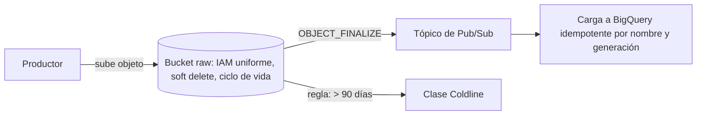

## 1. Resumen

Cloud Storage guarda datos como **objetos** dentro de **buckets**. Un bucket tiene un nombre único en todo Google Cloud y una ubicación; un objeto se identifica por su nombre y su número de generación y no se modifica por partes. Para un data lake importan, además, la clase de almacenamiento (costo frente a acceso), el acceso uniforme por IAM, el versionado o soft delete, las reglas de ciclo de vida y las notificaciones a Pub/Sub cuando llega un archivo.

## 2. Qué es

- **Bucket:** contenedor de objetos con nombre globalmente único, ubicación (región, dual-region o multi-region) y configuración (clase por defecto, acceso, versionado, ciclo de vida). No se anida ni se renombra.
- **Objeto:** datos opacos más metadatos. El **nombre** puede contener `/`, pero en un bucket de espacio de nombres plano eso es parte del nombre, no una carpeta real.
- **Generación:** número que Cloud Storage asigna a cada versión de un objeto; junto con el nombre, lo identifica.

## 3. Problema que resuelve

Un data lake necesita guardar archivos de cualquier tamaño y formato a bajo costo, con durabilidad alta, acceso controlado y la posibilidad de reaccionar cuando llega un archivo nuevo. Sin entender buckets, clases y permisos, se terminan pagando clases inadecuadas, se exponen datos o se pierden archivos sobrescritos.

## 4. Cómo funciona

- **Escritura:** subir un objeto con un nombre crea una generación nueva; si el nombre existía, la reemplaza. Tras una escritura exitosa, la lectura y el listado ven el objeto de inmediato (consistencia fuerte).
- **Clases:** Standard (sin duración mínima), Nearline (30 días), Coldline (90 días) y Archive (365 días). Las tres últimas cobran la recuperación y tienen duración mínima: sirven para datos que se leen poco.
- **Acceso:** con **acceso uniforme a nivel de bucket**, las ACL se desactivan y solo IAM concede acceso.
- **Protección:** Object Versioning conserva versiones no actuales al reemplazar o borrar; Google recomienda **soft delete** para protegerse de borrados.
- **Ciclo de vida:** reglas que cambian de clase o borran objetos por antigüedad, fecha o número de versiones.
- **Eventos:** las notificaciones a Pub/Sub avisan cuando se crea un objeto (`OBJECT_FINALIZE`), sin SLA de tiempo de entrega.

## 5. Cuándo utilizarlo

- Capa raw y curated de un data lake (archivos CSV, JSON, Parquet, Avro).
- Intercambio de archivos con terceros y exportaciones.
- Backend del state de Terraform y artefactos de pipelines.
- Disparar procesamiento cuando llega un archivo (notificación a Pub/Sub).

## 6. Cuándo no utilizarlo

- Datos que se actualizan registro a registro: un objeto se reemplaza entero; conviene una base de datos.
- Consultas analíticas frecuentes sobre muchos archivos pequeños: mejor cargarlos a BigQuery o compactarlos.
- Datos que se leen a menudo en clases frías: los cargos de recuperación y las duraciones mínimas lo encarecen.

## 7. Ejemplo sencillo

Un bucket `empresa-lake-raw` en la región del data warehouse guarda los pedidos de cada día en `pedidos/fecha=2026-09-30/parte-0001.parquet`. Volver a subir el mismo nombre reemplaza el archivo con una generación nueva.

## 8. Ejemplo de producción

- **Buckets separados:** uno por zona (raw, curated) y por entorno, con acceso uniforme a nivel de bucket y permisos IAM por cuenta de servicio.
- **raw:** soft delete activado y una regla de ciclo de vida que pasa a Coldline los objetos de más de 90 días y los borra a los 3 años.
- **Notificación:** una notificación `OBJECT_FINALIZE` hacia un tópico de Pub/Sub dispara la carga a BigQuery.
- **Idempotencia:** el consumidor tolera mensajes duplicados o tardíos y usa el nombre y la generación del objeto como clave.

## 9. Arquitectura



## 10. Código

```bash
# gcloud: bucket con acceso uniforme y notificación de objetos nuevos a Pub/Sub.
# Requiere: gcloud autenticado, permisos para crear buckets y configurar notificaciones, y el tópico "lake-raw-events".
gcloud storage buckets create gs://empresa-lake-raw \
  --location=us-central1 \
  --uniform-bucket-level-access \
  --public-access-prevention

gcloud storage buckets notifications create gs://empresa-lake-raw \
  --topic=lake-raw-events \
  --event-types=OBJECT_FINALIZE
```
Crear el bucket falla si el nombre ya existe (es global): el comando no es idempotente, por eso en un pipeline conviene declararlo con IaC.

El snippet de Terraform para Cloud Storage del lote 4 declarará el mismo bucket como código.

## 11. GCP

Esta ficha trata de **Cloud Storage**. Para datos: elegir la ubicación del bucket junto a BigQuery y al cómputo; activar acceso uniforme; usar clases frías solo para datos de lectura rara; y preferir soft delete para protegerse de borrados. Las notificaciones a Pub/Sub no tienen SLA de entrega, así que el consumidor debe tolerar demoras.

## 12. AWS

El equivalente es **Amazon S3**: también almacenamiento de objetos en buckets, con varias clases (Standard, Standard-IA, One Zone-IA, Glacier) y consistencia fuerte de lectura tras escritura para PUT y DELETE. Sus notificaciones de eventos están diseñadas para entregarse **al menos una vez**: el consumidor debe ser idempotente. Las clases y sus condiciones no son las mismas que en Cloud Storage.

## 13. Azure

En **Blob Storage** la jerarquía tiene un nivel más: **cuenta de almacenamiento**, **contenedores** y **blobs**. Con el *hierarchical namespace* de Data Lake Storage, los directorios son reales y se pueden manipular de forma atómica, algo que un espacio de nombres plano no ofrece. Los eventos se publican en Event Grid con entrega al menos una vez y posibles duplicados.

## 14. Buenas prácticas

- Acceso uniforme a nivel de bucket y permisos IAM por cuenta de servicio, no por usuario.
- Buckets separados por zona y entorno; nombres que no revelen información sensible (son globales).
- Soft delete o versionado en buckets con datos que no se pueden regenerar.
- Reglas de ciclo de vida desde el inicio.
- **Seguridad:** sin acceso público; prevención de acceso público activada; claves y cuentas mínimas.
- **Observabilidad:** alertar si dejan de llegar objetos esperados o si llegan objetos vacíos; vigilar el crecimiento del bucket.
- **Costo:** la clase y la ubicación definen el precio; las clases frías tienen duración mínima y cobran la recuperación.

## 15. Errores frecuentes

- Guardar datos de lectura frecuente en Coldline o Archive.
- Tratar los prefijos como carpetas reales y esperar renombres atómicos.
- Confiar en que la notificación llega una sola vez y a tiempo.
- Usar ACL por objeto y perder el control de quién accede.

## 16. Trade-offs

Las clases frías abaratan el almacenamiento a cambio de cargos de recuperación y duraciones mínimas. El versionado protege de sobrescrituras, a cambio de pagar las versiones no actuales hasta que una regla las borre.

## 17. Conceptos relacionados

- `partitioning`: prefijos por fecha en un lake.
- `parquet-format`: el formato habitual de los objetos del lake.
- `terraform-state`: el bucket como backend del state.
- `file-ingestion`: la carga de objetos al warehouse.
- Con ficha: `data-lake`, `pubsub-topics-and-subscriptions`.

## 18. Preguntas técnicas abiertas

1. ¿Qué clase y qué reglas de ciclo de vida pondrías a la capa raw de un lake?
2. ¿Cómo evitarías procesar dos veces un archivo si la notificación llega duplicada?
3. ¿Qué harías si necesitas renombrar un bucket que usan cinco pipelines?

## 19. Laboratorio relacionado

Pendiente (F4): snippet de Terraform para Cloud Storage (lote 4).

## 20. Fuentes

- Google Cloud: *About Cloud Storage buckets*, *About Cloud Storage objects*, *Storage classes*, *Uniform bucket-level access*, *Object Versioning*, *Object Lifecycle Management*, *Cloud Storage consistency*, *Pub/Sub notifications for Cloud Storage* y la referencia de `gcloud storage buckets create` y `notifications create`.
- AWS: *What is Amazon S3?* y *Amazon S3 Event Notifications*.
- Microsoft Learn: *Introduction to Blob Storage*, *Reacting to Blob Storage events* y *Data Lake Storage hierarchical namespace*.

El detalle de cada fuente está en `sources` del frontmatter.

## 21. Fecha de última verificación

2026-10-01. Pasa a `verified`: revisión B-F3.1 del lote 4 aplicada, sin VERIFY pendientes.

## 22. Historial de cambios importantes

- 2026-10-01: creación (lote 4 de F3).
- 2026-10-01: `verification_status: verified` (revisión B-F3.1 del lote 4 aplicada; sin VERIFY pendientes).
- 2026-10-06: la sección de conceptos relacionados ya no lista como pendientes de ficha a `data-lake`, `pubsub-topics-and-subscriptions`, que ya tienen ficha.
