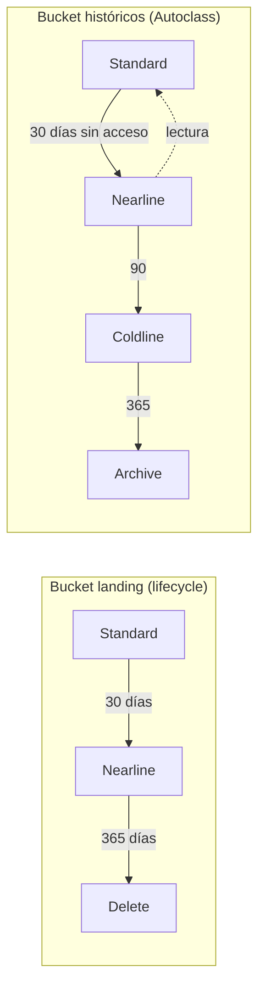

## 1. Resumen

Cada objeto de Cloud Storage tiene una **clase de almacenamiento** que define su disponibilidad y cómo se cobra. Las clases son, según su tabla al 2026-10-11:

| Clase | Duración mínima | Cobro de recuperación | Para qué |
| --- | --- | --- | --- |
| Rapid | ninguna | no | E/S intensiva en buckets zonales (Rapid Bucket) |
| Standard | ninguna | no | datos que se leen seguido |
| Nearline | 30 días | sí | se leen una vez al mes o menos |
| Coldline | 90 días | sí | se leen poco |
| Archive | 365 días | sí | archivo de largo plazo |

Borrar o mover un objeto antes de su duración mínima se cobra como si hubiera cumplido esa duración. Hay dos formas de mover objetos de clase:

- **Object Lifecycle Management:** reglas con condiciones y acciones (`Delete`, `SetStorageClass`, `AbortIncompleteMultipartUpload`).
- **Autoclass:** mueve cada objeto según su acceso real.

Los precios se consultan en la página de precios; esta ficha no los copia.

## 2. Qué es

- **Clase del objeto:** metadata de cada objeto. El bucket tiene una clase por defecto (Standard si no se indica) que heredan los objetos nuevos. Cambiarla no afecta a los objetos que ya existen.
- **Duración mínima:** si el objeto se borra, se reemplaza o se mueve antes, se cobra como si hubiera estado guardado esa duración (eliminación anticipada).
- **Lifecycle:**
  - una configuración del bucket con reglas, cada una con una acción y una o más condiciones (por ejemplo, la edad);
  - el objeto debe cumplir todas las condiciones de una regla;
  - si varias reglas `SetStorageClass` coinciden, gana la clase más barata en reposo.
- **Autoclass:**
  - los objetos empiezan en Standard;
  - pasan a Nearline tras 30 días sin acceso y, si la clase terminal es Archive, a Coldline a los 90 y a Archive a los 365;
  - vuelven a Standard al leerse;
  - los de menos de 128 KiB quedan siempre en Standard.

## 3. Problema que resuelve

Guardar todo en Standard para siempre es lo más caro a largo plazo. Moverlo todo a una clase fría sin mirar el acceso sale caro por las recuperaciones y por la eliminación anticipada. Las clases, el lifecycle y Autoclass permiten:

- bajar el costo de los datos que casi no se leen;
- borrar automáticamente lo que ya no sirve;
- limpiar las cargas multiparte incompletas, que ocupan espacio sin verse.

## 4. Cómo funciona

1. El bucket se crea con una clase por defecto, o con Autoclass.
2. **Con lifecycle:** Cloud Storage evalúa las reglas y aplica la acción a los objetos que cumplen las condiciones. Un cambio en la configuración puede tardar hasta 24 horas, y mientras tanto pueden ejecutarse acciones de la configuración anterior.
3. **Con Autoclass:** cada objeto baja de clase según el tiempo sin acceso y vuelve a Standard al leerse. Los cambios manuales de clase se ignoran.
4. Un cambio de clase por lifecycle no cobra recuperación ni eliminación anticipada por el cambio. Borrar un objeto antes de su duración mínima sí la cobra.

## 5. Cuándo utilizarlo

- **Lifecycle:** cuando el patrón de acceso es conocido. Por ejemplo, landing que se procesa en días y se borra al año, o históricos que pasan a frío tras 30 días.
- **Autoclass:** cuando el acceso es irregular o desconocido.
- **Archive:** copias que deben conservarse años y casi nunca se leen.
- **Rapid:** cargas con E/S intensiva cerca del cómputo, en buckets zonales.

## 6. Cuándo no utilizarlo

- No mover a Coldline o Archive datos que se leen cada semana: las recuperaciones y la eliminación anticipada pueden superar el ahorro.
- No combinar Autoclass con cambios manuales de clase: los ignora.
- No borrar con lifecycle datos sujetos a retención legal sin revisar la política de retención.

## 7. Ejemplo sencillo

Un objeto en Nearline se borra a los 10 días y se cobran 30, la duración mínima. Uno en Coldline borrado a los 45 días paga 90. Uno en Archive guardado 400 días paga 400, porque ya superó el mínimo. Así lo calcula el script de §10.

## 8. Ejemplo de producción

Un lake usa dos buckets:

- **landing:** archivos en Standard que el pipeline procesa el mismo día. A los 30 días pasan a Nearline por si hay que reprocesar, y al año se borran. Las cargas multiparte incompletas se abortan al día.
- **históricos:** Autoclass con clase terminal Archive, porque nadie sabe qué se va a consultar. Lo que no se lee baja solo de clase, y lo que se lee vuelve a Standard.

El equipo probó las reglas en un bucket de desarrollo antes de aplicarlas, como recomienda la documentación.

## 9. Arquitectura



## 10. Código

```hcl
# Terraform (validado en la CI con terraform validate, sin credenciales; no se aplicó): dos buckets. El de landing con
# reglas de ciclo de vida explícitas; el de históricos con Autoclass hasta Archive.
# Requiere: provider hashicorp/google; nombres de bucket únicos.
terraform {
  required_providers {
    google = {
      source  = "hashicorp/google"
      version = "~> 8.0"
    }
  }
}

variable "project_id" {
  type = string
}

resource "google_storage_bucket" "landing" {
  project                     = var.project_id
  name                        = "${var.project_id}-landing"
  location                    = "US"
  storage_class               = "STANDARD"
  uniform_bucket_level_access = true

  lifecycle_rule { # a los 30 días, a Nearline (duración mínima de 30 días en esa clase)
    condition {
      age = 30
    }
    action {
      type          = "SetStorageClass"
      storage_class = "NEARLINE"
    }
  }
  lifecycle_rule { # al año, se borra
    condition {
      age = 365
    }
    action {
      type = "Delete"
    }
  }
  lifecycle_rule { # cargas multiparte incompletas: se abortan al día
    condition {
      age = 1
    }
    action {
      type = "AbortIncompleteMultipartUpload"
    }
  }
}

resource "google_storage_bucket" "historicos" {
  project                     = var.project_id
  name                        = "${var.project_id}-historicos"
  location                    = "US"
  uniform_bucket_level_access = true

  autoclass { # Cloud Storage mueve cada objeto de clase según su acceso
    enabled                = true
    terminal_storage_class = "ARCHIVE"
  }
}
```

```python
# Python 3.12, solo biblioteca estándar (ejecutado; mypy --strict sin errores): cuántos días de almacenamiento se
# pagan si un objeto se borra antes de la duración mínima de su clase. Duraciones mínimas según la tabla de clases
# de Cloud Storage (Nearline 30, Coldline 90, Archive 365 días); los precios no se modelan.
DURACION_MINIMA = {"STANDARD": 0, "NEARLINE": 30, "COLDLINE": 90, "ARCHIVE": 365}


def dias_cobrados(clase: str, dias_guardado: int) -> int:
    """Si se borra antes de la duración mínima, se cobra como si se hubiera guardado hasta cumplirla."""
    return max(dias_guardado, DURACION_MINIMA[clase])


for clase, dias in [("STANDARD", 10), ("NEARLINE", 10), ("COLDLINE", 45), ("ARCHIVE", 400)]:
    cobrados = dias_cobrados(clase, dias)
    print(f"{clase:8} guardado {dias:3} días -> se cobran {cobrados:3} días")
# STANDARD guardado  10 días -> se cobran  10 días
# NEARLINE guardado  10 días -> se cobran  30 días
# COLDLINE guardado  45 días -> se cobran  90 días
# ARCHIVE  guardado 400 días -> se cobran 400 días
```

El bloque de Terraform se valida en la CI con `terraform validate`, sin credenciales (`make validate-terraform`), y **no se aplicó**. *Manage object lifecycles* gestiona el lifecycle con el recurso `google_storage_bucket`, como este bloque.

El script en Python 3.12, solo con biblioteca estándar, está ejecutado y pasa `mypy --strict` sin errores. Calcula los días que se cobran por eliminación anticipada con las duraciones mínimas de la tabla de clases. No modela precios.

## 11. GCP

**Cloud Storage.** Las clases, sus duraciones mínimas y su disponibilidad son las de su tabla al 2026-10-11. Las reglas de lifecycle y de Autoclass, las de sus páginas. Los precios por clase y ubicación, el cargo de habilitación y la tarifa de administración de Autoclass se consultan en la página de precios.

## 12. AWS

No aplica de forma específica: esta ficha describe Cloud Storage. Las clases de Amazon S3 tienen otros nombres, duraciones y reglas, y se tratan en sus fichas.

## 13. Azure

No aplica de forma específica: los niveles de acceso de Azure Blob Storage tienen su propio modelo.

## 14. Buenas prácticas

- Elegir la clase por el patrón de acceso medido, no por intuición.
- Lifecycle con reglas probadas en desarrollo; tener en cuenta las hasta 24 horas que tarda un cambio.
- Siempre una regla `AbortIncompleteMultipartUpload` en buckets que reciben cargas grandes.
- Autoclass cuando el acceso es desconocido, sin cambios manuales de clase.
- Revisar la duración mínima antes de mover datos a clases frías.
- **Seguridad:** una regla `Delete` mal escrita borra datos de forma masiva; revisar las reglas como código y combinarlas con versionado o retención donde corresponda.
- **Observabilidad:** seguir el almacenamiento por clase y las operaciones de recuperación; un aumento de recuperaciones indica datos fríos que se leen más de lo previsto.
- **Costo:** las clases frías bajan el costo en reposo y suben el de acceso, con eliminación anticipada; Autoclass cobra habilitación y administración. Los montos se consultan en la página de precios.

## 15. Errores frecuentes

- Mover a Archive datos que se leen cada semana.
- Borrar objetos de Coldline a los pocos días y pagar 90.
- Cambiar la clase por defecto del bucket esperando que cambien los objetos existentes.
- Activar Autoclass y seguir cambiando clases a mano.
- No limpiar las cargas multiparte incompletas.

## 16. Trade-offs

Las clases frías bajan mucho el costo en reposo, a cambio de cobros por recuperación, duraciones mínimas y menor disponibilidad. El lifecycle es predecible y gratuito en sus cambios de clase, pero exige conocer el patrón de acceso. Autoclass se adapta al acceso real sin reglas, con un cargo de habilitación y una tarifa de administración. Standard es lo más simple y caro en reposo.

## 17. Conceptos relacionados

- `gcs-buckets-and-objects`: buckets y objetos.
- `data-lifecycle`: retención y borrado en general.
- `data-lake`: las capas y sus patrones de acceso.

## 18. Preguntas técnicas abiertas

1. ¿Qué datos de tus buckets nadie ha leído en 90 días?
2. ¿Qué regla de lifecycle aplicarías primero, y cómo la probarías?
3. ¿Dónde usarías Autoclass en lugar de reglas?

## 19. Laboratorio relacionado

Pendiente (F4).

## 20. Fuentes

- Google Cloud, Cloud Storage: *Storage classes*, *Cloud Storage pricing*, *Object Lifecycle Management*, *Autoclass* y *Manage object lifecycles*.

El detalle de cada fuente está en `sources` del frontmatter.

## 21. Fecha de última verificación

2026-10-11. Pasa a `verified`: revisión B-F3.1 del lote F3b-08b aplicada, sin VERIFY pendientes.

## 22. Historial de cambios importantes

- 2026-10-11: creación (lote F3b-08b).
- 2026-10-11: revisión B-F3.1 del lote F3b-08b aplicada (docs/reviews/cards-f3b-08b.md): filas aprobadas sin cambios en esta ficha.
- 2026-10-11: `verification_status: verified` (sin VERIFY pendientes).
